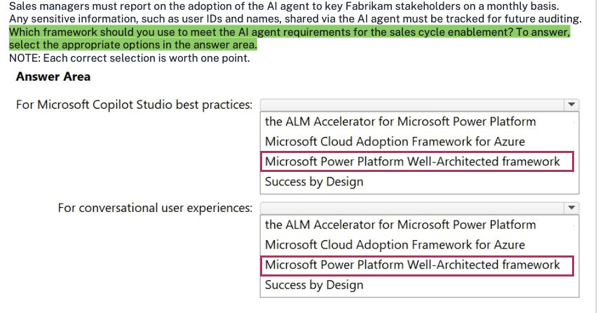
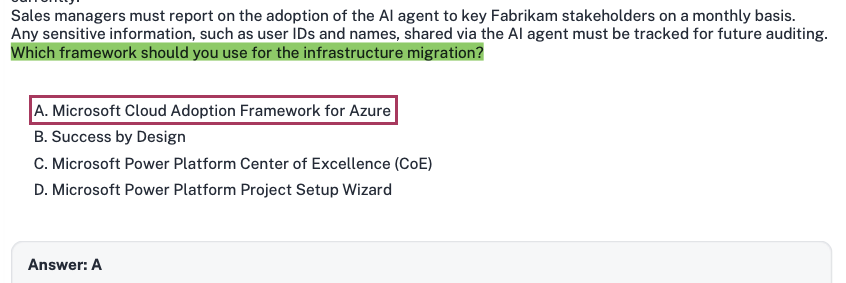

# Fabrikam Inc

**HOTSPOT -**

**Case study -**

This is a case study. Case studies are not timed separately from other exam sections. You can use as much exam time as you would like to complete each case study. However, there might be additional case studies or other exam sections. Manage your time to ensure that you can complete all the exam sections in the time provided. Pay attention to the Exam Progress at the top of the screen so you have sufficient time to complete any exam sections that follow this case study.

To answer the case study questions, you will need to reference information that is provided in the case. Case studies and associated questions might contain exhibits or other resources that provide more information about the scenario described in the case. Information provided in an individual question does not apply to the other questions in the case study.

A Review Screen will appear at the end of this case study. From the Review Screen, you can review and change your answers before you move to the next exam section. After you leave this case study, you will NOT be able to return to it.

**To start the case study -**

To display the first question in this case study, select the "Next" button. To the left of the question, a menu provides links to information such as business requirements, the existing environment, and problem statements. Please read through all this information before answering any questions. When you are ready to answer a question, select the "Question" button to return to the question.

---

### Background

Fabrikam, Inc., is a global consumer goods company that is undergoing a digital transformation initiative to migrate its entire infrastructure to the Microsoft cloud. As a key element of this cloud migration, the company will implement Microsoft Dynamics 365 Sales, moving away from the current on-premises proprietary technologies used by its business-to-business (B2B) sales team.

As part of the cloud migration, Fabrikam will adopt an AI-first approach to its business solutions and implement AI solutions, wherever possible, to streamline operations.

---

### Problem Statements

Fabrikam's infrastructure currently relies on various on-premises systems that require sales executives to use corporate computers with physical keyboards to access business information during customer interactions. Mobile phones cannot be used for these purposes, as the systems depend on keyboard input. As a result, the sales executives spend a lot of time using keyboards to search for data on several disparate systems and file servers, rather than focusing on the customers. This affects the customer experience.

Fabrikam stakeholders are concerned that users will be hesitant to adopt AI. If the AI initiatives are NOT adopted, cost savings will never be realized. Additionally, funding for future AI initiatives will depend on demonstrating an increase in AI adoption month over month. As the AI agent initiative for the sales team will be the first for Fabrikam, the rapid adoption of the agent is a high priority.

---

### Planned Initiatives

#### General

Fabrikam management has prioritized AI-driven projects to improve efficiency, customer engagement, and responsible AI adoption. The current application infrastructure is on-premises and must be migrated to the cloud to support the adoption of these technologies.

#### Infrastructure Migration

Fabrikam plans to migrate from its current on-premises infrastructure to a completely cloud-based topology; this will include user authentication, the security framework, and, primarily, the adoption of the services by end users. All the data from the different systems will be consolidated into a single data source - a common data model that will use a Microsoft Dataverse environment as a single source of truth (SSOT) for the sales team.

#### Sales Cycle Enablement

To achieve the company's objectives, Fabrikam intends to implement the following strategies to enhance the sales cycle:

* Use low-code development to create a single AI agent that has Dataverse as its core component.

* Ensure that sales managers can access unanswered correspondence from prospects and intervene as appropriate.

* Replace the previous proprietary software with Dynamics 365 Sales to track sales cycles and customer interactions.

* Have the sales executives use Dynamics 365 Sales to track interactions for open opportunities and send follow-up communications to prospects.

* Have the sales executives use handsfree headsets to interact with an AI agent when they have questions about internal policies or customer data.

---

### Requirements

#### Infrastructure Migration

Fabrikam has identified the following infrastructure migration requirements:

* Azure must be used for all future infrastructure workloads.

* The company must follow Microsoft-recommended methodologies for infrastructure migration to the cloud.

* Any created AI agents must have their return on investment (ROI) calculated to ensure that the solution will save the company money.

#### Sales Cycle Enablement

Fabrikam has identified the following requirements for sales cycle enablement:

* The final AI agent must follow Microsoft recommendations for a conversational user experience.

* A designated checklist must be reviewed to ensure that the AI agent follows Microsoft deployment recommendations for a compliant solution.

* Detailed telemetry must be logged for the first created AI agent to help troubleshoot and optimize the agent during the initial AI agent adoption process.

* Unexpected AI agent actions must end in an escalation to a live representative. For example, a sales executive must be rerouted to a representative if the agent cannot answer a question after two failed attempts.

* The return on investment (ROI) of switching from the current process to the future process is required for stakeholder sign off.

* The sales team must use Dynamics 365 Sales to correspond with prospects more quickly and efficiently than currently.

* Sales managers must report on the adoption of the AI agent to key Fabrikam stakeholders on a monthly basis.

* Any sensitive information, such as user IDs and names, shared via the AI agent must be tracked for future auditing.

---

### Question 1

Which framework should you use to meet the AI agent requirements for the sales cycle enablement? To answer, select the appropriate options in the answer area.

**NOTE:** Each correct selection is worth one point.

---

### Answer Area

**For Microsoft Copilot Studio best practices:**

* [ ] the ALM Accelerator for Microsoft Power Platform

* [ ] Microsoft Cloud Adoption Framework for Azure

* [ ] Microsoft Power Platform Well-Architected framework

* [ ] Success by Design

**For conversational user experiences:**

* [ ] the ALM Accelerator for Microsoft Power Platform

* [ ] Microsoft Cloud Adoption Framework for Azure

* [ ] Microsoft Power Platform Well-Architected framework

* [ ] Success by Design

### Answer

### 1. Extracted Question Summary

* **Scenario:** Fabrikam, Inc. is undergoing digital transformation, migrating infrastructure to Azure, adopting Dynamics 365 Sales, and building an AI-first sales enablement solution centered around a Copilot Studio agent backed by Dataverse as a Single Source of Truth (SSOT).

* **Sales Cycle Enablement Requirements:**
* The final AI agent must follow Microsoft recommendations for a conversational user experience.

* A designated checklist must be reviewed to ensure the AI agent follows Microsoft deployment recommendations for a compliant solution.

* Telemetry must be logged to troubleshoot and optimize during initial adoption.

* Unexpected AI actions must escalate to a live representative (e.g., after two failed attempts).

* **Question:** Which framework should you use to meet the AI agent requirements for the sales cycle enablement?

* **Dropdown 1:** *For Microsoft Copilot Studio best practices:*
* the ALM Accelerator for Microsoft Power Platform

* Microsoft Cloud Adoption Framework for Azure

* Microsoft Power Platform Well-Architected framework

* Success by Design

* **Dropdown 2:** *For conversational user experiences:*
* the ALM Accelerator for Microsoft Power Platform

* Microsoft Cloud Adoption Framework for Azure

* Microsoft Power Platform Well-Architected framework

* Success by Design

---

### 2. Correct Answer

* **For Microsoft Copilot Studio best practices:** **Microsoft Power Platform Well-Architected framework**
* **For conversational user experiences:** **Microsoft Power Platform Well-Architected framework** *(alternatively evaluated as **Success by Design** in early exam draft keys)*

> **Architectural Recommendation for the Live Exam:**
> 1. Under Microsoft's current Copilot Studio architectural guidance, both pillars are housed under the **Microsoft Power Platform Well-Architected Framework** (specifically the *Copilot Studio Architecture Guide* and the *Experience Optimization: Conversation Design (XO:10)* checklist).
> 2. If adhering to the legacy FastTrack Dynamics 365/Power Platform project governance key, **Success by Design** is designated for *conversational user experiences* (or Copilot Studio project governance reviews), with **Microsoft Power Platform Well-Architected framework** for technical workload best practices.
> 
> 

---

### 3. Verification of Visible Selection / Community Key

*(Skipped as no dropdown choice is selected or boxed in the provided screenshots.)*

---

### 4. Official Microsoft Justification

Under the Microsoft Learn pathway **"Architect agentic AI business solutions"** and the **Copilot Studio Architecture Center**:

* **Microsoft Power Platform Well-Architected Framework:**
* Serves as the official architectural standard for Copilot Studio workloads. It provides prescriptive guidance across five pillars: Reliability, Security, Operational Excellence, Performance Efficiency, and Experience Optimization.
* For **Conversational User Experiences**, Microsoft explicitly published the **Experience Optimization Checklist Recommendation (XO:10): *Recommendations for designing conversational user experiences***. This guidance defines how to handle fallback mechanisms, multi-turn escalation after failed attempts, transparent capability explanations, and intent disambiguation—directly matching Fabrikam's requirements.

* **Success by Design:**
* Success by Design is Microsoft's FastTrack implementation and solution blueprinting framework for Dynamics 365 and Power Platform business applications. It provides project gate checklists, readiness reviews, risk assessments, and user adoption strategies to ensure project deployment compliance.

---

### 5. Distractor Analysis (Why Others Are Wrong)

* **Microsoft Cloud Adoption Framework for Azure (CAF):** Designed for overarching cloud strategy, landing zones, cloud governance, and migrating infrastructure workloads from on-premises to Azure; it addresses the general infrastructure migration question in this case study, not agentic conversational UX or Copilot Studio component best practices.
* **The ALM Accelerator for Microsoft Power Platform:** A specialized deployment pipeline tool built on Azure DevOps / GitHub to automate solution transport across environments; it does not provide conversational design rubrics or holistic workload architecture checklists.

---

### 6. Exam Keyword / Trap Alert

* **Keywords:** *"Microsoft Copilot Studio best practices"* + *"designated checklist... for a compliant solution"* + *"conversational user experience"*.

* **Trap:** Do not select *Cloud Adoption Framework* for agent-specific or conversational questions—CAF is strictly reserved for the case study's *Infrastructure Migration* prompt. For conversational UX and Copilot Studio design, think **Power Platform Well-Architected (Experience Optimization)**.

Yes, exactly. The **Conversational User Experience** guidance is an explicit, formal recommendation and checklist within the **Microsoft Power Platform Well-Architected Framework**.

---

### The Official Architecture Mapping

In Microsoft Learn, the Power Platform Well-Architected Framework has five core pillars (Reliability, Security, Operational Excellence, Performance Efficiency, and Experience Optimization).

Under the **Experience Optimization** pillar, Microsoft published:

> **`XO:10` — Recommendations for designing conversational user experiences**
> *(Applies directly to Copilot Studio agents and intelligent application workloads)*

This specific recommendation provides the checklist and strategies directly targeted in the Fabrikam case study:

1. **Designing Intent & Transparent Capabilities:** Ensuring the agent clearly communicates what it can and cannot do upfront.
2. **Handling Conversational Failures & Fallbacks:** Defining multi-turn reprompting, intent disambiguation, and graceful escalation to live representatives after two failed attempts (matching Fabrikam's exact requirement).
3. **Continuous Experience Tuning:** Reviewing conversational transcripts, feedback loops, and user friction points.

---

### Why the Community Keys are Split

In exam dumps and community forums, you will see two competing interpretations for this hotspot question:

| Source / Interpretation | Dropdown 1: Copilot Studio Best Practices | Dropdown 2: Conversational User Experiences |
| --- | --- | --- |
| **Microsoft Learn Standard** | **Microsoft Power Platform Well-Architected framework** | **Microsoft Power Platform Well-Architected framework** |
| **Legacy FastTrack / Dump Key** | **Microsoft Power Platform Well-Architected framework** | **Success by Design** |

#### Why some dump keys pick *Success by Design* for Dropdown 2:

* *Success by Design* is Microsoft FastTrack's project governance framework originally created for Dynamics 365 implementations. It heavily relies on phased "Solution Blueprint Reviews" and "Go-Live Readiness Checklists".
* Some early test-takers reasoned that since Dropdown 1 already used *Power Platform Well-Architected*, Dropdown 2 *must* be a different framework, mapping the phrase *"a designated checklist must be reviewed"* to a FastTrack *Success by Design* review gate.

#### Why *Power Platform Well-Architected Framework* applies to both:

* In Microsoft certification exams (especially hotspot drop-downs with identical lists), **the same option can be correct for both dropdowns** unless the question explicitly states "each option can only be used once."
* *Well-Architected* specifically contains the **Experience Optimization: Conversation Design (`XO:10`) checklist**. *Success by Design*, while rich in project delivery and adoption reviews, does not contain chatbot/LLM conversational UX design heuristics or fallback engineering rubrics.

If you encounter this question on the AB-100 exam, **Microsoft Power Platform Well-Architected framework** is the architecturally precise answer grounded directly in Microsoft Learn's conversation design syllabus.

 

--- 

## Question 2

Which framework should you use for the infrastructure migration?

A. Microsoft Cloud Adoption Framework for Azure

B. Success by Design

C. Microsoft Power Platform Center of Excellence (CoE)

D. Microsoft Power Platform Project Setup Wizard

### 1. Extracted Question Summary

* **Scenario:** Fabrikam, Inc. is undergoing a digital transformation to migrate its on-premises infrastructure to the Microsoft cloud, implement Dynamics 365 Sales, and adopt an AI-first strategy.

* **Core Requirement:** Under *Requirements - Infrastructure Migration*, the company mandates: *"Azure must be used for all future infrastructure workloads"* and *"The company must follow Microsoft-recommended methodologies for infrastructure migration to the cloud."*

* **Question:** Which framework should you use for the infrastructure migration?

* **Options:**
* **A.** Microsoft Cloud Adoption Framework for Azure

* **B.** Success by Design

* **C.** Microsoft Power Platform Center of Excellence (CoE)

* **D.** Microsoft Power Platform Project Setup Wizard

---

### 2. Correct Answer

**A: Microsoft Cloud Adoption Framework for Azure**

---

### 3. Verification of Visible Selection / Community Key

* The answer displayed at the bottom of the screenshot (**Answer: A**) is **Correct**, because the Cloud Adoption Framework (CAF) is Microsoft's official, end-to-end guidance and methodology for planning, organizing, governing, and executing the migration of enterprise infrastructure and technical workloads to Azure.

---

### 4. Official Microsoft Justification

* Under the Microsoft Learn pathway **"Architect agentic AI business solutions"** (specifically the modules covering *Plan and implement cloud architecture and infrastructure governance*):
* When migrating existing on-premises server environments, user authentication models, networking, and platform hosting to Azure, Microsoft mandates the **Microsoft Cloud Adoption Framework for Azure (CAF)**.
* CAF delivers structured methodologies divided into explicit phases: **Strategy**, **Plan**, **Ready** (Azure Landing Zones), **Adopt** (Migrate & Innovate), **Govern**, and **Manage**.
* Fabrikam's stated requirement to *"follow Microsoft-recommended methodologies for infrastructure migration to the cloud"* maps directly to the CAF migration framework and Azure Landing Zone architectures.

---

### 5. Distractor Analysis (Why Others Are Wrong)

* **B. Success by Design:** A solution blueprinting and project quality governance framework specifically tailored for Microsoft Dynamics 365 and Power Platform business application rollouts; it governs business application solution readiness, not cloud infrastructure and network migration.
* **C. Microsoft Power Platform Center of Excellence (CoE):** A governance starter kit and organizational model for managing, monitoring, and nurturing low-code adoption across Power Platform environments; it does not guide enterprise cloud infrastructure or data center migration.
* **D. Microsoft Power Platform Project Setup Wizard:** Not an enterprise migration framework or standard architectural methodology; this is a distractor.

---

### 6. Exam Keyword / Trap Alert

* **Keywords:** *"Infrastructure migration"* + *"Azure must be used for all future infrastructure workloads"* + *"Microsoft-recommended methodologies for infrastructure migration to the cloud"*.

* **Trap:** Do not let the Power Platform/Copilot Studio context of the broader case study fool you into picking *Success by Design* or *CoE* here. When the question specifically isolates the **infrastructure migration** pillar of Fabrikam's transformation, the answer is always the **Microsoft Cloud Adoption Framework for Azure**.

