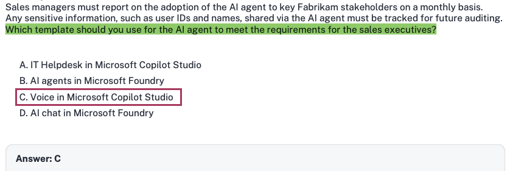
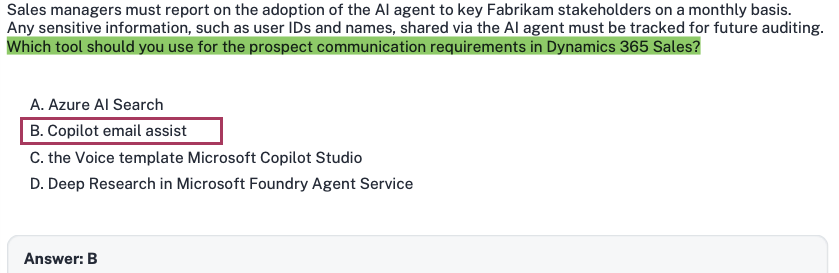
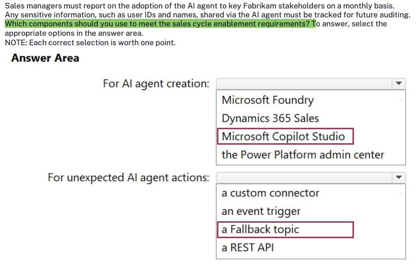
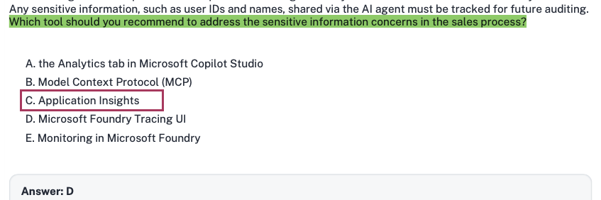
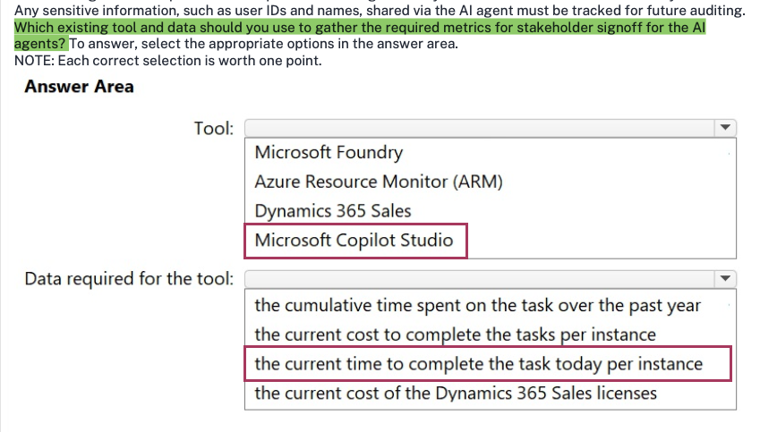
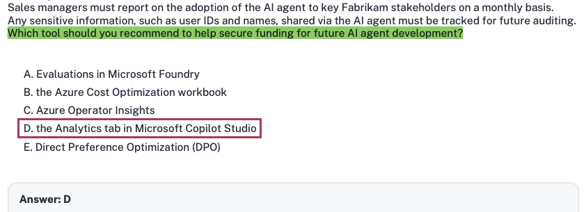

# Fabrikam Inc

**HOTSPOT -**

**Case study -**

This is a case study. Case studies are not timed separately from other exam sections. You can use as much exam time as you would like to complete each case study. However, there might be additional case studies or other exam sections. Manage your time to ensure that you can complete all the exam sections in the time provided. Pay attention to the Exam Progress at the top of the screen so you have sufficient time to complete any exam sections that follow this case study.

To answer the case study questions, you will need to reference information that is provided in the case. Case studies and associated questions might contain exhibits or other resources that provide more information about the scenario described in the case. Information provided in an individual question does not apply to the other questions in the case study.

A Review Screen will appear at the end of this case study. From the Review Screen, you can review and change your answers before you move to the next exam section. After you leave this case study, you will NOT be able to return to it.

**To start the case study -**

To display the first question in this case study, select the "Next" button. To the left of the question, a menu provides links to information such as business requirements, the existing environment, and problem statements. Please read through all this information before answering any questions. When you are ready to answer a question, select the "Question" button to return to the question.

---

### Background

Fabrikam, Inc., is a global consumer goods company that is undergoing a digital transformation initiative to migrate its entire infrastructure to the Microsoft cloud. As a key element of this cloud migration, the company will implement Microsoft Dynamics 365 Sales, moving away from the current on-premises proprietary technologies used by its business-to-business (B2B) sales team.

As part of the cloud migration, Fabrikam will adopt an AI-first approach to its business solutions and implement AI solutions, wherever possible, to streamline operations.

---

### Problem Statements

Fabrikam's infrastructure currently relies on various on-premises systems that require sales executives to use corporate computers with physical keyboards to access business information during customer interactions. Mobile phones cannot be used for these purposes, as the systems depend on keyboard input. As a result, the sales executives spend a lot of time using keyboards to search for data on several disparate systems and file servers, rather than focusing on the customers. This affects the customer experience.

Fabrikam stakeholders are concerned that users will be hesitant to adopt AI. If the AI initiatives are NOT adopted, cost savings will never be realized. Additionally, funding for future AI initiatives will depend on demonstrating an increase in AI adoption month over month. As the AI agent initiative for the sales team will be the first for Fabrikam, the rapid adoption of the agent is a high priority.

---

### Planned Initiatives

#### General

Fabrikam management has prioritized AI-driven projects to improve efficiency, customer engagement, and responsible AI adoption. The current application infrastructure is on-premises and must be migrated to the cloud to support the adoption of these technologies.

#### Infrastructure Migration

Fabrikam plans to migrate from its current on-premises infrastructure to a completely cloud-based topology; this will include user authentication, the security framework, and, primarily, the adoption of the services by end users. All the data from the different systems will be consolidated into a single data source - a common data model that will use a Microsoft Dataverse environment as a single source of truth (SSOT) for the sales team.

#### Sales Cycle Enablement

To achieve the company's objectives, Fabrikam intends to implement the following strategies to enhance the sales cycle:

* Use low-code development to create a single AI agent that has Dataverse as its core component.

* Ensure that sales managers can access unanswered correspondence from prospects and intervene as appropriate.

* Replace the previous proprietary software with Dynamics 365 Sales to track sales cycles and customer interactions.

* Have the sales executives use Dynamics 365 Sales to track interactions for open opportunities and send follow-up communications to prospects.

* Have the sales executives use handsfree headsets to interact with an AI agent when they have questions about internal policies or customer data.

---

### Requirements

#### Infrastructure Migration

Fabrikam has identified the following infrastructure migration requirements:

* Azure must be used for all future infrastructure workloads.

* The company must follow Microsoft-recommended methodologies for infrastructure migration to the cloud.

* Any created AI agents must have their return on investment (ROI) calculated to ensure that the solution will save the company money.

#### Sales Cycle Enablement

Fabrikam has identified the following requirements for sales cycle enablement:

* The final AI agent must follow Microsoft recommendations for a conversational user experience.

* A designated checklist must be reviewed to ensure that the AI agent follows Microsoft deployment recommendations for a compliant solution.

* Detailed telemetry must be logged for the first created AI agent to help troubleshoot and optimize the agent during the initial AI agent adoption process.

* Unexpected AI agent actions must end in an escalation to a live representative. For example, a sales executive must be rerouted to a representative if the agent cannot answer a question after two failed attempts.

* The return on investment (ROI) of switching from the current process to the future process is required for stakeholder sign off.

* The sales team must use Dynamics 365 Sales to correspond with prospects more quickly and efficiently than currently.

* Sales managers must report on the adoption of the AI agent to key Fabrikam stakeholders on a monthly basis.

* Any sensitive information, such as user IDs and names, shared via the AI agent must be tracked for future auditing.

---

### Question 1

Which framework should you use to meet the AI agent requirements for the sales cycle enablement? To answer, select the appropriate options in the answer area.

**NOTE:** Each correct selection is worth one point.

---

### Answer Area

**For Microsoft Copilot Studio best practices:**

* [ ] the ALM Accelerator for Microsoft Power Platform

* [ ] Microsoft Cloud Adoption Framework for Azure

* [ ] Microsoft Power Platform Well-Architected framework

* [ ] Success by Design

**For conversational user experiences:**

* [ ] the ALM Accelerator for Microsoft Power Platform

* [ ] Microsoft Cloud Adoption Framework for Azure

* [ ] Microsoft Power Platform Well-Architected framework

* [ ] Success by Design

### Answer

### 1. Extracted Question Summary

* **Scenario:** Fabrikam, Inc. is undergoing digital transformation, migrating infrastructure to Azure, adopting Dynamics 365 Sales, and building an AI-first sales enablement solution centered around a Copilot Studio agent backed by Dataverse as a Single Source of Truth (SSOT).

* **Sales Cycle Enablement Requirements:**
* The final AI agent must follow Microsoft recommendations for a conversational user experience.

* A designated checklist must be reviewed to ensure the AI agent follows Microsoft deployment recommendations for a compliant solution.

* Telemetry must be logged to troubleshoot and optimize during initial adoption.

* Unexpected AI actions must escalate to a live representative (e.g., after two failed attempts).

* **Question:** Which framework should you use to meet the AI agent requirements for the sales cycle enablement?

* **Dropdown 1:** *For Microsoft Copilot Studio best practices:*
* the ALM Accelerator for Microsoft Power Platform

* Microsoft Cloud Adoption Framework for Azure

* Microsoft Power Platform Well-Architected framework

* Success by Design

* **Dropdown 2:** *For conversational user experiences:*
* the ALM Accelerator for Microsoft Power Platform

* Microsoft Cloud Adoption Framework for Azure

* Microsoft Power Platform Well-Architected framework

* Success by Design

---

### 2. Correct Answer

* **For Microsoft Copilot Studio best practices:** **Microsoft Power Platform Well-Architected framework**
* **For conversational user experiences:** **Microsoft Power Platform Well-Architected framework** *(alternatively evaluated as **Success by Design** in early exam draft keys)*

> **Architectural Recommendation for the Live Exam:**
> 1. Under Microsoft's current Copilot Studio architectural guidance, both pillars are housed under the **Microsoft Power Platform Well-Architected Framework** (specifically the *Copilot Studio Architecture Guide* and the *Experience Optimization: Conversation Design (XO:10)* checklist).
> 2. If adhering to the legacy FastTrack Dynamics 365/Power Platform project governance key, **Success by Design** is designated for *conversational user experiences* (or Copilot Studio project governance reviews), with **Microsoft Power Platform Well-Architected framework** for technical workload best practices.
> 
> 

---

### 3. Verification of Visible Selection / Community Key

*(Skipped as no dropdown choice is selected or boxed in the provided screenshots.)*

---

### 4. Official Microsoft Justification

Under the Microsoft Learn pathway **"Architect agentic AI business solutions"** and the **Copilot Studio Architecture Center**:

* **Microsoft Power Platform Well-Architected Framework:**
* Serves as the official architectural standard for Copilot Studio workloads. It provides prescriptive guidance across five pillars: Reliability, Security, Operational Excellence, Performance Efficiency, and Experience Optimization.
* For **Conversational User Experiences**, Microsoft explicitly published the **Experience Optimization Checklist Recommendation (XO:10): *Recommendations for designing conversational user experiences***. This guidance defines how to handle fallback mechanisms, multi-turn escalation after failed attempts, transparent capability explanations, and intent disambiguation—directly matching Fabrikam's requirements.

* **Success by Design:**
* Success by Design is Microsoft's FastTrack implementation and solution blueprinting framework for Dynamics 365 and Power Platform business applications. It provides project gate checklists, readiness reviews, risk assessments, and user adoption strategies to ensure project deployment compliance.

---

### 5. Distractor Analysis (Why Others Are Wrong)

* **Microsoft Cloud Adoption Framework for Azure (CAF):** Designed for overarching cloud strategy, landing zones, cloud governance, and migrating infrastructure workloads from on-premises to Azure; it addresses the general infrastructure migration question in this case study, not agentic conversational UX or Copilot Studio component best practices.
* **The ALM Accelerator for Microsoft Power Platform:** A specialized deployment pipeline tool built on Azure DevOps / GitHub to automate solution transport across environments; it does not provide conversational design rubrics or holistic workload architecture checklists.

---

### 6. Exam Keyword / Trap Alert

* **Keywords:** *"Microsoft Copilot Studio best practices"* + *"designated checklist... for a compliant solution"* + *"conversational user experience"*.

* **Trap:** Do not select *Cloud Adoption Framework* for agent-specific or conversational questions—CAF is strictly reserved for the case study's *Infrastructure Migration* prompt. For conversational UX and Copilot Studio design, think **Power Platform Well-Architected (Experience Optimization)**.

Yes, exactly. The **Conversational User Experience** guidance is an explicit, formal recommendation and checklist within the **Microsoft Power Platform Well-Architected Framework**.

---

### The Official Architecture Mapping

In Microsoft Learn, the Power Platform Well-Architected Framework has five core pillars (Reliability, Security, Operational Excellence, Performance Efficiency, and Experience Optimization).

Under the **Experience Optimization** pillar, Microsoft published:

> **`XO:10` — Recommendations for designing conversational user experiences**
> *(Applies directly to Copilot Studio agents and intelligent application workloads)*

This specific recommendation provides the checklist and strategies directly targeted in the Fabrikam case study:

1. **Designing Intent & Transparent Capabilities:** Ensuring the agent clearly communicates what it can and cannot do upfront.
2. **Handling Conversational Failures & Fallbacks:** Defining multi-turn reprompting, intent disambiguation, and graceful escalation to live representatives after two failed attempts (matching Fabrikam's exact requirement).
3. **Continuous Experience Tuning:** Reviewing conversational transcripts, feedback loops, and user friction points.

---

### Why the Community Keys are Split

In exam dumps and community forums, you will see two competing interpretations for this hotspot question:

| Source / Interpretation | Dropdown 1: Copilot Studio Best Practices | Dropdown 2: Conversational User Experiences |
| --- | --- | --- |
| **Microsoft Learn Standard** | **Microsoft Power Platform Well-Architected framework** | **Microsoft Power Platform Well-Architected framework** |
| **Legacy FastTrack / Dump Key** | **Microsoft Power Platform Well-Architected framework** | **Success by Design** |

#### Why some dump keys pick *Success by Design* for Dropdown 2:

* *Success by Design* is Microsoft FastTrack's project governance framework originally created for Dynamics 365 implementations. It heavily relies on phased "Solution Blueprint Reviews" and "Go-Live Readiness Checklists".
* Some early test-takers reasoned that since Dropdown 1 already used *Power Platform Well-Architected*, Dropdown 2 *must* be a different framework, mapping the phrase *"a designated checklist must be reviewed"* to a FastTrack *Success by Design* review gate.

#### Why *Power Platform Well-Architected Framework* applies to both:

* In Microsoft certification exams (especially hotspot drop-downs with identical lists), **the same option can be correct for both dropdowns** unless the question explicitly states "each option can only be used once."
* *Well-Architected* specifically contains the **Experience Optimization: Conversation Design (`XO:10`) checklist**. *Success by Design*, while rich in project delivery and adoption reviews, does not contain chatbot/LLM conversational UX design heuristics or fallback engineering rubrics.

If you encounter this question on the AB-100 exam, **Microsoft Power Platform Well-Architected framework** is the architecturally precise answer grounded directly in Microsoft Learn's conversation design syllabus.

 

--- 

## Question 2

Which framework should you use for the infrastructure migration?

A. Microsoft Cloud Adoption Framework for Azure

B. Success by Design

C. Microsoft Power Platform Center of Excellence (CoE)

D. Microsoft Power Platform Project Setup Wizard

### 1. Extracted Question Summary

* **Scenario:** Fabrikam, Inc. is undergoing a digital transformation to migrate its on-premises infrastructure to the Microsoft cloud, implement Dynamics 365 Sales, and adopt an AI-first strategy.

* **Core Requirement:** Under *Requirements - Infrastructure Migration*, the company mandates: *"Azure must be used for all future infrastructure workloads"* and *"The company must follow Microsoft-recommended methodologies for infrastructure migration to the cloud."*

* **Question:** Which framework should you use for the infrastructure migration?

* **Options:**
* **A.** Microsoft Cloud Adoption Framework for Azure

* **B.** Success by Design

* **C.** Microsoft Power Platform Center of Excellence (CoE)

* **D.** Microsoft Power Platform Project Setup Wizard

---

### 2. Correct Answer

**A: Microsoft Cloud Adoption Framework for Azure**

---

### 3. Verification of Visible Selection / Community Key

* The answer displayed at the bottom of the screenshot (**Answer: A**) is **Correct**, because the Cloud Adoption Framework (CAF) is Microsoft's official, end-to-end guidance and methodology for planning, organizing, governing, and executing the migration of enterprise infrastructure and technical workloads to Azure.

---

### 4. Official Microsoft Justification

* Under the Microsoft Learn pathway **"Architect agentic AI business solutions"** (specifically the modules covering *Plan and implement cloud architecture and infrastructure governance*):
* When migrating existing on-premises server environments, user authentication models, networking, and platform hosting to Azure, Microsoft mandates the **Microsoft Cloud Adoption Framework for Azure (CAF)**.
* CAF delivers structured methodologies divided into explicit phases: **Strategy**, **Plan**, **Ready** (Azure Landing Zones), **Adopt** (Migrate & Innovate), **Govern**, and **Manage**.
* Fabrikam's stated requirement to *"follow Microsoft-recommended methodologies for infrastructure migration to the cloud"* maps directly to the CAF migration framework and Azure Landing Zone architectures.

---

### 5. Distractor Analysis (Why Others Are Wrong)

* **B. Success by Design:** A solution blueprinting and project quality governance framework specifically tailored for Microsoft Dynamics 365 and Power Platform business application rollouts; it governs business application solution readiness, not cloud infrastructure and network migration.
* **C. Microsoft Power Platform Center of Excellence (CoE):** A governance starter kit and organizational model for managing, monitoring, and nurturing low-code adoption across Power Platform environments; it does not guide enterprise cloud infrastructure or data center migration.
* **D. Microsoft Power Platform Project Setup Wizard:** Not an enterprise migration framework or standard architectural methodology; this is a distractor.

---

### 6. Exam Keyword / Trap Alert

* **Keywords:** *"Infrastructure migration"* + *"Azure must be used for all future infrastructure workloads"* + *"Microsoft-recommended methodologies for infrastructure migration to the cloud"*.

* **Trap:** Do not let the Power Platform/Copilot Studio context of the broader case study fool you into picking *Success by Design* or *CoE* here. When the question specifically isolates the **infrastructure migration** pillar of Fabrikam's transformation, the answer is always the **Microsoft Cloud Adoption Framework for Azure**.

 

---

## Question 45

Which template should you use for the AI agent to meet the requirements for the sales executives?

A. IT Helpdesk in Microsoft Copilot Studio

B. AI agents in Microsoft Foundry

C. Voice in Microsoft Copilot Studio

D. AI chat in Microsoft Foundry

### 1. Extracted Question Summary

* **Scenario:** Fabrikam, Inc. case study (Digital transformation, cloud migration to Azure, implementing Dynamics 365 Sales).

* **Core Requirements for Sales Executives:**
* *Problem Statement:* Current systems depend on physical keyboard input, forcing sales executives to spend excessive time typing rather than focusing on customer conversations.

* *Sales Cycle Enablement Strategy:* *"Use low-code development to create a single AI agent that has Dataverse as its core component"*.

* *Interaction Modality:* *"Have the sales executives use handsfree headsets to interact with an AI agent when they have questions about internal policies or customer data"*.

* **Question:** Which template should you use for the AI agent to meet the requirements for the sales executives?

* **Options:**
* **A.** IT Helpdesk in Microsoft Copilot Studio

* **B.** AI agents in Microsoft Foundry

* **C.** Voice in Microsoft Copilot Studio

* **D.** AI chat in Microsoft Foundry

---

### 2. Correct Answer

**C: Voice in Microsoft Copilot Studio**

---

### 3. Verification of Visible Selection / Community Key

* The answer displayed at the bottom of the screenshot (**Answer: C**) is **Correct**, because the case study explicitly specifies low-code development and hands-free headset interactions, for which the native **Voice** template in Microsoft Copilot Studio is specifically architected.

---

### 4. Official Microsoft Justification

Under the Microsoft Learn pathway **"Architect agentic AI business solutions"** (specifically the modules covering *Choose the right Microsoft agentic AI technology* and *Build voice-enabled conversational agents in Microsoft Copilot Studio*):

* **Voice-Enabled Low-Code Architecture:** The case study outlines two non-negotiable requirements for this agent:
1. *"Use low-code development to create a single AI agent that has Dataverse as its core component."*

2. *"Have the sales executives use handsfree headsets to interact with an AI agent when they have questions about internal policies or customer data."*

* **Copilot Studio Voice Template:** Microsoft Copilot Studio provides pre-configured agent templates, including the **Voice** template. This template provides out-of-the-box conversational speech telephony/headset primitives, speech synthesis (text-to-speech), real-time speech recognition (speech-to-text), and silence/turn-taking detection, allowing sales executives to query Dataverse and policy knowledge bases completely hands-free via headsets without typing on physical keyboards.

---

### 5. Distractor Analysis (Why Others Are Wrong)

* **A. IT Helpdesk in Microsoft Copilot Studio:** While this is a native Copilot Studio template, it is tailored for internal IT support ticket management, hardware troubleshooting, and IT service desk workflows; it does not configure hands-free voice-first conversational interaction pipelines for sales executives.

* **B. AI agents in Microsoft Foundry:** Microsoft Foundry (formerly Azure AI Studio / Azure AI Foundry) is a pro-code/developer platform requiring code-first SDK orchestration; this directly violates the mandate to *"use low-code development to create a single AI agent"*.

* **D. AI chat in Microsoft Foundry:** Besides being a pro-code service rather than a low-code Copilot Studio solution, this template targets text-based chat windows rather than hands-free speech/voice interaction.

---

### 6. Exam Keyword / Trap Alert

* **Keywords:** *"Low-code development"* + *"handsfree headsets to interact with an AI agent"* $\rightarrow$ **Voice in Microsoft Copilot Studio**.

* **Trap:** Pay attention to the two architectural dimensions: **Low-code vs. Pro-code** (Copilot Studio vs. Microsoft Foundry) and **Modality** (Text vs. Voice/Headset). Combining *"low-code"* and *"handsfree headsets"* eliminates Microsoft Foundry and isolates the **Voice** template in Copilot Studio.

 

---

## Question 46

Which tool should you use for the prospect communication requirements in Dynamics 365 Sales?

A. Azure AI Search

B. Copilot email assist

C. the Voice template Microsoft Copilot Studio

D. Deep Research in Microsoft Foundry Agent Service

### 1. Extracted Question Summary

* **Case Study Context:** Fabrikam, Inc. (Digital transformation migrating to the cloud, adopting Dynamics 365 Sales, and deploying an AI-first sales enablement solution).

* **Relevant Case Study Requirements:**
* *"Ensure that sales managers can access unanswered correspondence from prospects and intervene as appropriate."*

* *"Have the sales executives use Dynamics 365 Sales to track interactions for open opportunities and send follow-up communications to prospects."*

* *"The sales team must use Dynamics 365 Sales to correspond with prospects more quickly and efficiently than currently."*

* **Question:** Which tool should you use for the prospect communication requirements in Dynamics 365 Sales?

* **Options:**
* **A.** Azure AI Search

* **B.** Copilot email assist

* **C.** the Voice template Microsoft Copilot Studio

* **D.** Deep Research in Microsoft Foundry Agent Service

---

### 2. Correct Answer

**B: Copilot email assist**

---

### 3. Verification of Visible Selection / Community Key

* The answer displayed at the bottom of the screenshot (**Answer: B**) is **Correct**, because Copilot in Dynamics 365 Sales includes native **email assist** capabilities specifically designed to summarize customer threads, draft contextual follow-up emails, and streamline prospect correspondence directly within the CRM workflow.

---

### 4. Official Microsoft Justification

Under the Microsoft Learn pathway **"Architect agentic AI business solutions"** (specifically the modules covering *Choose the right Microsoft agentic AI technology* and *Extend and leverage Copilot in Dynamics 365 Sales*):

* **Dynamics 365 Sales Copilot Email Assist:**
* Microsoft embeds generative AI capabilities natively into Dynamics 365 Sales through **Copilot email assist**.
* It allows sellers to view summaries of past prospect interactions, compose contextual reply drafts (e.g., following up on an inquiry, making an offer, or addressing open concerns), and enrich communications with CRM data (such as product pricing and opportunity milestones).
* This directly solves Fabrikam's requirements to *"track interactions for open opportunities and send follow-up communications to prospects"* and *"correspond with prospects more quickly and efficiently than currently."*

---

### 5. Distractor Analysis (Why Others Are Wrong)

* **A. Azure AI Search:** An enterprise retrieval and indexing engine used for RAG workloads, vector search, and hybrid text search across disparate unstructured documents; it is an infrastructure search service, not an end-user email drafting or prospect correspondence tool.

* **C. the Voice template Microsoft Copilot Studio:** Used for the voice-enabled hands-free headset conversational agent requirement where executives query policies or customer data; it is not the built-in Dynamics 365 Sales communication feature for composing written prospect follow-up emails.

* **D. Deep Research in Microsoft Foundry Agent Service:** An autonomous research agent capability designed to synthesize multi-step, deep web or document investigations; it is not a CRM-integrated sales communication tool for prospect email workflows.

---

### 6. Exam Keyword / Trap Alert

* **Keywords:** *"prospect communication requirements in Dynamics 365 Sales"* + *"send follow-up communications to prospects"* $\rightarrow$ **Copilot email assist**.

* **Trap:** Do not conflate the different roles in this case study. The *hands-free headset agent* uses **the Voice template in Microsoft Copilot Studio**, whereas the *written prospect correspondence inside Dynamics 365 Sales* leverages the built-in **Copilot email assist** feature.

 

---

## Question 47

Which components should you use to meet the sales cycle enablement requirements? To answer, select the appropriate options in the answer area.

**NOTE:** Each correct selection is worth one point.

---

### Answer Area

**For AI agent creation:**

* [ ] Microsoft Foundry

* [ ] Dynamics 365 Sales

* [ ] Microsoft Copilot Studio

* [ ] the Power Platform admin center

**For unexpected AI agent actions:**

* [ ] a custom connector

* [ ] an event trigger

* [ ] a Fallback topic

* [ ] a REST API

### 1. Extracted Question Summary

* **Case Study Context:** Fabrikam, Inc. (Sales Cycle Enablement).

* **Relevant Case Study Requirements:**
* *"Use low-code development to create a single AI agent that has Dataverse as its core component."*

* *"Have the sales executives use handsfree headsets to interact with an AI agent when they have questions about internal policies or customer data."*

* *"Unexpected AI agent actions must end in an escalation to a live representative. For example, a sales executive must be rerouted to a representative if the agent cannot answer a question after two failed attempts."*

* **Question:** Which components should you use to meet the sales cycle enablement requirements? To answer, select the appropriate options in the answer area.

* **Dropdown 1 (For AI agent creation):**

* Microsoft Foundry

* Dynamics 365 Sales

* Microsoft Copilot Studio

* the Power Platform admin center

* **Dropdown 2 (For unexpected AI agent actions):**

* a custom connector

* an event trigger

* a Fallback topic

* a REST API

---

### 2. Correct Answer

* **For AI agent creation:** **Microsoft Copilot Studio**
* **For unexpected AI agent actions:** **a Fallback topic**

---

### 3. Verification of Visible Selection / Community Key

*(Skipped as no dropdown choice is selected or marked in the Answer Area in the screenshot)*.

---

### 4. Official Microsoft Justification

Under the Microsoft Learn pathway **"Architect agentic AI business solutions"** (specifically the modules covering *Choose the right Microsoft agentic AI technology*, *Build agents with Microsoft Copilot Studio and Power Platform*, and *Experience Optimization (XO:10) - Conversational UX design*):

* **For AI Agent Creation (Microsoft Copilot Studio):**
The scenario explicitly specifies that Fabrikam will *"use low-code development to create a single AI agent that has Dataverse as its core component"*. Microsoft Copilot Studio is the primary Software as a Service (SaaS) low-code platform for authoring, configuring, and publishing conversational agents that connect natively to Dataverse and support voice/headset channels.

* **For Unexpected AI Agent Actions (a Fallback topic):**
In Microsoft Copilot Studio, the built-in system **Fallback topic** is triggered automatically when the agent fails to understand user intent, encounters an unhandled exception, or cannot ground a response from knowledge sources. The Fallback topic is specifically designed to handle failed conversational attempts (using a counter variable such as `UnrecognizedTriggerCount`) and route the conversation to an escalation node or a live human representative after consecutive failed attempts (e.g., after two failures, satisfying Fabrikam's exact requirement).

---

### 5. Distractor Analysis (Why Others Are Wrong)

**Dropdown 1: For AI agent creation**

* **Microsoft Foundry:** A developer/pro-code platform centered on code-first agent orchestration, SDKs, and fine-tuning; it violates the explicit requirement to *"use low-code development"*.

* **Dynamics 365 Sales:** The CRM front-end where sales executives track pipelines and opportunities; it consumes Copilot capabilities (like email assist), but it is not the authoring environment used to build custom low-code conversational AI agents.

* **The Power Platform admin center:** A tenant/environment administration console for environment lifecycle, DLP policies, and capacity management; it contains no authoring canvas for creating AI agents.

**Dropdown 2: For unexpected AI agent actions**

* **A custom connector:** A wrapper around a REST API to invoke external transactional data actions; it does not intercept conversational misunderstandings, missed intents, or agent failures.

* **An event trigger:** Triggers a topic based on an external event (e.g., a message received from a external system); it does not natively govern failed conversational multi-turn fallbacks or unexpected conversation errors.

* **A REST API:** An architectural interface for raw web service integration; it is not a native conversational agent component inside Copilot Studio for orchestrating escalation flows.

---

### 6. Exam Keyword / Trap Alert

* **Keywords:**
* *"Low-code development to create a single AI agent"* $\rightarrow$ **Microsoft Copilot Studio**.

* *"Unexpected AI agent actions must end in an escalation to a live representative... after two failed attempts"* $\rightarrow$ **a Fallback topic**.

* **Trap:** Do not select *event trigger* for unexpected actions. In Copilot Studio architecture, unexpected inputs and conversational failures always resolve through the system **Fallback topic**, where multi-turn counter variables and escalation rules are defined.

 

---

## Question 78

Which tool should you recommend to address the sensitive information concerns in the sales process?

A. the Analytics tab in Microsoft Copilot Studio

B. Model Context Protocol (MCP)

C. Application Insights

D. Microsoft Foundry Tracing UI

E. Monitoring in Microsoft Foundry

### 1. Extracted Question Summary

* **Case Study Context:** Fabrikam, Inc. (Sales Cycle Enablement / AI Agent Governance).

* **Problem Statement & Requirements:**
* *"Detailed telemetry must be logged for the first created AI agent to help troubleshoot and optimize the agent during the initial AI agent adoption process."*

* *"Sales managers must report on the adoption of the AI agent to key Fabrikam stakeholders on a monthly basis."*

* *"Any sensitive information, such as user IDs and names, shared via the AI agent must be tracked for future auditing."*

* **Question:** Which tool should you recommend to address the sensitive information concerns in the sales process?

* **Options:**
* **A.** the Analytics tab in Microsoft Copilot Studio

* **B.** Model Context Protocol (MCP)

* **C.** Application Insights

* **D.** Microsoft Foundry Tracing UI

* **E.** Monitoring in Microsoft Foundry

---

### 2. Correct Answer

**C: Application Insights**

---

### 3. Verification of Visible Selection / Community Key

* The answer displayed at the bottom of the screenshot (**Answer: D**) is **Incorrect/Flawed**.

* **Reason:** Fabrikam’s sales agent is built using low-code **Microsoft Copilot Studio** (Voice template backed by Dataverse); the native Microsoft integration to capture detailed conversation transcripts, user identities, and custom logging for compliance auditing is **Azure Application Insights**, whereas Microsoft Foundry Tracing UI is exclusive to code-first SDK deployments created in Azure AI Foundry.

---

### 4. Official Microsoft Justification

Under the Microsoft Learn pathway **"Architect agentic AI business solutions"** (specifically the modules covering *Analyze agent performance in Microsoft Copilot Studio*, *Capture telemetry and audit logs for Power Platform agents*, and *Security and Governance in Agentic Architectures*):

* **Copilot Studio Telemetry & Audit Pipeline:**
When an enterprise requires custom tracking of user IDs, user names, and message payloads for compliance and security auditing, Microsoft prescribes connecting the Copilot Studio agent to **Azure Application Insights**.

* **Custom Telemetry Logging:**
While out-of-the-box telemetry anonymizes or strips PII by default to preserve privacy, connecting an agent to Application Insights enables architects to configure custom telemetry events (e.g., passing `User.Id` and `User.DisplayName` into custom properties or bot trace logs). These logs flow into an Azure Monitor Log Analytics workspace, providing an immutable audit repository for SecOps and compliance teams to meet future auditing mandates.

---

### 5. Distractor Analysis (Why Others Are Wrong)

* **A. the Analytics tab in Microsoft Copilot Studio:** The built-in Analytics tab displays aggregated, high-level operational metrics (resolution rates, CSAT, escalation rates, session counts); it does not provide an auditable log of individual user identities, sensitive payload details, or query-level compliance records.

* **B. Model Context Protocol (MCP):** An open standard for connecting AI models to external tools and data sources; it is an integration protocol, not a security logging or audit compliance tool.

* **D. Microsoft Foundry Tracing UI:** Provides OpenTelemetry-based distributed tracing for code-first AI applications built with Python/C# SDKs inside Azure AI Foundry. Fabrikam’s agent is explicitly authored in low-code Copilot Studio, making this an incompatible and misleading dump distractor.

* **E. Monitoring in Microsoft Foundry:** Monitors model drift, token usage, and quality metrics (evaluators) for models deployed via Azure AI Foundry endpoints; it does not capture conversation-level end-user identity audit trails for Copilot Studio low-code agents.

---

### 6. Exam Keyword / Trap Alert

* **Keywords:** *"User IDs and names, shared via the AI agent must be tracked for future auditing"* + low-code Copilot Studio agent $\rightarrow$ **Application Insights**.

* **Trap:** Early dump keys mistakenly choose *D (Microsoft Foundry Tracing UI)* because of the word "Tracing". In AB-100 architecture, low-code Copilot Studio agents stream runtime telemetry, session transcripts, and user identity logging directly into **Azure Application Insights**.

 

--- 

## Question 79

Which existing tool and data should you use to gather the required metrics for stakeholder signoff for the AI agents? To answer, select the appropriate options in the answer area.

**NOTE:** Each correct selection is worth one point.

---

### Answer Area

**Tool:**

* [ ] Microsoft Foundry

* [ ] Azure Resource Monitor (ARM)

* [ ] Dynamics 365 Sales

* [x] Microsoft Copilot Studio

**Data required for the tool:**

* [ ] the cumulative time spent on the task over the past year

* [ ] the current cost to complete the tasks per instance

* [x] the current time to complete the task today per instance

* [ ] the current cost of the Dynamics 365 Sales licenses

### 1. Extracted Question Summary

* **Case Study Context:** Fabrikam, Inc. (Sales Cycle Enablement / Business Adoption & Financial Analysis).

* **Relevant Case Study Requirements:**
* *"Any created AI agents must have their return on investment (ROI) calculated to ensure that the solution will save the company money."*

* *"The return on investment (ROI) of switching from the current process to the future process is required for stakeholder sign off."*

* *"Sales executives spend a lot of time using keyboards to search for data on several disparate systems and file servers, rather than focusing on the customers."*

* **Question:** Which existing tool and data should you use to gather the required metrics for stakeholder signoff for the AI agents? To answer, select the appropriate options in the answer area.
* **Dropdown 1 (Tool):**
* Microsoft Foundry
* Azure Resource Monitor (ARM)
* Dynamics 365 Sales
* Microsoft Copilot Studio

* **Dropdown 2 (Data required for the tool):**
* the cumulative time spent on the task over the past year
* the current cost to complete the tasks per instance
* the current time to complete the task today per instance
* the current cost of the Dynamics 365 Sales licenses

---

### 2. Correct Answer

* **Tool:** **Microsoft Copilot Studio**
* **Data required for the tool:** **the current time to complete the task today per instance**

---

### 3. Verification of Visible Selection / Community Key

*(Section skipped as no answers are marked or selected in the uploaded screenshot)*.

---

### 4. Official Microsoft Justification

Under the Microsoft Learn pathway **"Architect agentic AI business solutions"** (specifically the module *Evaluate business value, return on investment (ROI), and capacity for agentic AI solutions* and guidance on the **Copilot Studio ROI / Value Calculator / Usage Estimator**):

* **The Tool (Microsoft Copilot Studio):**
Microsoft provides built-in business value and ROI estimation tools within the **Microsoft Copilot Studio** lifecycle framework (and the Copilot Studio Value Calculator). This tool models financial return, efficiency gains, and cost-benefit trade-offs when transitioning from manual processes to autonomous or assistive agents.
* **Data Required for the Tool (Current time to complete the task today per instance):**
To compute baseline savings against future automated performance, the Copilot Studio value/ROI model requires core transactional variables:
1. Estimated session/interaction volume.
2. Hourly labor cost of the worker.
3. **The baseline time spent to complete the task manually today per instance** (as compared to the anticipated resolution time when assisted by the agent).
By taking the difference between the current task duration per instance and the reduced time with the AI agent, multiplied by volume and hourly cost, stakeholders obtain the verified ROI necessary for formal project signoff.

---

### 5. Distractor Analysis (Why Others Are Wrong)

**Dropdown 1: Tool**

* **Microsoft Foundry:** Developer platform for deploying, fine-tuning, and evaluating custom models and code-first agents; it does not contain a business ROI signoff calculator for low-code sales enablement workflows.
* **Azure Resource Monitor (ARM):** A non-existent hybrid label (combining Azure Resource Manager and Azure Monitor); neither provides financial ROI modeling for business processes.
* **Dynamics 365 Sales:** The front-end CRM where sellers execute sales activities; it does not feature an agent ROI estimation calculator to justify project funding for stakeholder signoff.

**Dropdown 2: Data required for the tool**

* **The cumulative time spent on the task over the past year:** The ROI calculator works on per-transaction unit economics (rate and volume per transaction instance), not a single aggregate past-year sum.
* **The current cost to complete the tasks per instance:** This is an *output* derived by multiplying labor rate by duration, not the foundational operational metric inputted into the tool.
* **The current cost of the Dynamics 365 Sales licenses:** License overhead is a fixed enterprise platform expense, not the operational process data metric required by the agent usage and ROI estimation model to measure task acceleration.

---

### 6. Exam Keyword / Trap Alert

* **Keywords:** *"ROI of switching from the current process to the future process is required for stakeholder sign off"* + *"Tool and data"*.

* **Trap:** Do not pick *Dynamics 365 Sales* simply because the sales team works there. The agent's financial model and usage ROI calculations are anchored to **Microsoft Copilot Studio** using **the current time to complete the task today per instance** to benchmark business efficiency gains.

 

---

## Question 80

Which tool should you recommend to help secure funding for future AI agent development?

A. Evaluations in Microsoft Foundry

B. the Azure Cost Optimization workbook

C. Azure Operator Insights

D. the Analytics tab in Microsoft Copilot Studio

E. Direct Preference Optimization (DPO)

### 1. Extracted Question Summary

* **Case Study Context:** Fabrikam, Inc. (Sales Cycle Enablement / Funding & Adoption Strategy).

* **Relevant Case Study Requirements:**
* *"Additionally, funding for future AI initiatives will depend on demonstrating an increase in AI adoption month over month. As the AI agent initiative for the sales team will be the first for Fabrikam, the rapid adoption of the agent is a high priority."*

* *"Sales managers must report on the adoption of the AI agent to key Fabrikam stakeholders on a monthly basis."*

* **Question:** Which tool should you recommend to help secure funding for future AI agent development?
* **Options:**
* **A.** Evaluations in Microsoft Foundry
* **B.** the Azure Cost Optimization workbook
* **C.** Azure Operator Insights
* **D.** the Analytics tab in Microsoft Copilot Studio
* **E.** Direct Preference Optimization (DPO)

---

### 2. Correct Answer

**D: the Analytics tab in Microsoft Copilot Studio**

---

### 3. Verification of Visible Selection / Community Key

* The answer displayed at the bottom of the screenshot (**Answer: D**) is **Correct**, because the **Analytics tab in Microsoft Copilot Studio** delivers native, out-of-the-box month-over-month usage and adoption metrics (total sessions, engaged sessions, and user trends) required to demonstrate increasing adoption to secure funding for future initiatives.

---

### 4. Official Microsoft Justification

Under the Microsoft Learn pathway **"Architect agentic AI business solutions"** (specifically the modules covering *Analyze agent performance in Microsoft Copilot Studio* and *Evaluate business value, return on investment (ROI), and capacity for agentic AI solutions*):

* Fabrikam’s explicit business constraint states that **funding for future AI initiatives depends directly on demonstrating month-over-month increases in AI adoption**, which sales managers must report to stakeholders monthly.

* In **Microsoft Copilot Studio**, the **Analytics tab** provides out-of-the-box dashboards tailored specifically for operational usage and business adoption tracking:
* **Overview & Usage Dashboard:** Displays daily, weekly, and monthly trends for total sessions, engaged sessions, unengaged sessions, and billing sessions over time.
* Tracking these monthly adoption curves directly supplies sales managers with the quantitative adoption proof needed to report to stakeholders and unlock subsequent project funding.

---

### 5. Distractor Analysis (Why Others Are Wrong)

* **A. Evaluations in Microsoft Foundry:** Focuses on pre-deployment and operational model quality benchmarks (groundedness, relevance, coherence, toxicity) via LLM-assisted or manual evaluators; it tracks algorithmic output quality, not monthly end-user business adoption trends.
* **B. the Azure Cost Optimization workbook:** A FinOps workbook in Azure Monitor/Azure Advisor that identifies idle cloud infrastructure, unattached disks, or oversized VMs; it does not measure low-code Copilot Studio agent usage or business user adoption.
* **C. Azure Operator Insights:** A specialized analytics service designed for telecommunications operators to analyze multi-terabyte network traffic and subscriber data; it is completely unrelated to Power Platform AI agents.
* **E. Direct Preference Optimization (DPO):** An alignment training algorithm for fine-tuning foundation models using pairwise human preference rankings; it is a machine learning training technique, not an analytical monitoring tool.

---

### 6. Exam Keyword / Trap Alert

* **Keywords:** *"Funding for future AI initiatives will depend on demonstrating an increase in AI adoption month over month"* + *"secure funding for future AI agent development"* $\rightarrow$ **the Analytics tab in Microsoft Copilot Studio**.

* **Trap:** Do not overcomplicate this by searching for finance or cost management tools (like *Azure Cost Optimization workbook*). The case study specifies that funding is gated strictly by **demonstrating user adoption month-over-month**, which is tracked natively on the **Analytics tab**.

 

---

