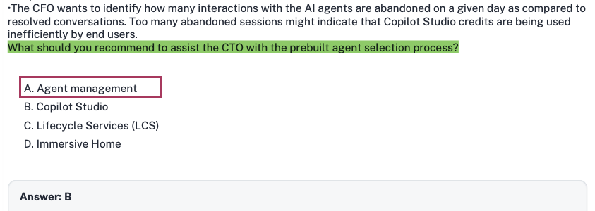
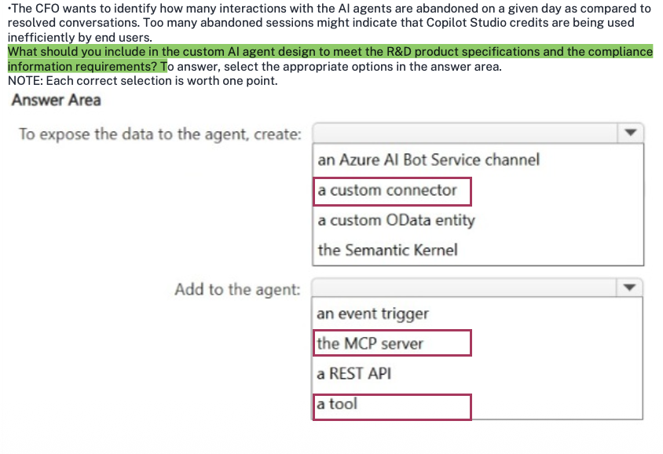
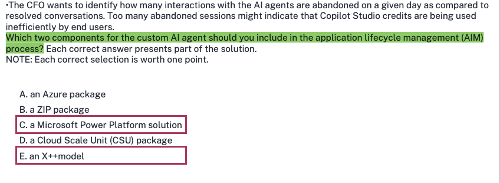
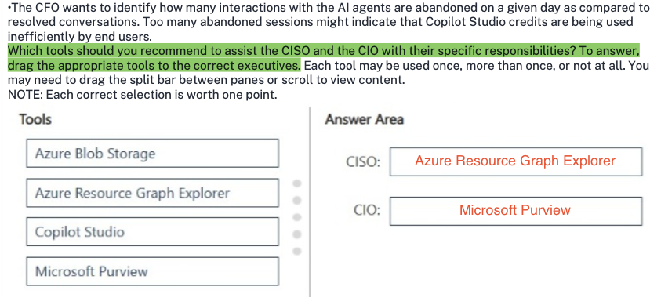
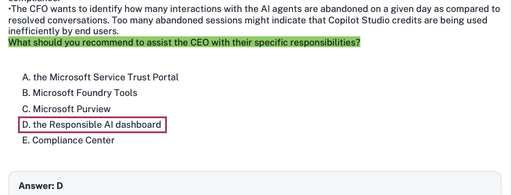
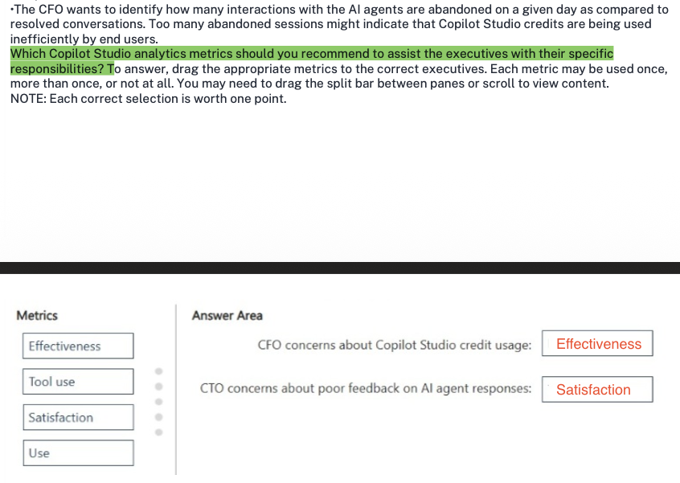

### Case study -

This is a case study. Case studies are not timed separately from other exam sections. You can use as much exam time as you would like to complete each case study. However, there might be additional case studies or other exam sections. Manage your time to ensure that you can complete all the exam sections in the time provided. Pay attention to the Exam Progress at the top of the screen so you have sufficient time to complete any exam sections that follow this case study.

To answer the case study questions, you will need to reference information that is provided in the case. Case studies and associated questions might contain exhibits or other resources that provide more information about the scenario described in the case. Information provided in an individual question does not apply to the other questions in the case study.

A Review Screen will appear at the end of this case study. From the Review Screen, you can review and change your answers before you move to the next exam section. After you leave this case study, you will NOT be able to return to it.

To start the case study -

To display the first question in this case study, select the "Next" button. To the left of the question, a menu provides links to information such as business requirements, the existing environment, and problem statements. Please read through all this information before answering any questions. When you are ready to answer a question, select the "Question" button to return to the question.

---

### Overview -

Contoso, Ltd. is a high-tech manufacturing company that uses Microsoft Dynamics 365 Finance, Dynamics 365 Supply Chain Management, and Dynamics 365 Commerce for its North American operations. The company designs and develops innovative products that have many patents and proprietary technologies. The patents and engineering designs are closely guarded secrets.

Contoso executives want to integrate and adopt AI solutions to help scale the company in preparation for an anticipated period of rapid growth.

The company has multiple legal entities and Azure subscriptions that will be used in the adopted AI solutions.

---

### Requirements -

#### AI Adoption -

The following executives will have specific responsibilities in the overall AI adoption:

* **Chief Technology Officer (CTO):** Select one Dynamics 365 Finance, Dynamics 365 Supply Chain Management or Dynamics 365 Commerce prebuilt AI agent and one custom Microsoft Copilot Studio AI agent to prioritize and deploy during the initial AI adoption phase.

* **Chief Information Officer (CIO):** Ensure that appropriate security labels are assigned to the data used by the AI agents.

* **Chief Financial Officer (CFO):** Analyze the return on investment (ROI) for the AI agents being deployed.

* **Chief Information Security Officer (CISO):** Discover and inventory AI resources for auditing.

* **Chief Executive Officer (CEO):** Ensure that all solutions adhere to industry-standard responsible AI practices.

All AI initiatives and agents will have a detailed business use case, a defined audience profile, and an estimated ROI that will compare the cost savings of the current process against the estimated costs of using the new AI solutions.

The company's research and development (R&D) department already has a custom Model Context Protocol (MCP) server that contains comprehensive product specifications and compliance data.

#### Prebuilt AI Agent -

The CTO has NOT yet selected which prebuilt AI agent to use in Dynamics 365 Supply Chain Management. The CTO wants to view available agent templates to identify which agent will add the most business value. Depending on which high-priority AI agents are identified, its agent capabilities must be previewed in a discovery meeting with the relevant business operation stakeholders.

#### Custom AI Agent -

Contoso has identified the following custom AI agent requirements:

* The custom AI agent will use data from Dynamics 365 Supply Chain Management to answer questions for the manufacturing team as a low-code solution.

* The custom AI agent will be accessible from within Microsoft Teams.

* The custom AI agent must be designed to eventually connect to other agents that can be selected based on their description.

* The topics used in the custom AI agent will be selected based NOT on a trigger phrase, but on a description of the purpose of the query, to make the interactions more conversational.

* The custom AI agent must be able to answer questions about product specifications by using existing technologies. The product specifications are maintained by the R&D department.

* The custom AI agent must be integrated with and accessible from Dynamics 365 Supply Chain Management.

* The custom AI agent must be able to use Dynamics 365 Supply Chain Management business logic that is stored outside of the application.

#### Analysis, Reporting, and Troubleshooting

Contoso has identified the following analysis, reporting, and troubleshooting requirements:

* The CISO will audit all the AI solutions monthly for compliance and security.

* The CFO will analyze all the AI solutions quarterly to compare the estimated ROI against actual measured efficiencies and adoption. The CFO will use the Copilot Studio agent usage estimator to perform this analysis.

* The CISO wants to identify how much sensitive data was accessed for a given AI agent run and who accessed the data. Too much sensitive data accessed by a single user might indicate a high security risk.

* The CTO wants to track user feedback on the quality of the AI agent responses during user interactions with the agents. Consistently poor feedback will trigger an escalated reengineering discussion.

* The CEO wants a quarterly assessment of all the required metrics for their specific responsibilities. The tools used for the assessments must be Microsoft-recommended and must verify reliability, interpretability, fairness, and compliance.

* The CFO wants to identify how many interactions with the AI agents are abandoned on a given day as compared to resolved conversations. Too many abandoned sessions might indicate that Copilot Studio credits are being used inefficiently by end users.

---

### Question 31

Which two components in the custom AI agent design should the CFO evaluate in the quarterly agent analysis?

Each correct answer presents part of the solution.

**NOTE:** Each correct selection is worth one point.

A. the GPT models used for the agent

B. the average characters in a chat message

C. the agent orchestration method

D. the average session time per agent

### 1. Extracted Question Summary

* **Scenario:** Contoso, Ltd. case study. The company is adopting AI agents across Dynamics 365 and Copilot Studio.

* **CFO Role & Requirement:**
* *"Chief Financial Officer (CFO): Analyze the return on investment (ROI) for the AI agents being deployed."*

* *"The CFO will analyze all the AI solutions quarterly to compare the estimated ROI against actual measured efficiencies and adoption. The CFO will use the Copilot Studio agent usage estimator to perform this analysis."*

* **Question:** Which two components in the custom AI agent design should the CFO evaluate in the quarterly agent analysis? (Each correct answer presents part of the solution).

* **Options:**
* **A.** the GPT models used for the agent

* **B.** the average characters in a chat message

* **C.** the agent orchestration method

* **D.** the average session time per agent

---

### 2. Correct Answer

* **C: the agent orchestration method**

* **D: the average session time per agent**

---

### 3. Verification of Visible Selection / Community Key

*(Section skipped as no answer or community key is marked or highlighted in the uploaded screenshots)*.

---

### 4. Official Microsoft Justification

Under the Microsoft Learn pathway **"Architect agentic AI business solutions"** (specifically the modules covering *Evaluate business value, ROI, and capacity for agentic solutions* and *Manage Copilot Studio capacity and billing rates using the Agent Usage Estimator*):

* **The Agent Orchestration Method (Option C):**
* In Microsoft Copilot Studio and the **Copilot Studio agent usage estimator**, the **orchestration method** (Classic trigger/topic-based vs. Generative dynamic chaining) is a fundamental architectural driver of credit consumption and cost.
* When generative orchestration is enabled, the agent dynamically decides which topics, plugins, and tools to call in sequence, consuming billed **Agent Action** credits and generative answer credits dynamically per step. The CFO must evaluate this design setting because switching between classic and generative orchestration directly alters the financial ROI model and monthly credit burn.

* **The Average Session Time per Agent (Option D):**
* To compare estimated ROI against *actual measured efficiencies and adoption*, the CFO evaluates interaction duration. Average session time reflects both user adoption (operational engagement) and workforce productivity efficiency (whether tasks are being resolved swiftly or users are getting bogged down in lengthy, unassisted loops that drain billed session capacity).

---

### 5. Distractor Analysis (Why Others Are Wrong)

* **A. the GPT models used for the agent:** In standard low-code Copilot Studio custom agents, the underlying foundation models (e.g., standard GPT deployments provided via the Copilot Studio SaaS harness) are managed as a managed platform service and abstracted behind credit tiers rather than being individually priced by raw base model SKU in the business usage estimator.
* **B. the average characters in a chat message:** Copilot Studio agent credit billing and capacity estimators do not calculate costs based on raw character length counts of messages; character counts are an irrelevant micro-metric for executive ROI and capacity modeling.

---

### 6. Exam Keyword / Trap Alert

* **Keywords:** *"CFO will use the Copilot Studio agent usage estimator"* + *"compare the estimated ROI against actual measured efficiencies and adoption"*.

* **Trap:** Do not think like a low-level LLM developer who looks at raw token character lengths or individual model selection. In the AB-100 business architecture context, the Copilot Studio estimator models cost around **orchestration mode/actions** and measures efficiency/adoption around **session-level KPIs (average session time)**.

---

## Question 32

• The CFO wants to identify how many interactions with the AI agents are abandoned on a given day as compared to resolved conversations. Too many abandoned sessions might indicate that Copilot Studio credits are being used inefficiently by end users.

What should you configure for the custom AI agent?

A. AI-assisted evaluators

B. classic orchestration

C. generative orchestration

D. Azure OpenAI reasoning models

### 1. Extracted Question Summary

* **Case Study Context:** Contoso, Ltd. (AI Adoption & Custom AI Agent Design).

* **Case Study Requirements Referenced:**
* *"The topics used in the custom AI agent will be selected based NOT on a trigger phrase, but on a description of the purpose of the query, to make the interactions more conversational."*
* *"The custom AI agent must be designed to eventually connect to other agents that can be selected based on their description."*
* *(Visible exhibit snippet)*: *"The CFO wants to identify how many interactions with the AI agents are abandoned on a given day as compared to resolved conversations. Too many abandoned sessions might indicate that Copilot Studio credits are being used inefficiently by end users."*

* **Question:** What should you configure for the custom AI agent?
* **Options:**
* **A.** AI-assisted evaluators
* **B.** classic orchestration
* **C.** generative orchestration
* **D.** Azure OpenAI reasoning models

---

### 2. Correct Answer

**C: generative orchestration**

---

### 3. Verification of Visible Selection / Community Key

*(Skipped as no answer is selected or marked in the screenshot)*.

---

### 4. Official Microsoft Justification

Under the Microsoft Learn pathway **"Architect agentic AI business solutions"** (specifically the modules covering *Choose the right Microsoft agentic AI technology* and *Configure generative orchestration and actions in Microsoft Copilot Studio*):

* **Trigger Phrases vs. Generative Descriptions:**
* In **Classic orchestration**, Copilot Studio determines which topic to run by matching user input against fixed, author-defined **trigger phrases** using traditional Natural Language Understanding (NLU).
* In **Generative orchestration** (dynamic chaining), Copilot Studio uses a foundation model to analyze the user's intent and dynamically selects topics, agent actions, tools, and connected sub-agents based on their **descriptions** rather than predefined trigger phrases.

* The Contoso case study explicitly specifies: *"The topics used in the custom AI agent will be selected based NOT on a trigger phrase, but on a description of the purpose of the query, to make the interactions more conversational"* and *"The custom AI agent must be designed to eventually connect to other agents that can be selected based on their description."*
* Enabling **generative orchestration** in the agent settings is the exact configuration requirement to achieve description-based topic and action selection.

---

### 5. Distractor Analysis (Why Others Are Wrong)

* **A. AI-assisted evaluators:** These are LLM-as-a-judge evaluation metrics used in Azure AI Foundry / Azure AI Studio to assess generative model accuracy, groundedness, and relevance during testing; they do not control conversational routing or topic selection inside a Copilot Studio agent.
* **B. classic orchestration:** Classic mode relies strictly on authoring multiple **trigger phrases** per topic; selecting classic orchestration directly contradicts Contoso's explicit requirement to avoid trigger phrases.
* **D. Azure OpenAI reasoning models:** Models such as OpenAI o1/o3 reasoning models are specialized foundation models for complex multi-step logical reasoning; they are not an orchestration mode switch in Microsoft Copilot Studio.

---

### 6. Exam Keyword / Trap Alert

* **Keywords:** *"Topics used in the custom AI agent will be selected based NOT on a trigger phrase, but on a description of the purpose of the query"* $\rightarrow$ **generative orchestration**.
* **Trap:** Do not be distracted by the CFO usage/abandonment snippet visible at the top of the question window. The architectural decision of whether to use trigger phrases vs. descriptions is the signature definition of **generative orchestration** vs. **classic orchestration** in Copilot Studio.

 

---

## Question 72

What should you recommend to assist the CTO with the prebuilt agent selection process?

A. Agent management

B. Copilot Studio

C. Lifecycle Services (LCS)

D. Immersive Home

### 1. Extracted Question Summary

* **Scenario:** Contoso, Ltd. case study (High-tech manufacturing company using Dynamics 365 Finance, Dynamics 365 Supply Chain Management, and Dynamics 365 Commerce).

* **Core Requirements for Prebuilt AI Agent Selection:**
* *"Chief Technology Officer (CTO): Select one Dynamics 365 Finance, Dynamics 365 Supply Chain Management or Dynamics 365 Commerce prebuilt AI agent and one custom Microsoft Copilot Studio AI agent to prioritize and deploy during the initial AI adoption phase."*

* *"The CTO has NOT yet selected which prebuilt AI agent to use in Dynamics 365 Supply Chain Management. The CTO wants to view available agent templates to identify which agent will add the most business value. Depending on which high-priority AI agents are identified, its agent capabilities must be previewed in a discovery meeting with the relevant business operation stakeholders."*

* **Question:** What should you recommend to assist the CTO with the prebuilt agent selection process?

* **Options:**
* **A.** Agent management

* **B.** Copilot Studio

* **C.** Lifecycle Services (LCS)

* **D.** Immersive Home

---

### 2. Correct Answer

**A: Agent management**

---

### 3. Verification of Visible Selection / Community Key

* The answer displayed at the bottom of the screenshot (**Answer: B**) is **Incorrect/Disputed**.

* **Reason:** While Copilot Studio is used for authoring the *custom* agent in this case study, the feature purpose-built directly within Dynamics 365 Supply Chain Management/Finance and Operations to browse the template library, preview agent capabilities, and activate **prebuilt** autonomous ERP agent templates is **Agent management**.

---

### 4. Official Microsoft Justification

Under the Microsoft Learn pathway **"Architect agentic AI business solutions"** and the official documentation for **"Enable agent management in finance and operations apps"** (`Dynamics 365 Supply Chain Management / Copilot`):

* **Agent Management Feature:** Microsoft introduced the **Agent management** capability directly within Dynamics 365 Finance and Operations apps (including Supply Chain Management).
* Under **Agent management**, administrators and technical executives access two core operational tabs:
1. **Library Tab:** Allows stakeholders to browse available prebuilt ERP agent templates, preview prebuilt agent capabilities, and evaluate which out-of-the-box agent adds the most business value before committing to activation.
2. **Manage Tab:** Allows tracking and managing currently active ERP agents.

* Because the CTO's requirement explicitly states: *"The CTO wants to view available agent templates to identify which agent will add the most business value. Depending on which high-priority AI agents are identified, its agent capabilities must be previewed in a discovery meeting,"* recommending **Agent management** is the exact administrative feature designed to satisfy this selection workflow.

---

### 5. Distractor Analysis (Why Others Are Wrong)

* **B. Copilot Studio:** Copilot Studio is an authoring SaaS platform used to build, extend, and orchestrate *custom* conversational agents and plugins; it is not the catalog browser within Dynamics 365 SCM where native first-party ERP prebuilt agent templates are previewed and selected.
* **C. Lifecycle Services (LCS):** LCS is an environment and ALM infrastructure management tool used for deploying VMs, applying service updates/binary packages, and monitoring infrastructure health; it does not contain the business agent template library or functional agent preview capabilities.
* **D. Immersive Home:** Immersive Home is the AI-driven modern dashboard and landing page experience surface in Dynamics 365 Finance and Operations that displays prioritized work feeds and actionable agent cards; it is the host surface where links are surfaced, not the specific administrative feature tool (*Agent management*) utilized to browse the agent template library and preview template capabilities.

---

### 6. Exam Keyword / Trap Alert

* **Keywords:** *"Prebuilt AI agent to use in Dynamics 365 Supply Chain Management"* + *"view available agent templates"* + *"previewed in a discovery meeting"*.

* **Trap:** Do not conflate the two CTO responsibilities:
* Building the **custom AI agent** $\rightarrow$ **Microsoft Copilot Studio**.

* Browsing and selecting **prebuilt Dynamics 365 SCM/F&O agent templates** $\rightarrow$ **Agent management**.

Dump keys that mark *B (Copilot Studio)* reflexively mistake this for a bot-authoring question rather than a Dynamics 365 ERP prebuilt agent management inquiry.

 

---

## Question 73

What should you include in the custom AI agent design to meet the R&D product specifications and the compliance information requirements? To answer, select the appropriate options in the answer area.

**NOTE:** Each correct selection is worth one point.

---

### Answer Area

**To expose the data to the agent, create:**

* [ ] an Azure AI Bot Service channel

* [ ] a custom connector

* [ ] a custom OData entity

* [ ] the Semantic Kernel

**Add to the agent:**

* [ ] an event trigger

* [ ] the MCP server

* [ ] a REST API

* [ ] a tool

### 1. Extracted Question Summary

* **Case Study Context:** Contoso, Ltd. (High-tech manufacturing company adopting agentic AI solutions).

* **Relevant Case Study Facts:**
* *"The company's research and development (R&D) department already has a custom Model Context Protocol (MCP) server that contains comprehensive product specifications and compliance data."*

* *"The custom AI agent must be able to answer questions about product specifications by using existing technologies. The product specifications are maintained by the R&D department."*

* **Question:** What should you include in the custom AI agent design to meet the R&D product specifications and the compliance information requirements? To answer, select the appropriate options in the answer area.

* **Dropdown 1:** *To expose the data to the agent, create:*

* an Azure AI Bot Service channel

* a custom connector

* a custom OData entity

* the Semantic Kernel

* **Dropdown 2:** *Add to the agent:*

* an event trigger

* the MCP server

* a REST API

* a tool

---

### 2. Correct Answer

* **To expose the data to the agent, create:** **a custom connector**
* **Add to the agent:** **a tool** *(or **the MCP server** in specific MCP-native preview releases)*

> **Architectural Recommendation for the Live Exam:**
> 1. In standard Microsoft Copilot Studio architecture, external REST/custom services exposing data and actions to low-code agents are wrapped by creating **a custom connector** in Power Platform, and then added to the agent canvas/generative actions library as **a tool** (an agent action/plugin).
> 2. Where the curriculum tests direct Model Context Protocol integration: if the exam key evaluates the pre-existing server asset directly, **the MCP server** is added to the agent as **a tool**.
> 
> 

---

### 3. Verification of Visible Selection / Community Key

*(Section skipped as no answers are marked or highlighted in the uploaded screenshot)*.

---

### 4. Official Microsoft Justification

Under the Microsoft Learn pathway **"Architect agentic AI business solutions"** (specifically the modules covering *Extend agents with actions and tools in Microsoft Copilot Studio* and *Integrate external APIs and protocols with agentic workflows*):

* **Exposing External Data and Services (a custom connector):**
* In Microsoft Power Platform and Copilot Studio, external systems and proprietary APIs that exist outside of Microsoft 365/Dataverse must be bridged into the low-code ecosystem using **custom connectors**.
* Custom connectors define OpenAPI (Swagger) specifications that describe the external service endpoints, parameter schemas, and authentication schemes, making external data accessible to the Power Platform runtime.

* **Adding Capabilities to the Agent (a tool):**
* Under generative orchestration, agent capabilities (connectors, flows, conversational plugins, and protocol endpoints) are surfaced to the agent's reasoning engine as **tools**.
* When generative orchestration is enabled, the agent dynamically selects and executes the appropriate **tool** based on the description of the user's query and the tool's parameter contracts to retrieve R&D product specifications and compliance data.

---

### 5. Distractor Analysis (Why Others Are Wrong)

**Dropdown 1: To expose the data to the agent, create:**

* **An Azure AI Bot Service channel:** Channels (e.g., Teams, Web Chat, Direct Line) represent inbound conversational front-ends where users interact with the bot; they do not expose backend enterprise data to the agent.

* **A custom OData entity:** Used within Dynamics 365 Finance and Operations for tabular data export/import; it does not connect an external R&D MCP service to Copilot Studio.

* **The Semantic Kernel:** An open-source, code-first developer SDK for orchestrating AI agents in C#, Python, and Java; it is not a configuration asset created in low-code Copilot Studio architectures.

**Dropdown 2: Add to the agent:**

* **An event trigger:** Triggers a topic based on an asynchronous incoming event or webhook; it does not provide conversational query-answering or bidirectional data retrieval capabilities.

* **A REST API:** A raw architectural communication protocol; raw REST APIs cannot be attached directly to a Copilot Studio agent without first being abstracted as a connector or tool.

---

### 6. Exam Keyword / Trap Alert

* **Keywords:** *"Expose data to the agent"* $\rightarrow$ **a custom connector**; *"Add to the agent"* $\rightarrow$ **a tool**.

* **Trap:** Do not get misled by the mention of the R&D department's *MCP server* into looking for code-first orchestration frameworks like *Semantic Kernel*. In Copilot Studio low-code solutions, external capabilities are governed by wrapping endpoints in **custom connectors** and consuming them as **tools**.

 

--- 

## Question 116

Which two components for the custom AI agent should you include in the application lifecycle management (AIM) process? Each correct answer presents part of the solution.

**NOTE:** Each correct selection is worth one point.

A. an Azure package

B. a ZIP package

C. a Microsoft Power Platform solution

D. a Cloud Scale Unit (CSU) package

E. an X++model

### 1. Extracted Question Summary

* **Case Study Context:** Contoso, Ltd. (High-tech manufacturing company using Dynamics 365 Finance, Dynamics 365 Supply Chain Management, and Dynamics 365 Commerce).

* **Relevant Custom AI Agent Requirements:**
* *"The custom AI agent will use data from Dynamics 365 Supply Chain Management to answer questions for the manufacturing team as a low-code solution."*

* *"The custom AI agent must be integrated with and accessible from Dynamics 365 Supply Chain Management."*

* *"The custom AI agent must be able to use Dynamics 365 Supply Chain Management business logic that is stored outside of the application."*

* **Question:** Which two components for the custom AI agent should you include in the application lifecycle management (ALM) process? Each correct answer presents part of the solution.

* **Options:**
* **A.** an Azure package

* **B.** a ZIP package

* **C.** a Microsoft Power Platform solution

* **D.** a Cloud Scale Unit (CSU) package

* **E.** an X++ model

---

### 2. Correct Answer

* **C: a Microsoft Power Platform solution**

* **E: an X++ model**

---

### 3. Verification of Visible Selection / Community Key

*(Skipped as no answer is selected or marked in the screenshot)*.

---

### 4. Official Microsoft Justification

Under the Microsoft Learn pathway **"Architect agentic AI business solutions"** (specifically the modules covering *Manage the application lifecycle for agentic AI solutions* and *Extend Microsoft Dynamics 365 Supply Chain Management / Finance and Operations apps*):

* **Microsoft Power Platform solution (Option C):**
The custom AI agent is authored in Microsoft Copilot Studio as a low-code solution connected to Dataverse and Microsoft Teams. In Microsoft Power Platform, **solutions** are the mandatory architectural vehicle for packaging, versioning, source controlling, and transporting agents, topics, generative actions, connection references, and environment variables across Dev, Test, and Production environments.

* **An X++ model (Option E):**
The scenario states: *"The custom AI agent must be able to use Dynamics 365 Supply Chain Management business logic that is stored outside of the application."* In Dynamics 365 Finance & Operations / Supply Chain Management, custom enterprise business logic, services, and data entities are authored in **X++** and structured inside an **X++ model**. An X++ model is the fundamental development and ALM unit managed in source control (Azure DevOps Git/TFVC) and compiled into deployable packages for deployment to F&O environments via LCS/Cloud-hosted pipelines.

---

### 5. Distractor Analysis (Why Others Are Wrong)

* **A. an Azure package:** A generic term for cloud service deployment artifacts (e.g., `.cspkg`, App Service zip deploy); it is not the structured ALM container for Copilot Studio components or Dynamics 365 F&O business logic.

* **B. a ZIP package:** While Power Platform solutions are physically exported as compressed `.zip` archives, the actual conceptual and architectural component inside the ALM framework is the **Microsoft Power Platform solution**, not the raw file format.

* **D. a Cloud Scale Unit (CSU) package:** A deployable package specifically utilized for Dynamics 365 Commerce headless commerce engines, Point of Sale (POS), and channel database extensions; it does not manage Supply Chain Management manufacturing logic or Copilot Studio agent metadata.

---

### 6. Exam Keyword / Trap Alert

* **Keywords:** *"Custom AI agent"* $\rightarrow$ **Microsoft Power Platform solution**; *"Dynamics 365 Supply Chain Management business logic that is stored outside of the application"* $\rightarrow$ **an X++ model**.

* **Trap:** Do not fall for *ZIP package* (Option B). ALM questions evaluate formal governance constructs—the ALM component is the **Power Platform solution**. Likewise, do not select *CSU package* (Option D), which is restricted to Dynamics 365 Commerce retail scale units rather than Supply Chain Management core logic.

 

--- 

## Question 117

Which tools should you recommend to assist the CISO and the CIO with their specific responsibilities? To answer, drag the appropriate tools to the correct executives. Each tool may be used once, more than once, or not at all. You may need to drag the split bar between panes or scroll to view content.

**NOTE:** Each correct selection is worth one point.

---

### Tools

* Azure Blob Storage

* Azure Resource Graph Explorer

* Copilot Studio

* Microsoft Purview

---

### Answer Area

* **CISO:** [                ]

* **CIO:**  [                ]

### 1. Extracted Question Summary

* **Case Study Context:** Contoso, Ltd. (AI Adoption & Executive Roles across multiple legal entities and Azure subscriptions).

* **Relevant Executive Responsibilities:**
* *"Chief Information Officer (CIO): Ensure that appropriate security labels are assigned to the data used by the AI agents."*

* *"Chief Information Security Officer (CISO): Discover and inventory AI resources for auditing."*

* **Question:** Which tools should you recommend to assist the CISO and the CIO with their specific responsibilities? To answer, drag the appropriate tools to the correct executives. Each tool may be used once, more than once, or not at all.

* **Tools Available:**
* Azure Blob Storage

* Azure Resource Graph Explorer

* Copilot Studio

* Microsoft Purview

* **Answer Area:**
* **CISO:** [Target Box]

* **CIO:** [Target Box]

---

### 2. Correct Answer

* **CISO:** **Azure Resource Graph Explorer**
* **CIO:** **Microsoft Purview**

---

### 3. Verification of Visible Selection / Community Key

*(Section skipped as no answer is selected or visible in the target boxes in the screenshot)*.

---

### 4. Official Microsoft Justification

Under the Microsoft Learn pathway **"Architect agentic AI business solutions"** (specifically the modules covering *Plan and implement cloud architecture and infrastructure governance* and *Security and Governance in Agentic Architectures*):

* **CISO Responsibility (Discover and inventory AI resources for auditing):**
* Contoso operates across **multiple legal entities and Azure subscriptions**.

* **Azure Resource Graph Explorer** is Microsoft’s specialized cloud inventory and querying service that executes performant KQL (Kusto Query Language) queries across all Azure subscriptions and management groups at scale. It provides immediate discovery and comprehensive inventory of deployed cloud resources (e.g., Azure OpenAI instances, Azure AI Search resources, Cognitive Services accounts, and bot registrations) for security baseline validation and compliance auditing.

* **CIO Responsibility (Ensure appropriate security labels are assigned to data used by AI agents):**
* Microsoft’s unified data governance, compliance, and risk platform is **Microsoft Purview**.
* Purview governs **Sensitivity Labels** and **Information Protection** (such as classifying confidential patents and proprietary engineering designs) across Microsoft 365, Dataverse, Azure storage, and third-party data repositories. It ensures that data consumed or surfaced by conversational agents inherits appropriate classification labels, protection policies, and access controls.

---

### 5. Distractor Analysis (Why Others Are Wrong)

* **Azure Blob Storage:** An unstructured object storage service for binary data, files, and images; it does not provide discovery/inventory query engines across subscriptions, nor does it define or assign security classification labels.

* **Copilot Studio:** The low-code authoring and runtime platform for custom conversational agents; it consumes classified data and relies on Purview/Dataverse security, but it is not an enterprise data labeling tool or multi-subscription cloud resource inventory tool.

---

### 6. Exam Keyword / Trap Alert

* **Keywords:**
* *"Discover and inventory AI resources for auditing"* across multiple Azure subscriptions $\rightarrow$ **Azure Resource Graph Explorer**.

* *"Ensure that appropriate security labels are assigned to the data"* $\rightarrow$ **Microsoft Purview**.

* **Trap:** Do not mix up the security roles: the **CISO** inventories and audits the deployed cloud infrastructure/resources across subscriptions (**Azure Resource Graph Explorer**), whereas the **CIO** ensures information protection and compliance through data labeling (**Microsoft Purview**).

 

---

## Question 118

What should you recommend to assist the CEO with their specific responsibilities?

A. the Microsoft Service Trust Portal

B. Microsoft Foundry Tools

C. Microsoft Purview

D. the Responsible AI dashboard

E. Compliance Center

### 1. Extracted Question Summary

* **Case Study Context:** Contoso, Ltd. (AI Adoption & Governance).

* **Executive Responsibilities Referenced:**
* *"Chief Executive Officer (CEO): Ensure that all solutions adhere to industry-standard responsible AI practices."*

* *"The CEO wants a quarterly assessment of all the required metrics for their specific responsibilities. The tools used for the assessments must be Microsoft-recommended and must verify reliability, interpretability, fairness, and compliance."*

* **Question:** What should you recommend to assist the CEO with their specific responsibilities?

* **Options:**
* **A.** the Microsoft Service Trust Portal

* **B.** Microsoft Foundry Tools

* **C.** Microsoft Purview

* **D.** the Responsible AI dashboard

* **E.** Compliance Center

---

### 2. Correct Answer

**D: the Responsible AI dashboard**

---

### 3. Verification of Visible Selection / Community Key

* The answer displayed at the bottom of the screenshot (**Answer: D**) is **Correct**, because the **Responsible AI dashboard** is Microsoft's dedicated toolkit specifically engineered to assess, debug, and measure models against the core pillars of Responsible AI: **reliability, interpretability, fairness, and compliance**.

---

### 4. Official Microsoft Justification

Under the Microsoft Learn pathway **"Architect agentic AI business solutions"** (specifically the modules covering *Evaluate and monitor generative AI applications and infrastructure* and *Apply Responsible AI principles for business solutions*):

* Microsoft operationalizes its **Responsible AI Standard** (Fairness, Reliability & Safety, Privacy & Security, Inclusiveness, Transparency, and Accountability) using the **Responsible AI dashboard** (in Azure Machine Learning and Azure AI Studio / Foundry).
* The case study explicitly assigns the CEO the responsibility to:
1. *"Ensure that all solutions adhere to industry-standard responsible AI practices."*

2. Perform a quarterly assessment to *"verify reliability, interpretability, fairness, and compliance."*

* The **Responsible AI dashboard** directly integrates these exact assessment components into a single interface:
* **Error Analysis:** Assesses model reliability and failure distribution.
* **Model Interpretability / Explanation:** Explains feature importances and decision drivers.
* **Fairness Assessment:** Evaluates algorithmic disparity and fairness metrics across demographic cohorts.
* **Data Analysis & Counterfactuals:** Ensures adherence to compliance and safety guardrails.

---

### 5. Distractor Analysis (Why Others Are Wrong)

* **A. the Microsoft Service Trust Portal:** An external-facing compliance portal where customers download Microsoft's own regulatory audit reports (SOC 2, ISO, FedRAMP); it verifies Microsoft's cloud hosting compliance, not the fairness, reliability, or interpretability of Contoso's custom AI solutions.

* **B. Microsoft Foundry Tools:** A broad, generic category of development and orchestration tools in Azure AI Foundry; it is not the specific diagnostic assessment framework built for auditing fairness, interpretability, and responsible AI metrics.

* **C. Microsoft Purview:** The unified data governance and sensitivity labeling platform; assigned specifically to the **CIO** to label sensitive data, not to evaluate AI model fairness, interpretability, or algorithmic reliability.

* **E. Compliance Center:** Legacy name (now Microsoft Purview Compliance portal) for tenant regulatory compliance, eDiscovery, and audit management; it does not contain model interpretability or algorithmic fairness evaluation tools.

---

### 6. Exam Keyword / Trap Alert

* **Keywords:** *"Ensure that all solutions adhere to industry-standard responsible AI practices"* + *"verify reliability, interpretability, fairness, and compliance"* $\rightarrow$ **the Responsible AI dashboard**.

* **Trap:** Do not get confused by the word *"compliance"* into reflexively choosing *Compliance Center* or *Microsoft Purview*. When the question pairs compliance with **interpretability and fairness**, it is testing the **Responsible AI dashboard**.

 

--- 

## Question 119

Which Copilot Studio analytics metrics should you recommend to assist the executives with their specific responsibilities? To answer, drag the appropriate metrics to the correct executives. Each metric may be used once, more than once, or not at all. You may need to drag the split bar between panes or scroll to view content.

**NOTE:** Each correct selection is worth one point.

---

### Metrics

* Effectiveness

* Tool use

* Satisfaction

* Use

---

### Answer Area

* **CFO concerns about Copilot Studio credit usage:** [                ]

* **CTO concerns about poor feedback on AI agent responses:** [                ]

### 1. Extracted Question Summary

* **Case Study Context:** Contoso, Ltd. (AI Adoption & Executive Responsibilities).

* **Relevant Case Study Requirements:**
* *"The CFO wants to identify how many interactions with the AI agents are abandoned on a given day as compared to resolved conversations. Too many abandoned sessions might indicate that Copilot Studio credits are being used inefficiently by end users."*

* *"The CTO wants to track user feedback on the quality of the AI agent responses during user interactions with the agents. Consistently poor feedback will trigger an escalated reengineering discussion."*

* **Question:** Which Copilot Studio analytics metrics should you recommend to assist the executives with their specific responsibilities? To answer, drag the appropriate metrics to the correct executives. Each metric may be used once, more than once, or not at all.
* **Available Metrics:**
* Effectiveness
* Tool use
* Satisfaction
* Use

* **Answer Area:**
* CFO concerns about Copilot Studio credit usage: [Target Box]
* CTO concerns about poor feedback on AI agent responses: [Target Box]

---

### 2. Correct Answer

* **CFO concerns about Copilot Studio credit usage:** **Effectiveness**
* **CTO concerns about poor feedback on AI agent responses:** **Satisfaction**

---

### 3. Verification of Visible Selection / Community Key

*(Section skipped as no answers are placed or marked in the Answer Area target boxes in the screenshot)*.

---

### 4. Official Microsoft Justification

Under the Microsoft Learn pathway **"Architect agentic AI business solutions"** (specifically the module *Analyze agent performance in Microsoft Copilot Studio* and the official documentation for *Key concepts - Analytics in Microsoft Copilot Studio*):

* **Effectiveness (CFO concern):**
* In Microsoft Copilot Studio analytics, the **Effectiveness** (resolution/abandonment) metrics specifically measure how conversations terminate: **Resolution rate**, **Escalation rate**, and **Abandon rate**.
* Abandoned sessions represent conversations where users disengaged without reaching a resolution or escalating, which the CFO explicitly notes leads to wasted Copilot Studio billed capacity/credits. Tracking the **Effectiveness** analytics tab provides the precise breakdown of resolved versus abandoned session ratios.

* **Satisfaction (CTO concern):**
* The **Satisfaction** analytics tab measures user sentiment and qualitative feedback through **CSAT (Customer Satisfaction)** scores, post-conversation surveys (thumbs up / thumbs down ratings), and sentiment indicators.
* The CTO’s explicit objective is to *"track user feedback on the quality of the AI agent responses during user interactions"* where poor sentiment triggers re-engineering. This directly aligns with the **Satisfaction** metrics dashboard.

---

### 5. Distractor Analysis (Why Others Are Wrong)

* **Use:** The *Usage* (or *Use*) metric tracks volume-based activity—such as total sessions, engaged sessions, unengaged sessions, and active users over time; it tracks raw traffic volume, not whether sessions were resolved vs. abandoned (Effectiveness) or how users scored the responses (Satisfaction).
* **Tool use:** Tracks the invocation frequency, latency, and success/failure rate of autonomous agent tools, plugins, and custom connectors; it does not measure conversational resolution/abandonment outcomes or end-user sentiment/feedback.

---

### 6. Exam Keyword / Trap Alert

* **Keywords:**
* *"Abandoned on a given day as compared to resolved conversations"* $\rightarrow$ **Effectiveness** (resolution vs. abandonment rate).

* *"User feedback on the quality of the AI agent responses"* $\rightarrow$ **Satisfaction** (CSAT / thumbs ratings).

* **Trap:** Do not associate *"credit usage"* with the *Use* metric. The scenario specifically qualifies the CFO's concern as distinguishing between **abandoned vs. resolved** conversations wasting credits, which is exclusively tracked under **Effectiveness**.

