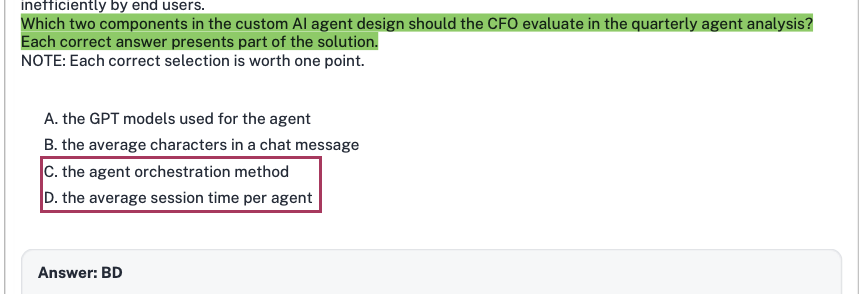
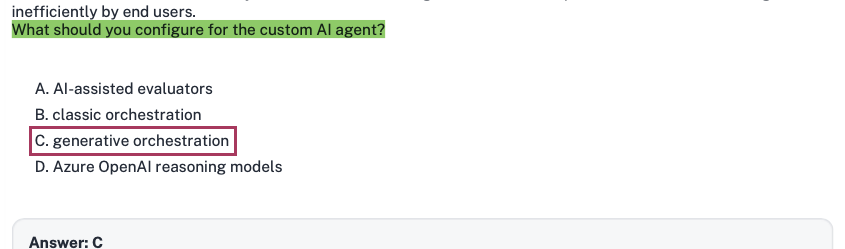

### Case study -

This is a case study. Case studies are not timed separately from other exam sections. You can use as much exam time as you would like to complete each case study. However, there might be additional case studies or other exam sections. Manage your time to ensure that you can complete all the exam sections in the time provided. Pay attention to the Exam Progress at the top of the screen so you have sufficient time to complete any exam sections that follow this case study.

To answer the case study questions, you will need to reference information that is provided in the case. Case studies and associated questions might contain exhibits or other resources that provide more information about the scenario described in the case. Information provided in an individual question does not apply to the other questions in the case study.

A Review Screen will appear at the end of this case study. From the Review Screen, you can review and change your answers before you move to the next exam section. After you leave this case study, you will NOT be able to return to it.

To start the case study -

To display the first question in this case study, select the "Next" button. To the left of the question, a menu provides links to information such as business requirements, the existing environment, and problem statements. Please read through all this information before answering any questions. When you are ready to answer a question, select the "Question" button to return to the question.

---

### Overview -

Contoso, Ltd. is a high-tech manufacturing company that uses Microsoft Dynamics 365 Finance, Dynamics 365 Supply Chain Management, and Dynamics 365 Commerce for its North American operations. The company designs and develops innovative products that have many patents and proprietary technologies. The patents and engineering designs are closely guarded secrets.

Contoso executives want to integrate and adopt AI solutions to help scale the company in preparation for an anticipated period of rapid growth.

The company has multiple legal entities and Azure subscriptions that will be used in the adopted AI solutions.

---

### Requirements -

#### AI Adoption -

The following executives will have specific responsibilities in the overall AI adoption:

* **Chief Technology Officer (CTO):** Select one Dynamics 365 Finance, Dynamics 365 Supply Chain Management or Dynamics 365 Commerce prebuilt AI agent and one custom Microsoft Copilot Studio AI agent to prioritize and deploy during the initial AI adoption phase.

* **Chief Information Officer (CIO):** Ensure that appropriate security labels are assigned to the data used by the AI agents.

* **Chief Financial Officer (CFO):** Analyze the return on investment (ROI) for the AI agents being deployed.

* **Chief Information Security Officer (CISO):** Discover and inventory AI resources for auditing.

* **Chief Executive Officer (CEO):** Ensure that all solutions adhere to industry-standard responsible AI practices.

All AI initiatives and agents will have a detailed business use case, a defined audience profile, and an estimated ROI that will compare the cost savings of the current process against the estimated costs of using the new AI solutions.

The company's research and development (R&D) department already has a custom Model Context Protocol (MCP) server that contains comprehensive product specifications and compliance data.

#### Prebuilt AI Agent -

The CTO has NOT yet selected which prebuilt AI agent to use in Dynamics 365 Supply Chain Management. The CTO wants to view available agent templates to identify which agent will add the most business value. Depending on which high-priority AI agents are identified, its agent capabilities must be previewed in a discovery meeting with the relevant business operation stakeholders.

#### Custom AI Agent -

Contoso has identified the following custom AI agent requirements:

* The custom AI agent will use data from Dynamics 365 Supply Chain Management to answer questions for the manufacturing team as a low-code solution.

* The custom AI agent will be accessible from within Microsoft Teams.

* The custom AI agent must be designed to eventually connect to other agents that can be selected based on their description.

* The topics used in the custom AI agent will be selected based NOT on a trigger phrase, but on a description of the purpose of the query, to make the interactions more conversational.

* The custom AI agent must be able to answer questions about product specifications by using existing technologies. The product specifications are maintained by the R&D department.

* The custom AI agent must be integrated with and accessible from Dynamics 365 Supply Chain Management.

* The custom AI agent must be able to use Dynamics 365 Supply Chain Management business logic that is stored outside of the application.

#### Analysis, Reporting, and Troubleshooting

Contoso has identified the following analysis, reporting, and troubleshooting requirements:

* The CISO will audit all the AI solutions monthly for compliance and security.

* The CFO will analyze all the AI solutions quarterly to compare the estimated ROI against actual measured efficiencies and adoption. The CFO will use the Copilot Studio agent usage estimator to perform this analysis.

* The CISO wants to identify how much sensitive data was accessed for a given AI agent run and who accessed the data. Too much sensitive data accessed by a single user might indicate a high security risk.

* The CTO wants to track user feedback on the quality of the AI agent responses during user interactions with the agents. Consistently poor feedback will trigger an escalated reengineering discussion.

* The CEO wants a quarterly assessment of all the required metrics for their specific responsibilities. The tools used for the assessments must be Microsoft-recommended and must verify reliability, interpretability, fairness, and compliance.

* The CFO wants to identify how many interactions with the AI agents are abandoned on a given day as compared to resolved conversations. Too many abandoned sessions might indicate that Copilot Studio credits are being used inefficiently by end users.

---

### Question 31

Which two components in the custom AI agent design should the CFO evaluate in the quarterly agent analysis?

Each correct answer presents part of the solution.

**NOTE:** Each correct selection is worth one point.

A. the GPT models used for the agent

B. the average characters in a chat message

C. the agent orchestration method

D. the average session time per agent

### 1. Extracted Question Summary

* **Scenario:** Contoso, Ltd. case study. The company is adopting AI agents across Dynamics 365 and Copilot Studio.

* **CFO Role & Requirement:**
* *"Chief Financial Officer (CFO): Analyze the return on investment (ROI) for the AI agents being deployed."*

* *"The CFO will analyze all the AI solutions quarterly to compare the estimated ROI against actual measured efficiencies and adoption. The CFO will use the Copilot Studio agent usage estimator to perform this analysis."*

* **Question:** Which two components in the custom AI agent design should the CFO evaluate in the quarterly agent analysis? (Each correct answer presents part of the solution).

* **Options:**
* **A.** the GPT models used for the agent

* **B.** the average characters in a chat message

* **C.** the agent orchestration method

* **D.** the average session time per agent

---

### 2. Correct Answer

* **C: the agent orchestration method**

* **D: the average session time per agent**

---

### 3. Verification of Visible Selection / Community Key

*(Section skipped as no answer or community key is marked or highlighted in the uploaded screenshots)*.

---

### 4. Official Microsoft Justification

Under the Microsoft Learn pathway **"Architect agentic AI business solutions"** (specifically the modules covering *Evaluate business value, ROI, and capacity for agentic solutions* and *Manage Copilot Studio capacity and billing rates using the Agent Usage Estimator*):

* **The Agent Orchestration Method (Option C):**
* In Microsoft Copilot Studio and the **Copilot Studio agent usage estimator**, the **orchestration method** (Classic trigger/topic-based vs. Generative dynamic chaining) is a fundamental architectural driver of credit consumption and cost.
* When generative orchestration is enabled, the agent dynamically decides which topics, plugins, and tools to call in sequence, consuming billed **Agent Action** credits and generative answer credits dynamically per step. The CFO must evaluate this design setting because switching between classic and generative orchestration directly alters the financial ROI model and monthly credit burn.

* **The Average Session Time per Agent (Option D):**
* To compare estimated ROI against *actual measured efficiencies and adoption*, the CFO evaluates interaction duration. Average session time reflects both user adoption (operational engagement) and workforce productivity efficiency (whether tasks are being resolved swiftly or users are getting bogged down in lengthy, unassisted loops that drain billed session capacity).

---

### 5. Distractor Analysis (Why Others Are Wrong)

* **A. the GPT models used for the agent:** In standard low-code Copilot Studio custom agents, the underlying foundation models (e.g., standard GPT deployments provided via the Copilot Studio SaaS harness) are managed as a managed platform service and abstracted behind credit tiers rather than being individually priced by raw base model SKU in the business usage estimator.
* **B. the average characters in a chat message:** Copilot Studio agent credit billing and capacity estimators do not calculate costs based on raw character length counts of messages; character counts are an irrelevant micro-metric for executive ROI and capacity modeling.

---

### 6. Exam Keyword / Trap Alert

* **Keywords:** *"CFO will use the Copilot Studio agent usage estimator"* + *"compare the estimated ROI against actual measured efficiencies and adoption"*.

* **Trap:** Do not think like a low-level LLM developer who looks at raw token character lengths or individual model selection. In the AB-100 business architecture context, the Copilot Studio estimator models cost around **orchestration mode/actions** and measures efficiency/adoption around **session-level KPIs (average session time)**.

---

## Question 32

• The CFO wants to identify how many interactions with the AI agents are abandoned on a given day as compared to resolved conversations. Too many abandoned sessions might indicate that Copilot Studio credits are being used inefficiently by end users.

What should you configure for the custom AI agent?

A. AI-assisted evaluators

B. classic orchestration

C. generative orchestration

D. Azure OpenAI reasoning models

### 1. Extracted Question Summary

* **Case Study Context:** Contoso, Ltd. (AI Adoption & Custom AI Agent Design).

* **Case Study Requirements Referenced:**
* *"The topics used in the custom AI agent will be selected based NOT on a trigger phrase, but on a description of the purpose of the query, to make the interactions more conversational."*
* *"The custom AI agent must be designed to eventually connect to other agents that can be selected based on their description."*
* *(Visible exhibit snippet)*: *"The CFO wants to identify how many interactions with the AI agents are abandoned on a given day as compared to resolved conversations. Too many abandoned sessions might indicate that Copilot Studio credits are being used inefficiently by end users."*

* **Question:** What should you configure for the custom AI agent?
* **Options:**
* **A.** AI-assisted evaluators
* **B.** classic orchestration
* **C.** generative orchestration
* **D.** Azure OpenAI reasoning models

---

### 2. Correct Answer

**C: generative orchestration**

---

### 3. Verification of Visible Selection / Community Key

*(Skipped as no answer is selected or marked in the screenshot)*.

---

### 4. Official Microsoft Justification

Under the Microsoft Learn pathway **"Architect agentic AI business solutions"** (specifically the modules covering *Choose the right Microsoft agentic AI technology* and *Configure generative orchestration and actions in Microsoft Copilot Studio*):

* **Trigger Phrases vs. Generative Descriptions:**
* In **Classic orchestration**, Copilot Studio determines which topic to run by matching user input against fixed, author-defined **trigger phrases** using traditional Natural Language Understanding (NLU).
* In **Generative orchestration** (dynamic chaining), Copilot Studio uses a foundation model to analyze the user's intent and dynamically selects topics, agent actions, tools, and connected sub-agents based on their **descriptions** rather than predefined trigger phrases.

* The Contoso case study explicitly specifies: *"The topics used in the custom AI agent will be selected based NOT on a trigger phrase, but on a description of the purpose of the query, to make the interactions more conversational"* and *"The custom AI agent must be designed to eventually connect to other agents that can be selected based on their description."*
* Enabling **generative orchestration** in the agent settings is the exact configuration requirement to achieve description-based topic and action selection.

---

### 5. Distractor Analysis (Why Others Are Wrong)

* **A. AI-assisted evaluators:** These are LLM-as-a-judge evaluation metrics used in Azure AI Foundry / Azure AI Studio to assess generative model accuracy, groundedness, and relevance during testing; they do not control conversational routing or topic selection inside a Copilot Studio agent.
* **B. classic orchestration:** Classic mode relies strictly on authoring multiple **trigger phrases** per topic; selecting classic orchestration directly contradicts Contoso's explicit requirement to avoid trigger phrases.
* **D. Azure OpenAI reasoning models:** Models such as OpenAI o1/o3 reasoning models are specialized foundation models for complex multi-step logical reasoning; they are not an orchestration mode switch in Microsoft Copilot Studio.

---

### 6. Exam Keyword / Trap Alert

* **Keywords:** *"Topics used in the custom AI agent will be selected based NOT on a trigger phrase, but on a description of the purpose of the query"* $\rightarrow$ **generative orchestration**.
* **Trap:** Do not be distracted by the CFO usage/abandonment snippet visible at the top of the question window. The architectural decision of whether to use trigger phrases vs. descriptions is the signature definition of **generative orchestration** vs. **classic orchestration** in Copilot Studio.

