# Complete Answer Workings

## Q3

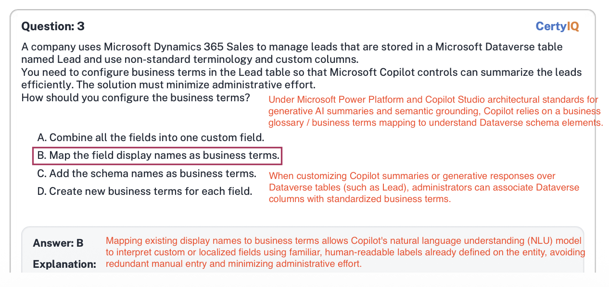

### Answer
### 1. Extracted Question Summary

* **Scenario:** A company uses Microsoft Dynamics 365 Sales to manage leads stored in a Microsoft Dataverse table named `Lead` with non-standard terminology and custom columns. You must configure business terms in the Lead table so that Microsoft Copilot controls can summarize the leads efficiently while **minimizing administrative effort**.


* **Question:** How should you configure the business terms?


* **Options:**
* **A.** Combine all the fields into one custom field.


* **B.** Map the field display names as business terms.


* **C.** Add the schema names as business terms.


* **D.** Create new business terms for each field.


---

### 2. Correct Answer

**B: Map the field display names as business terms.**

---

### 3. Verification of Visible Selection / Community Key

* The visible answer marked in the screenshot (**Answer: B**) is **Correct**, as mapping existing user-friendly column display names to Copilot's semantic business terms directly leverages existing metadata and requires minimal administrative overhead compared to manually authoring definitions from scratch.


---

### 4. Official Microsoft Justification

* Under Microsoft Power Platform and Copilot Studio architectural standards for generative AI summaries and semantic grounding, Copilot relies on a business glossary / business terms mapping to understand Dataverse schema elements.
* When customizing Copilot summaries or generative responses over Dataverse tables (such as `Lead`), administrators can associate Dataverse columns with standardized business terms.
* Mapping existing **display names** to business terms allows Copilot's natural language understanding (NLU) model to interpret custom or localized fields using familiar, human-readable labels already defined on the entity, avoiding redundant manual entry and minimizing administrative effort.

---

### 5. Distractor Analysis (Why Others Are Wrong)

* **A. Combine all the fields into one custom field:** Violates relational data modeling and Dataverse design principles. Merging diverse attributes (e.g., contact information, estimated value, stage) into a single blob/text field degrades query performance, breaks reporting/analytics, and hampers targeted summarization.
* **C. Add the schema names as business terms:** Schema names often use system prefixes, camelCase, or developer shorthand (e.g., `cr123_custleadtype`), which perform poorly with LLM semantic matching compared to natural-language display names.
* **D. Create new business terms for each field:** While functional, manually creating and typing custom definitions and terms for every individual column creates unnecessary administrative overhead, directly violating the requirement to *minimize administrative effort*.

---

### 6. Exam Keyword / Trap Alert

* **Keywords:** *"non-standard terminology / custom columns"* paired with *"minimize administrative effort."*
* **Trap:** Do not fall for manually creating brand new business glossaries from scratch when existing metadata (display names) can simply be mapped. Always choose the path that leverages existing Dataverse metadata to reduce operational burden.


In a real-life Microsoft Dataverse and Dynamics 365 Sales implementation, configuring business terms for Copilot involves grounding Copilot's semantic index in your table metadata via **Power Apps maker portal** and **Copilot Studio / Dynamics 365 Sales settings**.

Here are the concrete ways this mapping is performed in practice depending on the specific Copilot capability being configured:

---

### Method 1: Dataverse Column Display Name & Description Optimization (Zero-Code / Built-in Grounding)

Copilot controls (such as the Copilot chat sidecar in Dynamics 365 Sales or Model-Driven Apps) utilize Dataverse schema metadata as their semantic glossary. To map non-standard column names to standard business terminology with minimal effort:

1. **Navigate to Power Apps Studio:**
    * Go to [make.powerapps.com](https://make.powerapps.com) and select the target Dataverse environment.


2. **Access the Table Schema:**
    * Open **Tables** > select the **Lead** table > select **Columns**.


3. **Map Display Names and Semantic Descriptions:**
    * Open the custom column (e.g., schema name `cr123_turnover`).
    * Set **Display name** to the natural business term your sales reps use (e.g., `Annual Revenue` or `Company Turnover`).
    * Under **Advanced options**, populate the **Description** field with clear business semantics (e.g., *"Total gross sales volume generated by the prospective account in the prior fiscal year"*). Copilot LLM prompts read the column description directly as context grounding.


4. **Save and Publish:**
    * Save the column and select **Publish Table**.


---

### Method 2: Configure Summary Fields via Dynamics 365 Sales App Settings

To configure exactly which business fields the built-in Copilot lead summary control displays and evaluates:

1. **Open Sales Hub App Settings:**
    * Sign in to Dynamics 365 Sales (Sales Hub) as a System Administrator.
    * Switch the area navigation (bottom-left) to **App Settings**.


2. **Navigate to Copilot Setup:**
    * Under **General Settings**, select **Copilot** (or **Sales Copilot / Record summary**).


3. **Select Table & Fields:**
    * Select the **Lead** table.
    * You will see the field mapping grid for lead summarization. Rather than exposing internal database column names, select the friendly **Display Names** representing your required business terms (e.g., *Estimated Value*, *Buying Timeframe*, *Decision Maker*).


4. **Publish Rules:**
* Save and apply the configuration. Copilot will now prioritize these mapped display fields when generating narrative summaries for sellers.

---

### Method 3: Business Terminology / Glossary Grounding in Copilot Studio

If you extend or build custom Copilot agents over the Lead table using Microsoft Copilot Studio:

1. **Add Dataverse Knowledge Source:**
    * In [Copilot Studio](https://copilotstudio.microsoft.com), open your custom agent.
    * Go to **Knowledge** > **Add knowledge** > **Dataverse**.
    * Select the **Lead** table.


2. **Configure Semantic Glossary / Grounding:**
    * In the knowledge source configuration, specify the columns to index.
    * In the agent's **Instructions** / **Prompt Grounding** tab, add a business glossary dictionary mapping custom or regional terms to standard entity attributes:


```text
When the user asks about:
- "Deal Size" or "Ticket Value": map to the "Estimated Value" column.
- "Prospect Tier": map to the "Lead Rating" column.
- "Org Size": map to "Number of Employees".

```

3. **Save and Test:**
    * Test in the side-pane test chat to confirm the natural language prompts correctly extract and summarize the mapped attributes.


<br>

---

## Q4

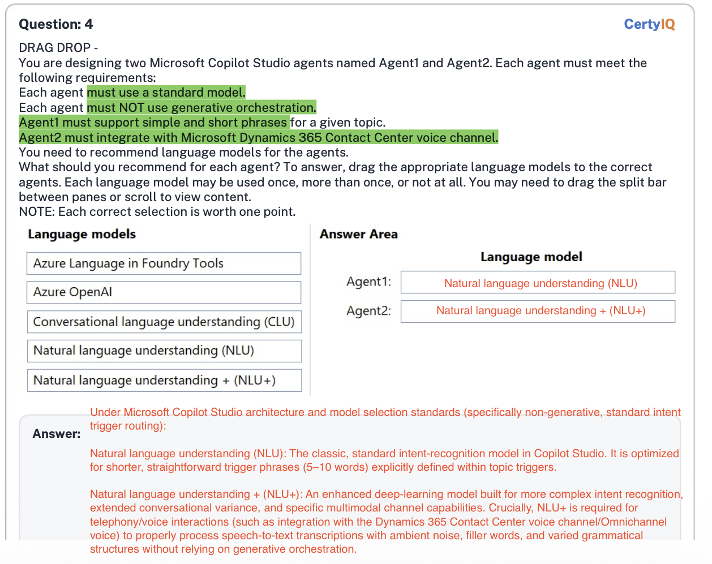

### 1. Extracted Question Summary

* **Scenario:** You are designing two Microsoft Copilot Studio agents named **Agent1** and **Agent2** with the following requirements:
* Each agent must use a standard model.


* Each agent must NOT use generative orchestration.


* **Agent1** must support simple and short phrases for a given topic.


* **Agent2** must integrate with Microsoft Dynamics 365 Contact Center voice channel.


* **Task:** Drag the appropriate language model to each agent from the available list:
* *Azure Language in Foundry Tools*


* *Azure OpenAI*


* *Conversational language understanding (CLU)*


* *Natural language understanding (NLU)*


* *Natural language understanding + (NLU+)*


---

### 2. Correct Answer

* **Agent1:** **Natural language understanding (NLU)**
* **Agent2:** **Natural language understanding + (NLU+)**

---

### 3. Verification of Visible Selection / Community Key

* No selection or community answer is filled in the screenshot's Answer box (it is left blank under "Answer:").

---

### 4. Official Microsoft Justification

* Under Microsoft Copilot Studio architecture and model selection standards (specifically non-generative, standard intent trigger routing):
* **Natural language understanding (NLU):** The classic, standard intent-recognition model in Copilot Studio. It is optimized for shorter, straightforward trigger phrases (5–10 words) explicitly defined within topic triggers.
* **Natural language understanding + (NLU+):** An enhanced deep-learning model built for more complex intent recognition, extended conversational variance, and specific multimodal channel capabilities. Crucially, **NLU+** is required for telephony/voice interactions (such as integration with the Dynamics 365 Contact Center voice channel/Omnichannel voice) to properly process speech-to-text transcriptions with ambient noise, filler words, and varied grammatical structures without relying on generative orchestration.


---

### 5. Distractor Analysis (Why Others Are Wrong)

* **Conversational language understanding (CLU):** Requires external configuration in Azure AI Language and custom connection mapping rather than functioning as the built-in standard model natively selected for basic trigger matching without external deployment overhead.
* **Azure OpenAI:** Violates the constraint that agents must *not* use generative orchestration and must use a standard model.
* **Azure Language in Foundry Tools:** An invalid/distractor term mixing Azure AI Foundry tool concepts, not a selectable native language model option in Copilot Studio settings.

---

### 6. Exam Keyword / Trap Alert

* **Keywords:** *"Simple and short phrases"* triggers standard **NLU**, whereas *"Voice channel"* / *"Dynamics 365 Contact Center"* triggers **NLU+** (which handles conversational speech recognition and longer, acoustic transcription variances).


### Architecture & Prerequisites Overview

Before configuring these two agents, note the governance and architectural boundaries required by Microsoft Copilot Studio:

* **Orchestration Requirement:** Both scenarios dictate disabling **Generative Orchestration** and using **Classic Orchestration** (the deterministic rule/topic-based trigger engine).
* **Licensing Constraint for NLU+:** **NLU+** is an enterprise-grade model built specifically for high-accuracy intent recognition and multimodal speech processing. It is available when managing voice/chat channels backed by a **Dynamics 365 Contact Center** license, and processing occurs natively within Dynamics 365 Contact Center runtime.
* **Agent1 (Standard NLU):** Runs runtime processing entirely within Copilot Studio, optimized for simple 5–10 word deterministic trigger phrases without model training latency.

---

### Step-by-Step Configuration: Agent1 (Standard NLU)

1. **Disable Generative Orchestration:**
* Sign in to **[Microsoft Copilot Studio](https://copilotstudio.microsoft.com)** and open **Agent1**.
* In the top-right corner, select the **Settings (gear icon)**.
* Navigate to **Generative AI** > under **How should your agent decide how to respond?**, select **Classic** (or set **Generative (preview) / Orchestration** to **Off / No**).


2. **Verify Language Understanding Engine:**
* In the left-hand navigation pane of **Settings**, select **Language understanding**.
* Confirm that the default option—**Natural language understanding (NLU)** (Standard Copilot Studio NLU)—is selected.
* Select **Save**.


3. **Configure Trigger Phrases (Simple/Short Phrases):**
* Go to the **Topics** tab.
* Create or open a custom topic.
* On the **Trigger** node, enter 5 to 10 concise, distinct trigger phrases (e.g., `check balance`, `order status`, `store hours`).
* Select **Save topic**. No offline training step is required; standard NLU evaluates these dynamically at runtime.


---

### Step-by-Step Configuration: Agent2 (NLU+ with Dynamics 365 Contact Center Voice)

#### 1. Configure Orchestration & Language Model in Copilot Studio

1. Open **Agent2** in Copilot Studio.
2. Select **Settings** > **Generative AI**.
3. Set **Orchestration** to **Classic** (disable generative orchestration).
4. Switch to **Settings** > **Language understanding**.
5. Under the model options, select **NLU+** (*More prework, enhanced precision*).
6. *(Optional)* Set the **NLU intent confidence score** threshold (default is `0.3`) to balance acoustic variance and topic switching precision.
7. Select **Save**.

#### 2. Author Training Data & Train the Model

1. In the **Topics** panel, open the custom business topics.
2. Supply expanded utterance datasets and carrier phrases representing natural spoken dialogue (e.g., filler words, longer acoustic sentences).
3. Annotate topic triggers and entities using the formal grammar syntax (e.g., `{Topic.Variable_Name/Entity_item_or_synonym}`).
4. Select **Train NLU+ model** from the **Topics** or **Entities** page and wait for the model compilation status to show completed.
5. Select **Publish** to deploy the trained model.

#### 3. Integrate with Dynamics 365 Contact Center Voice Channel

1. In Copilot Studio, select **Channels** from the left pane and choose **Omnichannel / Dynamics 365 Contact Center**.
2. Select **Connect** to register the agent application into the Dynamics 365 Contact Center environment.
3. Open the **Dynamics 365 Contact Center Admin Center** (or Omnichannel admin center).
4. Navigate to **Customer support** > **Workstreams**.
5. Select or create a **Voice workstream** (configured with Azure Communication Services telephony/phone numbers).
6. Under the workstream's **Bot** configuration, select **Add Bot**.
7. Choose **Agent2** from the list of published Copilot Studio bots and bind it to the voice routing queue.


---

<br>

## Q5

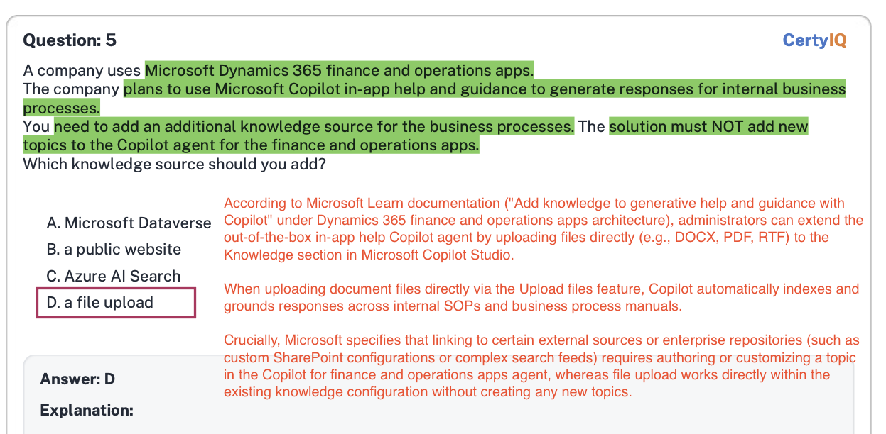

### 1. Extracted Question Summary

* **Scenario:** A company uses Microsoft Dynamics 365 finance and operations apps. The company plans to use Microsoft Copilot in-app help and guidance to generate responses for internal business processes.


* **Requirement:** You need to add an additional knowledge source for the business processes. The solution must **NOT** add new topics to the Copilot agent for the finance and operations apps.


* **Question:** Which knowledge source should you add?


* **Options:**
* **A.** Microsoft Dataverse


* **B.** a public website


* **C.** Azure AI Search


* **D.** a file upload


---

### 2. Correct Answer

**D: a file upload**

---

### 3. Verification of Visible Selection / Community Key

* The answer marked in the screenshot (**Answer: D**) is **Correct**, as uploading individual document files directly into the Copilot agent in Copilot Studio extends generative in-app help and guidance without requiring the creation of custom conversational boosting topics or external search integrations.


---

### 4. Official Microsoft Justification

* According to Microsoft Learn documentation (*"Add knowledge to generative help and guidance with Copilot"* under Dynamics 365 finance and operations apps architecture), administrators can extend the out-of-the-box in-app help Copilot agent by uploading files directly (e.g., DOCX, PDF, RTF) to the **Knowledge** section in Microsoft Copilot Studio.
* When uploading document files directly via the **Upload files** feature, Copilot automatically indexes and grounds responses across internal SOPs and business process manuals.
* Crucially, Microsoft specifies that linking to certain external sources or enterprise repositories (such as custom SharePoint configurations or complex search feeds) requires authoring or customizing a topic in the *Copilot for finance and operations apps* agent, whereas **file upload** works directly within the existing knowledge configuration without creating any new topics.

---

### 5. Distractor Analysis (Why Others Are Wrong)

* **A. Microsoft Dataverse:** Used primarily for structured operational data, tables, and CRM records, not as a direct unmanaged document knowledge source for extending standard F&O in-app generative process help without building dedicated actions or topics.
* **B. a public website:** Intended for indexing publicly accessible internet documentation, which is unsuitable for private, proprietary *internal business processes* and security compliance policies.
* **C. Azure AI Search:** An enterprise retrieval-augmented generation (RAG) platform that requires configuring an external index and connecting it via custom topics/actions or generative plugin connections, violating the constraint to avoid adding new topics.

---

### 6. Exam Keyword / Trap Alert

* **Keywords:** *"Dynamics 365 finance and operations"*, *"Copilot in-app help and guidance"*, and *"must NOT add new topics."*


* **Trap:** Candidates often default to *Azure AI Search* assuming enterprise scalability, but for the specific prebuilt *Copilot in-app help and guidance* agent in F&O, direct **file upload** is the native, zero-topic mechanism explicitly documented by Microsoft to add proprietary process manuals.


To configure and upload custom business process documentation for **Copilot in-app help and guidance in Dynamics 365 Finance and Operations apps**, the configuration is managed inside **Microsoft Copilot Studio** under the pre-deployed system agent.

---

### Step-by-Step Configuration Guide

#### 1. Navigate to the Power Platform Environment

1. Sign in to **[Microsoft Copilot Studio](https://copilotstudio.microsoft.com)** (or go via **Power Apps** > **Chatbots**).
2. In the top-right environment selector, ensure you switch to the **Dataverse environment linked to your Dynamics 365 finance and operations apps** deployment.

#### 2. Open the Prebuilt F&O Copilot Agent

1. From the left navigation pane, select **Copilots** (or **Agents**).
2. Locate and open the pre-installed system copilot named:
> **`Copilot for finance and operations apps`**


#### 3. Upload the Knowledge Files

1. Open the **Knowledge** tab from the top navigation bar (or the **Knowledge** section on the Overview page).
2. Select **+ Add knowledge**.
3. Choose the **Upload files** option.
4. Drag and drop or browse to select your business process manuals, standard operating procedures (SOPs), or internal guidance documents from your local machine:
* **Supported File Types:** `.docx`, `.pdf`, `.txt`, `.rtf`, `.pptx`, `.html`.
* **File Limits:** Up to 512 MB per file (or tenant allocation limits) with direct indexing.


5. Confirm the upload.

#### 4. Monitor Ingestion & Verification

1. The uploaded documents will appear in the Knowledge grid.
2. Monitor the **Status** column:
* It will display *Processing* while Copilot extracts and generates vector embeddings.
* Wait until the status changes to **Ready** (usually takes a few minutes depending on document size).


3. On the top toolbar, select **Test** to open the test canvas.
4. Enter typical business process queries (e.g., *"How do I submit an intercompany expense report according to our internal policy?"*) and verify that Copilot grounds its answers using your uploaded document with proper citation markers.

#### 5. Publish to Finance & Operations Apps

1. On the top toolbar, click **Publish**.
2. Once publication succeeds, the new knowledge is pushed to the in-app Copilot sidecar across all Dynamics 365 Finance and Operations client sessions.
3. *(Tip)* Users currently working in F&O should refresh their browser or reopen the Copilot sidecar to pick up the newly published index.

<br>

---

## Q6

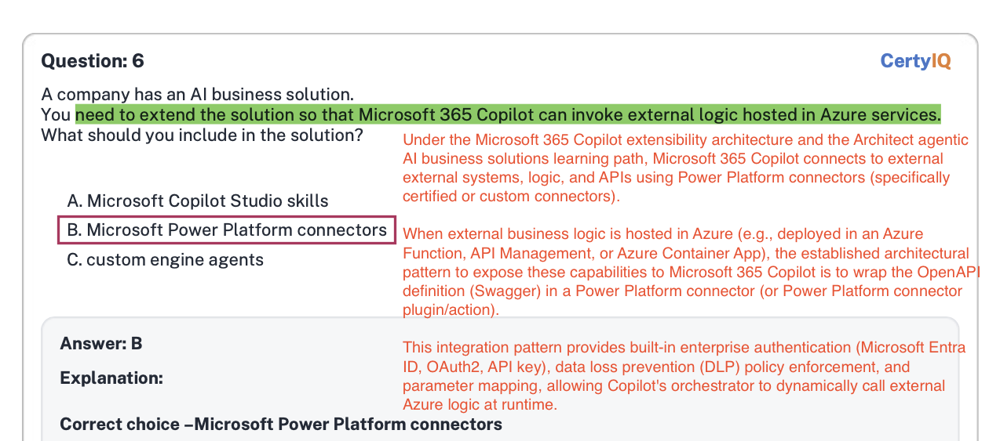

### Answer

### 1. Extracted Question Summary

* **Scenario:** A company has an AI business solution. You need to extend the solution so that Microsoft 365 Copilot can invoke external logic hosted in Azure services.


* **Question:** What should you include in the solution?


* **Options:**
* **A.** Microsoft Copilot Studio skills


* **B.** Microsoft Power Platform connectors


* **C.** custom engine agents


---

### 2. Correct Answer

**B: Microsoft Power Platform connectors**

---

### 3. Verification of Visible Selection / Community Key

* The visible selection marked in the screenshot (**Answer: B**) is **Correct**. Power Platform connectors (standard or custom connectors) serve as the fundamental integration layer to wrap RESTful Azure services (such as Azure Functions, Azure App Services, or Logic Apps) so that Microsoft 365 Copilot can discover and invoke them as runtime actions.


---

### 4. Official Microsoft Justification

* Under the Microsoft 365 Copilot extensibility architecture and the *Architect agentic AI business solutions* learning path, Microsoft 365 Copilot connects to external external systems, logic, and APIs using **Power Platform connectors** (specifically certified or custom connectors).
* When external business logic is hosted in Azure (e.g., deployed in an Azure Function, API Management, or Azure Container App), the established architectural pattern to expose these capabilities to Microsoft 365 Copilot is to wrap the OpenAPI definition (Swagger) in a **Power Platform connector** (or Power Platform connector plugin/action).
* This integration pattern provides built-in enterprise authentication (Microsoft Entra ID, OAuth2, API key), data loss prevention (DLP) policy enforcement, and parameter mapping, allowing Copilot's orchestrator to dynamically call external Azure logic at runtime.

---

### 5. Distractor Analysis (Why Others Are Wrong)

* **A. Microsoft Copilot Studio skills:** In Copilot Studio architecture, "skills" refer to Bot Framework Skills or self-contained modular bot logic designed to extend bots. They are not the native integration mechanism used to invoke external Azure REST APIs or cloud services directly from Microsoft 365 Copilot.
* **C. custom engine agents:** Custom engine agents (built with Teams AI library, Azure OpenAI Assistants, or custom LLM orchestrations) are full, standalone conversational agents that replace Copilot's orchestration model. They are not used simply to extend Microsoft 365 Copilot to invoke external Azure logic.

---

### 6. Exam Keyword / Trap Alert

* **Keywords:** *"Extend Microsoft 365 Copilot"* paired with *"invoke external logic hosted in Azure services."*


* **Trap:** Candidates often confuse *Copilot Studio skills* with *Power Platform connectors*. Remember: **Power Platform connectors** wrap external APIs and Azure services, whereas *skills* in Bot Framework terminology extend conversational dialogs between bots.

<br>

---

## Q7

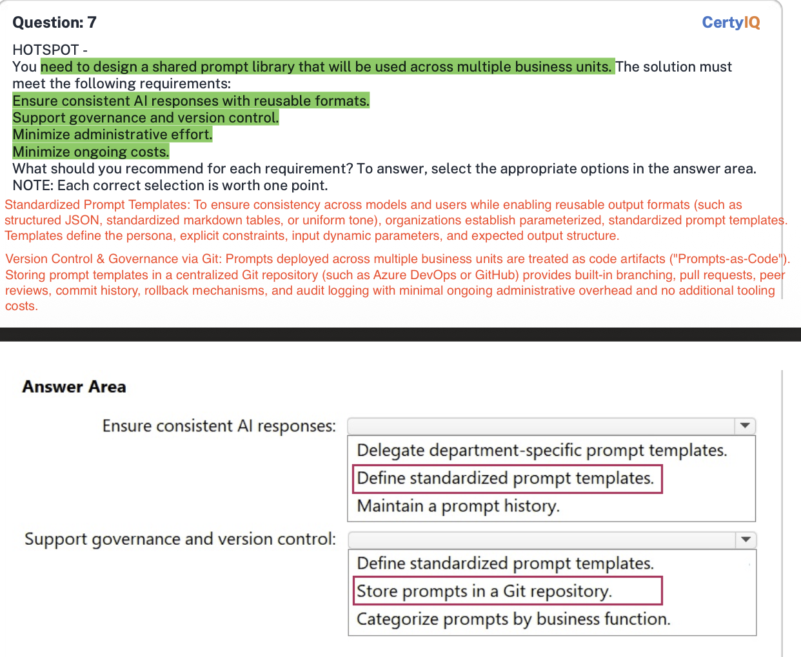

### Answer

### 1. Extracted Question Summary

* **Scenario:** You need to design a shared prompt library that will be used across multiple business units. The solution must meet the following requirements:


* Ensure consistent AI responses with reusable formats.


* Support governance and version control.


* Minimize administrative effort.


* Minimize ongoing costs.


* **Question:** What should you recommend for each requirement?


* **Answer Area (Dropdown 1 - Ensure consistent AI responses):**
* *Delegate department-specific prompt templates.*


* *Define standardized prompt templates.*


* *Maintain a prompt history.*


* **Answer Area (Dropdown 2 - Support governance and version control):**
* *Define standardized prompt templates.*


* *Store prompts in a Git repository.*


* *Categorize prompts by business function.*


---

### 2. Correct Answer

* **Ensure consistent AI responses:** **Define standardized prompt templates.**
* **Support governance and version control:** **Store prompts in a Git repository.**

---

### 3. Verification of Visible Selection / Community Key

* *(Section skipped as no selection or community answer is highlighted or displayed in the screenshot).*

---

### 4. Official Microsoft Justification

* According to Microsoft Learn architectural guidelines for enterprise prompt engineering and generative AI governance (under the *Architect agentic AI business solutions* path):
* **Standardized Prompt Templates:** To ensure consistency across models and users while enabling reusable output formats (such as structured JSON, standardized markdown tables, or uniform tone), organizations establish parameterized, standardized prompt templates. Templates define the persona, explicit constraints, input dynamic parameters, and expected output structure.
* **Version Control & Governance via Git:** Prompts deployed across multiple business units are treated as code artifacts ("Prompts-as-Code"). Storing prompt templates in a centralized Git repository (such as Azure DevOps or GitHub) provides built-in branching, pull requests, peer reviews, commit history, rollback mechanisms, and audit logging with minimal ongoing administrative overhead and no additional tooling costs.


---

### 5. Distractor Analysis (Why Others Are Wrong)

#### Dropdown 1: Ensure consistent AI responses

* **Delegate department-specific prompt templates:** Decentralizing and delegating prompt creation across departments leads to prompt drift, conflicting style guidelines, and inconsistent AI behavior across the enterprise.
* **Maintain a prompt history:** Logging conversational chat history tracks what was previously executed, but it does not proactively enforce structural uniformity or reusable formats for future generative outputs.

#### Dropdown 2: Support governance and version control

* **Define standardized prompt templates:** Standardized templates define the structure of a prompt, but they do not provide a mechanism for tracking revisions, author attribution, change approvals, or rollback capabilities (version control).
* **Categorize prompts by business function:** Categorization organizes a catalog or library for discovery and searchability, but it offers no versioning, auditing, or release control mechanisms.

---

### 6. Exam Keyword / Trap Alert

* **Keywords:** *"Consistent AI responses with reusable formats"* pairs directly with **standardized prompt templates**, while *"governance and version control"* at minimal cost points directly to **Git repository** (leveraging standard Prompts-as-Code practices).


To implement **standardized prompt templates** and **governance via a Git repository** across multiple business units in an enterprise Microsoft Power Platform / Copilot Studio ecosystem, follow this two-part implementation procedure:

---

### Part 1: Define Standardized Prompt Templates (Power Platform AI Hub / Copilot Studio)

Standardized prompt templates use dynamic input parameters, explicit constraints, and deterministic formatting to ensure uniform model outputs across departments.

1. **Access the Prompt Builder:**
* Sign in to **[Power Apps](https://make.powerapps.com)** (or Copilot Studio).
* In the left navigation pane, expand **AI hub** (or select **Discover**) > choose **Prompts**.
* Select **Create text with GPT using a prompt** (or **+ Create custom prompt**).


2. **Structure the Prompt Template:**
* Give the prompt a standardized enterprise naming convention (e.g., `Enterprise_LeadSummary_Template_v1`).
* Define the persona, task context, and structural output format in the prompt editor:
```text
You are an enterprise business assistant. Summarize the following customer record.

Output Structure:
- Executive Overview (Max 2 sentences)
- Key Risk Factors (Bulleted list)
- Recommended Next Action

Input Data: [InputRecord]

```


* Use the **+ Add input** button to insert parameterized dynamic tokens (e.g., `{InputRecord}`).


3. **Test and Share Across Business Units:**
* Test the prompt with sample values using the test side-pane.
* Select **Save prompt**.
* To make it accessible as a shared enterprise asset, select **Share**, add the relevant Microsoft Entra security groups representing your target business units, and grant **User** permissions.


---

### Part 2: Store and Govern Prompts in a Git Repository (ALM & Source Control)

Prompts created in the Power Platform AI Hub are stored as native Dataverse solution components (`Prompt` / `AI Builder Model` schema types). You can version-control, audit, and govern them using a Git repository (Azure Repos or GitHub) using either the **native Dataverse Git integration** or the **Power Platform CLI (`pac`)**.

#### Method A: Built-in Dataverse Git Integration (No-Code ALM)

1. **Add the Prompt to an Unmanaged Solution:**
* Navigate to **Solutions** > open your shared enterprise solution (e.g., `EnterpriseSharedPrompts`).
* Select **Add existing** > **AI Builder** > **Prompt** > select your standardized prompt template.


2. **Connect Solution to Git:**
* In the solution command bar, select **Source control** > **Connect to Git** (Azure DevOps / GitHub).
* Specify your Git repository URL, project, and target working branch (e.g., `main` or `feature/prompts`).


3. **Commit & Branch:**
* Select **Commit changes** whenever a prompt is updated. Enter a descriptive commit message detailing the template revision.
* Use Git Pull Request (PR) policies in Azure DevOps/GitHub to mandate peer reviews and approval gates before merging prompt modifications into `main`.


#### Method B: Developer / CI-CD Pipeline (Power Platform CLI)

If you manage your prompt library through enterprise automated CI/CD pipelines:

1. **Export the Solution Containing Prompts:**
```bash
pac solution export --path ./EnterpriseSharedPrompts.zip --name EnterpriseSharedPrompts --managed false

```


2. **Unpack Solution into Raw XML / YAML Files:**
```bash
pac solution unpack --zipfile ./EnterpriseSharedPrompts.zip --folder ./src/EnterpriseSharedPrompts

```


*The prompt definition, system instructions, and input parameters will unpack into clean, human-readable declarative files.*
3. **Commit and Push to Git:**
```bash
git add ./src/EnterpriseSharedPrompts
git commit -m "feat(prompts): add standardized lead summary template v1"
git push origin main

```


4. **Enforce Governance:**
* Enable branch protection rules on your repository to restrict direct writes to `main`.
* Run automated pipeline checks (e.g., scanning for sensitive keywords, token boundaries, or prompt injection syntax) on every pull request.


<br>

---

## Q8

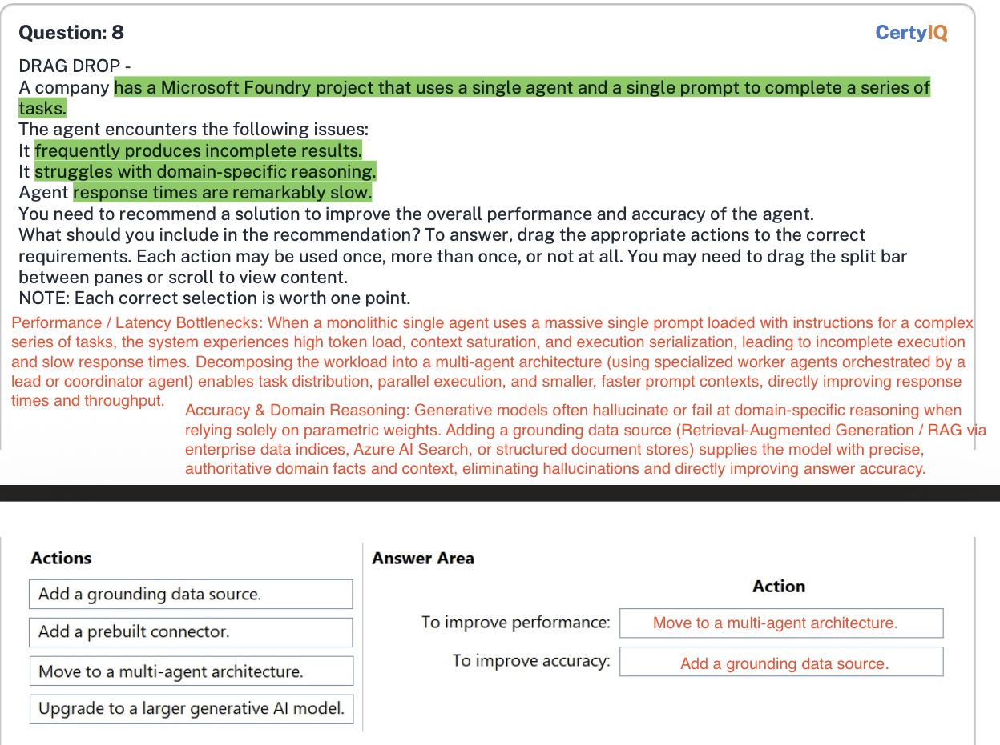

### Answer

### 1. Extracted Question Summary

* **Scenario:** A company has a Microsoft Foundry project that uses a single agent and a single prompt to complete a series of tasks. The agent encounters the following issues:


* It frequently produces incomplete results.


* It struggles with domain-specific reasoning.


* Agent response times are remarkably slow.


* **Requirement:** Recommend a solution to improve the overall performance and accuracy of the agent.


* **Actions Available:**
* *Add a grounding data source.*


* *Add a prebuilt connector.*


* *Move to a multi-agent architecture.*


* *Upgrade to a larger generative AI model.*


* **Answer Area:**
* **To improve performance:** [Action box]


* **To improve accuracy:** [Action box]


---

### 2. Correct Answer

* **To improve performance:** **Move to a multi-agent architecture.**
* **To improve accuracy:** **Add a grounding data source.**

---

### 3. Verification of Visible Selection / Community Key

* *(Section skipped as no selection or community answer is marked or visible in the screenshot).*

---

### 4. Official Microsoft Justification

* Under the Microsoft Learn module **"Architect agentic AI business solutions"** (specifically the patterns for scaling multi-agent systems and grounding LLMs):
* **Performance / Latency Bottlenecks:** When a monolithic single agent uses a massive single prompt loaded with instructions for a complex series of tasks, the system experiences high token load, context saturation, and execution serialization, leading to incomplete execution and slow response times. Decomposing the workload into a **multi-agent architecture** (using specialized worker agents orchestrated by a lead or coordinator agent) enables task distribution, parallel execution, and smaller, faster prompt contexts, directly improving response times and throughput.


* **Accuracy & Domain Reasoning:** Generative models often hallucinate or fail at domain-specific reasoning when relying solely on parametric weights. **Adding a grounding data source** (Retrieval-Augmented Generation / RAG via enterprise data indices, Azure AI Search, or structured document stores) supplies the model with precise, authoritative domain facts and context, eliminating hallucinations and directly improving answer accuracy.


---

### 5. Distractor Analysis (Why Others Are Wrong)

* **Upgrade to a larger generative AI model:** Upgrading to a larger model (e.g., from GPT-4o-mini to a heavy flagship model) increases reasoning depth but *worsens* response latency (slower inference time), directly conflicting with the requirement to fix slow response times.


* **Add a prebuilt connector:** Connectors provide read/write API actions to external systems (such as CRM or ERP), but they do not inherently provide semantic grounding to resolve general domain-specific reasoning deficiencies or decompose complex sequential workflows.

---

### 6. Exam Keyword / Trap Alert

* **Keywords:** *"Single agent and a single prompt to complete a series of tasks"* + *"slow response times"* flags **Move to a multi-agent architecture** (task decomposition pattern).


* **Trap:** Do not fall into the trap of selecting *"Upgrade to a larger generative AI model"* to solve reasoning or accuracy issues when the scenario explicitly notes that *response times are remarkably slow*. Larger models inherently increase token generation latency.


To resolve both the performance bottleneck (slow response times, incomplete results) and domain accuracy issues in Microsoft Foundry (formerly Azure AI Foundry / Azure AI Studio), you follow a two-part modernization pattern: **adding a grounding data source (RAG)** and **decomposing the monolithic agent into a multi-agent orchestration**.

---

### Part 1: Add a Grounding Data Source (Fix Domain Reasoning & Accuracy)

Grounding connects the agent directly to enterprise documentation or knowledge stores so the model does not rely on parametric hallucination.

#### 1. In Microsoft Foundry Portal (Declarative / Low-Code)

1. **Navigate to Foundry Portal:**
* Go to [ai.azure.com](https://ai.azure.com) and open your **Foundry Project**.


2. **Connect Knowledge Layer:**
* In the left navigation pane under **Components / Tools**, select **Data + Indexes** (or use **Foundry IQ** / **Data sources**).
* Select **+ New index** or **Add connection** to link your domain repository:
* **Azure AI Search:** Best for enterprise hybrid search with semantic reranking.
* **OneLake / Microsoft Fabric / SharePoint / Azure Blob Storage:** Select the target container hosting your domain SOPs, manuals, or database exports.


3. **Attach to the Agent:**
* Under **Build**, select **Agents** (Foundry Agent Service) and open your agent.
* Go to the **Knowledge** (or **Tools**) section and click **+ Add knowledge** > **Azure AI Search** (or **File search** / **Foundry IQ**).
* Select the target index and configure the retrieval parameters (semantic search, top-k chunks, vector embedding model).


4. **Test Grounding:**
* In the built-in **Playground / Test Canvas**, query a domain-specific scenario. Verify that the agent generates answers with explicit citations referencing the uploaded index chunks.


#### 2. Via Code / SDK (Python)

If using the Azure AI Foundry SDK (`azure-ai-projects`):

```python
from azure.ai.projects import AIProjectClient
from azure.ai.projects.models import AzureAISearchTool
from azure.identity import DefaultAzureCredential

client = AIProjectClient.from_connection_string(
    credential=DefaultAzureCredential(),
    conn_str="<your_foundry_project_connection_string>"
)

# Connect Azure AI Search as a grounding tool
search_tool = AzureAISearchTool(
    index_connection_id="<ai_search_connection_id>",
    index_name="domain-knowledge-index"
)

# Create/Update the specialized agent with grounding
domain_specialist = client.agents.create_agent(
    model="gpt-4o-mini",
    name="DomainSpecialistAgent",
    instructions="You are an expert grounded in enterprise domain knowledge. Use the search tool to ground answers.",
    tools=search_tool.definitions
)

```

---

### Part 2: Decompose into a Multi-Agent Architecture (Fix Latency & Task Completion)

Monolithic agents fail on multi-step workflows because large system prompts overload the model's context window and serialize tasks. Decomposing follows the **Orchestrator-Worker (Connected Agents)** pattern.

```
                  ┌───────────────────────────────┐
                  │      Orchestrator Agent       │
                  │ (Goal decomposition & routing)│
                  └───────────────┬───────────────┘
                                  │
         ┌────────────────────────┼────────────────────────┐
         ▼                        ▼                        ▼
┌──────────────────┐    ┌──────────────────┐    ┌──────────────────┐
│  Domain Agent    │    │  Analysis Agent  │    │   Action Agent   │
│ (Grounded RAG)   │    │(Code Interpreter)│    │(OpenAPI/Connect) │
└──────────────────┘    └──────────────────┘    └──────────────────┘

```

#### Step 1: Segregate Responsibilities into Worker Agents

In your Foundry project, create individual, purpose-built worker agents with lightweight system prompts and focused toolsets:

* **Retrieval / Domain Agent:** Contains the grounding data source configured in Part 1. Responsible *only* for querying the index and summarizing domain facts.
* **Computation / Analysis Agent:** Equipped with the built-in *Code Interpreter* tool to execute calculations, tabular sorting, or formatting.
* **Action Agent:** Equipped with OpenAPI plugins, Logic Apps, or Power Platform connectors to update external systems of record.

#### Step 2: Configure the Lead Orchestrator Agent

Create an **Orchestrator Agent** whose sole role is task routing, execution planning, and final aggregation:

1. In Foundry, create a new agent (e.g., `SupervisorAgent`).
2. Give it a concise routing prompt:
```text
You are the workflow orchestrator. Break down the user's multi-step request:
1. Delegate factual/domain queries to the DomainSpecialistAgent.
2. Delegate data manipulation or calculations to the AnalysisAgent.
3. Consolidate results into a final executive summary.
Do not attempt domain extraction or math directly.

```


#### Step 3: Connect Agents via Foundry Agent Service / Semantic Kernel

In Microsoft Foundry, worker agents can be registered directly as callable sub-agent tools (Agent-to-Agent / A2A pattern) or coordinated via an agent orchestration framework:

* **Using Semantic Kernel Agent Groups (`AgentGroupChat`):**
```csharp
// Register agents retrieved from Azure AI Foundry
var domainAgent = await client.GetAgentAsync("asst_domain_specialist_id");
var analysisAgent = await client.GetAgentAsync("asst_analysis_id");
var orchestratorAgent = await client.GetAgentAsync("asst_orchestrator_id");

// Create orchestrated group chat with turn-taking logic
AgentGroupChat chat = new(domainAgent, analysisAgent, orchestratorAgent)
{
    ExecutionSettings = new()
    {
        SelectionStrategy = new KernelFunctionSelectionStrategy(selectionFunction, kernel),
        TerminationStrategy = new ApprovalTerminationStrategy() { MaximumIterations = 5 }
    }
};

```


* **Benefits Achieved:**
* **Latency:** Specialized workers use compact system prompts and faster, smaller models (e.g., `gpt-4o-mini`), cutting inference time dramatically.
* **Task Completion:** The orchestrator tracks state transitions step-by-step rather than dropping instructions mid-generation.
* **Accuracy:** The domain worker queries the isolated search index, ensuring factually verifiable outputs with zero parameter drift.


<br>

---

## Q9

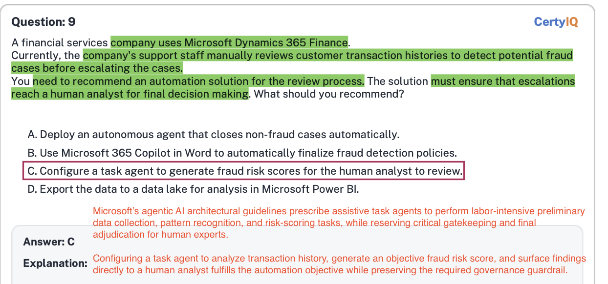

### Answer

### 1. Extracted Question Summary

* **Scenario:** A financial services company uses Microsoft Dynamics 365 Finance where support staff currently manually review customer transaction histories to detect potential fraud cases before escalating them.


* **Requirement:** Recommend an automation solution for the review process that **must ensure escalations reach a human analyst for final decision making**.


* **Options:**
* **A.** Deploy an autonomous agent that closes non-fraud cases automatically.


* **B.** Use Microsoft 365 Copilot in Word to automatically finalize fraud detection policies.


* **C.** Configure a task agent to generate fraud risk scores for the human analyst to review.


* **D.** Export the data to a data lake for analysis in Microsoft Power BI.


---

### 2. Correct Answer

**C: Configure a task agent to generate fraud risk scores for the human analyst to review.**

---

### 3. Verification of Visible Selection / Community Key

* The answer marked in the screenshot (**Answer: C**) is **Correct**, as it properly implements a Human-in-the-Loop (HITL) assistive task agent pattern that automates initial transaction review while routing final decisions to a human analyst.


---

### 4. Official Microsoft Justification

* Under the Microsoft Learn pathway **"Architect agentic AI business solutions"** (specifically the architectural principles of *Human-in-the-Loop (HITL)* and *Agent Autonomy Levels*):
* In high-stakes regulatory and compliance environments like financial fraud detection, full autonomy introduces unacceptable operational risk and liability.
* Microsoft’s agentic AI architectural guidelines prescribe **assistive task agents** to perform labor-intensive preliminary data collection, pattern recognition, and risk-scoring tasks, while reserving critical gatekeeping and final adjudication for human experts.
* Configuring a task agent to analyze transaction history, generate an objective fraud risk score, and surface findings directly to a human analyst fulfills the automation objective while preserving the required governance guardrail.


---

### 5. Distractor Analysis (Why Others Are Wrong)

* **A. Deploy an autonomous agent that closes non-fraud cases automatically:** An autonomous agent making unilateral closure decisions removes human oversight from critical edge cases, creating regulatory non-compliance and increasing the risk of false negatives in fraud detection.
* **B. Use Microsoft 365 Copilot in Word to automatically finalize fraud detection policies:** Microsoft 365 Copilot in Word is a productivity tool for document authoring and policy drafting; it does not evaluate live transactional telemetry or automate case reviews in Dynamics 365 Finance.
* **D. Export the data to a data lake for analysis in Microsoft Power BI:** Power BI provides descriptive analytics, business intelligence dashboards, and reporting; it does not constitute an agentic automation workflow that actively flags and escalates individual transaction cases.

---

### 6. Exam Keyword / Trap Alert

* **Keywords:** *"Automation solution for the review process"* combined with *"must ensure that escalations reach a human analyst for final decision making."*


* **Trap:** Beware of options introducing *autonomous agents* or fully automated closures in scenarios mentioning compliance, fraud, or high-risk outcomes. On the AB-100 exam, requirements specifying human oversight always require an **assistive / task agent** with **Human-in-the-Loop (HITL)** architecture.


<br>

---

## Q10

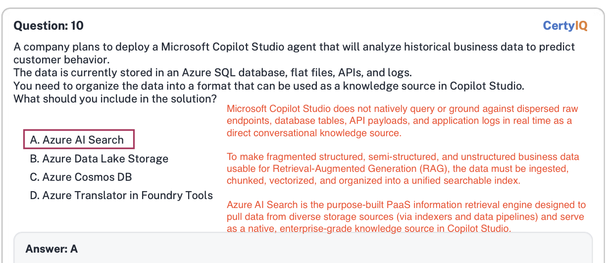

### Answer

### 1. Extracted Question Summary

* **Scenario:** A company plans to deploy a Microsoft Copilot Studio agent that will analyze historical business data to predict customer behavior.


* **Current State:** The data is currently stored across disparate, heterogeneous sources: an Azure SQL database, flat files, APIs, and logs.


* **Requirement:** You need to organize the data into a format that can be used as a knowledge source in Copilot Studio.


* **Question:** What should you include in the solution?


* **Options:**
* **A.** Azure AI Search


* **B.** Azure Data Lake Storage


* **C.** Azure Cosmos DB


* **D.** Azure Translator in Foundry Tools


---

### 2. Correct Answer

**A: Azure AI Search**

---

### 3. Verification of Visible Selection / Community Key

* The answer marked in the screenshot (**Answer: A**) is **Correct**, as Azure AI Search provides the native ingestion, chunking, vectorization, and search indexing required to aggregate heterogeneous data into a queryable knowledge source for Copilot Studio.


---

### 4. Official Microsoft Justification

* According to Microsoft Learn architectural guidance under the **"Architect agentic AI business solutions"** path (specifically *Configure knowledge sources for agents in Copilot Studio* and *Enterprise RAG Architecture*):
* Microsoft Copilot Studio does not natively query or ground against dispersed raw endpoints, database tables, API payloads, and application logs in real time as a direct conversational knowledge source.
* To make fragmented structured, semi-structured, and unstructured business data usable for Retrieval-Augmented Generation (RAG), the data must be ingested, chunked, vectorized, and organized into a unified searchable index.
* **Azure AI Search** is the purpose-built PaaS information retrieval engine designed to pull data from diverse storage sources (via indexers and data pipelines) and serve as a native, enterprise-grade knowledge source in Copilot Studio.


---

### 5. Distractor Analysis (Why Others Are Wrong)

* **B. Azure Data Lake Storage:** While excellent for large-scale raw, silver, or gold data lake ingestion, Data Lake Storage (ADLS Gen2) by itself is merely passive object storage; it lacks built-in vectorization, semantic ranking, and native search indexing mechanisms required to act as a direct, ready-to-query Copilot Studio knowledge source.
* **C. Azure Cosmos DB:** A globally distributed NoSQL database designed for operational transactions and low-latency document/key-value lookups; it does not solve the unified multi-source consolidation and enterprise RAG retrieval pipeline needed for logs, files, SQL, and APIs.
* **D. Azure Translator in Foundry Tools:** A prebuilt cognitive service dedicated solely to text translation and localization; it cannot store, index, or organize disparate business datasets into a knowledge repository.

---

### 6. Exam Keyword / Trap Alert

* **Keywords:** *"stored in an Azure SQL database, flat files, APIs, and logs"* + *"organize the data into a format that can be used as a knowledge source in Copilot Studio."*


* **Trap:** Candidates often lean toward *Azure Data Lake Storage* when they see heterogeneous data sources (files, APIs, logs), but storage is not retrieval. In the AB-100 exam, whenever the goal is preparing varied datasets specifically to serve as a **knowledge source in Copilot Studio**, the architectural answer is **Azure AI Search**.


### Architectural Reality: Can RAG Alone Predict Customer Behavior?

**No, a RAG system alone cannot reliably predict customer behavior.**

In an enterprise architecture, RAG (Retrieval-Augmented Generation via Azure AI Search + LLM) is fundamentally an **information retrieval and synthesis pattern**, not a **statistical predictive engine**:

* **What RAG provides:** Semantic search, context retrieval from unstructured/semi-structured historical logs, customer interaction recaps, and qualitative sentiment analysis.
* **Why RAG alone fails for predictive tasks:** Generative LLMs do not run regressions, compute probability distributions across tabular features, or calculate mathematically sound propensity/churn scores over thousands of transactional data points. When forced to "predict" future behavior purely via RAG, LLMs hallucinate patterns or rely on heuristic guesses.

To build a production-grade, enterprise agent for predicting customer behavior, you must combine **RAG** (for historical context and qualitative signals) with **Deterministic Machine Learning & Actions** (for quantitative inference).

---

### Complete Component Architecture

To deliver the full functionality of a customer behavior prediction agent, the end-to-end architecture consists of five core tiers:

```
┌────────────────────────────────────────────────────────────────────────┐
│                   1. Conversational & Agent Tier                       │
│                      (Microsoft Copilot Studio)                        │
│   - Orchestrator (Intent evaluation & execution planning)              │
│   - Generative Prompt Actions (Synthesis & human-readable output)      │
└──────────────────┬─────────────────────────────────┬───────────────────┘
                   │                                 │
                   ▼                                 ▼
┌─────────────────────────────────────┐ ┌────────────────────────────────┐
│  2. Grounding Tier (Qualitative)    │ │  3. Predictive Tier (Quant)    │
│         (Azure AI Search)           │ │  (Azure Machine Learning /     │
│   - Semantic & Hybrid Vector Search │ │   Fabric Synapse / AI Builder) │
│   - Unstructured text, ticket logs, │ │   - Trained ML model endpoint  │
│     CRM notes, feedback surveys     │ │   - Churn / Propensity / CLTV  │
└──────────────────┬──────────────────┘ └────────────────┬───────────────┘
                   │                                     │
                   └──────────────────┬──────────────────┘
                                      ▼
┌────────────────────────────────────────────────────────────────────────┐
│               4. Integration & Tooling Layer (Actions)                 │
│         - Power Platform Custom Connector / Power Automate Flow        │
│         - REST endpoint invocation with Entra ID Authentication        │
└─────────────────────────────────────┬──────────────────────────────────┘
                                      ▼
┌────────────────────────────────────────────────────────────────────────┐
│                    5. Data Engineering & Fabric Layer                  │
│       (Microsoft Fabric OneLake / Azure Data Lake Storage / Synapse)   │
│   - Ingests raw Azure SQL, APIs, event streams, and logs               │
│   - Feature engineering & pipeline orchestration to train models       │
└────────────────────────────────────────────────────────────────────────┘

```

---

### Breakdown of Required Components

#### 1. Predictive Engine (Quantitative Scoring)

* **Role:** Computes actual mathematical likelihoods (e.g., Churn Risk: `87%`, Upsell Propensity: `0.74`, Next Best Action).
* **Technology Options:**
* **Azure Machine Learning (AML) Managed Endpoint:** A trained classification or regression model (e.g., XGBoost, Random Forest, or LightGBM) exposed as a low-latency REST inference API.
* **Microsoft Fabric / Azure Synapse ML:** Batch-scored tables written back to Dataverse or OneLake.
* **AI Builder (Prediction Model):** A low-code binary/numeric prediction model running directly inside Dataverse.


#### 2. Grounding & Search Layer (Qualitative RAG Context)

* **Role:** Extracts the *reasons* behind the behavior and historical narrative from unstructured/semi-structured data.
* **Technology:** **Azure AI Search**
* Indexes customer support notes, interaction transcripts, email communications, and qualitative feedback logs.
* Returns top-$k$ grounded facts to explain *why* the customer is at risk or what past friction points occurred.


#### 3. Integration & Action Tooling (Connecting Agent to ML)

* **Role:** Bridges the conversational agent to the predictive ML endpoint.
* **Technology:**
* **Power Platform Custom Connector / OpenAPI Plugin:** Wraps the Azure ML scoring REST API with Entra ID bearer token authentication.
* **Power Automate Cloud Flow:** Executes orchestration logic if intermediate data lookups or transactional updates in Dataverse/CRM are required before returning the prediction to the agent.


#### 4. Copilot Studio Agent (Orchestration & Explanation)

* **Role:** Serves as the cognitive orchestrator, interface, and explainer.
* **Configuration:**
* **Agent Action (Tool):** Calls the custom connector with the Customer ID to fetch the real-time predictive score.
* **Agent Knowledge:** Queries the Azure AI Search index for relevant qualitative history.
* **Prompt Synthesis:** An instruction prompt combines the quantitative output with the qualitative context to produce an actionable recommendation:
```text
- Predict Score: Churn Risk = 82% (from Azure ML tool)
- Supporting Evidence: Customer logged 4 critical billing tickets in the past 30 days and noted dissatisfaction with latency (from Azure AI Search)
- Recommendation: Route to customer retention manager with an immediate billing credit proposal.

```


#### 5. Data Pipeline & Unified Storage (Feature Store)

* **Role:** Consolidates the disparate data mentioned in the scenario (Azure SQL, flat files, APIs, and logs).
* **Technology:** **Microsoft Fabric OneLake / Azure Data Factory**
* Cleanses and feeds feature data to the ML model for training and vectorizes text documents into Azure AI Search for retrieval.


<br>

---

## Q11

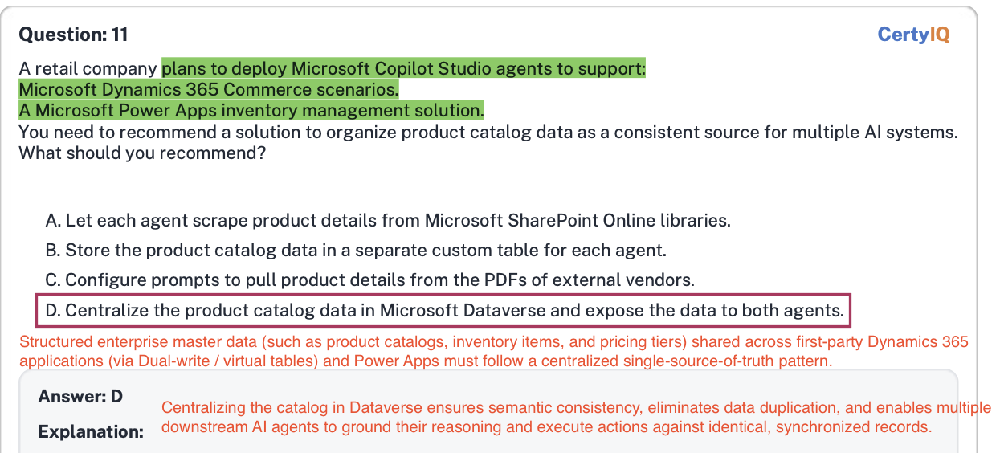

### Answer

### 1. Extracted Question Summary

* **Scenario:** A retail company plans to deploy Microsoft Copilot Studio agents to support two workloads:


* Microsoft Dynamics 365 Commerce scenarios.


* A Microsoft Power Apps inventory management solution.


* **Requirement:** Recommend a solution to organize product catalog data as a consistent source for multiple AI systems.


* **Options:**
* **A.** Let each agent scrape product details from Microsoft SharePoint Online libraries.


* **B.** Store the product catalog data in a separate custom table for each agent.


* **C.** Configure prompts to pull product details from the PDFs of external vendors.


* **D.** Centralize the product catalog data in Microsoft Dataverse and expose the data to both agents.


---

### 2. Correct Answer

**D: Centralize the product catalog data in Microsoft Dataverse and expose the data to both agents.**

---

### 3. Verification of Visible Selection / Community Key

* The answer selected and boxed in the screenshot (**Answer: D**) is **Correct**, as Microsoft Dataverse acts as the foundational enterprise data layer across Dynamics 365 and Power Platform solutions, providing a single source of truth for both Copilot Studio agents.


---

### 4. Official Microsoft Justification

* According to Microsoft Learn architectural guidelines under the **"Architect agentic AI business solutions"** path (specifically data architecture and grounding patterns for multi-system agents):
* Structured enterprise master data (such as product catalogs, inventory items, and pricing tiers) shared across first-party Dynamics 365 applications (via Dual-write / virtual tables) and Power Apps must follow a **centralized single-source-of-truth** pattern.
* **Microsoft Dataverse** provides native relational schema modeling, standard Common Data Model (CDM) entity definitions (such as `Product`), role-based access control (RBAC), and out-of-the-box knowledge and action integration for Microsoft Copilot Studio agents.
* Centralizing the catalog in Dataverse ensures semantic consistency, eliminates data duplication, and enables multiple downstream AI agents to ground their reasoning and execute actions against identical, synchronized records.


---

### 5. Distractor Analysis (Why Others Are Wrong)

* **A. Let each agent scrape product details from Microsoft SharePoint Online libraries:** SharePoint document libraries are designed for unstructured or semi-structured documents, not transactional, relational master catalog data; web/document scraping introduces data drift, stale information, and poor query performance.
* **B. Store the product catalog data in a separate custom table for each agent:** Creates siloed data duplication, high synchronization overhead, and inevitable data inconsistency across the agents, directly violating the requirement for a *consistent source*.
* **C. Configure prompts to pull product details from the PDFs of external vendors:** Prompts reading unstructured PDFs cannot reliably maintain transactional integrity, real-time inventory levels, or consistent product attributes across multiple operational systems.

---

### 6. Exam Keyword / Trap Alert

* **Keywords:** *"Consistent source for multiple AI systems"* spanning *"Dynamics 365"* and *"Power Apps."*


* **Trap:** When a question requires standardizing structured enterprise data across Dynamics 365 and Power Apps solutions for multiple agents, always select **centralizing in Microsoft Dataverse** over fragmented document stores (SharePoint/PDFs) or duplicated custom tables.


<br>

---

## Q12

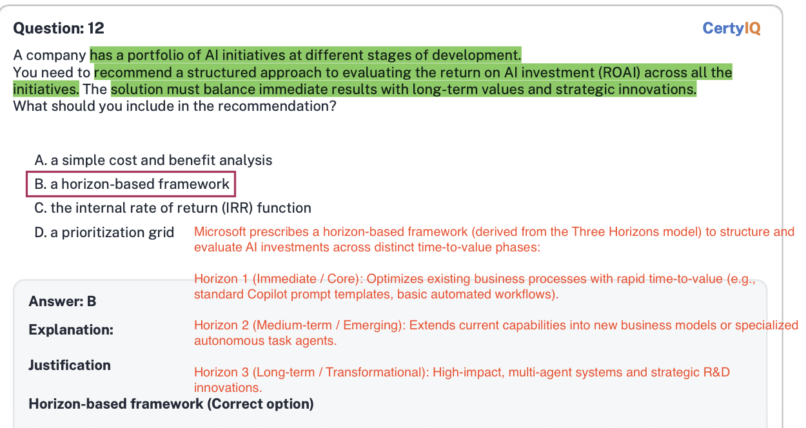

### Answer

### 1. Extracted Question Summary

* **Scenario:** A company has a portfolio of AI initiatives at different stages of development.


* **Requirement:** Recommend a structured approach to evaluate the return on AI investment (ROAI) across all initiatives while balancing **immediate results with long-term values and strategic innovations**.


* **Question:** What should you include in the recommendation?


* **Options:**
* **A.** a simple cost and benefit analysis


* **B.** a horizon-based framework


* **C.** the internal rate of return (IRR) function


* **D.** a prioritization grid


---

### 2. Correct Answer

**B: a horizon-based framework**

---

### 3. Verification of Visible Selection / Community Key

* The visible selection marked in the screenshot (**Answer: B**) is **Correct**, as a horizon-based framework specifically categorizes AI investments across timeframes to balance quick operational wins with transformative, long-term strategic value.


---

### 4. Official Microsoft Justification

* Under the Microsoft Learn pathway **"Architect agentic AI business solutions"** (specifically the strategy modules covering AI portfolio management, governance, and business value realization):
* Evaluating Return on AI Investment (ROAI) across an enterprise portfolio requires managing diverse initiatives ranging from immediate productivity gains to complex, disruptive agentic transformations.
* Microsoft prescribes a **horizon-based framework** (derived from the Three Horizons model) to structure and evaluate AI investments across distinct time-to-value phases:
* **Horizon 1 (Immediate / Core):** Optimizes existing business processes with rapid time-to-value (e.g., standard Copilot prompt templates, basic automated workflows).
* **Horizon 2 (Medium-term / Emerging):** Extends current capabilities into new business models or specialized autonomous task agents.
* **Horizon 3 (Long-term / Transformational):** High-impact, multi-agent systems and strategic R&D innovations.


* This structured approach prevents organizations from over-indexing solely on short-term efficiency gains or prematurely killing high-value strategic innovations due to delayed initial payoffs.


---

### 5. Distractor Analysis (Why Others Are Wrong)

* **A. a simple cost and benefit analysis:** Focuses purely on near-term monetary inputs and outputs for single projects; it fails to evaluate complex portfolios across multiple developmental lifecycles or account for strategic option value.
* **C. the internal rate of return (IRR) function:** A traditional discounted cash-flow financial metric that requires predictable, quantifiable monetary inflows; applying pure IRR to early-stage or experimental Horizon 3 generative AI initiatives undervalues strategic innovation.
* **D. a prioritization grid:** (Such as an Impact vs. Effort matrix) is useful for selecting which individual use cases to build first in a workshop, but it does not provide an ongoing lifecycle governance framework to evaluate multi-stage portfolio ROAI over time.

---

### 6. Exam Keyword / Trap Alert

* **Keywords:** *"Portfolio of AI initiatives"*, *"evaluating ROAI"*, and *"balance immediate results with long-term values and strategic innovations."*


* **Trap:** Do not select generic financial methods like *cost-benefit analysis* or *IRR*; whenever an AB-100 question mentions balancing **short-term/immediate gains with long-term strategic/transformational innovation across a portfolio**, the target architectural concept is always a **horizon-based framework**.


### Horizon-Based Framework: Application to the Business Requirement

The **Horizon-Based Framework** (derived from the McKinsey Three Horizons model and integrated into the Microsoft AI Business School / AB-100 architectural principles) is a portfolio governance structure that categorizes AI investments by maturity, operational risk, and time-to-impact.

When evaluating **Return on AI Investment (ROAI)** across an organization's active initiatives, this framework prevents a common enterprise anti-pattern: killing strategic, high-value AI transformations simply because they cannot demonstrate the same immediate dollar savings as low-code, off-the-shelf automation.

---

### Mapping the AI Portfolio Across Horizons

| Horizon | Strategic Focus | Typical Business Initiatives | Target ROAI Metrics |
| --- | --- | --- | --- |
| **Horizon 1**<br>

<br>*(Immediate Results / Core)* | Incremental optimization of existing workflows and everyday productivity. | • Standardized prompt templates in Copilot Studio<br>

<br>• Out-of-the-box Microsoft 365 Copilot adoption<br>

<br>• File-upload grounding for internal SOP in-app help | • Time saved per employee per week<br>

<br>• Adoption & active usage rate<br>

<br>• Immediate operational cost reduction (hours) |
| **Horizon 2**<br>

<br>*(Emerging / Medium-Term)* | Expanding business capabilities into next-generation digital processes. | • Specialized assistive task agents (e.g., fraud risk-scoring agent with human-in-the-loop)<br>

<br>• Centralized Dataverse product catalogs across Commerce and Power Apps<br>

<br>• Custom connector integrations for Azure backends | • Process throughput acceleration<br>

<br>• Error rate / false-positive reductions<br>

<br>• Measurable revenue uplift / customer retention gains |
| **Horizon 3**<br>

<br>*(Strategic Innovation / Long-Term)* | Transformative, multi-agent autonomous ecosystems and disruptive capabilities. | • Connected multi-agent Foundry architectures coordinating end-to-end supply chain decisions<br>

<br>• Autonomous market trend analysis and predictive multi-modal agents | • Strategic option value & market leadership<br>

<br>• New business model generation<br>

<br>• Long-term structural operating margin expansion |

---

### Why It Solves This Business Requirement

1. **Balances Short-Term vs. Long-Term Value:**
* **Horizon 1** initiatives fund the journey by delivering quick, undeniable efficiency wins to executive stakeholders within weeks.
* **Horizon 3** initiatives build organizational competitive moats that redefine the business over the next 2–3 years.


2. **Differentiated Evaluation Criteria:**
* Instead of applying rigid financial calculations (like standard IRR or static cost-benefit ratios) uniformly across all projects, leadership measures each initiative against metrics appropriate to its horizon:
* *H1 is judged on speed of adoption and immediate efficiency.*
* *H2 is judged on scaling capacity and process acceleration.*
* *H3 is judged on proof-of-capability, strategic readiness, and enterprise innovation.*


<br>

---

## Q13

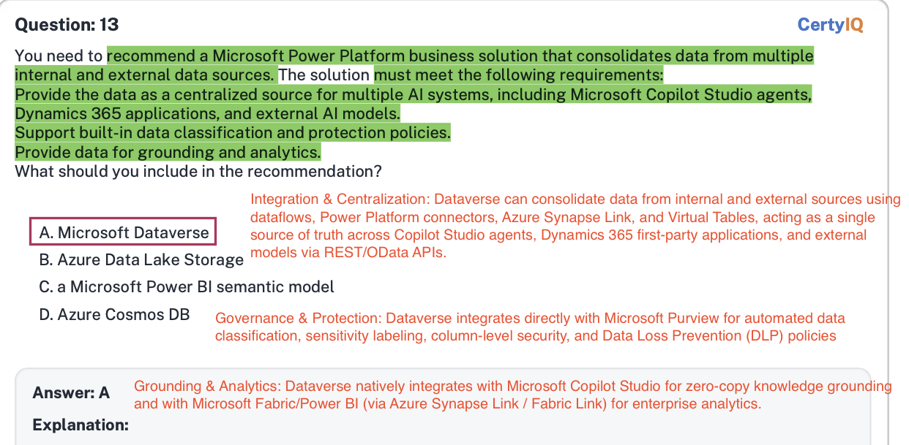

### Answer

### 1. Extracted Question Summary

* **Scenario:** You need to recommend a Microsoft Power Platform business solution that consolidates data from multiple internal and external data sources. The solution must meet the following requirements:


* Provide the data as a centralized source for multiple AI systems, including Microsoft Copilot Studio agents, Dynamics 365 applications, and external AI models.


* Support built-in data classification and protection policies.


* Provide data for grounding and analytics.


* **Question:** What should you include in the recommendation?


* **Options:**
* **A.** Microsoft Dataverse


* **B.** Azure Data Lake Storage


* **C.** a Microsoft Power BI semantic model


* **D.** Azure Cosmos DB


---

### 2. Correct Answer

**A: Microsoft Dataverse**

---

### 3. Verification of Visible Selection / Community Key

* The answer marked and boxed in the screenshot (**Answer: A**) is **Correct**, as Microsoft Dataverse is the native Power Platform data service that unifies data across Dynamics 365 and Copilot Studio while natively integrating with Microsoft Purview for data classification and protection policies.


---

### 4. Official Microsoft Justification

* According to the Microsoft Learn pathway **"Architect agentic AI business solutions"** (specifically modules on data architecture, enterprise governance, and semantic grounding):
* **Microsoft Power Platform Boundary:** The requirement explicitly calls for a *Microsoft Power Platform business solution*. **Microsoft Dataverse** is the native, smart, and scalable data platform foundational to Power Platform and Dynamics 365.


* **Integration & Centralization:** Dataverse can consolidate data from internal and external sources using dataflows, Power Platform connectors, Azure Synapse Link, and Virtual Tables, acting as a single source of truth across Copilot Studio agents, Dynamics 365 first-party applications, and external models via REST/OData APIs.


* **Governance & Protection:** Dataverse integrates directly with **Microsoft Purview** for automated data classification, sensitivity labeling, column-level security, and Data Loss Prevention (DLP) policies.


* **Grounding & Analytics:** Dataverse natively integrates with Microsoft Copilot Studio for zero-copy knowledge grounding and with Microsoft Fabric/Power BI (via Azure Synapse Link / Fabric Link) for enterprise analytics.


---

### 5. Distractor Analysis (Why Others Are Wrong)

* **B. Azure Data Lake Storage:** An Azure infrastructure service (IaaS/PaaS storage), not a *Microsoft Power Platform business solution*. While it stores raw files and logs, it does not provide native transactional entity modeling, out-of-the-box Dynamics 365 application integration, or direct low-code Purview classification binding within Power Platform.


* **C. a Microsoft Power BI semantic model:** Designed specifically for read-only reporting and analytical aggregation, not as an enterprise operational transaction data layer that unifies and writes back business records for Dynamics 365 apps and external AI models.
* **D. Azure Cosmos DB:** A globally distributed Azure PaaS NoSQL database service, not a Power Platform business solution; it lacks out-of-the-box Common Data Model (CDM) structures, native Dynamics 365 bindings, and built-in Power Platform governance controls.


---

### 6. Exam Keyword / Trap Alert

* **Keywords:** *"Microsoft Power Platform business solution"* + *"centralized source for multiple AI systems, including Microsoft Copilot Studio agents, Dynamics 365 applications"* + *"built-in data classification and protection policies."*


* **Trap:** Pay strict attention to the scope defined in the first sentence (*"recommend a Microsoft Power Platform business solution"*). Even though *Azure Data Lake Storage* or *Azure Cosmos DB* can store data, they are Azure infrastructure offerings, automatically disqualifying them from being Power Platform solutions.


## Q14

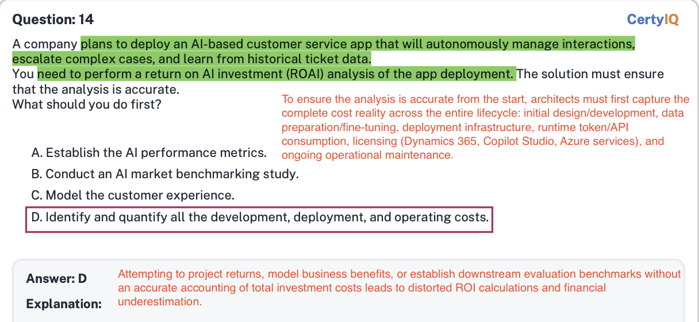

### Answer

### 1. Extracted Question Summary

* **Scenario:** A company plans to deploy an AI-based customer service app that will autonomously manage interactions, escalate complex cases, and learn from historical ticket data.


* **Requirement:** You need to perform a Return on AI Investment (ROAI) analysis of the app deployment. The solution must ensure that the analysis is accurate.


* **Question:** What should you do first?


* **Options:**
* **A.** Establish the AI performance metrics.


* **B.** Conduct an AI market benchmarking study.


* **C.** Model the customer experience.


* **D.** Identify and quantify all the development, deployment, and operating costs.


---

### 2. Correct Answer

**D: Identify and quantify all the development, deployment, and operating costs.**

---

### 3. Verification of Visible Selection / Community Key

* The visible selection marked and boxed in the screenshot (**Answer: D**) is **Correct**, because establishing an accurate total cost baseline (Total Cost of Ownership including model inference, engineering, infrastructure, and ongoing token/API operations) is the fundamental prerequisite denominator before net return or financial feasibility can be calculated.


---

### 4. Official Microsoft Justification

* Under the Microsoft Learn pathway **"Architect agentic AI business solutions"** (specifically modules addressing *Evaluating Return on AI Investment (ROAI)* and financial planning for AI systems):
* The ROAI formula requires computing net financial benefits against total cumulative investment:

$$\text{ROAI} = \frac{\text{Net Financial Benefits}}{\text{Total AI Costs}} \times 100$$


* To ensure the analysis is accurate from the start, architects must first capture the complete cost reality across the entire lifecycle: initial design/development, data preparation/fine-tuning, deployment infrastructure, runtime token/API consumption, licensing (Dynamics 365, Copilot Studio, Azure services), and ongoing operational maintenance.
* Attempting to project returns, model business benefits, or establish downstream evaluation benchmarks without an accurate accounting of total investment costs leads to distorted ROI calculations and financial underestimation.


---

### 5. Distractor Analysis (Why Others Are Wrong)

* **A. Establish the AI performance metrics:** Performance metrics (e.g., latency, task completion rate, intent recognition precision, CSAT) assess operational and technical efficiency during or after implementation; they do not establish the foundational financial investment baseline required to perform an accurate ROAI calculation first.
* **B. Conduct an AI market benchmarking study:** Market benchmarking assesses peer performance or external competitive landscape trends; it does not determine the specific organization's internal expenditures, project budget, or deployment viability.
* **C. Model the customer experience:** Customer experience modeling (e.g., journey mapping, CSAT targeting) defines design requirements and qualitative outcomes, but it does not quantify financial input costs necessary to initiate an ROAI financial assessment.

---

### 6. Exam Keyword / Trap Alert

* **Keywords:** *"Perform a return on AI investment (ROAI) analysis"* paired with *"ensure that the analysis is accurate"* and *"What should you do first?"*


* **Trap:** Do not get sidetracked by AI operational metrics (*Option A*) or user experience design (*Option C*); financial calculations always require identifying the complete cost denominator (development, deployment, operational expenses) as step one.


<br>

## Q15

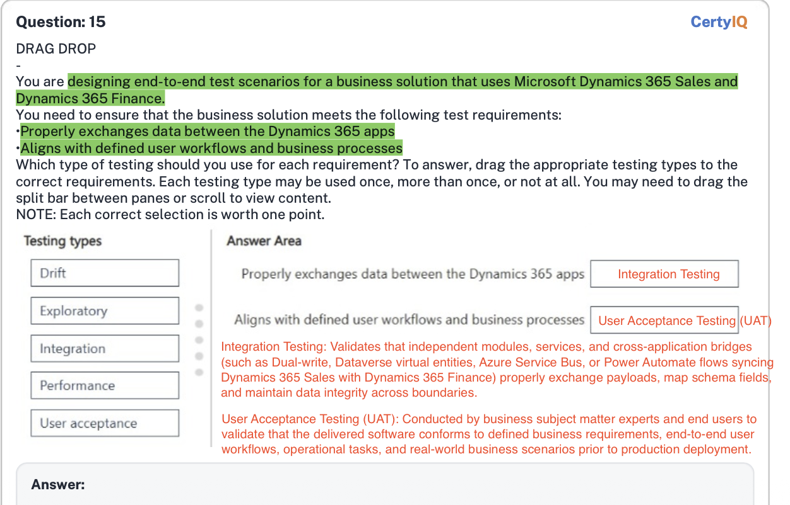

### Answer

### 1. Extracted Question Summary

* **Scenario:** You are designing end-to-end test scenarios for a business solution that uses Microsoft Dynamics 365 Sales and Dynamics 365 Finance.


* **Requirements:**
* Properly exchanges data between the Dynamics 365 apps.


* Aligns with defined user workflows and business processes.


* **Question:** Which type of testing should you use for each requirement? (Drag the appropriate testing types to the correct requirements).


* **Testing Types Available:**
* *Drift*


* *Exploratory*


* *Integration*


* *Performance*


* *User acceptance*


---

### 2. Correct Answer

* **Properly exchanges data between the Dynamics 365 apps:** **Integration**
* **Aligns with defined user workflows and business processes:** **User acceptance**

---

### 3. Verification of Visible Selection / Community Key

* *(Section skipped as no answer or community key is marked or visible in the screenshot)*.


---

### 4. Official Microsoft Justification

* Under the Microsoft Learn pathway **"Architect agentic AI business solutions"** (specifically the testing, validation, and lifecycle management modules for multi-tier Dynamics 365 / Power Platform solutions):
* **Integration Testing:** Validates that independent modules, services, and cross-application bridges (such as Dual-write, Dataverse virtual entities, Azure Service Bus, or Power Automate flows syncing Dynamics 365 Sales with Dynamics 365 Finance) properly exchange payloads, map schema fields, and maintain data integrity across boundaries.


* **User Acceptance Testing (UAT):** Conducted by business subject matter experts and end users to validate that the delivered software conforms to defined business requirements, end-to-end user workflows, operational tasks, and real-world business scenarios prior to production deployment.


---

### 5. Distractor Analysis (Why Others Are Wrong)

* **Drift (Testing / Monitoring):** In AI and machine learning architectures, drift refers to monitoring data drift (input distribution shifts) or concept drift (changes in statistical relationships over time); it is an ongoing telemetry and model observability practice, not an end-to-end functional test of data exchange or business processes.


* **Exploratory (Testing):** Unscripted, manual testing where testers discover edge-case bugs by freely navigating the system; it does not systematically verify formal compliance with defined user workflows or cross-system payload exchanges.


* **Performance (Testing):** Evaluates latency, response times, load handling, and system scalability under stress; it does not assess business workflow correctness or functional cross-app data synchronization.


---

### 6. Exam Keyword / Trap Alert

* **Keywords:** *"Exchanges data between the Dynamics 365 apps"* targets **Integration** testing, while *"Aligns with defined user workflows and business processes"* points to **User acceptance** testing.


* **Trap:** Do not select *Performance* or *Drift* when encountering multi-app or AI-adjacent Dynamics 365 questions; test classification in architecture exams strictly follows testing scopes: technical handshakes = *Integration*, business process validation = *User acceptance*.


<br>

---

## Q16

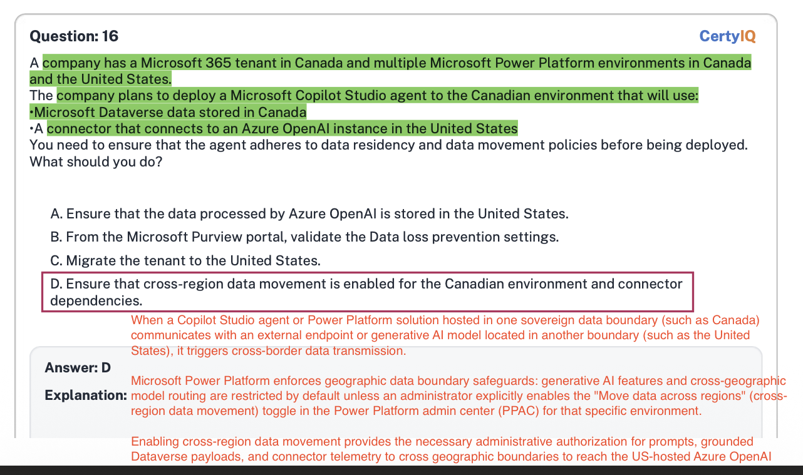

### Answer

### 1. Extracted Question Summary

* **Scenario:** A company has a Microsoft 365 tenant in Canada and multiple Microsoft Power Platform environments in Canada and the United States. The company plans to deploy a Microsoft Copilot Studio agent to the Canadian environment that will use:


* Microsoft Dataverse data stored in Canada.


* A connector that connects to an Azure OpenAI instance in the United States.


* **Requirement:** Ensure that the agent adheres to data residency and data movement policies before being deployed.


* **Question:** What should you do?


* **Options:**
* **A.** Ensure that the data processed by Azure OpenAI is stored in the United States.


* **B.** From the Microsoft Purview portal, validate the Data loss prevention settings.


* **C.** Migrate the tenant to the United States.


* **D.** Ensure that cross-region data movement is enabled for the Canadian environment and connector dependencies.


---

### 2. Correct Answer

**D: Ensure that cross-region data movement is enabled for the Canadian environment and connector dependencies.**

---

### 3. Verification of Visible Selection / Community Key

* The answer marked and boxed in the screenshot (**Answer: D**) is **Correct**, as Power Platform enforces strict geographic boundaries that block generative AI requests and connector calls from routing outside an environment’s home region unless cross-region data movement is explicitly enabled by an administrator.


---

### 4. Official Microsoft Justification

* Under the Microsoft Learn pathway **"Architect agentic AI business solutions"** (specifically the modules covering *Data residency, governance, and security for generative AI and Copilot Studio*):
* When a Copilot Studio agent or Power Platform solution hosted in one sovereign data boundary (such as Canada) communicates with an external endpoint or generative AI model located in another boundary (such as the United States), it triggers cross-border data transmission.
* Microsoft Power Platform enforces geographic data boundary safeguards: generative AI features and cross-geographic model routing are restricted by default unless an administrator explicitly enables the **"Move data across regions"** (cross-region data movement) toggle in the Power Platform admin center (PPAC) for that specific environment.
* Enabling cross-region data movement provides the necessary administrative authorization for prompts, grounded Dataverse payloads, and connector telemetry to cross geographic boundaries to reach the US-hosted Azure OpenAI instance.


---

### 5. Distractor Analysis (Why Others Are Wrong)

* **A. Ensure that the data processed by Azure OpenAI is stored in the United States:** By default, Azure OpenAI stateless inference does not store customer data in the processing region beyond transient operational caching; furthermore, forcing persistent storage in another country violates standard corporate data residency governance.
* **B. From the Microsoft Purview portal, validate the Data loss prevention settings:** While Purview governs data sensitivity labels, Power Platform DLP policies that govern connectors and cross-region generative data toggles are managed within the Power Platform Admin Center (PPAC), not by validating general Purview portal DLP policies.
* **C. Migrate the tenant to the United States:** Unnecessary, costly, disruptive, and directly violates tenant data sovereignty policies for Canadian enterprise data assets.

---

### 6. Exam Keyword / Trap Alert

* **Keywords:** *"Tenant/Environment in Canada"* calling *"Azure OpenAI instance in the United States"* paired with *"data residency and data movement policies."*


* **Trap:** Do not select *Purview DLP* or *Tenant migration*; whenever an AB-100 question involves Power Platform/Copilot Studio agents making calls outside their local geographic boundary, the administrative prerequisite is always enabling **cross-region data movement** in the Power Platform admin center.


<br>

---

## Q17

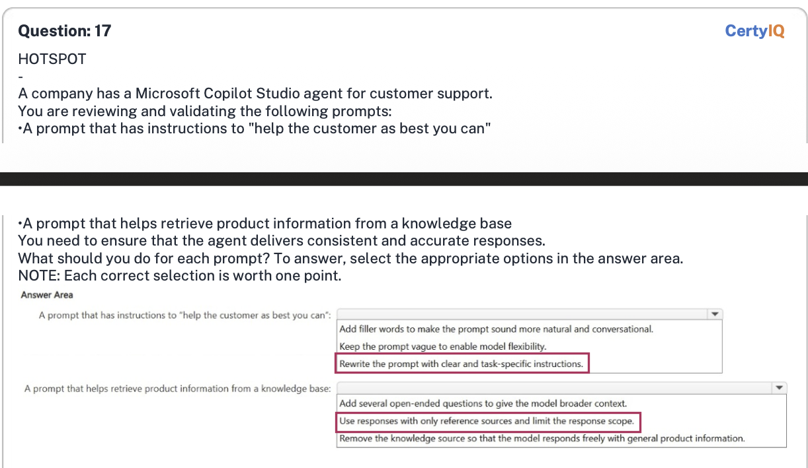

### Answer

### 1. Extracted Question Summary

* **Scenario:** A company has a Microsoft Copilot Studio agent for customer support. You are reviewing and validating two prompts:


1. *A prompt that has instructions to "help the customer as best you can"*


2. *A prompt that helps retrieve product information from a knowledge base*


* **Requirement:** Ensure that the agent delivers consistent and accurate responses.


* **Answer Area (Dropdown 1 - "help the customer as best you can"):**
* *Add filler words to make the prompt sound more natural and conversational.*


* *Keep the prompt vague to enable model flexibility.*


* *Rewrite the prompt with clear and task-specific instructions.*


* **Answer Area (Dropdown 2 - retrieve product information from a knowledge base):**
* *Add several open-ended questions to give the model broader context.*


* *Use responses with only reference sources and limit the response scope.*


* *Remove the knowledge source so that the model responds freely with general product information.*


---

### 2. Correct Answer

* **A prompt that has instructions to "help the customer as best you can":** **Rewrite the prompt with clear and task-specific instructions.**
* **A prompt that helps retrieve product information from a knowledge base:** **Use responses with only reference sources and limit the response scope.**

---

### 3. Verification of Visible Selection / Community Key

* *(Section skipped as no selection or community answer is marked or visible in the screenshot)*.


---

### 4. Official Microsoft Justification

* Under the Microsoft Learn pathway **"Architect agentic AI business solutions"** (specifically the modules covering *Prompt Engineering Best Practices* and *Grounded Knowledge Retrieval in Copilot Studio*):
* **Task-Specific Precision:** Vague instructions like *"help the customer as best you can"* introduce high ambiguity, leading to unpredictable agent behaviors, off-topic drift, and inconsistent responses. Microsoft prompt engineering guidance requires prompts to define a distinct persona, explicit boundaries, exact task scope, and expected response formats.


* **Grounding and Scope Limiting:** To ensure factual accuracy and prevent hallucinations during knowledge retrieval, Copilot Studio prompts and generative knowledge configurations must constrain the model's output strictly to the provided reference sources (grounding data) while explicitly bounding the scope to prevent unverified extrapolation.


---

### 5. Distractor Analysis (Why Others Are Wrong)

#### Dropdown 1: Instructions to "help the customer as best you can"

* **Add filler words to make the prompt sound more natural and conversational:** Consumes unnecessary token bandwidth, increases latency, and dilutes instructional clarity without providing operational structure.
* **Keep the prompt vague to enable model flexibility:** Directly conflicts with the requirement for consistent and accurate responses; vagueness increases prompt entropy and hallucination risk.


#### Dropdown 2: Retrieve product information from a knowledge base

* **Add several open-ended questions to give the model broader context:** Increases ambiguity and risks pulling irrelevant chunks during retrieval, degrading precision.
* **Remove the knowledge source so that the model responds freely with general product information:** Defeats the foundational architecture of enterprise RAG, causing the model to rely on stale parametric training weights and hallucinate proprietary product attributes.

---

### 6. Exam Keyword / Trap Alert

* **Keywords:** *"Consistent and accurate responses"* paired with fixing vague directives and controlling retrieval scope.


* **Trap:** Beware of options suggesting *"conversational filler words"* or *"model flexibility"*—enterprise agent engineering mandates explicit task constraints and strict reference-bounded grounding.


<br>

---

## Q18


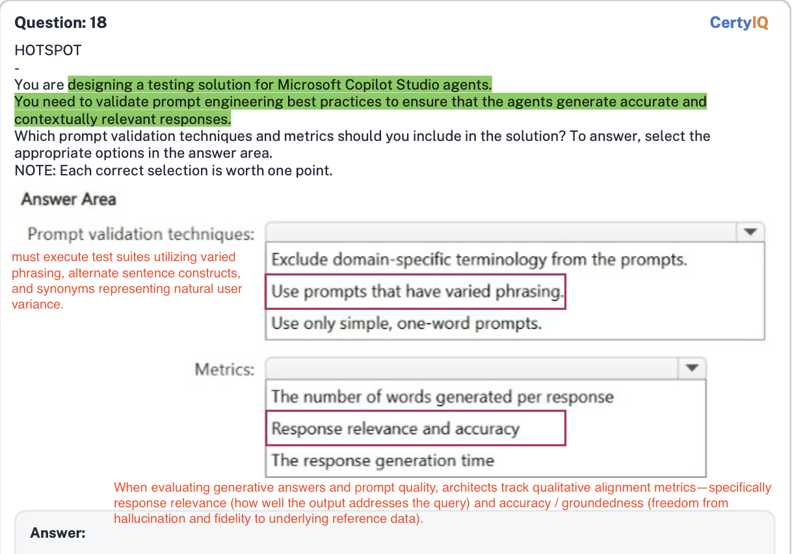

### Answer

### 1. Extracted Question Summary

* **Scenario:** You are designing a testing solution for Microsoft Copilot Studio agents. You need to validate prompt engineering best practices to ensure that the agents generate accurate and contextually relevant responses.


* **Question:** Which prompt validation techniques and metrics should you include in the solution?


* **Answer Area (Dropdown 1 - Prompt validation techniques):**
* *Exclude domain-specific terminology from the prompts.*


* *Use prompts that have varied phrasing.*


* *Use only simple, one-word prompts.*


* **Answer Area (Dropdown 2 - Metrics):**
* *The number of words generated per response*


* *Response relevance and accuracy*


* *The response generation time*


---

### 2. Correct Answer

* **Prompt validation techniques:** **Use prompts that have varied phrasing.**
* **Metrics:** **Response relevance and accuracy**

---

### 3. Verification of Visible Selection / Community Key

* *(Section skipped as no answer or community key is marked or visible in the screenshot)*.


---

### 4. Official Microsoft Justification

* Under the Microsoft Learn pathway **"Architect agentic AI business solutions"** (specifically the modules covering *Prompt Engineering Best Practices* and *Testing, Evaluating, and Monitoring Agentic AI Solutions*):
* **Prompt Validation Techniques:** Real-world users express intents across diverse syntactic structures, idioms, and lengths. To rigorously validate that an agent consistently understands and retrieves relevant information without breaking or misclassifying intents, testing frameworks must execute test suites utilizing **varied phrasing**, alternate sentence constructs, and synonyms representing natural user variance.
* **Metrics for Contextual Relevance & Accuracy:** When evaluating generative answers and prompt quality, architects track qualitative alignment metrics—specifically **response relevance** (how well the output addresses the query) and **accuracy / groundedness** (freedom from hallucination and fidelity to underlying reference data).


---

### 5. Distractor Analysis (Why Others Are Wrong)

#### Dropdown 1: Prompt validation techniques

* **Exclude domain-specific terminology from the prompts:** Incorrect. Enterprise agents are specifically deployed to handle specialized enterprise jargon, schema names, and industry terms; excluding them creates false evaluation baselines.
* **Use only simple, one-word prompts:** Incorrect. Real-world prompts contain complex questions, compound queries, and background context; testing exclusively with one-word inputs fails to validate semantic parsing or multi-variable entity extraction.

#### Dropdown 2: Metrics

* **The number of words generated per response:** A superficial quantitative count of generated tokens; word count does not measure whether an answer is truthful, grounded, or useful.
* **The response generation time:** Measures system latency and infrastructure performance, not prompt alignment, semantic correctness, or contextual relevance.

---

### 6. Exam Keyword / Trap Alert

* **Keywords:** *"Ensure that the agents generate accurate and contextually relevant responses"* directly maps to testing with **varied phrasing** and measuring **response relevance and accuracy**.


* **Trap:** Do not select *response generation time*; while latency is a general system performance metric, the question specifically focuses on validating prompt quality to ensure *accuracy and contextual relevance*.


<br>

---

## Q19

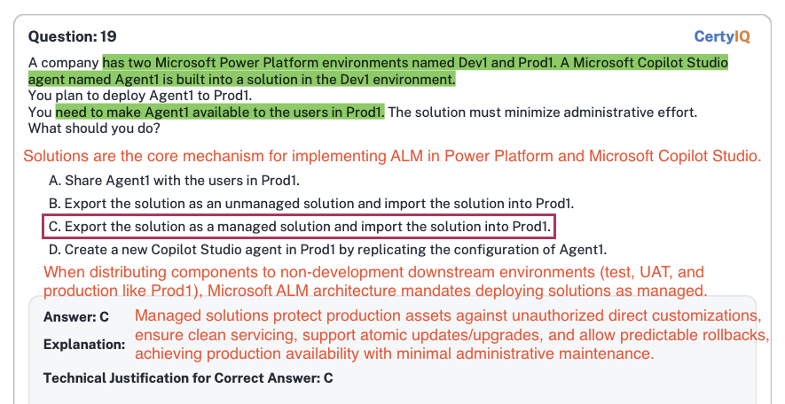

### Answer

### 1. Extracted Question Summary

* **Scenario:** A company has two Microsoft Power Platform environments named `Dev1` and `Prod1`. A Microsoft Copilot Studio agent named `Agent1` is built into a solution in the `Dev1` environment.


* **Requirement:** You plan to deploy `Agent1` to `Prod1` and make it available to users in `Prod1` while **minimizing administrative effort**.


* **Question:** What should you do?


* **Options:**
* **A.** Share Agent1 with the users in Prod1.


* **B.** Export the solution as an unmanaged solution and import the solution into Prod1.


* **C.** Export the solution as a managed solution and import the solution into Prod1.


* **D.** Create a new Copilot Studio agent in Prod1 by replicating the configuration of Agent1.


---

### 2. Correct Answer

**C: Export the solution as a managed solution and import the solution into Prod1.**

---

### 3. Verification of Visible Selection / Community Key

* The visible selection marked and boxed in the screenshot (**Answer: C**) is **Correct**, as importing a managed solution is the standard Power Platform ALM best practice to deploy packaged, tamper-proof agent artifacts into production with minimal administrative effort.


---

### 4. Official Microsoft Justification

* Under the Microsoft Learn pathway **"Architect agentic AI business solutions"** (specifically the modules covering *Application Lifecycle Management (ALM) for Copilot Studio and Power Platform*):
* Solutions are the core mechanism for implementing ALM in Power Platform and Microsoft Copilot Studio.
* Development is performed in an unmanaged solution in a development environment (`Dev1`).


* When distributing components to non-development downstream environments (test, UAT, and production like `Prod1`), Microsoft ALM architecture mandates deploying solutions as **managed**.


* Managed solutions protect production assets against unauthorized direct customizations, ensure clean servicing, support atomic updates/upgrades, and allow predictable rollbacks, achieving production availability with minimal administrative maintenance.


---

### 5. Distractor Analysis (Why Others Are Wrong)

* **A. Share Agent1 with the users in Prod1:** Copilot Studio agents are environment-bound Dataverse artifacts. You cannot simply "share" an agent resident in `Dev1` to users across an environment boundary into `Prod1` without first deploying the solution package to `Prod1`.


* **B. Export the solution as an unmanaged solution and import the solution into Prod1:** Unmanaged solutions are intended strictly for development environments. Deploying an unmanaged solution to a production environment violates Power Platform governance and ALM best practices by exposing components to unversioned edits and creating unmanaged customization debt in production.
* **D. Create a new Copilot Studio agent in Prod1 by replicating the configuration of Agent1:** Manual recreation is error-prone, completely ignores Power Platform ALM tooling, and introduces massive administrative and maintenance overhead.


---

### 6. Exam Keyword / Trap Alert

* **Keywords:** *"Dev1 to Prod1"* + *"built into a solution"* + *"deploy"* + *"minimize administrative effort."*


* **Trap:** Whenever an ALM question moves components from a **Dev** environment to a **Prod** (or Test) environment, the answer is virtually always **Export as managed and import**. Deploying *unmanaged* solutions downstream is an enterprise anti-pattern.


<br>

---

## Q20

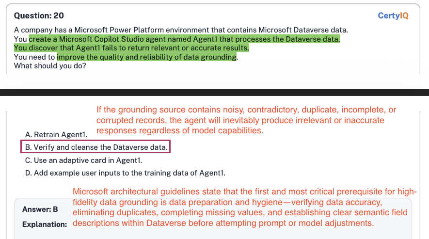

### Answer

### 1. Extracted Question Summary

* **Scenario:** A company has a Microsoft Power Platform environment that contains Microsoft Dataverse data. You create a Microsoft Copilot Studio agent named `Agent1` that processes the Dataverse data. You discover that `Agent1` fails to return relevant or accurate results.


* **Requirement:** You need to improve the quality and reliability of data grounding.


* **Question:** What should you do?


* **Options:**
* **A.** Retrain Agent1.


* **B.** Verify and cleanse the Dataverse data.


* **C.** Use an adaptive card in Agent1.


* **D.** Add example user inputs to the training data of Agent1.


---

### 2. Correct Answer

**B: Verify and cleanse the Dataverse data.**

---

### 3. Verification of Visible Selection / Community Key

* The answer marked and boxed in the screenshot (**Answer: B**) is **Correct**, as grounding quality directly depends on the integrity, cleanliness, and accuracy of the underlying source data ("garbage in, garbage out").


---

### 4. Official Microsoft Justification

* Under the Microsoft Learn pathway **"Architect agentic AI business solutions"** (specifically the modules covering *Data preparation, quality, and semantic grounding in Microsoft Copilot Studio and Dataverse*):
* In a Retrieval-Augmented Generation (RAG) and data grounding architecture, the generative model synthesizes responses based entirely on the retrieved data records.
* If the grounding source contains noisy, contradictory, duplicate, incomplete, or corrupted records, the agent will inevitably produce irrelevant or inaccurate responses regardless of model capabilities.
* Microsoft architectural guidelines state that the first and most critical prerequisite for high-fidelity data grounding is **data preparation and hygiene**—verifying data accuracy, eliminating duplicates, completing missing values, and establishing clear semantic field descriptions within Dataverse before attempting prompt or model adjustments.


---

### 5. Distractor Analysis (Why Others Are Wrong)

* **A. Retrain Agent1:** Copilot Studio agents using generative grounding over Dataverse tables do not use traditional supervised offline model retraining; responses are generated at runtime via semantic indexing and RAG over the live table data.


* **C. Use an adaptive card in Agent1:** Adaptive cards are user interface elements used to present structured interactive content to end users; they format output display but do not alter, fix, or improve the quality and reliability of backend data retrieval and grounding.


* **D. Add example user inputs to the training data of Agent1:** Adding sample phrases or trigger utterances helps classic intent recognition (matching a user utterance to a specific deterministic topic), but it does not address grounding failures caused by poor underlying Dataverse record data.


---

### 6. Exam Keyword / Trap Alert

* **Keywords:** *"Fails to return relevant or accurate results"* combined with *"improve the quality and reliability of data grounding."*


* **Trap:** Do not default to bot configuration changes like *"Retrain"* or *"Add example user inputs"* when the failure is explicitly tied to **data grounding**. In generative architectures, poor grounding quality points directly back to source data quality issues in the underlying store (Dataverse).


<br>

---

## Q21

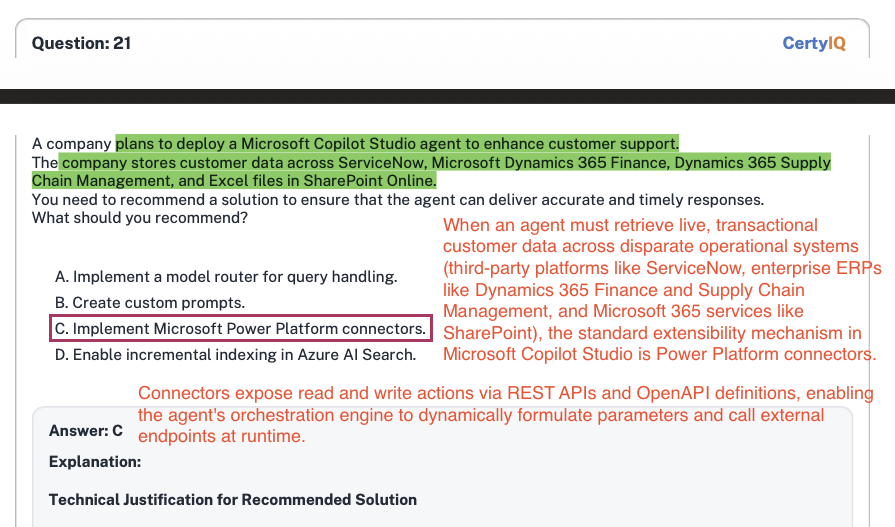

### Answer

### 1. Extracted Question Summary

* **Scenario:** A company plans to deploy a Microsoft Copilot Studio agent to enhance customer support. The company stores customer data across ServiceNow, Microsoft Dynamics 365 Finance, Dynamics 365 Supply Chain Management, and Excel files in SharePoint Online.


* **Requirement:** Recommend a solution to ensure that the agent can deliver accurate and timely responses.


* **Question:** What should you recommend?


* **Options:**
* **A.** Implement a model router for query handling.


* **B.** Create custom prompts.


* **C.** Implement Microsoft Power Platform connectors.


* **D.** Enable incremental indexing in Azure AI Search.


---

### 2. Correct Answer

**C: Implement Microsoft Power Platform connectors.**

---

### 3. Verification of Visible Selection / Community Key

* The selection marked in the screenshot (**Answer: C**) is **Correct**, because Power Platform connectors provide the standard, prebuilt integration actions required to query live customer data directly across disparate SaaS platforms (ServiceNow), first-party Dynamics 365 ERP systems, and SharePoint Online files at runtime without duplicating data.


---

### 4. Official Microsoft Justification

* Under the Microsoft Learn pathway **"Architect agentic AI business solutions"** (specifically modules addressing *Extending agent capabilities with actions and connectors* and *Enterprise Integration Architecture*):
* When an agent must retrieve live, transactional customer data across disparate operational systems (third-party platforms like ServiceNow, enterprise ERPs like Dynamics 365 Finance and Supply Chain Management, and Microsoft 365 services like SharePoint), the standard extensibility mechanism in Microsoft Copilot Studio is **Power Platform connectors**.
* Connectors expose read and write actions via REST APIs and OpenAPI definitions, enabling the agent's orchestration engine to dynamically formulate parameters and call external endpoints at runtime.
* This ensures that responses contain real-time, authoritative data directly from the system of record rather than relying on delayed batch indexing or static prompt structures.


---

### 5. Distractor Analysis (Why Others Are Wrong)

* **A. Implement a model router for query handling:** A model router directs incoming prompts to different underlying LLMs (e.g., small language models vs. large reasoning models) based on complexity; it does not connect or integrate external transactional systems (ServiceNow, Dynamics 365) to fetch customer data.
* **B. Create custom prompts:** Prompts structure the persona, instructions, and formatting for generative responses, but prompts alone cannot retrieve external transactional records without an underlying data source or connector action.
* **D. Enable incremental indexing in Azure AI Search:** While Azure AI Search is used for document RAG, configuring indexing over live transactional ERP records and ServiceNow tickets introduces synchronization delays and does not natively support bidirectional actions or real-time query retrieval as effectively as certified Power Platform connectors.

---

### 6. Exam Keyword / Trap Alert

* **Keywords:** Multi-system data fragmentation across *"ServiceNow, Dynamics 365 Finance, Dynamics 365 Supply Chain Management, and Excel files in SharePoint Online"* paired with enabling a *"Copilot Studio agent"* to retrieve records.


* **Trap:** Do not default to *Azure AI Search* whenever multiple sources are listed; if the sources involve active transactional platforms (like ServiceNow and Dynamics 365 ERP) rather than unstructured search archives, the correct integration pattern for Copilot Studio is **Microsoft Power Platform connectors**.

### Are Copilot Studio Connectors and Power Platform Connectors the Same?

**Yes, fundamentally they are the exact same underlying technology.**

Copilot Studio is built directly on top of the Microsoft Power Platform ecosystem and Microsoft Dataverse. In Copilot Studio:

* An **"Action"** (or plugin) added to an agent is typically backed directly by a **Power Platform Connector** (prebuilt or custom).
* Behind the scenes, both use the exact same OpenAPI (Swagger 2.0 / 3.0) definitions, authentication connections (Entra ID, OAuth2, API key), Data Loss Prevention (DLP) policies, and connection references managed in the Power Platform Admin Center.

When you add a connector action inside Copilot Studio, the agent's generative orchestrator treats the connector’s operations (`GET`, `POST`, etc.) as **callable tools / functions**.

---

### The Architectural Dilemma: Direct Connector Calls vs. Dataverse Consolidation (Virtual Tables)

In enterprise implementations, you have two primary architectural patterns to connect an agent to multi-platform estates (ServiceNow, Dynamics 365 Finance & SCM, SharePoint Excel):

```
┌──────────────────────────────────────────────────────────────────────────────────┐
│ Pattern 1: Direct Agent Tooling (Connector Actions / Dynamic Plugins)            │
│ Copilot Agent ──(Power Platform Connectors)──> [ServiceNow / D365 / SharePoint]  │
│ • Live, on-demand query execution per user turn                                  │
│ • Zero replication, real-time transactional read/write                           │
└──────────────────────────────────────────────────────────────────────────────────┘

┌──────────────────────────────────────────────────────────────────────────────────┐
│ Pattern 2: Semantic Data Virtualization (Dataverse Virtual Tables)               │
│ Copilot Agent ──> Dataverse Knowledge/Search ──(Virtual Tables via Connector)    │
│ • Unified schema in Dataverse                                                    │
│ • Read-only virtualization or point-in-time federation                           │
└──────────────────────────────────────────────────────────────────────────────────┘

```

#### Why the Exam Answer Highlights Connectors Directly

The scenario asks how to enable the agent to deliver **accurate and timely responses** across live operational systems (ServiceNow, ERPs).

* In **Copilot Studio**, connecting via **Power Platform connectors as Agent Actions** gives the LLM direct, parameterized API calling capabilities.
* The user asks: *"What is the status of Incident INC00918 in ServiceNow and the PO 4001 status in Dynamics 365 Finance?"*
* The agent's orchestrator identifies the appropriate connector actions, queries each API in real-time, and generates an aggregated answer.

---

### Practical Ways to Implement This Agent in Real Life

To build this multi-system agent cleanly, use one of two battle-tested approaches:

---

#### Approach A: Direct Action Plugins in Copilot Studio (Best for Real-Time Querying & Updates)

In this approach, you do not replicate or virtualize data; you expose the connector actions directly to the Copilot orchestrator.

1. **Verify / Establish Connector Connections:**
* In Power Apps / Copilot Studio, ensure you have established authenticated connections for:
* **ServiceNow** (Prebuilt certified connector with OAuth / Basic Auth).
* **Dynamics 365 Finance & Operations** (Prebuilt connector or OData API).
* **Excel Online (Business) / SharePoint** (Microsoft Graph / SharePoint connector).


2. **Add Actions to the Copilot Studio Agent:**
* Open your agent in **Copilot Studio** > navigate to the **Actions** tab.
* Click **+ Add an action**.
* Search for **ServiceNow** > select operations such as `Get Record` or `List Incidents`.
* Add **Dynamics 365 Finance and Operations** > select `Get an entity record` or custom OData action.
* Add **Excel Online (Business)** > select `Get row` or `List rows present in a table`.


3. **Configure Semantic Metadata for the Orchestrator:**
* For every action, define a clear natural-language description so the generative orchestrator knows when to invoke it:
* *Action Description:* `"Retrieves support ticket status, assigned technician, and incident priority from ServiceNow based on incident number or user email."`
* *Parameter Descriptions:* Ensure input variables (e.g., `sys_id`, `incident_number`, `order_number`) have descriptive titles and types.


4. **Execution Flow at Runtime:**
* The user asks: *"Has the replacement part for ticket INC1024 shipped from the ERP warehouse?"*
* Copilot Studio analyzes the intent, executes the ServiceNow connector action to read the incident notes and order reference, calls Dynamics 365 Supply Chain to read the shipment status, and provides a unified, real-time response.


---

#### Approach B: Dataverse Virtual Tables via Power Platform Connectors (Best for Unified Schema & Security)

If your enterprise governance requires a single security boundary, unified Dataverse audit logging, or Purview sensitivity labeling:

1. **Deploy Virtual Tables via Virtual Connector Provider:**
* In Power Apps ([make.powerapps.com](https://make.powerapps.com)), go to **Tables** > **New table** > **New table from external data**.
* Select the **ServiceNow** or **SQL / OData** connector.
* Configure the connection and map external entity tables (e.g., ServiceNow `incident` or Dynamics 365 `SalesOrder`) as **Virtual Tables** inside Dataverse.


2. **Result in Dataverse:**
* No data is duplicated into Dataverse storage. The records reside in ServiceNow / ERP, but Dataverse treats them as local tables with standard GUIDs and relationships.


3. **Bind to Copilot Studio as a Single Knowledge Source:**
* In Copilot Studio, add **Dataverse** as the **Knowledge Source**.
* Select the newly created virtual tables.
* Grounding queries are automatically routed through Dataverse’s query pipeline directly to the underlying connectors.


---

### Which Pattern Should You Choose?

* **Use Direct Connector Actions (Approach A)** when the agent needs to perform **bi-directional tasks** (e.g., update a ticket, create a requisition, or query specific live operational records on demand with minimal overhead).
* **Use Virtual Tables in Dataverse (Approach B)** when you need **centralized governance, unified role-based security (RBAC)** across tables, or need to join external data with native Dataverse entities (like Accounts and Contacts) before the agent evaluates it.

<br>

---

## Q22

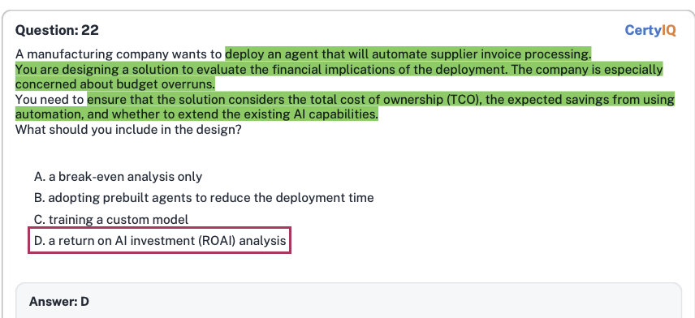

### Answer

### 1. Extracted Question Summary

* **Scenario:** A manufacturing company wants to deploy an agent that will automate supplier invoice processing. You are designing a solution to evaluate the financial implications of the deployment. The company is especially concerned about budget overruns.


* **Requirement:** Ensure that the solution considers the total cost of ownership (TCO), the expected savings from using automation, and whether to extend existing AI capabilities.


* **Question:** What should you include in the design?


* **Options:**
* **A.** a break-even analysis only


* **B.** adopting prebuilt agents to reduce the deployment time


* **C.** training a custom model


* **D.** a return on AI investment (ROAI) analysis


---

### 2. Correct Answer

**D: a return on AI investment (ROAI) analysis**

---

### 3. Verification of Visible Selection / Community Key

* The answer marked and boxed in the screenshot (**Answer: D**) is **Correct**, as a comprehensive ROAI analysis holistically evaluates lifecycle costs (TCO), operational automation savings, and the strategic financial feasibility of extending AI capabilities.


---

### 4. Official Microsoft Justification

* Under the Microsoft Learn pathway **"Architect agentic AI business solutions"** (specifically the modules covering *Evaluating Return on AI Investment (ROAI)* and *Financial Planning for AI Solutions*):
* Measuring AI financial viability requires more than traditional software accounting; it demands a dedicated **Return on AI Investment (ROAI)** framework.
* An ROAI analysis incorporates full **Total Cost of Ownership (TCO)**—including upfront development, model inference/token consumption, licensing, and ongoing maintenance—directly mitigating concerns regarding budget overruns.


* Furthermore, ROAI systematically contrasts these comprehensive lifecycle expenditures against direct tangible savings (e.g., labor hours saved, invoice error reduction) while assessing the strategic option value of extending existing AI investments into broader operational workloads.


---

### 5. Distractor Analysis (Why Others Are Wrong)

* **A. a break-even analysis only:** A break-even analysis merely calculates the static point in time where cumulative cost equals cumulative monetary return; it does not account for comprehensive multi-factor TCO variables or assess the strategic value of extending existing AI capabilities.


* **B. adopting prebuilt agents to reduce the deployment time:** This is a tactical delivery/architecture choice to accelerate time-to-market, not an evaluation framework designed to analyze financial implications, budget overruns, or TCO.


* **C. training a custom model:** A development/engineering execution step that actually increases compute costs, training overhead, and budget overrun risk without providing any financial evaluation methodology.


---

### 6. Exam Keyword / Trap Alert

* **Keywords:** *"Evaluate the financial implications"*, *"concerned about budget overruns"*, and *"considers the total cost of ownership (TCO), expected savings, and whether to extend existing AI capabilities."*


* **Trap:** Watch out for narrow financial methods like *"break-even analysis only"* (*Option A*); whenever an AB-100 question asks for a framework that combines **TCO, automation savings, and future AI extensibility**, the required architectural solution is always a **return on AI investment (ROAI) analysis**.


<br>

---

## Q23

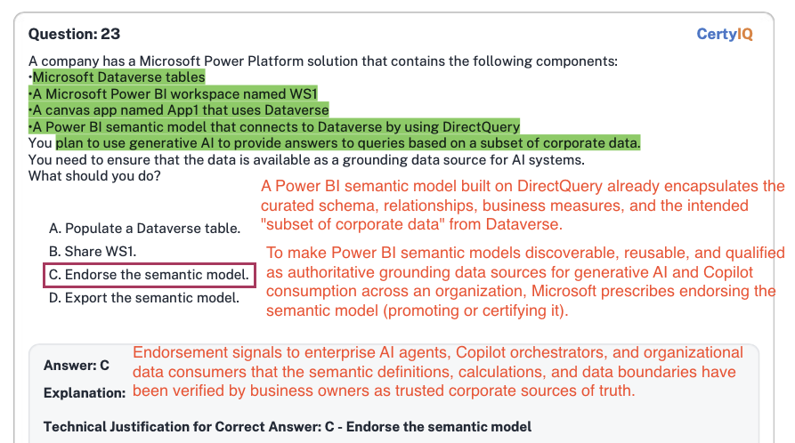

### Answer

### 1. Extracted Question Summary

* **Scenario:** A company has a Microsoft Power Platform solution that contains the following components:


* Microsoft Dataverse tables


* A Microsoft Power BI workspace named `WS1`


* A canvas app named `App1` that uses Dataverse


* A Power BI semantic model that connects to Dataverse by using DirectQuery


* **Requirement:** You plan to use generative AI to provide answers to queries based on a subset of corporate data. You need to ensure that the data is available as a grounding data source for AI systems.


* **Question:** What should you do?


* **Options:**
* **A.** Populate a Dataverse table.


* **B.** Share WS1.


* **C.** Endorse the semantic model.


* **D.** Export the semantic model.


---

### 2. Correct Answer

**C: Endorse the semantic model.**

---

### 3. Verification of Visible Selection / Community Key

* The answer marked and boxed in the screenshot (**Answer: C**) is **Correct**, as endorsing the semantic model (marking it as Promoted or Certified) designates it as an authoritative, trusted data asset that downstream generative AI grounding engines and Copilot experiences can discover and reliably query.


---

### 4. Official Microsoft Justification

* Under the Microsoft Learn pathway **"Architect agentic AI business solutions"** (specifically modules addressing *Governing enterprise data assets and preparing Power BI / Fabric semantic models for Copilot grounding*):
* A Power BI semantic model built on DirectQuery already encapsulates the curated schema, relationships, business measures, and the intended "subset of corporate data" from Dataverse.


* To make Power BI semantic models discoverable, reusable, and qualified as authoritative grounding data sources for generative AI and Copilot consumption across an organization, Microsoft prescribes **endorsing the semantic model** (promoting or certifying it).
* Endorsement signals to enterprise AI agents, Copilot orchestrators, and organizational data consumers that the semantic definitions, calculations, and data boundaries have been verified by business owners as trusted corporate sources of truth.


---

### 5. Distractor Analysis (Why Others Are Wrong)

* **A. Populate a Dataverse table:** The scenario states that Dataverse tables already exist and the curated subset is already modeled in the Power BI semantic model using DirectQuery. Populating another redundant Dataverse table duplicates data and bypasses the defined semantic model layer.


* **B. Share WS1:** Sharing the Power BI workspace grants administrative or viewing permissions to human users in the Power BI portal; it does not classify, certify, or expose the underlying semantic model as an authorized enterprise AI grounding source.
* **D. Export the semantic model:** Exporting the model (e.g., as a `.pbix` or template file) extracts it out of the governed cloud tenant, preventing live AI grounding and breaking automated query processing.

---

### 6. Exam Keyword / Trap Alert

* **Keywords:** *"Power BI semantic model connecting to Dataverse via DirectQuery"* + *"subset of corporate data"* + *"ensure that the data is available as a grounding data source for AI systems."*


* **Trap:** Do not fall for *Populate a Dataverse table* simply because Dataverse is a common grounding store. The question highlights an existing **Power BI semantic model** representing the curated data subset—making it trusted and available for enterprise generative AI always requires **endorsing the semantic model** (Certified / Promoted status).


In Microsoft Power BI and Microsoft Fabric, **Endorsement** is the mechanism used to flag high-quality, verified data assets so that AI orchestrators (like Microsoft Copilot Studio agents or Microsoft 365 Copilot) and report authors can identify them as trusted sources of enterprise truth.

Endorsement supports two distinct tiers:

* **Promoted:** Applied by the semantic model owner to indicate the dataset is tested, clean, and ready for general sharing.
* **Certified:** The highest level of trust, reserved for vetted corporate sources of truth. This requires specific permissions configured by the Fabric/Power BI administrator.

---

### Step-by-Step Implementation: How to Endorse a Semantic Model

#### Step 1: Verify Prerequisites & Admin Setup

* **For Promotion:** You must hold **Write** (or Admin/Member/Contributor) permissions on the workspace containing the semantic model.
* **For Certification:**
1. The Power BI / Fabric Tenant Administrator must first enable **Certification** in the Admin Portal under **Tenant settings > Export and sharing settings > Certification**.
2. The administrator assigns a designated security group (e.g., *Data Governance Stewards* or *Center of Excellence Leads*) authorized to apply the certified badge.
3. You must be a member of that designated authorized security group.


#### Step 2: Open Semantic Model Settings

1. Sign in to the **Power BI Service / Microsoft Fabric** ([app.powerbi.com](https://app.powerbi.com)).
2. In the left navigation pane, open the workspace where the target semantic model resides (e.g., `WS1`).
3. Locate the semantic model in the item list.
4. Hover over the semantic model, click the **More options (...)** ellipsis, and select **Settings**.

#### Step 3: Configure Endorsement & Discoverability

1. In the Settings pane, expand the **Endorsement and discovery** (or **Endorsement**) accordion section.
2. Choose the appropriate endorsement level:
* Select **Promoted** if you are the model owner signaling that this DirectQuery subset is production-ready.
* Select **Certified** if you are an authorized reviewer verifying that this model meets strict enterprise data governance standards. *(Note: If you are not in the authorized certification security group, this option will be greyed out).*


3. Check the box **"Make discoverable"** (if visible). This allows AI systems, Copilots, and enterprise consumers across other workspaces to locate the dataset via OneLake Data Hub.
4. Provide a rich, clear **Description** in the semantic model details. *(This is vital for AI grounding because generative models and agent orchestrators use these natural language descriptions to match user queries with the correct semantic model).*

#### Step 4: Save & Verify

1. Click **Apply** at the bottom of the section.
2. Return to the workspace or the **OneLake data hub**.
3. Verify that the semantic model now displays the official green **Promoted** ribbon or the blue ribbon with a checkmark for **Certified**.

Once endorsed, Copilot Studio and connected AI systems recognize the semantic model as an authorized grounding boundary, enabling accurate natural language queries over the underlying Dataverse data.

<br>

---

## Q24

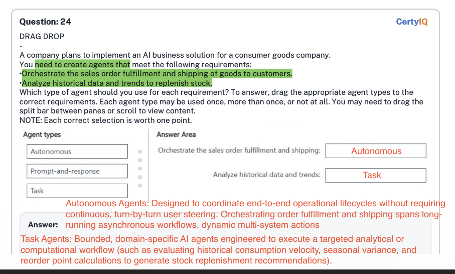

### Answer

### 1. Extracted Question Summary

* **Scenario:** A company plans to implement an AI business solution for a consumer goods company.


* **Requirements:**
* Orchestrate the sales order fulfillment and shipping of goods to customers.


* Analyze historical data and trends to replenish stock.


* **Question:** Which type of agent should you use for each requirement? (Drag the appropriate agent types to the correct requirements).


* **Agent Types Available:**
* *Autonomous*


* *Prompt-and-response*


* *Task*


---

### 2. Correct Answer

* **Orchestrate the sales order fulfillment and shipping:** **Autonomous**
* **Analyze historical data and trends:** **Task**

---

### 3. Verification of Visible Selection / Community Key

* *(Section skipped as no selections or community keys are filled in the answer boxes in the screenshot)*.


---

### 4. Official Microsoft Justification

* Under the Microsoft Learn pathway **"Architect agentic AI business solutions"** (specifically the taxonomy covering *Agent autonomy levels, Task agents, and Autonomous business agents*):
* **Autonomous Agents:** Designed to coordinate end-to-end operational lifecycles without requiring continuous, turn-by-turn user steering. Orchestrating order fulfillment and shipping spans long-running asynchronous workflows, dynamic multi-system actions (checking inventory, generating packing slips, updating ERP line items, scheduling logistics carriers), and self-directed exception escalation.
* **Task Agents:** Bounded, domain-specific AI agents engineered to execute a targeted analytical or computational workflow (such as evaluating historical consumption velocity, seasonal variance, and reorder point calculations to generate stock replenishment recommendations). Unlike simple prompt chats, task agents combine reasoning over specific operational datasets with deterministic business logic.


---

### 5. Distractor Analysis (Why Others Are Wrong)

* **Prompt-and-response:** Designed for synchronous, ad-hoc natural language question-and-answering over grounded knowledge sources (e.g., employee FAQs, helpdesk inquiries, or basic document search). It lacks workflow execution state, autonomous decision-making loops, and multi-system orchestration capabilities.
* **Why Task is not used for Fulfillment Orchestration:** End-to-end sales order fulfillment and shipping is a cross-departmental, event-driven business process requiring autonomous goal pursuit and proactive event handling across multiple enterprise systems, which exceeds the scope of a single bounded task agent.
* **Why Autonomous is not used for Trend Analysis / Replenishment:** While inventory replenishment actions could eventually be triggered by an autonomous workflow, the specific requirement here (*"Analyze historical data and trends to replenish stock"*) is a specialized, bounded analytical job designed for a task agent to process and present for procurement approval.

---

### 6. Exam Keyword / Trap Alert

* **Keywords:** *"Orchestrate sales order fulfillment and shipping"* triggers **Autonomous**, while *"Analyze historical data and trends to replenish stock"* triggers **Task**.


* **Trap:** Do not classify trend analysis as *Prompt-and-response* simply because it involves data analysis; prompt-and-response is strictly for conversational Q&A, whereas bounded business calculations and analytical workflows map directly to **Task agents**.

<br>

---

## Q25

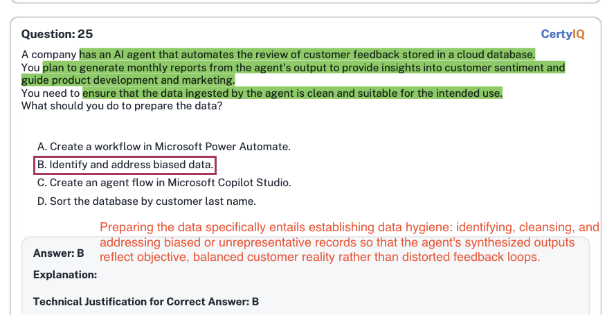

### Answer

### 1. Extracted Question Summary

* **Scenario:** A company has an AI agent that automates the review of customer feedback stored in a cloud database. You plan to generate monthly reports from the agent's output to provide insights into customer sentiment and guide product development and marketing.


* **Requirement:** Ensure that the data ingested by the agent is clean and suitable for the intended use.


* **Question:** What should you do to prepare the data?


* **Options:**
* **A.** Create a workflow in Microsoft Power Automate.


* **B.** Identify and address biased data.


* **C.** Create an agent flow in Microsoft Copilot Studio.


* **D.** Sort the database by customer last name.


---

### 2. Correct Answer

**B: Identify and address biased data.**

---

### 3. Verification of Visible Selection / Community Key

* The answer marked and boxed in the screenshot (**Answer: B**) is **Correct**, because mitigating data bias during ingestion ensures that customer sentiment metrics are representative and reliable for downstream product development and strategic decisions.


---

### 4. Official Microsoft Justification

* Under the Microsoft Learn pathway **"Architect agentic AI business solutions"** (specifically the modules covering *Responsible AI principles*, *Data preparation and curation for generative systems*, and *Data hygiene*):
* When AI agents ingest historical text and customer feedback to drive strategic executive reporting (such as guiding product development and marketing spend), data curation and quality assurance are vital prerequisites.


* Uncurated feedback repositories frequently suffer from selection bias, sampling bias, demographic imbalance, or spam/bot submissions that skew sentiment analytics.


* Preparing the data specifically entails establishing data hygiene: identifying, cleansing, and addressing biased or unrepresentative records so that the agent's synthesized outputs reflect objective, balanced customer reality rather than distorted feedback loops.


---

### 5. Distractor Analysis (Why Others Are Wrong)

* **A. Create a workflow in Microsoft Power Automate:** Power Automate orchestrates scheduled data movement or triggers events; it does not in itself prepare, validate, or ensure the semantic cleanliness or suitability of the underlying text feedback.


* **C. Create an agent flow in Microsoft Copilot Studio:** Agent flows define conversational turns and generative orchestration logic inside Copilot Studio; they execute agent actions at runtime but do not cleanse or prepare backend database ingestion datasets.


* **D. Sort the database by customer last name:** Ordering database records alphabetically by customer surname is an arbitrary indexing/sorting operation that provides zero improvement to data quality, representation, sentiment validity, or bias mitigation.


---

### 6. Exam Keyword / Trap Alert

* **Keywords:** *"Ensure data ingested by the agent is clean and suitable for the intended use"* combined with *"insights into customer sentiment and guide product development."*


* **Trap:** Do not pick workflow automation tools (*Power Automate* or *Agent flows*) when the question specifically asks what to do to **prepare and ensure the data itself is clean and suitable**. In the AB-100 exam, data preparation scenarios paired with sentiment/decision guidance focus on **data hygiene, cleansing, and addressing bias**.


<br>

---

## Q26

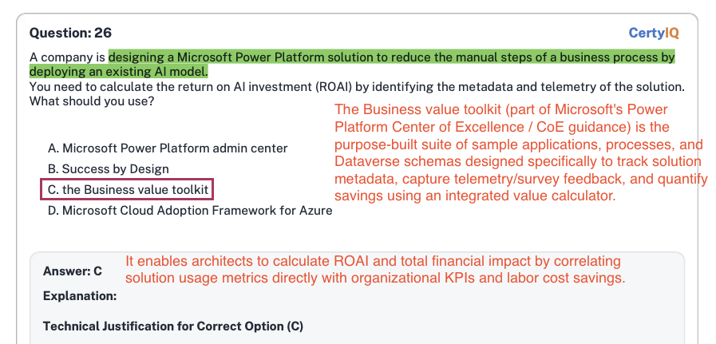

### Answer

### 1. Extracted Question Summary

* **Scenario:** A company is designing a Microsoft Power Platform solution to reduce the manual steps of a business process by deploying an existing AI model.


* **Requirement:** You need to calculate the return on AI investment (ROAI) by identifying the metadata and telemetry of the solution.


* **Question:** What should you use?


* **Options:**
* **A.** Microsoft Power Platform admin center


* **B.** Success by Design


* **C.** the Business value toolkit


* **D.** Microsoft Cloud Adoption Framework for Azure


---

### 2. Correct Answer

**C: the Business value toolkit**

---

### 3. Verification of Visible Selection / Community Key

* The answer marked and boxed in the screenshot (**Answer: C**) is **Correct**, as the Business value toolkit provides the dedicated framework, Dataverse-backed value calculator, and telemetry-capturing templates required to measure business impact and compute ROAI across Power Platform AI solutions.


---

### 4. Official Microsoft Justification

* Under the Microsoft Learn pathway **"Architect agentic AI business solutions"** (specifically the guidance on *Capturing and communicating business value* and *Measuring Return on AI Investment (ROAI)*):
* Measuring tangible business value and ROAI across low-code and agentic AI implementations requires capturing baseline process metrics (e.g., manual time spent per transaction before implementation) and comparing them against automated runtime telemetry and user-reported savings.
* **The Business value toolkit** (part of Microsoft's Power Platform Center of Excellence / CoE guidance) is the purpose-built suite of sample applications, processes, and Dataverse schemas designed specifically to track solution metadata, capture telemetry/survey feedback, and quantify savings using an integrated value calculator.
* It enables architects to calculate ROAI and total financial impact by correlating solution usage metrics directly with organizational KPIs and labor cost savings.


---

### 5. Distractor Analysis (Why Others Are Wrong)

* **A. Microsoft Power Platform admin center:** Admin center provides environment provisioning, capacity management, Data Loss Prevention (DLP) configuration, and platform-level diagnostic logs (API calls, active users); it does not provide an automated value calculator or ROAI framework tied to business process cost baselines.
* **B. Success by Design:** A prescriptive architectural and implementation review framework for Microsoft Dynamics 365 enterprise deployments to reduce project risk; it is not a software toolkit for mining Power Platform metadata and calculating ROAI.
* **D. Microsoft Cloud Adoption Framework for Azure:** Provides cloud adoption strategy, migration roadmaps, landing zones, and cloud governance for Azure infrastructure; it does not evaluate Power Platform solution telemetry to calculate application-level ROAI.

---

### 6. Exam Keyword / Trap Alert

* **Keywords:** *"Calculate the return on AI investment (ROAI)"* + *"identifying the metadata and telemetry of the solution"* in a *"Power Platform"* context.


* **Trap:** Do not default to the *Power Platform admin center* simply because it collects diagnostic telemetry; the tool engineered specifically to compute and model ROI/ROAI from solution metadata is **the Business value toolkit**.


### What is the Business Value Toolkit?

The **Business Value Toolkit** is a specialized framework and set of Power Platform components (released under Microsoft’s Center of Excellence / CoE guidance) engineered to **capture, calculate, and communicate the measurable business value and ROAI** of Power Platform and AI solutions.

It consists of:

1. **Business Value Admin App (Model-Driven App):** Used by leadership/CoE to configure organizational departments, map enterprise strategic objectives, and define standard cost baselines (the *"average cost of things"*, such as an employee's hourly labor cost or standard manual invoice handling cost).
2. **Business Value Capture App (Canvas App):** Used by makers, product owners, and end users to document use cases, log baseline metrics vs. post-implementation metrics, and record time savings.
3. **Value Calculator:** A built-in Dataverse calculation engine that quantifies financial impact (e.g., *Transactions per hour $\times$ Cost saved per transaction = Net Annual Savings*).
4. **AI-Assisted Storytelling & Value Cards:** Integrated prompt flows (via Power Automate) that refine technical stats into executive-ready narratives and embed visual "Value Cards" directly onto SharePoint intranet pages.

---

### Can It Only Be Used *After* Deploying an Agent? (Pre-Dev Value Discovery)

**No, that is a common misconception.** The toolkit is explicitly designed to handle both **Pre-Development Discovery** and **Post-Deployment Realization**.

The toolkit features two primary assessment modes:

* **Assess an Idea or Proposal (Pre-Development / Value Discovery):**
* Makers and architects submit an AI idea or proposal *before* a single line of code or agent topic is built.
* You input the **current manual pain points**, estimated volume of transactions, baseline labor hours spent, and which strategic organizational objectives the solution targets.
* The toolkit’s calculator and AI prompts analyze the proposal against enterprise goals and generate a **projected ROAI / impact score**.
* **Why this matters:** IT governance and Center of Excellence (CoE) teams use this backlog of proposals to **prioritize pipeline investments**—approving high-impact AI agents and filtering out low-value ideas before spending budget.


* **Assess an Existing App / Agent (Post-Deployment / Telemetry):**
* Once deployed, it captures actual operational telemetry, user feedback surveys (via automated cards sent to users asking how many minutes they save), and before-and-after KPI comparisons.


---

### High-Level Setup Steps

The toolkit can be deployed independently without needing the full CoE Starter Kit core infrastructure:

1. **Prerequisites & Solution Download:**
* Ensure an environment with Microsoft Dataverse is available.
* Download the managed solution package (`business_value_core_x_x_x_managed.zip`) from Microsoft’s official CoE release repository.


2. **Import the Managed Solution:**
* In Power Apps ([make.powerapps.com](https://make.powerapps.com)), import the managed solution into your designated governance/admin environment.
* Configure connection references for Dataverse, Office 365 Users, SharePoint, and Power Automate.


3. **Configure Baseline Financials in the Admin App:**
* Launch the **Business Value Admin** app.
* Define your **Business Units / Departments**.
* Enter **Strategic Objectives** (e.g., *"Reduce processing cycle time by 30%"*).
* Define the **Standard Cost Baselines** (hourly rates, transaction unit costs).


4. **Publish & Enable Maker Intake:**
* Share the **Business Value Capture** app with makers and solution architects.
* Use it during project intake to run value discovery on new agent proposals, and link it to deployed agents to track ongoing ROAI.


### 1. Is it Free to Implement?

**Yes, the Business Value Toolkit is completely free to download and implement.**

* **No separate software purchase:** It is published as an open-source/guidance asset by Microsoft's PowerCAT team and distributed via the **Center of Excellence (CoE) Starter Kit** releases (`aka.ms/CoeStarterKitDownload` or GitHub).
* **Licensing prerequisite:** Because it utilizes **Microsoft Dataverse** for custom schema storage and **Power Apps / Power Automate premium connectors / generative AI prompt actions**, users and admins who interact with the toolkit need standard Power Platform premium licenses (e.g., *Power Apps per user/per app* or *Copilot Studio/Capacity* licenses already provisioned in your tenant). There is zero additional cost for the toolkit solution itself.

---

### 2. Central Deployment vs. Multiple Environments

**It is designed to be deployed into a single, centralized environment.**

You **do not** need to install the solution across every child, development, or production environment.

#### Architectural Topology:

```
┌────────────────────────────────────────────────────────────────────────┐
│             Central Governance / CoE Dedicated Environment             │
│   (e.g., "IT Governance - CoE" or "Center for Enablement")             │
│                                                                        │
│   • Business Value Admin App (Central Cost Baselines, Depts, Targets)  │
│   • Business Value Capture App (Makers submit ideas or app reviews)    │
│   • Dataverse Tables (Central Value Storage & ROI Calculator)          │
│   • Automated Admin & User Assessment Flows                            │
└───────────────────────────────────┬────────────────────────────────────┘
                                    │
       Queries tenant metadata via admin connection references
                                    │
       ┌────────────────────────────┼────────────────────────────┐
       ▼                            ▼                            ▼
┌──────────────┐             ┌──────────────┐             ┌──────────────┐
│  Dev / Test  │             │  Production  │             │  Production  │
│  Environment │             │  Env (Sales) │             │  Env (HR/Ops)│
└──────────────┘             └──────────────┘             └──────────────┘

```

#### Why a Single Central Environment?

1. **Centralized Baseline Financials:** Your standard labor rates, invoice processing unit costs, and strategic organizational objectives are defined in one place in the **Business Value Admin App**. You don't want fragmented or divergent cost formulas scattered across environments.
2. **Tenant-Wide Visibility via Admin Connectors:** The toolkit uses admin connection references (e.g., *Power Apps for Admins*, *Power Automate for Admins*, *Office 365 Users*). From this single hub, the toolkit can discover and list applications across the entire tenant regardless of which environment they live in.
3. **Standalone Independence:** Unlike earlier iterations of the CoE Starter Kit, the Business Value Toolkit is packaged as an independent solution (`business_value_core_x_x_x_managed.zip`). It does **not** require the remaining inventory or sync flows of the core CoE Starter Kit to function.
4. **Intranet Distribution:** Once stories and metrics are calculated in this central environment, you embed the **Display Value Cards** canvas app directly onto company-wide SharePoint Online communication pages or Teams channels via a simple web link parameter (`?storyId=...`).


<br>

---


## Q27

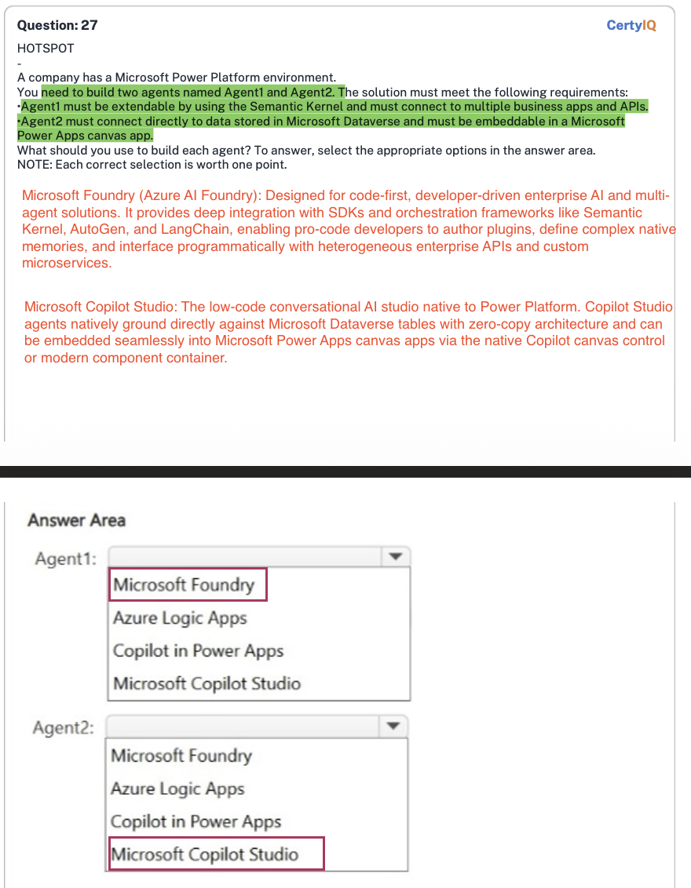

### Answer

### 1. Extracted Question Summary

* **Scenario:** A company has a Microsoft Power Platform environment and needs to build two agents named `Agent1` and `Agent2` to meet specific requirements:


* `Agent1` must be extendable by using the Semantic Kernel and must connect to multiple business apps and APIs.


* `Agent2` must connect directly to data stored in Microsoft Dataverse and must be embeddable in a Microsoft Power Apps canvas app.


* **Question:** What should you use to build each agent?


* **Answer Area (Dropdown for Agent1):**
* *Microsoft Foundry*


* *Azure Logic Apps*


* *Copilot in Power Apps*


* *Microsoft Copilot Studio*


* **Answer Area (Dropdown for Agent2):**
* *Microsoft Foundry*


* *Azure Logic Apps*


* *Copilot in Power Apps*


* *Microsoft Copilot Studio*


---

### 2. Correct Answer

* **Agent1:** **Microsoft Foundry**
* **Agent2:** **Microsoft Copilot Studio**

---

### 3. Verification of Visible Selection / Community Key

* *(Section skipped as no answers or community keys are marked or selected in the screenshot)*.


---

### 4. Official Microsoft Justification

* Under the Microsoft Learn pathway **"Architect agentic AI business solutions"** (specifically the modules covering *Selecting the right platform: Microsoft Copilot Studio vs. Azure AI Foundry / Microsoft Foundry* and *Code-first agent architectures with Semantic Kernel*):
* **Microsoft Foundry (Azure AI Foundry):** Designed for code-first, developer-driven enterprise AI and multi-agent solutions. It provides deep integration with SDKs and orchestration frameworks like **Semantic Kernel**, AutoGen, and LangChain, enabling pro-code developers to author plugins, define complex native memories, and interface programmatically with heterogeneous enterprise APIs and custom microservices.
* **Microsoft Copilot Studio:** The low-code conversational AI studio native to Power Platform. Copilot Studio agents natively ground directly against **Microsoft Dataverse** tables with zero-copy architecture and can be embedded seamlessly into **Microsoft Power Apps canvas apps** via the native Copilot canvas control or modern component container.


---

### 5. Distractor Analysis (Why Others Are Wrong)

#### For Agent1:

* **Microsoft Copilot Studio:** While Copilot Studio can invoke plugins and actions, code-first extensibility built on top of the **Semantic Kernel** SDK resides in Azure AI Foundry / Microsoft Foundry.
* **Azure Logic Apps:** An integration and workflow orchestration platform for event-driven logic and connectors, not an AI agent development platform extensible via the Semantic Kernel SDK.
* **Copilot in Power Apps:** A built-in feature enabling natural language interactions for makers and end users within Power Apps; it is not a standalone agent builder extendable with Semantic Kernel.

#### For Agent2:

* **Microsoft Foundry:** Requires custom REST endpoints, authentication bridging, and iframe/web components to embed into canvas apps, and does not have the native, low-code zero-config Dataverse binding that Copilot Studio provides.
* **Azure Logic Apps:** Used for backend flow orchestration and data pipelines, not a conversational agent capable of being embedded into a canvas UI.
* **Copilot in Power Apps:** Refers to the prebuilt platform Copilot assistant rather than a custom authored agent designed to bind to custom Dataverse schemas and embed as an app component.

---

### 6. Exam Keyword / Trap Alert

* **Keywords:** *"Extendable by using the Semantic Kernel"* points directly to **Microsoft Foundry** (Azure AI Foundry), while *"connect directly to data stored in Microsoft Dataverse"* + *"embeddable in a Microsoft Power Apps canvas app"* points directly to **Microsoft Copilot Studio**.


* **Trap:** Do not select *Copilot in Power Apps* for either agent; that option is an assistive platform feature, whereas *Microsoft Copilot Studio* and *Microsoft Foundry* are the designated development platforms for authoring custom agents.


<br>

---


## Q28

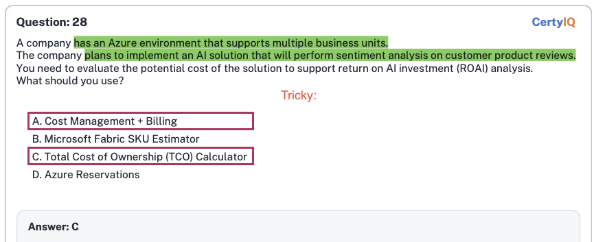

### Answer

### 1. Extracted Question Summary

* **Scenario:** A company has an Azure environment that supports multiple business units. The company plans to implement an AI solution that will perform sentiment analysis on customer product reviews.


* **Requirement:** Evaluate the potential cost of the solution to support Return on AI Investment (ROAI) analysis.


* **Question:** What should you use?


* **Options:**
* **A.** Cost Management + Billing


* **B.** Microsoft Fabric SKU Estimator


* **C.** Total Cost of Ownership (TCO) Calculator


* **D.** Azure Reservations


---

### 2. Correct Answer

**A: Cost Management + Billing**

---

### 3. Verification of Visible Selection / Community Key

* The answer marked and boxed in the screenshot (**Answer: C: Total Cost of Ownership (TCO) Calculator**) is **Incorrect / Flawed Dump Key**.


* The dump creator selected the **TCO Calculator** due to keyword association with "ROAI/cost," but the Azure TCO Calculator is exclusively a datacenter migration tool (comparing on-premises physical servers, storage, and networking against Azure infrastructure) and cannot model Azure AI service consumption. When the *Azure Pricing Calculator* is not present in the options, **Cost Management + Billing** is the intended official answer.

---

### 4. Official Microsoft Justification

* Under the Microsoft Learn pathway **"Architect agentic AI business solutions"** (specifically the modules covering *Plan AI-powered business solutions*, *Financial Planning for AI Solutions*, and *Enterprise Cost Governance*):
* In an enterprise architecture where an organization **already has an established Azure environment supporting multiple business units**, cost governance and projected workload evaluation must account for existing organizational scopes, shared billing constructs, and forecasted consumption.


* **Microsoft Cost Management + Billing** provides the foundational tools to model, allocate, and forecast cloud spending across distinct business units (using management groups, subscription scopes, cost allocation rules, and budgets). It incorporates predictive forecasting algorithms that project upcoming consumption trends and operational expenditures necessary to substantiate an accurate ROAI business case.


---

### 5. Distractor Analysis (Why Others Are Wrong)

* **B. Microsoft Fabric SKU Estimator:** Specifically calculates capacity provisioning (e.g., F-SKUs) for Microsoft Fabric analytics workloads (OneLake, Synapse Data Engineering/Warehouse, Power BI premium capacities); it does not evaluate generic Azure AI sentiment analysis API consumption costs.
* **C. Total Cost of Ownership (TCO) Calculator:** A common trap. The Azure TCO Calculator is strictly designed to evaluate the financial cost savings of **migrating on-premises datacenter workloads** (physical compute, SAN storage, virtualization, datacenter power/cooling, on-premises IT staffing) into Azure. It does not support configuring Azure AI Foundry, Azure OpenAI, or Azure AI Language APIs for sentiment analysis.
* **D. Azure Reservations:** A financial commitment purchasing mechanism (1-year or 3-year upfront commitment for compute/database capacity discounts); it is a discount instrument, not a cost evaluation or forecasting tool.

---

### 6. Exam Keyword / Trap Alert

* **Keywords:** *"Azure environment that supports multiple business units"* + *"evaluate the potential cost ... to support return on AI investment (ROAI)"*.


* **Trap:** Do not fall for the literal word "TCO" in **Option C**! The Azure TCO Calculator is strictly for on-premises-to-cloud migration studies. If the question asks to project costs across existing Azure subscriptions/business units and *Azure Pricing Calculator* is omitted, the correct tool is **Cost Management + Billing**.


That is one of the most debated questions in the AB-100 question pool, and your reasoning hits the exact intuitive contradiction that causes so many candidates to get tripped up by it.

Here is how Microsoft structures this question, why the question pool behaves the way it does, and why the official answer is **Cost Management + Billing**.

---

### 1. The Core Exam Question Pattern: Repeated Scenarios with Different Distractors

In the actual Microsoft AB-100 item bank, Microsoft uses this identical scenario stem across multiple variations:

> *"A company has an Azure environment that supports multiple business units. The company plans to implement an AI solution that will perform sentiment analysis on customer product reviews. You need to evaluate the potential cost of the solution to support return on AI investment (ROAI) analysis. What should you use?"*

Depending on which permutation of the question you receive on the exam:

* **Variant 1:** When **Azure pricing calculator** is listed in the options, **Azure pricing calculator** is the correct answer because it directly estimates pre-deployment consumption (API calls/tokens).
* **Variant 2 (This Question):** When **Azure pricing calculator** is **not** an option (replaced by *Microsoft Fabric SKU Estimator*, *Azure Reservations*, *Total Cost of Ownership (TCO) Calculator*, and *Cost Management + Billing*), the correct answer is **Cost Management + Billing**.

---

### 2. Why "TCO Calculator" is Technically and Architecturally Impossible

The prompt specifically says: *"plans to implement an AI solution that will perform sentiment analysis on customer product reviews."*

Many candidates pick **Total Cost of Ownership (TCO) Calculator** purely because of keyword association with "ROAI" and "potential cost." However, in the Microsoft ecosystem:

1. **The Azure TCO Calculator has zero capability to model AI or cloud-native applications:** It is strictly an **on-premises-to-cloud migration comparison tool**. It asks you:
* *How many physical/virtual server cores do you run in your on-premises datacenter?*
* *How many TB of SAN/NAS storage do you have on-premises?*
* *What are your on-premises electricity, rack, and IT administrative labor costs?*
It then outputs a report comparing on-prem datacenter operating costs against equivalent Azure VMs and storage.


2. There is no field, slider, or capability in the TCO Calculator to enter Azure AI Foundry, Azure OpenAI tokens, or Language Cognitive Services text records for sentiment analysis.
3. The company **already has an Azure environment**; they are not migrating a physical datacenter to Azure.

Therefore, Microsoft never designates the TCO Calculator as the solution for greenfield Azure AI workloads.

---

### 3. How "Cost Management + Billing" Evaluates Potential Cost Before Full Rollout

You are completely right that Cost Management tracks incurred costs, but under the Microsoft Learn curriculum for **"Plan AI-powered business solutions"** and **Cost Governance**, Cost Management + Billing plays two critical pre-implementation roles:

1. **Enterprise Scope & Rate Cards:**
* In an enterprise supporting multiple business units, resource costs are heavily affected by organizational pricing (e.g., Enterprise Agreement / MCA negotiated discount tiers, regional currency rates, and existing shared commitments). Cost Management + Billing defines these scopes (Management Groups, Subscription billing profiles) against which any planned workload must be assessed.


2. **Pilot Ingestion & Cost Forecasting:**
* In enterprise AI architectural practices, before fully committing capital to a large-scale generative or sentiment analysis rollout, organizations deploy an initial pilot/prototype workload against a subset of data.
* Cost Management + Billing uses built-in **machine learning forecasting algorithms** to project the linear and seasonal trajectory of that consumption across the enterprise's billing periods, enabling architects to project the ongoing run-rate needed for an accurate ROAI denominator.


3. **Cost Allocation & Showback:**
* The scenario explicitly emphasizes that the environment **supports multiple business units**. Cost Management + Billing allows architects to model how these new AI consumption costs will be tagged, budgeted, and allocated across each respective business unit's cost center.


---

### Summary for the Exam

If this exact question appears:

* Look for **Azure pricing calculator** first.
* If **Azure pricing calculator** is absent from the choices, select **Cost Management + Billing**.
* **Never select the TCO Calculator** unless the scenario explicitly involves calculating cost savings from decommissioning on-premises physical hardware and migrating to Azure.


### Azure Pricing Calculator vs. Total Cost of Ownership (TCO) Calculator

| Feature / Dimension | Azure Pricing Calculator | Total Cost of Ownership (TCO) Calculator |
| --- | --- | --- |
| **Primary Purpose** | Estimate the ongoing operational cost (OpEx) of specific Azure cloud services before provisioning. | Estimate and compare cumulative cost savings over 1–5 years when migrating an existing **on-premises datacenter** to Azure. |
| **Target Workload Type** | **Cloud-native & net-new services:** Azure AI Foundry, Azure OpenAI tokens, Copilot Studio capacity, Azure AI Search, VMs, Azure SQL, storage, networking. | **Infrastructure migration:** Physical servers, SAN/NAS storage, virtualization hosts (VMware/Hyper-V), physical networking gear. |
| **Input Parameters** | Service tiers, regions, instance sizes, API calls, prompt/completion token volumes, storage capacity, egress bandwidth. | Server hardware costs, electricity/cooling, physical rack space, virtualization licensing, datacenter storage maintenance, IT admin labor. |
| **Output / Deliverable** | Detailed, itemized monthly and annual cost estimate; exportable as an Excel or PDF quote or saved estimate link. | High-level financial comparison report showing on-premises run rate vs. Azure run rate and total projected dollar savings. |
| **Exam Relevance (AB-100)** | The correct tool for pre-deployment pricing, sizing AI model inference (Azure OpenAI, Azure AI Language), and modeling token consumption. | **Never the answer for AI workloads.** Only chosen if the question explicitly mentions migrating an on-premises datacenter to Azure. |

---

### Where to Find the Azure Pricing Calculator

The **Azure Pricing Calculator is not a native blade inside the Azure Portal** (`portal.azure.com`).

It is hosted as a standalone, publicly accessible web tool directly on the Azure marketing/documentation portal:

* **Direct URL:** [azure.microsoft.com/pricing/calculator](https://azure.microsoft.com/pricing/calculator/)

#### How to Access It from Within the Azure Ecosystem:

1. **From Any Browser:** Navigate directly to `[https://azure.microsoft.com/pricing/calculator/](https://azure.microsoft.com/pricing/calculator/)`.
2. **From the Azure Portal Search Bar:**
* Sign in to `portal.azure.com`.
* In the top global search bar, type `Pricing Calculator`.
* Under the **Resources / Documentation / Web links** section of the search results, click **Azure Pricing Calculator**. This opens the calculator tool in a new browser tab.


3. **During Resource Creation (inline estimates):**
* When deploying individual services (such as Azure OpenAI, Azure AI Search, or an App Service) through the Azure Portal wizard, the final **Review + create** tab displays an estimated hourly or monthly rate card for that single resource configuration, with a hyperlinked prompt pointing to the full Pricing Calculator.


<br>

---

## Q29

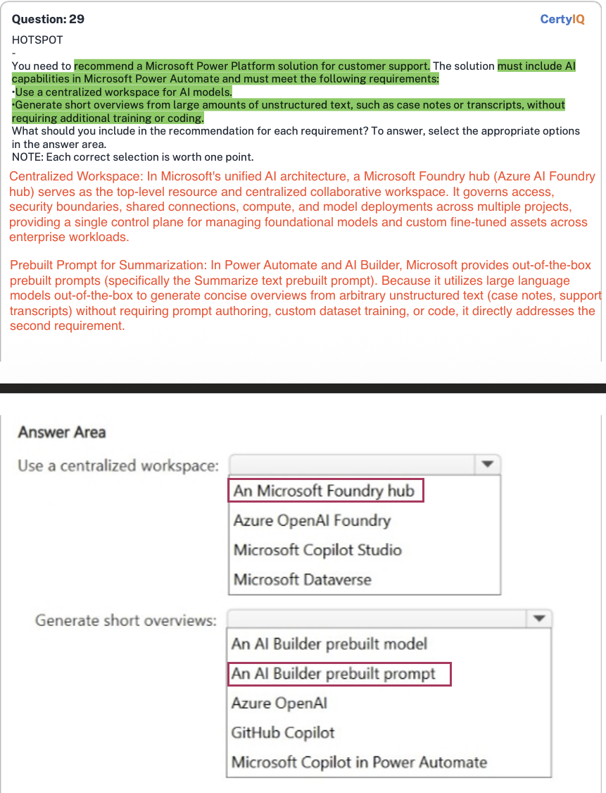

### Answer

### 1. Extracted Question Summary

* **Scenario:** You need to recommend a Microsoft Power Platform solution for customer support. The solution must include AI capabilities in Microsoft Power Automate and must meet the following requirements:


* Use a centralized workspace for AI models.


* Generate short overviews from large amounts of unstructured text, such as case notes or transcripts, without requiring additional training or coding.


* **Question:** What should you include in the recommendation for each requirement?


* **Answer Area (Dropdown 1 - Use a centralized workspace):**
* *An Microsoft Foundry hub*


* *Azure OpenAI Foundry*


* *Microsoft Copilot Studio*


* *Microsoft Dataverse*


* **Answer Area (Dropdown 2 - Generate short overviews):**
* *An AI Builder prebuilt model*


* *An AI Builder prebuilt prompt*


* *Azure OpenAI*


* *GitHub Copilot*


* *Microsoft Copilot in Power Automate*


---

### 2. Correct Answer

* **Use a centralized workspace:** **An Microsoft Foundry hub**
* **Generate short overviews:** **An AI Builder prebuilt prompt**

---

### 3. Verification of Visible Selection / Community Key

* *(Section skipped as no answer or community key is marked or selected in the screenshot)*.


---

### 4. Official Microsoft Justification

* Under the Microsoft Learn pathway **"Architect agentic AI business solutions"** (specifically modules addressing *Centralized enterprise AI management with Azure AI Foundry / Microsoft Foundry hubs* and *Power Automate AI Builder integration*):
* **Centralized Workspace:** In Microsoft's unified AI architecture, a **Microsoft Foundry hub** (Azure AI Foundry hub) serves as the top-level resource and centralized collaborative workspace. It governs access, security boundaries, shared connections, compute, and model deployments across multiple projects, providing a single control plane for managing foundational models and custom fine-tuned assets across enterprise workloads.
* **Prebuilt Prompt for Summarization:** In Power Automate and AI Builder, Microsoft provides out-of-the-box **prebuilt prompts** (specifically the *Summarize text* prebuilt prompt). Because it utilizes large language models out-of-the-box to generate concise overviews from arbitrary unstructured text (case notes, support transcripts) without requiring prompt authoring, custom dataset training, or code, it directly addresses the second requirement.


---

### 5. Distractor Analysis (Why Others Are Wrong)

#### Dropdown 1: Use a centralized workspace

* **Azure OpenAI Foundry:** A non-existent/fictitious service name combining Azure OpenAI and Azure AI Foundry.
* **Microsoft Copilot Studio:** A studio for authoring conversational and autonomous agents; it is not the enterprise workspace/hub for hosting and managing underlying AI model deployments.
* **Microsoft Dataverse:** The underlying transactional data fabric and relational business database for Power Platform; it stores records and schema metadata, not an AI model workspace.

#### Dropdown 2: Generate short overviews

* **An AI Builder prebuilt model:** AI Builder prebuilt *models* are designed for specific computer vision/structured tasks (such as Receipt Processing, Invoice Processing, Business Card Reader, Sentiment Analysis, or Language Detection). Text summarization in AI Builder is implemented as an **AI Builder prebuilt prompt** (*Summarize text*).
* **Azure OpenAI:** Requires custom API orchestration, credential management, or direct REST/HTTP connector actions in Power Automate, requiring additional configuration rather than using the native zero-code Power Automate AI Builder prompt catalog.
* **GitHub Copilot:** A developer pair-programming coding assistant for IDEs, not an automation action for runtime text summarization.
* **Microsoft Copilot in Power Automate:** The conversational maker assistant inside the Power Automate flow designer used to build and edit flows with natural language; it does not process runtime payload data inside a running flow.

---

### 6. Exam Keyword / Trap Alert

* **Keywords:** *"Centralized workspace for AI models"* maps to **An Microsoft Foundry hub**; *"Generate short overviews from large amounts of unstructured text... without requiring additional training or coding"* in Power Automate maps to **An AI Builder prebuilt prompt**.


* **Trap:** Distinguish carefully between an *AI Builder prebuilt model* (fixed tasks like ID reader, receipt reader, sentiment analysis) and an *AI Builder prebuilt prompt* (generative tasks like summarization, text classification, and entity extraction). Summarization is a **prebuilt prompt**.


<br>

---

## Q30

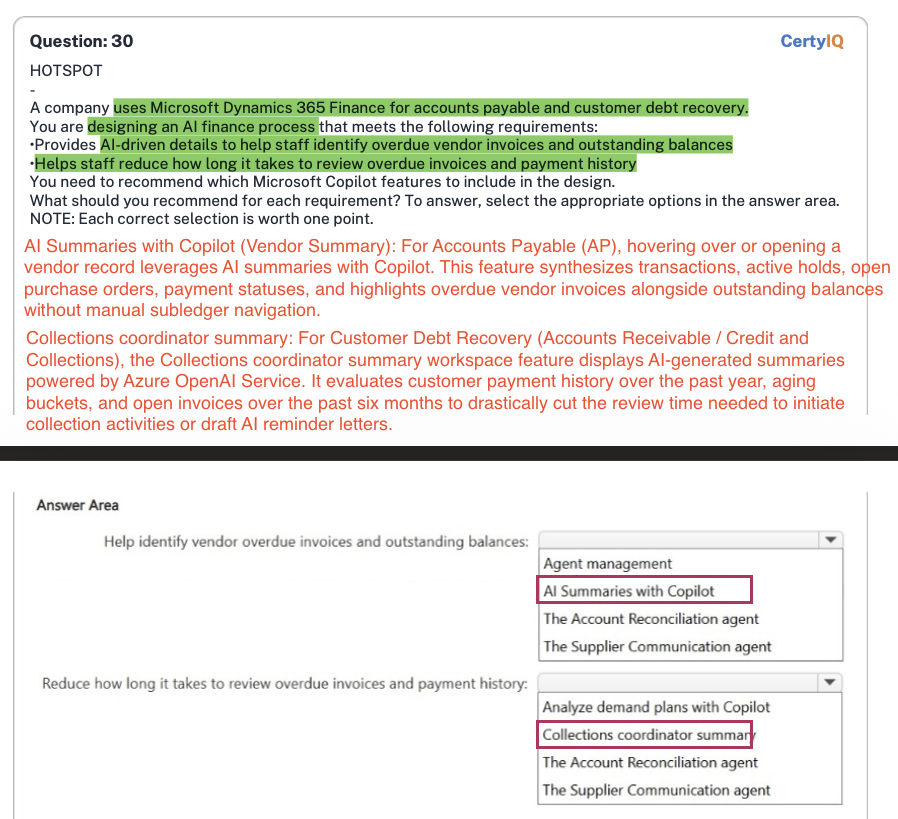

### Answer

### 1. Extracted Question Summary

* **Scenario:** A company uses Microsoft Dynamics 365 Finance for accounts payable and customer debt recovery. You are designing an AI finance process that meets the following requirements:


1. Provides AI-driven details to help staff identify overdue vendor invoices and outstanding balances.


2. Helps staff reduce how long it takes to review overdue invoices and payment history.


* **Requirement:** Recommend which Microsoft Copilot features to include in the design.


* **Answer Area (Dropdown 1 - Help identify vendor overdue invoices and outstanding balances):**


* *Agent management*


* *AI Summaries with Copilot*


* *The Account Reconciliation agent*


* *The Supplier Communication agent*


* **Answer Area (Dropdown 2 - Reduce how long it takes to review overdue invoices and payment history):**


* *Analyze demand plans with Copilot*


* *Collections coordinator summary*


* *The Account Reconciliation agent*


* *The Supplier Communication agent*


---

### 2. Correct Answer

* **Help identify vendor overdue invoices and outstanding balances:** **AI Summaries with Copilot**
* **Reduce how long it takes to review overdue invoices and payment history:** **Collections coordinator summary**

---

### 3. Verification of Visible Selection / Community Key

* *(Section skipped as no selections or community keys are marked or highlighted in the screenshot)*.


---

### 4. Official Microsoft Justification

* Under the Microsoft Learn pathway **"Architect agentic AI business solutions"** (specifically the modules covering *Dynamics 365 Copilot capabilities in Finance and Operations*):
* **AI Summaries with Copilot (Vendor Summary):** For Accounts Payable (AP), hovering over or opening a vendor record leverages **AI summaries with Copilot**. This feature synthesizes transactions, active holds, open purchase orders, payment statuses, and highlights overdue vendor invoices alongside outstanding balances without manual subledger navigation.
* **Collections coordinator summary:** For Customer Debt Recovery (Accounts Receivable / Credit and Collections), the **Collections coordinator summary** workspace feature displays AI-generated summaries powered by Azure OpenAI Service. It evaluates customer payment history over the past year, aging buckets, and open invoices over the past six months to drastically cut the review time needed to initiate collection activities or draft AI reminder letters.


---

### 5. Distractor Analysis (Why Others Are Wrong)

#### Dropdown 1: Help identify vendor overdue invoices and outstanding balances

* **The Supplier Communication agent:** Designed specifically to automate inbound/outbound vendor email exchanges regarding purchase order confirmations and delivery date changes in Supply Chain Management; it does not generate the in-app summary details for identifying overdue vendor invoice balances.
* **The Account Reconciliation agent:** Autonomous finance agent tailored for ledger matching, flagging discrepancies between general ledgers and sub-ledgers (bank, GL, subledger reconciliation), not identifying vendor AP overdue invoices.
* **Agent management:** An administrative and governance console in finance and operations apps used to deploy, configure, and monitor autonomous AI agents, not an end-user analytical Copilot feature.

#### Dropdown 2: Reduce how long it takes to review overdue invoices and payment history

* **Analyze demand plans with Copilot:** A Supply Chain Management feature built for demand planners to spot forecast shifts, seasonality trends, and anomaly detection, unrelated to debt recovery or invoice payment history.
* **The Supplier Communication agent:** Vendor/procurement-facing communications tool; customer debt recovery involves customer payment history, not supplier purchase order communication.
* **The Account Reconciliation agent:** Bounded to periodic account balancing and journal matching, not reviewing customer debt recovery histories or aging invoices.

---

### 6. Exam Keyword / Trap Alert

* **Keywords:**
* *"Vendor overdue invoices and outstanding balances"* = **AI Summaries with Copilot** (Vendor Summary in ERP).
* *"Reduce how long it takes to review overdue invoices and payment history"* paired with *"customer debt recovery"* = **Collections coordinator summary**.


* **Trap:** Do not confuse the *Supplier Communication agent* with vendor summaries. The Supplier Communication agent strictly handles email dialogues and PO confirmation changes, whereas fast record/invoice balance identification in the ERP interface is delivered via **AI Summaries with Copilot**.


**Yes, both are 100% built-in, out-of-the-box features.** You do not need to write custom code, build custom AI models, or assemble custom Copilot Studio agent flows to get these capabilities.

Both features are pre-engineered by Microsoft directly into the finance and operations platform:

---

### 1. Where These Built-in Features Live

#### A. AI Summaries with Copilot (Accounts Payable / Vendors)

* **Location:** Built directly into the **All vendors** page under **Accounts Payable** (`Accounts payable > Vendors > All vendors`).
* **How it works:** When you open or select a vendor account, Dynamics 365 presents a native FastTab titled **Summary by Copilot** (or surfaces product/vendor hover cards).
* **What it does out-of-the-box:** Without any custom orchestration, it automatically aggregates ledger data to display the vendor's currency, hold status, number of open purchase orders, posted vendor invoices, payment status, and highlights **overdue vendor invoices and outstanding balances**.

#### B. Collections Coordinator Summary (Accounts Receivable / Debt Recovery)

* **Location:** Built directly into the **Credit and collections** module under the **Collections coordinator** workspace (`Credit and collections > Workspaces > Collections coordinator`).
* **How it works:** When a credit or collections agent selects a customer account and views customer details, the native **Summary by Copilot** pane is displayed right on the workspace canvas.
* **What it does out-of-the-box:** It uses Azure OpenAI Service to analyze the customer’s payment history over the past year, current outstanding debt, and open invoices over the last six months. It generates a concise natural-language overview to slash the time staff spend manually digging through subledgers, and even provides a one-click button to draft personalized collection reminder emails.

---

### 2. What Is Required to Turn Them On? (Configuration, Not Custom Code)

Because they are native first-party capabilities, deploying them is purely an administrative enablement workflow:

1. **Power Platform Integration:** Ensure your Dynamics 365 Finance and Operations environment has **Power Platform Integration** linked and enabled via Microsoft Lifecycle Services (LCS) or Power Platform Admin Center (PPAC).
2. **Feature Management Workspace:**
* Go to **System administration > Workspaces > Feature management**.
* Verify and enable:
* **(Preview) AI summaries with Copilot** (or ensure the underlying Copilot summaries feature is enabled).
* **Collections coordinator summary** (turned on by default in modern service updates like version 10.0.40+).


3. **Security Privileges:** Users automatically inherit access based on their standard out-of-the-box security roles (e.g., *Accounts payable clerk*, *Accounts payable manager*, or *Collections coordinator*).

### Why This Matters for the AB-100 Exam

Microsoft designs these questions specifically to test whether a Solution Architect knows **when to leverage native first-party SaaS Copilot features vs. when to build custom agents**. When standard business requirements (like AP vendor balance checks or AR debt recovery summaries) are fully satisfied by Dynamics 365's native Copilot features, recommending a custom-built solution or standalone agent is considered an anti-pattern.


<br>

---

## Q33

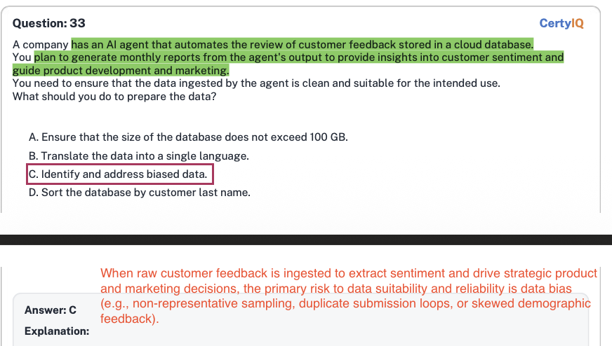

### Answer

### 1. Extracted Question Summary

* **Scenario:** A company has an AI agent that automates the review of customer feedback stored in a cloud database. You plan to generate monthly reports from the agent's output to provide insights into customer sentiment and guide product development and marketing.


* **Requirement:** Ensure that the data ingested by the agent is clean and suitable for the intended use.


* **Question:** What should you do to prepare the data?


* **Options:**
* **A.** Ensure that the size of the database does not exceed 100 GB.


* **B.** Translate the data into a single language.


* **C.** Identify and address biased data.


* **D.** Sort the database by customer last name.


---

### 2. Correct Answer

**C: Identify and address biased data.**

---

### 3. Verification of Visible Selection / Community Key

* The answer marked in the screenshot (**Answer: C**) is **Correct**, as identifying and mitigating data bias is the essential data preparation step to ensure feedback metrics are statistically representative, accurate, and suitable for informing business decisions.


---

### 4. Official Microsoft Justification

* Under the Microsoft Learn pathway **"Architect agentic AI business solutions"** (specifically the modules covering *Responsible AI principles*, *Data preparation and curation for generative systems*, and *Data hygiene*):
* When raw customer feedback is ingested to extract sentiment and drive strategic product and marketing decisions, the primary risk to data suitability and reliability is **data bias** (e.g., non-representative sampling, duplicate submission loops, or skewed demographic feedback).


* Microsoft's Responsible AI and data preparation frameworks mandate that architects implement data hygiene pipelines that detect, balance, and remediate skewed or biased datasets before ingestion to ensure model outputs reflect ground truth rather than distorted patterns.


---

### 5. Distractor Analysis (Why Others Are Wrong)

* **A. Ensure that the size of the database does not exceed 100 GB:** An arbitrary storage constraint that has no bearing on whether ingested data is semantically clean, objective, or suitable for sentiment analysis.


* **B. Translate the data into a single language:** Modern multimodal and multilingual foundation models natively analyze and extract sentiment across multiple languages without requiring pre-translation pipelines, which can introduce semantic loss or translation errors.
* **D. Sort the database by customer last name:** Merely changes the display or index order of records; it does not clean, validate, or improve data suitability.


---

### 6. Exam Keyword / Trap Alert

* **Keywords:** *"Ensure that the data ingested by the agent is clean and suitable"* paired with *"insights into customer sentiment and guide product development and marketing."*


* **Trap:** Beware of distractors proposing mechanical database operations (like sorting or size caps); in data preparation questions under the AB-100 architecture blueprint, ensuring data quality for strategic sentiment analysis requires **identifying and addressing biased data**.


<br>

---

## Q34

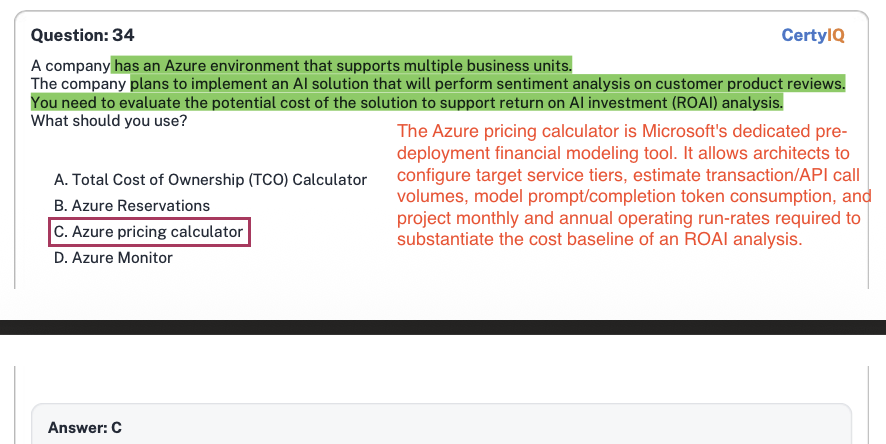

### Answer

### 1. Extracted Question Summary

* **Scenario:** A company has an Azure environment that supports multiple business units. The company plans to implement an AI solution that will perform sentiment analysis on customer product reviews.


* **Requirement:** You need to evaluate the potential cost of the solution to support return on AI investment (ROAI) analysis.


* **Question:** What should you use?


* **Options:**
* **A.** Total Cost of Ownership (TCO) Calculator


* **B.** Azure Reservations


* **C.** Azure pricing calculator


* **D.** Azure Monitor


---

### 2. Correct Answer

**C: Azure pricing calculator**

---

### 3. Verification of Visible Selection / Community Key

* *(Section skipped as no answer or community key is marked or highlighted in the screenshot)*.


---

### 4. Official Microsoft Justification

* Under the Microsoft Learn pathway **"Architect agentic AI business solutions"** (specifically the modules covering *Plan AI-powered business solutions*, *Evaluating Return on AI Investment (ROAI)*, and *Pre-deployment Financial Estimation*):
* When designing a planned/net-new AI solution (such as sentiment analysis on customer reviews using Azure AI Language or Azure OpenAI), architects must forecast projected operational expenditure (OpEx) before provisioning resources.


* The **Azure pricing calculator** is Microsoft's dedicated pre-deployment financial modeling tool. It allows architects to configure target service tiers, estimate transaction/API call volumes, model prompt/completion token consumption, and project monthly and annual operating run-rates required to substantiate the cost baseline of an ROAI analysis.


---

### 5. Distractor Analysis (Why Others Are Wrong)

* **A. Total Cost of Ownership (TCO) Calculator:** Designed exclusively to compare the financial costs of migrating an **on-premises physical datacenter** (servers, storage, power, virtualization, cooling) into Azure. It cannot model Azure AI service consumption or estimate cloud-native AI workload costs.
* **B. Azure Reservations:** A financial commitment purchasing model that provides discounted hourly rates for predictable, steady-state compute workloads (e.g., 1-year or 3-year commitments on VMs or dedicated capacity). It is a discount mechanism, not an exploratory pre-deployment cost evaluation tool.
* **D. Azure Monitor:** A platform observability and diagnostic service that collects telemetry, performance metrics, and application logs from running cloud resources; it does not evaluate financial costs or model pre-deployment ROAI.

---

### 6. Exam Keyword / Trap Alert

* **Keywords:** *"Plans to implement an AI solution"* + *"evaluate the potential cost ... to support return on AI investment (ROAI) analysis."*


* **Trap:** This is the twin variation of Question 28! Whenever **Azure pricing calculator** is present in the choices for estimating the potential cost of an unbuilt AI solution, **Azure pricing calculator** is always the intended answer. Remember: never choose the *TCO Calculator* for cloud-native AI workloads.


<br>

---

## Q35

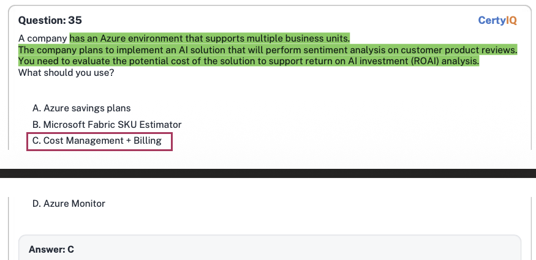

### 1. Extracted Question Summary

* **Scenario:** A company has an Azure environment that supports multiple business units. The company plans to implement an AI solution that will perform sentiment analysis on customer product reviews.


* **Requirement:** You need to evaluate the potential cost of the solution to support return on AI investment (ROAI) analysis.


* **Question:** What should you use?


* **Options:**
* **A.** Azure savings plans


* **B.** Microsoft Fabric SKU Estimator


* **C.** Cost Management + Billing


* **D.** Azure Monitor


---

### 2. Correct Answer

**C: Cost Management + Billing**

---

### 3. Verification of Visible Selection / Community Key

* The visible selection marked in the screenshot (**Answer: C**) is **Correct**, because in the absence of the standalone web-based Azure pricing calculator, Microsoft Cost Management + Billing is the designated enterprise platform tool to evaluate cost allocation, forecast consumption, and model spending across multi-business-unit scopes to substantiate an ROAI analysis.


---

### 4. Official Microsoft Justification

* Under the Microsoft Learn pathway **"Architect agentic AI business solutions"** (specifically the modules covering *Plan AI-powered business solutions*, *Evaluating Return on AI Investment (ROAI)*, and *Enterprise Cost Governance and Billing Scopes*):
* In an enterprise architecture where an organization **already operates an established Azure environment supporting multiple business units**, potential solution costs must be evaluated in the context of enterprise rate cards, active commitment discounts (Enterprise Agreement / MCA), and specific departmental scopes (Management Groups and Billing Profiles).


* **Microsoft Cost Management + Billing** enables architects to model multi-tenant cost allocation and leverage predictive forecasting algorithms across pilot/test iterations. This establishes the accurate cost baseline (TCO/run-rate) required as the denominator for calculating Return on AI Investment (ROAI).


---

### 5. Distractor Analysis (Why Others Are Wrong)

* **A. Azure savings plans:** A pricing discount mechanism offering flexible savings across compute services (up to 65% on select compute) based on an hourly spend commitment; it is an optimization purchasing vehicle, not a tool to evaluate potential solution costs or model ROAI.


* **B. Microsoft Fabric SKU Estimator:** Sizing utility specifically tailored to calculate compute capacity (F-SKUs) required for Microsoft Fabric analytics workloads (OneLake, Lakehouses, Power BI Premium capacities); it does not evaluate Azure AI sentiment analysis API consumption.


* **D. Azure Monitor:** A telemetry, observability, and diagnostic service that tracks application availability, system health, and performance logs; it does not analyze or project financial solution costs.


---

### 6. Exam Keyword / Trap Alert

* **Keywords:** *"Azure environment that supports multiple business units"* + *"evaluate the potential cost ... to support return on AI investment (ROAI)"*.


* **Trap:** Pay close attention to the option pool across variants of this question stem: when **Azure pricing calculator** is excluded from the choices, **Cost Management + Billing** is the correct Microsoft answer. Do not confuse cost evaluation with purchasing discount instruments like *Azure savings plans* or *Azure Reservations*.


<br>

---

## Q36

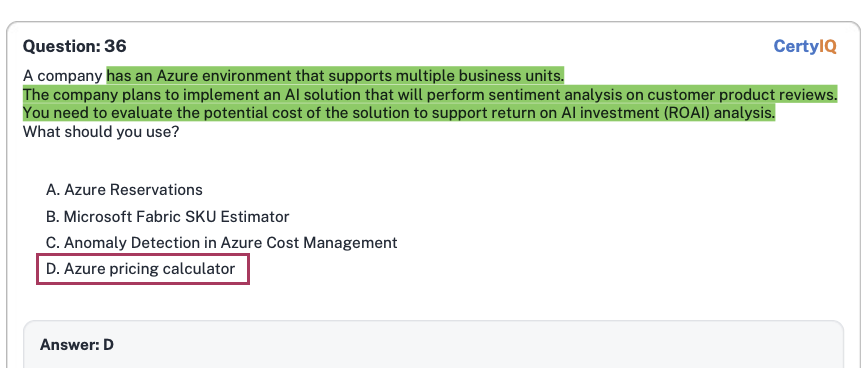

<br>

---

## Q37

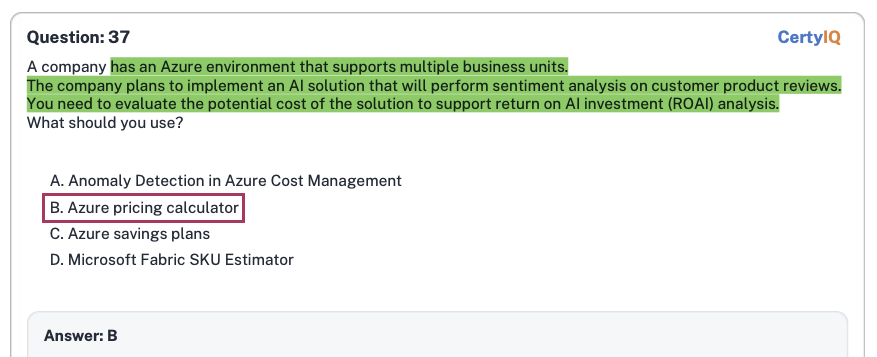


<br>

---

## Q38

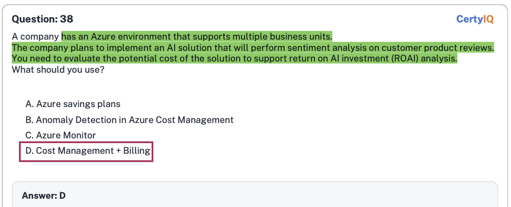


<br>

---

## Q39

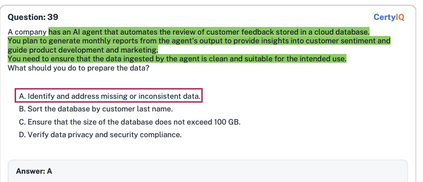

<br>

---

### 1. Extracted Question Summary

* **Scenario:** A company has an AI agent that automates the review of customer feedback stored in a cloud database. You plan to generate monthly reports from the agent's output to provide insights into customer sentiment and guide product development and marketing.


* **Requirement:** Ensure that the data ingested by the agent is clean and suitable for the intended use.


* **Question:** What should you do to prepare the data?


* **Options:**
* **A.** Identify and address missing or inconsistent data.


* **B.** Sort the database by customer last name.


* **C.** Ensure that the size of the database does not exceed 100 GB.


* **D.** Verify data privacy and security compliance.


---

### 2. Correct Answer

**A: Identify and address missing or inconsistent data.**

---

### 3. Verification of Visible Selection / Community Key

* The answer marked and boxed in the screenshot (**Answer: A**) is **Correct**, as identifying and handling missing values, anomalies, and schema inconsistencies is the core prerequisite of data preparation and data hygiene to make ingested datasets clean and suitable for automated AI analysis.


---

### 4. Official Microsoft Justification

* Under the Microsoft Learn pathway **"Architect agentic AI business solutions"** (specifically the modules covering *Data preparation, curation, and hygiene for agentic and generative AI solutions*):
* Ingesting raw unstructured customer feedback for downstream sentiment reporting requires rigorous **data hygiene** to prevent distorted outputs ("garbage in, garbage out").


* Preparing the data specifically entails handling data quality issues: resolving missing fields (e.g., blank feedback text, missing product metadata), addressing inconsistent formats/timestamps, eliminating null values, and reconciling contradictory records.


* Remediating missing or inconsistent data ensures that the generative model or sentiment classifier ingests high-fidelity inputs suitable for strategic reporting.


---

### 5. Distractor Analysis (Why Others Are Wrong)

* **B. Sort the database by customer last name:** Modifies the index or display sort order; it does not cleanse the data, handle anomalies, or improve the quality/suitability of text ingested by the agent.


* **C. Ensure that the size of the database does not exceed 100 GB:** An arbitrary infrastructure storage cap that does not clean or evaluate the contents or semantic quality of feedback records.


* **D. Verify data privacy and security compliance:** An essential governance step across enterprise solutions (e.g., GDPR, PII handling), but it is a security/compliance task rather than the operational *data preparation and cleaning* step needed to ensure input data suitability.


---

### 6. Exam Keyword / Trap Alert

* **Keywords:** *"Ensure that the data ingested by the agent is clean and suitable for the intended use"* + *"prepare the data"*.


* **Trap:** Notice the sibling variation: earlier iterations of this question stem paired with options testing *biased data* (*"Identify and address biased data"*); in this option permutation where bias is omitted, the official Microsoft data hygiene answer is **"Identify and address missing or inconsistent data"**.


<br>

---

## Q40

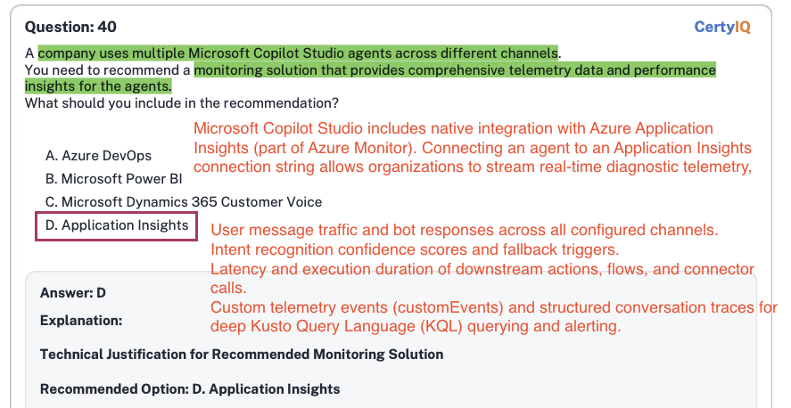

### 1. Extracted Question Summary

* **Scenario:** A company uses multiple Microsoft Copilot Studio agents across different channels.


* **Requirement:** Recommend a monitoring solution that provides comprehensive telemetry data and performance insights for the agents.


* **Question:** What should you include in the recommendation?


* **Options:**
* **A.** Azure DevOps


* **B.** Microsoft Power BI


* **C.** Microsoft Dynamics 365 Customer Voice


* **D.** Application Insights


---

### 2. Correct Answer

**D: Application Insights**

---

### 3. Verification of Visible Selection / Community Key

* The answer marked and boxed in the screenshot (**Answer: D**) is **Correct**, because Azure Application Insights provides the native integration to capture detailed conversation-level telemetry, custom events, latency, and diagnostic performance logs from Microsoft Copilot Studio agents.


---

### 4. Official Microsoft Justification

* Under the Microsoft Learn pathway **"Architect agentic AI business solutions"** (specifically the modules covering *Monitoring, Evaluating, and Operating Agentic AI Solutions* and *Enterprise Governance with Copilot Studio*):
* While Copilot Studio provides basic built-in analytics dashboards in its web portal, enterprise monitoring across multiple channels requires comprehensive, raw telemetry ingestion.
* Microsoft Copilot Studio includes native integration with **Azure Application Insights** (part of Azure Monitor). Connecting an agent to an Application Insights connection string allows organizations to stream real-time diagnostic telemetry, including:
* User message traffic and bot responses across all configured channels.
* Intent recognition confidence scores and fallback triggers.
* Latency and execution duration of downstream actions, flows, and connector calls.
* Custom telemetry events (`customEvents`) and structured conversation traces for deep Kusto Query Language (KQL) querying and alerting.


---

### 5. Distractor Analysis (Why Others Are Wrong)

* **A. Azure DevOps:** A CI/CD, source control, and agile work tracking platform used for application lifecycle management (ALM) and automated pipelines; it does not ingest runtime telemetry or monitor live agent performance logs.


* **B. Microsoft Power BI:** A business intelligence and data visualization tool. While Power BI can consume and visualize data queried from Application Insights or Dataverse, it is a reporting tool, not the telemetry ingestion engine that captures agent execution performance.


* **C. Microsoft Dynamics 365 Customer Voice:** An enterprise feedback management and survey application used to capture net promoter scores (NPS) and post-interaction customer sentiment surveys; it does not collect technical infrastructure telemetry, system execution metrics, or agent performance logs.


---

### 6. Exam Keyword / Trap Alert

* **Keywords:** *"Monitoring solution that provides comprehensive telemetry data and performance insights for the agents"* across *"different channels"*.


* **Trap:** Do not get confused by *Microsoft Power BI*; Power BI is often used for executive dashboards, but the direct service configured within Copilot Studio settings (`Settings > Advanced > Application Insights`) to stream raw telemetry and monitor agent performance is **Application Insights**.

<br>

---

## Q41

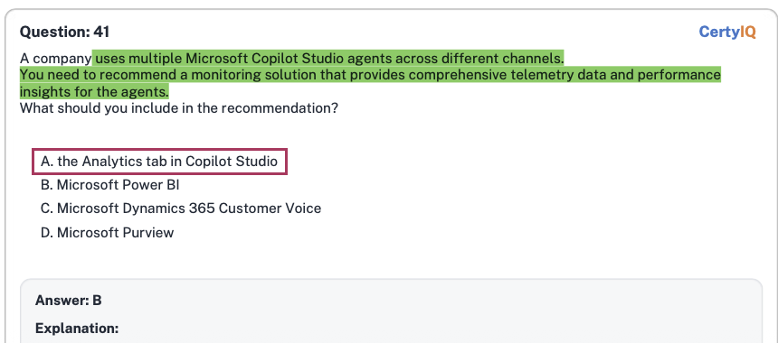

### 1. Extracted Question Summary

* **Scenario:** A company uses multiple Microsoft Copilot Studio agents across different channels.


* **Requirement:** Recommend a monitoring solution that provides comprehensive telemetry data and performance insights for the agents.


* **Question:** What should you include in the recommendation?


* **Options:**
* **A.** the Analytics tab in Copilot Studio


* **B.** Microsoft Power BI


* **C.** Microsoft Dynamics 365 Customer Voice


* **D.** Microsoft Purview


---

### 2. Correct Answer

**A: the Analytics tab in Copilot Studio**

---

### 3. Verification of Visible Selection / Community Key

* The answer marked in the screenshot (**Answer: B**) is **Incorrect/Flawed Dump Key**.


* Dumps often incorrectly pick *Power BI* because it generates charts, but Power BI is a reporting/visualization presentation layer, not a monitoring or telemetry engine. Among the options presented in this permutation (where Azure-level telemetry stores like *Application Insights* or *Log Analytics* are omitted), **the Analytics tab in Copilot Studio** is the official built-in monitoring solution.


---

### 4. Official Microsoft Justification

* Under the Microsoft Learn pathway **"Architect agentic AI business solutions"** (specifically modules addressing *Monitoring, Evaluating, and Operating Agentic AI Solutions* and *Copilot Studio Analytics*):
* In Microsoft Copilot Studio, the primary built-in monitoring experience is the **Analytics** (or **Monitor**) tab.
* Official Microsoft documentation (*"Analytics overview in Microsoft Copilot Studio"*) explicitly defines this feature as providing comprehensive data and performance insights for agents across all connected channels.
* It tracks end-to-end conversation telemetry, including:
* **Summary & Engagement Metrics:** Total sessions, engaged sessions, engagement rate, and unengaged sessions.
* **Performance & Resolution Outcomes:** Resolution rate, escalation rate (handoff to human agents), and abandonment rate.
* **Generative & Knowledge Insights:** Knowledge source query analytics, trigger accuracy, and customer satisfaction (CSAT) scores.


---

### 5. Distractor Analysis (Why Others Are Wrong)

* **B. Microsoft Power BI:** Power BI is an analytics and dashboarding tool. While it can connect to Dataverse tables or Log Analytics to visualize extracted numbers, it does not collect agent telemetry or generate performance insights by itself.


* **C. Microsoft Dynamics 365 Customer Voice:** A survey and feedback management tool designed to capture post-service customer sentiment (NPS, CSAT surveys); it does not monitor agent telemetry or conversation run-time performance.


* **D. Microsoft Purview:** An enterprise data governance, compliance, auditing, and security platform (tracking data classification, DLP, retention, and audit logs); it does not provide agent operational performance analytics or conversational telemetry.


---

### 6. Exam Keyword / Trap Alert

* **Keywords:** *"Monitoring solution that provides comprehensive telemetry data and performance insights for the agents"* across *"different channels"*.


* **Trap (Option Pool Hierarchy):** Microsoft uses this identical stem across three variants in the AB-100 pool:
1. If **Application Insights** is listed $\rightarrow$ Choose **Application Insights** (deep code-level diagnostic telemetry).


2. If **Log Analytics** is listed (without App Insights) $\rightarrow$ Choose **Log Analytics** (centralized Azure Monitor telemetry ingestion).
3. If neither Azure Monitor service is available $\rightarrow$ Choose **the Analytics tab in Copilot Studio** (the native built-in agent monitoring dashboard). Never select *Power BI*!


<br>

---

## Q42

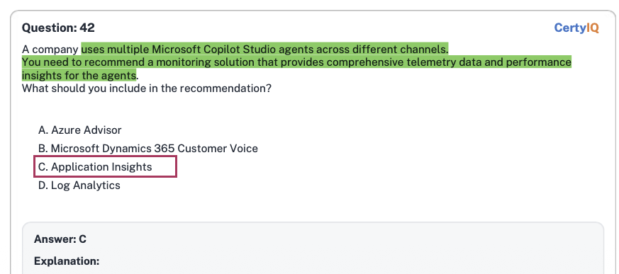

<br>

---

## Q43

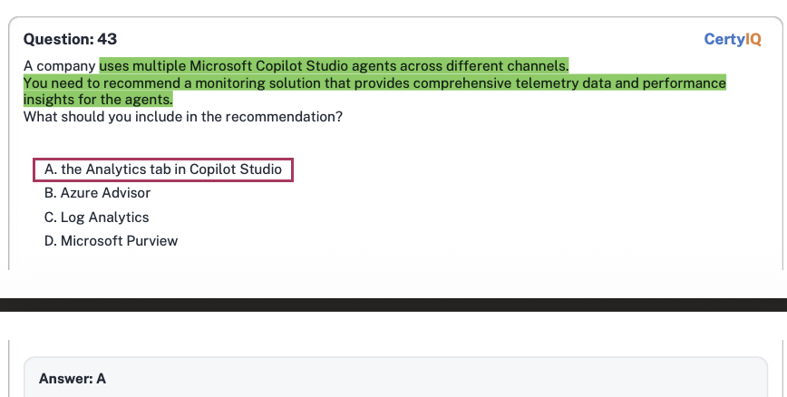

<br>

---

## Q44

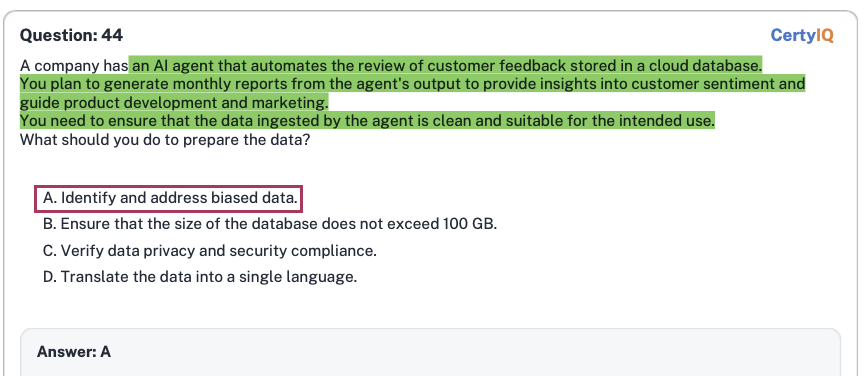

<br>

---

## Q48

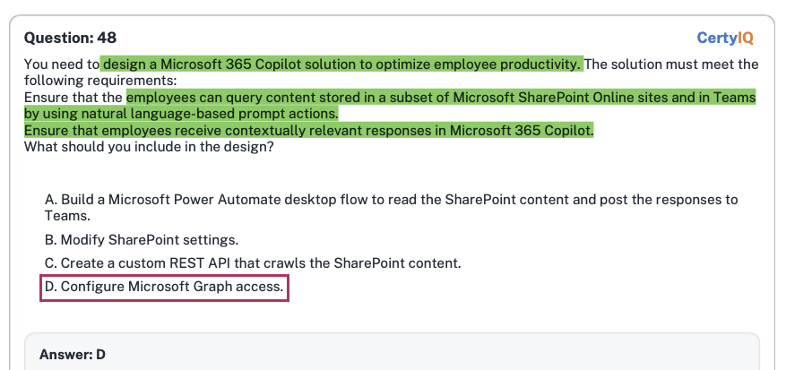

### 1. Extracted Question Summary

* **Scenario:** You need to design a Microsoft 365 Copilot solution to optimize employee productivity. The solution must meet the following requirements:


* Ensure that employees can query content stored in a subset of Microsoft SharePoint Online sites and in Teams by using natural language-based prompt actions.


* Ensure that employees receive contextually relevant responses in Microsoft 365 Copilot.


* **Question:** What should you include in the design?


* **Options:**
* **A.** Build a Microsoft Power Automate desktop flow to read the SharePoint content and post the responses to Teams.


* **B.** Modify SharePoint settings.


* **C.** Create a custom REST API that crawls the SharePoint content.


* **D.** Configure Microsoft Graph access.


---

### 2. Correct Answer

**D: Configure Microsoft Graph access.**

---

### 3. Verification of Visible Selection / Community Key

* The boxed answer in the screenshot (**Answer: D**) is **Correct**, because Microsoft Graph serves as the foundational data grounding and context fabric that enables Microsoft 365 Copilot to discover, retrieve, and security-trim content across SharePoint Online and Teams.


---

### 4. Official Microsoft Justification

* Under the Microsoft Learn pathway **"Architect agentic AI business solutions"** (specifically the modules covering *Grounding Microsoft 365 Copilot using Microsoft Graph and semantic search* and *Extensibility architecture for Microsoft 365 Copilot*):
* Microsoft 365 Copilot relies on the **Microsoft Graph** to retrieve contextually relevant organizational knowledge (such as documents in SharePoint Online sites, Teams chat threads, channels, and OneDrive files).
* When users submit natural language prompt actions, the orchestrator grounds the prompt by issuing semantic queries against Microsoft Graph. Microsoft Graph evaluates the user’s Entra ID identity and granular access permissions (ensuring users only receive context from the subset of SharePoint sites and Teams they have explicit read access to), providing the grounded context necessary for the large language model to formulate accurate, relevant responses.


---

### 5. Distractor Analysis (Why Others Are Wrong)

* **A. Build a Microsoft Power Automate desktop flow to read the SharePoint content and post the responses to Teams:** Desktop flows are robotic process automation (RPA) tools used to automate legacy UI interactions on local/virtual machines; they have no native role in grounding Microsoft 365 Copilot semantic search queries.
* **B. Modify SharePoint settings:** While SharePoint admin controls (such as *Restricted SharePoint Search*) can place tenant-level caps on searchable sites, changing generic site settings alone does not provide or configure the underlying context retrieval and prompt-grounding fabric required by Microsoft 365 Copilot.
* **C. Create a custom REST API that crawls the SharePoint content:** Unnecessary, anti-pattern architecture that introduces high development overhead and duplicates native search indexing; SharePoint Online content is already automatically indexed and accessible to Copilot natively via the Microsoft Graph.

---

### 6. Exam Keyword / Trap Alert

* **Keywords:** *"Query content stored in... SharePoint Online sites and in Teams"* + *"contextually relevant responses in Microsoft 365 Copilot"*.


* **Trap:** Community discussions often debate **Option B** because of the feature *Restricted SharePoint Search*; however, on the official Microsoft AB-100 rubric, any requirement focused on enabling Copilot to query M365 collaboration apps (SharePoint/Teams) while returning contextually grounded, security-trimmed answers points directly to **Configure Microsoft Graph access**.


<br>

---

## Q49

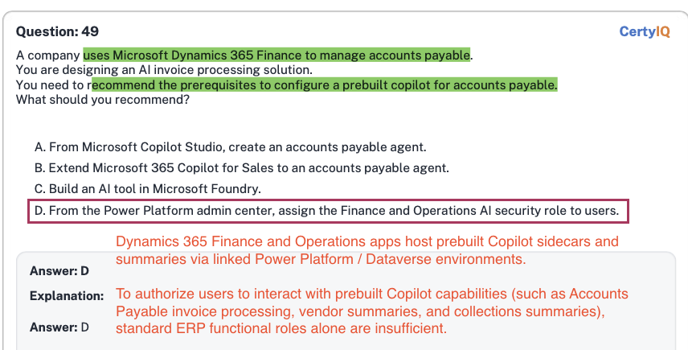

### 1. Extracted Question Summary

* **Scenario:** A company uses Microsoft Dynamics 365 Finance to manage accounts payable, and you are designing an AI invoice processing solution.


* **Requirement:** Recommend the prerequisites to configure a prebuilt copilot for accounts payable.


* **Question:** What should you recommend?


* **Options:**
* **A.** From Microsoft Copilot Studio, create an accounts payable agent.


* **B.** Extend Microsoft 365 Copilot for Sales to an accounts payable agent.


* **C.** Build an AI tool in Microsoft Foundry.


* **D.** From the Power Platform admin center, assign the Finance and Operations AI security role to users.


---

### 2. Correct Answer

**D: From the Power Platform admin center, assign the Finance and Operations AI security role to users.**

---

### 3. Verification of Visible Selection / Community Key

* The marked selection (**Answer: D**) is **Correct**, as granting the Dataverse-level **Finance and Operations AI** role via the Power Platform admin center is the required security prerequisite for users to access prebuilt Copilot features inside Dynamics 365 Finance.


---

### 4. Official Microsoft Justification

* Under the Microsoft Learn pathway **"Architect agentic AI business solutions"** (specifically the modules covering *Enable Copilot capabilities in finance and operations apps* and *Security architecture for Dynamics 365 Copilot*):
* Dynamics 365 Finance and Operations apps host prebuilt Copilot sidecars and summaries via linked Power Platform / Dataverse environments.
* To authorize users to interact with prebuilt Copilot capabilities (such as Accounts Payable invoice processing, vendor summaries, and collections summaries), standard ERP functional roles alone are insufficient.
* Administrators must navigate to the **Power Platform admin center (PPAC)**, select the connected environment, and assign the designated **Finance and Operations AI** security role to the target users or user groups. This role grants the necessary Dataverse-level permissions to communicate with the Copilot orchestration service.


---

### 5. Distractor Analysis (Why Others Are Wrong)

* **A. From Microsoft Copilot Studio, create an accounts payable agent:** The scenario explicitly specifies configuring a **prebuilt copilot** for accounts payable, not building a custom-authored agent from scratch in Copilot Studio.


* **B. Extend Microsoft 365 Copilot for Sales to an accounts payable agent:** Copilot for Sales is a CRM-focused role-based Copilot (connecting to Dynamics 365 Sales or Salesforce) designed for seller workflows; it does not govern ERP accounts payable invoice processing.


* **C. Build an AI tool in Microsoft Foundry:** Microsoft Foundry (Azure AI Foundry) is used for pro-code custom model fine-tuning and SDK orchestration (e.g., Semantic Kernel); it is not a prerequisite for enabling native first-party prebuilt ERP Copilot features.


---

### 6. Exam Keyword / Trap Alert

* **Keywords:** *"Prerequisites to configure a prebuilt copilot for accounts payable"* in *"Microsoft Dynamics 365 Finance"*.


* **Trap:** Do not select custom development platforms (*Copilot Studio* or *Microsoft Foundry*) when the requirement is for a **prebuilt copilot**. Prebuilt Dynamics 365 Copilots require tenant/environment enablement and assigning the **Finance and Operations AI** security role via PPAC.


<br>

---

## Q50

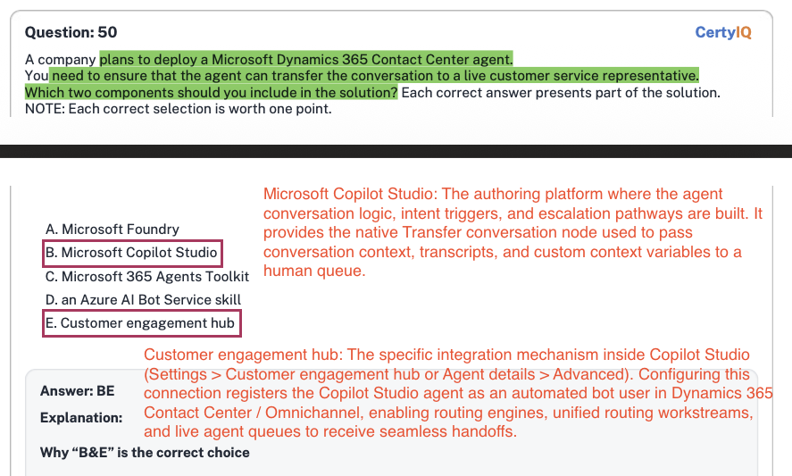

### 1. Extracted Question Summary

* **Scenario:** A company plans to deploy a Microsoft Dynamics 365 Contact Center agent.


* **Requirement:** Ensure that the agent can transfer the conversation to a live customer service representative.


* **Question:** Which two components should you include in the solution? (Each correct answer presents part of the solution).


* **Options:**
* **A.** Microsoft Foundry


* **B.** Microsoft Copilot Studio


* **C.** Microsoft 365 Agents Toolkit


* **D.** an Azure AI Bot Service skill


* **E.** Customer engagement hub


---

### 2. Correct Answer

* **B: Microsoft Copilot Studio**


* **E: Customer engagement hub**


---

### 3. Verification of Visible Selection / Community Key

* The answer marked in the screenshot (**Answer: BE**) is **Correct**, as configuring live human escalation from Dynamics 365 Contact Center requires authoring the bot and its transfer node in Microsoft Copilot Studio and establishing the handoff integration through the Customer engagement hub settings.


---

### 4. Official Microsoft Justification

* Under the Microsoft Learn pathway **"Architect agentic AI business solutions"** (specifically the modules covering *Configure human handoff in Microsoft Copilot Studio* and *Integrate Dynamics 365 Contact Center / Omnichannel for Customer Service*):
* **Microsoft Copilot Studio:** The authoring platform where the agent conversation logic, intent triggers, and escalation pathways are built. It provides the native **Transfer conversation** node used to pass conversation context, transcripts, and custom context variables to a human queue.
* **Customer engagement hub:** The specific integration mechanism inside Copilot Studio (`Settings > Customer engagement hub` or `Agent details > Advanced`). Configuring this connection registers the Copilot Studio agent as an automated bot user in Dynamics 365 Contact Center / Omnichannel, enabling routing engines, unified routing workstreams, and live agent queues to receive seamless handoffs.


---

### 5. Distractor Analysis (Why Others Are Wrong)

* **A. Microsoft Foundry:** Azure AI Foundry is a pro-code developer platform for managing, fine-tuning, and evaluating foundation models; it does not configure the native Contact Center human handoff channel.
* **C. Microsoft 365 Agents Toolkit:** Designed for building and debugging Teams and Microsoft 365 Copilot extensions/declarative agents in Visual Studio Code; it is not the native vehicle for Dynamics 365 Contact Center agent routing.
* **D. an Azure AI Bot Service skill:** Azure Bot Service skills extend a bot with external reusable dialog components from another bot; they do not establish the native live representative handoff connection to Dynamics 365 Contact Center.

---

### 6. Exam Keyword / Trap Alert

* **Keywords:** *"Dynamics 365 Contact Center agent"* + *"transfer the conversation to a live customer service representative"*.


* **Trap:** In Copilot Studio, the feature setting that connects the bot to Dynamics 365 Omnichannel / Contact Center routing is explicitly named **Customer engagement hub**. Watch for distractors like *Azure AI Bot Service skill* that mimic legacy Bot Framework terminology.

<br>

---


## Q51

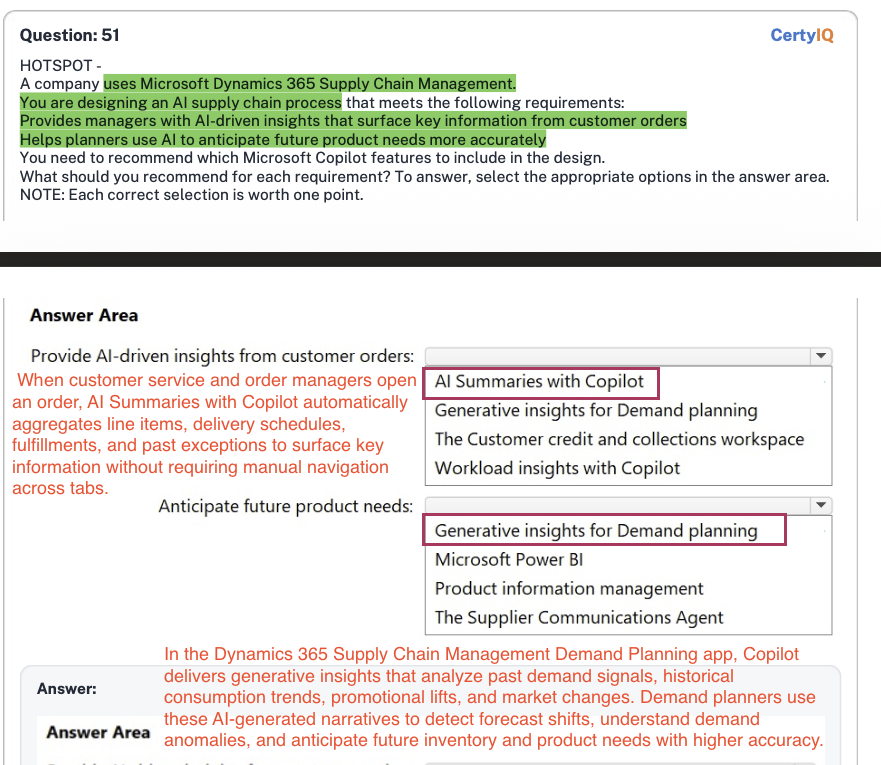

### 1. Extracted Question Summary

* **Scenario:** A company uses Microsoft Dynamics 365 Supply Chain Management. You are designing an AI supply chain process that meets the following requirements:


* Provides managers with AI-driven insights that surface key information from customer orders.


* Helps planners use AI to anticipate future product needs more accurately.


* **Question:** What should you recommend for each requirement? (Select the appropriate options in the answer area).


* **Answer Area (Dropdown 1 - Provide AI-driven insights from customer orders):**


* *AI Summaries with Copilot*


* *Generative insights for Demand planning*


* *The Customer credit and collections workspace*


* *Workload insights with Copilot*


* **Answer Area (Dropdown 2 - Anticipate future product needs):**


* *Generative insights for Demand planning*


* *Microsoft Power BI*


* *Product information management*


* *The Supplier Communications Agent*


---

### 2. Correct Answer

* **Provide AI-driven insights from customer orders:** **AI Summaries with Copilot**
* **Anticipate future product needs:** **Generative insights for Demand planning**

---

### 3. Verification of Visible Selection / Community Key

* *(Section skipped as no answer or community key is marked or selected in the screenshot)*.


---

### 4. Official Microsoft Justification

* Under the Microsoft Learn pathway **"Architect agentic AI business solutions"** (specifically the modules covering *Dynamics 365 Copilot capabilities in Supply Chain Management* and *Demand Planning with Copilot*):
* **AI Summaries with Copilot (Sales Order / Customer Order Summaries):** In Dynamics 365 Supply Chain Management, Copilot provides native out-of-the-box sidecar and header summaries directly on the **Sales Orders** form. When customer service and order managers open an order, **AI Summaries with Copilot** automatically aggregates line items, delivery schedules, fulfillments, and past exceptions to surface key information without requiring manual navigation across tabs.
* **Generative insights for Demand planning:** In the Dynamics 365 Supply Chain Management **Demand Planning** app, Copilot delivers **generative insights** that analyze past demand signals, historical consumption trends, promotional lifts, and market changes. Demand planners use these AI-generated narratives to detect forecast shifts, understand demand anomalies, and anticipate future inventory and product needs with higher accuracy.


---

### 5. Distractor Analysis (Why Others Are Wrong)

#### Dropdown 1: Provide AI-driven insights from customer orders

* **Generative insights for Demand planning:** Designed specifically for macro-level forecasting and aggregate demand projections, not for individual customer sales order operational summaries.


* **The Customer credit and collections workspace:** A Dynamics 365 Finance (Accounts Receivable) capability focused on customer aging balances and debt recovery, not Supply Chain Management customer order fulfillment.


* **Workload insights with Copilot:** A warehouse management/operations feature used to monitor and balance warehouse labor capacity, picking throughput, and packing line bottlenecks; it does not summarize customer sales orders.


#### Dropdown 2: Anticipate future product needs

* **Microsoft Power BI:** A visualization and dashboard reporting tool; it does not natively provide out-of-the-box generative AI forecasting or conversational demand planning models.


* **Product information management:** A master data management module used to define product attributes, released products, barcodes, and variants; it has no AI forecasting capabilities.


* **The Supplier Communications Agent:** An autonomous/interactive agent designed to automate communication and confirmation workflows with upstream vendors for purchase orders, not customer demand forecasting.


---

### 6. Exam Keyword / Trap Alert

* **Keywords:**
* *"Surface key information from customer orders"* = **AI Summaries with Copilot** (Customer Order/Sales Order summary).


* *"Anticipate future product needs"* + *"planners"* = **Generative insights for Demand planning**.


* **Trap:** Pay attention to the user role mentioned in the prompt: *managers reviewing orders* need conversational/sidecar summaries (**AI Summaries with Copilot**), while *planners anticipating inventory* map to the **Demand planning** app.


<br>

---


## Q52

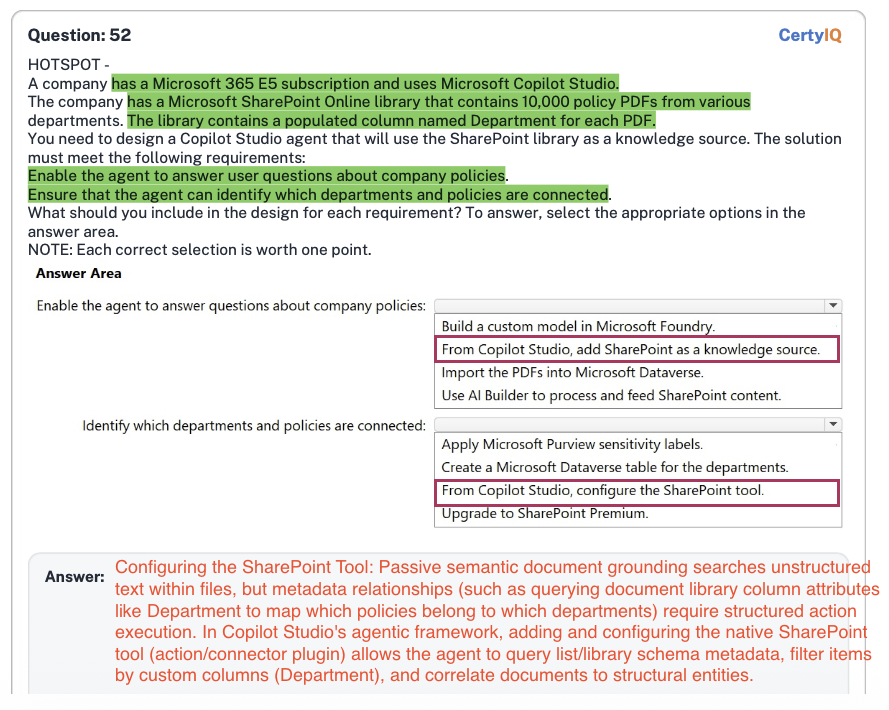

### 1. Extracted Question Summary

* **Scenario:** A company has a Microsoft 365 E5 subscription and uses Microsoft Copilot Studio. The company has a Microsoft SharePoint Online library containing 10,000 policy PDFs from various departments. The library contains a populated column named `Department` for each PDF.


* **Requirement:** Design a Copilot Studio agent using the SharePoint library as a knowledge source that meets two specific criteria:


1. Enable the agent to answer user questions about company policies.


2. Ensure that the agent can identify which departments and policies are connected.


* **Question:** What should you include in the design for each requirement?


* **Answer Area (Dropdown 1 - Enable the agent to answer questions about company policies):**


* *Build a custom model in Microsoft Foundry.*


* *From Copilot Studio, add SharePoint as a knowledge source.*


* *Import the PDFs into Microsoft Dataverse.*


* *Use AI Builder to process and feed SharePoint content.*


* **Answer Area (Dropdown 2 - Identify which departments and policies are connected):**


* *Apply Microsoft Purview sensitivity labels.*


* *Create a Microsoft Dataverse table for the departments.*


* *From Copilot Studio, configure the SharePoint tool.*


* *Upgrade to SharePoint Premium.*


---

### 2. Correct Answer

* **Enable the agent to answer questions about company policies:** **From Copilot Studio, add SharePoint as a knowledge source.**
* **Identify which departments and policies are connected:** **From Copilot Studio, configure the SharePoint tool.**

---

### 3. Verification of Visible Selection / Community Key

* *(Section skipped as no answer or community key is marked or selected in the screenshot)*.


---

### 4. Official Microsoft Justification

* Under the Microsoft Learn pathway **"Architect agentic AI business solutions"** (specifically modules addressing *Connecting Knowledge Sources in Microsoft Copilot Studio*, *Generative Answers Architecture*, and *Extending Agents with Tools/Actions*):
* **SharePoint Knowledge Source:** Adding a SharePoint Online site or document library URL directly as a native **Knowledge Source** inside Microsoft Copilot Studio enables out-of-the-box Retrieval-Augmented Generation (RAG). Copilot Studio queries the Microsoft Graph search index, summarizes policy PDF content dynamically, and applies user Entra ID security trimming without custom ETL pipelines.
* **Configuring the SharePoint Tool:** Passive semantic document grounding searches unstructured text within files, but metadata relationships (such as querying document library column attributes like `Department` to map which policies belong to which departments) require structured action execution. In Copilot Studio's agentic framework, adding and configuring the native **SharePoint tool** (action/connector plugin) allows the agent to query list/library schema metadata, filter items by custom columns (`Department`), and correlate documents to structural entities.


---

### 5. Distractor Analysis (Why Others Are Wrong)

#### Dropdown 1: Enable the agent to answer questions about company policies

* **Build a custom model in Microsoft Foundry:** Custom fine-tuning or training models in Azure AI Foundry is pro-code overhead; Copilot Studio natively connects to SharePoint document libraries for question answering with zero code.
* **Import the PDFs into Microsoft Dataverse:** Storing 10,000 PDF documents in Dataverse file/attachment columns introduces unnecessary storage overhead, requires migration pipelines, and breaks native SharePoint versioning.
* **Use AI Builder to process and feed SharePoint content:** AI Builder document processing models are designed to extract structured key-value pairs (like invoices or receipts) rather than answering conversational policy inquiries across 10,000 general PDFs.

#### Dropdown 2: Identify which departments and policies are connected

* **Apply Microsoft Purview sensitivity labels:** Purview sensitivity labels govern information protection, encryption, and access controls (e.g., General, Confidential); they do not provide metadata relationship queries between business departments and policies.
* **Create a Microsoft Dataverse table for the departments:** Unnecessary data duplication; the relationship and column (`Department`) already exist directly inside the SharePoint library metadata.
* **Upgrade to SharePoint Premium:** While SharePoint Premium provides automated document processing, content classification, and advanced compliance, it is not a prerequisite for Copilot Studio to inspect existing SharePoint list/library metadata columns.

---

### 6. Exam Keyword / Trap Alert

* **Keywords:** *"Answer user questions about company policies"* points to adding SharePoint as a **knowledge source**; querying metadata relationships (*"identify which departments and policies are connected"* using library columns) points to configuring the **SharePoint tool**.


* **Trap:** Do not default to *Microsoft Dataverse* or *Microsoft Purview* for metadata questions when the metadata column (`Department`) is already defined and populated in SharePoint. Copilot Studio leverages the native **SharePoint tool** action to interact with library columns directly.


Practical configuration of this scenario involves two distinct capabilities in Microsoft Copilot Studio: **Knowledge Grounding** (semantic search inside PDF document bodies) and **Tools/Actions** (querying SharePoint metadata columns such as `Department`):

---

### Step 1: Ground Policy Content (SharePoint as a Knowledge Source)

This step enables the agent to parse and answer natural-language questions directly from the 10,000 PDF text bodies using out-of-the-box Retrieval-Augmented Generation (RAG).

1. **Navigate to Copilot Studio:**
* Sign in to [copilotstudio.microsoft.com](https://copilotstudio.microsoft.com) and ensure you are in the correct Dataverse environment.
* Open your existing agent or click **Create an agent**.


2. **Add Knowledge Source:**
* From the top navigation or sidebar, select the **Knowledge** tab.
* Click **+ Add knowledge**.
* Select **SharePoint** from the list of available sources.


3. **Configure the Target URL:**
* In the SharePoint dialog, paste the absolute URL to the specific document library or subfolder containing the policy PDFs (e.g., `https://<tenant>[.sharepoint.com/sites/Policies/Shared](https://.sharepoint.com/sites/Policies/Shared) Documents/Policies`).
* Give the knowledge source a descriptive name (e.g., `Company Policy Document Library`).
* Click **Add**.


4. **Configure Generative Answers Behavior:**
* Go to **Overview** or **Settings > Generative AI**.
* Ensure the moderation level is set (e.g., *Medium* or *High*).
* Under standard conversation triggers, verify that Copilot Studio routes unmatched user queries to generative search against this knowledge source.


---

### Step 2: Configure Authentication (Entra ID Security Trimming)

Because the library contains sensitive departmental policies, the agent must enforce SharePoint permissions so users only retrieve policies they are authorized to see.

1. Navigate to **Settings > Security > Authentication**.
2. Select **Authenticate with Microsoft** (or **Authenticate manually** using an Entra ID app registration if embedding in external channels).
3. Check **Require users to sign in** to ensure Copilot passes the user's delegated identity token via Microsoft Graph, enabling native security trimming over SharePoint content.

---

### Step 3: Configure the SharePoint Tool (Action/Plugin for Metadata)

A standard knowledge search scans unstructured document text, but it does not execute relational queries across SharePoint list/library columns (e.g., *"Which policies are associated with the Finance department?"* or *"List all departments that have policies"*). To inspect and filter the `Department` column, configure the SharePoint action/tool:

1. **Add the Tool/Action:**
* In your agent, navigate to the **Actions / Tools** tab (under **Topics & Plugins / Tools** depending on your Studio layout).
* Click **+ Add an action** (or **Add a tool**).
* Select the **SharePoint** connector or choose the prebuilt **SharePoint Metadata Filter / List items** action.


2. **Define Connection & Inputs:**
* Select the connector action **Get files (properties only)** or **SharePoint metadata filter**.
* Provide the **Site Address** and select the **Library Name** (e.g., `Policy Library`).


3. **Configure the Column Schema & Filter Query:**
* Expand the action parameters to surface the custom **`Department`** metadata column.
* If using dynamic OData filtering, set the Filter Query input dynamically to accept an agent variable:
```odata
Department eq '{System.Activity.Text}'

```


* Provide a clear, natural-language tool description so the agent's generative orchestrator knows when to invoke it:
> *"Use this tool to find which policies belong to a given department or to list departments associated with specific policy documents by checking document library metadata."*


4. **Set Up Outputs:**
* Expose the relevant output properties: `File name`, `Department`, `EncodedAbsUrl` (File URL), and `Modified Date`.


---

### Step 4: Test in the Copilot Studio Canvas

1. Open the **Test your agent** panel on the right side of Copilot Studio.
2. **Test Knowledge Grounding (Document Content):**
* Query: *"What is the standard policy for remote work equipment allowance?"*
* Verify the agent extracts the exact clause from the relevant PDF and renders the SharePoint reference citation link.


3. **Test Tool Invocation (Metadata Inspection):**
* Query: *"Show me all policies connected to the Human Resources department."*
* Verify in the activity trace that the orchestrator invokes the **SharePoint tool** rather than relying solely on semantic document text search, correctly reading the `Department` column values to return the policy list.


<br>

---

## Q53

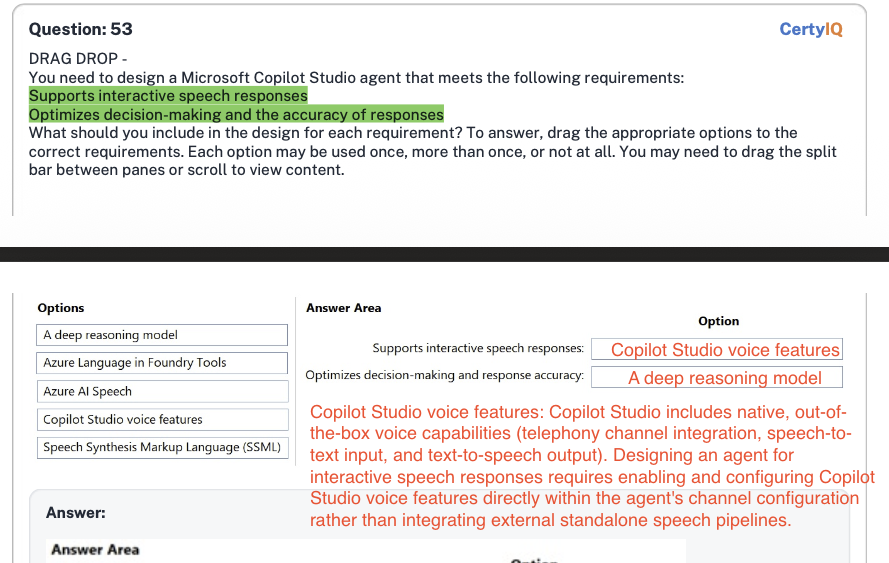

### 1. Extracted Question Summary

* **Type:** Drag-and-Drop (DRAG DROP)


* **Scenario:** You need to design a Microsoft Copilot Studio agent that meets two specific requirements:


1. *Supports interactive speech responses*


2. *Optimizes decision-making and the accuracy of responses*


* **Options Available:**


* *A deep reasoning model*


* *Azure Language in Foundry Tools*


* *Azure AI Speech*


* *Copilot Studio voice features*


* *Speech Synthesis Markup Language (SSML)*


* **Answer Area:**


* Supports interactive speech responses: `[Option]`


* Optimizes decision-making and response accuracy: `[Option]`


---

### 2. Correct Answer

* **Supports interactive speech responses:** **Copilot Studio voice features**
* **Optimizes decision-making and response accuracy:** **A deep reasoning model**

---

### 3. Verification of Visible Selection / Community Key

* *(Section skipped as no answers or target drop selections are filled or marked in the screenshot)*.


---

### 4. Official Microsoft Justification

* Under the Microsoft Learn pathway **"Architect agentic AI business solutions"** (specifically the modules covering *Configure voice and speech-enabled agents in Microsoft Copilot Studio* and *Selecting and orchestrating foundation models for complex reasoning*):
* **Copilot Studio voice features:** Copilot Studio includes native, out-of-the-box voice capabilities (telephony channel integration, speech-to-text input, and text-to-speech output). Designing an agent for interactive speech responses requires enabling and configuring **Copilot Studio voice features** directly within the agent's channel configuration rather than integrating external standalone speech pipelines.
* **A deep reasoning model:** To handle complex decision-making, solve multi-step problems, and boost response precision/accuracy, Copilot Studio enables architects to select advanced reasoning foundation models (such as OpenAI o-series/reasoning models deployed via Azure OpenAI / Foundry). These models use chain-of-thought processing to deliberate through inputs before responding, optimizing logic flow and mitigating factual errors.


---

### 5. Distractor Analysis (Why Others Are Wrong)

* **Azure AI Speech:** While Azure AI Speech provides developer APIs for speech recognition and synthesis, configuring a Copilot Studio agent to support interactive voice natively leverages the built-in **Copilot Studio voice features** rather than building a custom external Azure AI Speech integration layer.
* **Speech Synthesis Markup Language (SSML):** SSML is an XML-based markup standard used to fine-tune pronunciation, pitch, rate, and pauses in spoken text output; it is a formatting markup language, not the architectural feature that enables interactive speech responses.


* **Azure Language in Foundry Tools:** Used for NLP tasks like custom entity recognition, conversational language understanding (CLU), and sentiment analysis; it does not address conversational speech I/O or deep reasoning orchestration.


---

### 6. Exam Keyword / Trap Alert

* **Keywords:** *"Supports interactive speech responses"* inside a *"Copilot Studio agent"* triggers **Copilot Studio voice features**; *"Optimizes decision-making and the accuracy of responses"* triggers **A deep reasoning model**.


* **Trap:** Do not get baited into dragging *Azure AI Speech* or *SSML* for the speech requirement—within Copilot Studio's unified agent design, interactive voice capabilities are encapsulated under native **Copilot Studio voice features**.


Here is the end-to-end implementation architecture to build this agent in Microsoft Copilot Studio, focusing specifically on **voice channel enablement (STT/TTS)** and **SharePoint knowledge grounding**:

---

### Step 1: Create the Agent and Ground on SharePoint

1. **Create the Agent:**
* Sign in to [copilotstudio.microsoft.com](https://copilotstudio.microsoft.com).
* Select your target Dataverse environment and click **Create an agent**.
* Assign a name (e.g., `Voice Policy Assistant`) and select the primary language.


2. **Attach SharePoint Knowledge Source:**
* Open the **Knowledge** tab from the top navigation.
* Click **+ Add knowledge** and select **SharePoint**.
* Enter the full URL to the SharePoint document library or folder where your policy files reside:
```text
https://<your-tenant>.sharepoint.com/sites/<SiteName>/<LibraryName>

```


* Click **Add**. Copilot Studio automatically configures generative answers to ground responses using Microsoft Graph semantic search over the library files.


3. **Configure Authentication:**
* Go to **Settings > Security > Authentication**.
* Select **Authenticate with Microsoft** so Copilot passes the caller's Entra ID delegated token, ensuring documents are strictly security-trimmed to what the caller is permitted to access.


---

### Step 2: Configure the Foundation Reasoning Model

1. Navigate to **Settings > Generative AI**.
2. Under **Model selection / AI capabilities**, select an advanced reasoning-capable model (or bind to your Azure OpenAI / Azure AI Foundry deployment supporting deep reasoning/o-series logic).
3. Set the **Content moderation** level (e.g., *Medium* or *High*) and define high-level system instructions directing the model to summarize concisely for spoken delivery (e.g., *"Provide direct, conversational answers suitable for audio playback. Avoid formatting with bulleted Markdown or raw URLs"*).

---

### Step 3: Configure Speech-to-Text (STT) and Text-to-Speech (TTS) via Voice Features

Microsoft Copilot Studio provides native voice integration directly within the platform—you do not need to stitch custom REST pipelines to Azure AI Speech.

#### 1. Enable the Telephony / Voice Channel

* Navigate to **Channels** in the left or top navigation.
* Select **Telephony** (or **Omnichannel for Customer Service / Dynamics 365 Contact Center** if routing through a unified contact center).
* Click **Enable** / **Turn on**.
* Copilot Studio provisions the native voice pipeline that handles:
* **Speech-to-Text (Inbound Audio):** Automatically streams caller speech into real-time text tokens fed directly to topic triggers and generative orchestration.
* **Text-to-Speech (Outbound Audio):** Converts synthesized agent responses into spoken audio streams.


#### 2. Select and Configure Voice Persona (TTS)

* Inside the voice/telephony channel settings (or via **Settings > Voice**):
* Choose the desired **Voice style / Neural Voice** (e.g., `en-US-JennyMultilingualNeural`, `en-US-AndrewMultilingualNeural`, or your regional equivalent).
* Adjust the default **speech rate**, **pitch**, and **silence timeout** (DTMF or pause duration before the agent assumes the caller has finished speaking).


#### 3. Optimize Response Nodes for Speech Output

While the agent uses generative answers from SharePoint, whenever you craft custom topic nodes or system messages:

* Open the message node settings on the authoring canvas.
* Toggle between **Text** and **Speech**.
* In the **Speech** tab, you can customize the exact spoken message or embed inline SSML markup:
```xml
<speak version="1.0" xmlns="http://www.w3.org/2001/10/synthesis" xml:lang="en-US">
    <voice name="en-US-JennyMultilingualNeural">
        <prosody rate="medium">
            Based on the company travel policy, domestic meal allowances are capped at fifty dollars per day.
        </prosody>
    </voice>
</speak>

```


* This ensures dates, numbers, currencies, and policy acronyms sound natural over a voice channel rather than sounding like raw database strings.

---

### Step 4: Configure DTMF & Barge-In (Interactive Voice Controls)

Under **Channel settings > Telephony**:

1. **Enable Barge-In:** Allow callers to interrupt the agent while it is speaking without waiting for lengthy policy text to finish playing.
2. **Speech Recognition Timers:**
* Configure **Initial silence timeout** (how long to wait for the user to start talking).
* Configure **End-of-speech detection** (how long a pause indicates the user is done with their question).


---

### Step 5: Test and Validate

1. **Test Voice in Studio:**
* Use the **Test your agent** pane. If testing in voice mode, enable the microphone input toggle to speak directly into the browser and listen to the synthesized neural TTS playback.


2. **Verify SharePoint Grounding over Voice:**
* Ask an open-ended policy question via microphone: *"What is the policy for parental leave?"*
* Verify that:
1. The speech engine accurately transcribes the spoken input to text.
2. Generative search retrieves the relevant clause from the SharePoint library.
3. The deep reasoning model formulates a concise spoken reply.
4. Neural TTS plays back the response clearly without reading aloud raw Markdown citations or hyperlinks.


<br>

---

## Q54

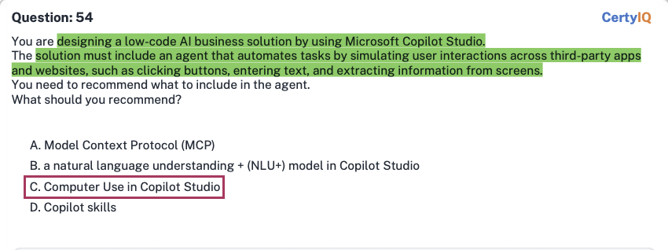

### 1. Extracted Question Summary

* **Scenario:** You are designing a low-code AI business solution by using Microsoft Copilot Studio. The solution must include an agent that automates tasks by simulating user interactions across third-party apps and websites, such as clicking buttons, entering text, and extracting information from screens.


* **Question:** You need to recommend what to include in the agent. What should you recommend?


* **Options:**
* **A.** Model Context Protocol (MCP)


* **B.** a natural language understanding + (NLU+) model in Copilot Studio


* **C.** Computer Use in Copilot Studio


* **D.** Copilot skills


---

### 2. Correct Answer

**C: Computer Use in Copilot Studio**

---

### 3. Verification of Visible Selection / Community Key

* The boxed answer in the screenshot (**Answer: C**) is **Correct**, as Computer Use in Copilot Studio is the native agentic capability designed to simulate human interactions (GUI automation, mouse clicks, keystrokes, and screen reading) across web and desktop applications without dedicated APIs.


---

### 4. Official Microsoft Justification

* Under the Microsoft Learn pathway **"Architect agentic AI business solutions"** (specifically modules covering *Extending agents with autonomous tools* and *Automate web and desktop apps with computer use in Copilot Studio*):
* **Computer Use in Copilot Studio** introduces vision-based, agentic UI automation.
* Instead of requiring pre-built API connectors or traditional rigid robotic process automation (RPA) scripts, agents equipped with the Computer Use tool leverage multimodal vision models to "see" a virtual screen, interact dynamically with user interfaces, click buttons, input text into form fields, and scrape/extract data across third-party websites and legacy desktop software.
* It adapts dynamically to visual interface changes (e.g., repositioned buttons or updated layouts) using real-time reasoning.


---

### 5. Distractor Analysis (Why Others Are Wrong)

* **A. Model Context Protocol (MCP):** An open standard for exposing structured context and tool calls from data sources/servers to AI models; it is an interface/protocol standard, not a low-code UI automation tool for clicking buttons and typing into screens.
* **B. a natural language understanding + (NLU+) model in Copilot Studio:** The conversational language model layer responsible for intent detection, entity recognition, and parsing user utterances into conversation topics; it does not execute GUI actions or interact with third-party software interfaces.
* **D. Copilot skills:** Legacy Bot Framework extensibility components (skills) used to share dialog modules across bots; they do not simulate mouse clicks, keystrokes, or screen scraping across third-party websites.

---

### 6. Exam Keyword / Trap Alert

* **Keywords:** *"Simulating user interactions across third-party apps and websites, such as clicking buttons, entering text, and extracting information from screens"*.


* **Trap:** Do not default to legacy RPA or flow concepts when designing within Copilot Studio; the designated feature for agentic UI automation is **Computer Use in Copilot Studio**.


---

For a visual demonstration of how agents simulate clicks and form entries using this capability, see this [walkthrough of Computer use in Copilot Studio](https://www.youtube.com/watch?v=lWCbtGHlw9I). This tutorial directly demonstrates how the tool interacts with UI elements and navigates applications in real time.


<br>

---

## Q55

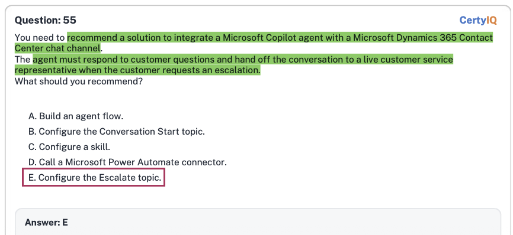

### 1. Extracted Question Summary

* **Scenario:** You need to recommend a solution to integrate a Microsoft Copilot agent with a Microsoft Dynamics 365 Contact Center chat channel.


* **Requirement:** The agent must respond to customer questions and hand off the conversation to a live customer service representative when the customer requests an escalation.


* **Question:** What should you recommend?


* **Options:**
* **A.** Build an agent flow.


* **B.** Configure the Conversation Start topic.


* **C.** Configure a skill.


* **D.** Call a Microsoft Power Automate connector.


* **E.** Configure the Escalate topic.


---

### 2. Correct Answer

**E: Configure the Escalate topic.**

---

### 3. Verification of Visible Selection / Community Key

* The marked and boxed selection (**Answer: E**) is **Correct**, as the prebuilt system **Escalate** topic in Microsoft Copilot Studio is specifically designed to handle user requests to speak with a human agent and contains the **Transfer conversation** node required to execute the handoff to Dynamics 365 Contact Center.


---

### 4. Official Microsoft Justification

* Under the Microsoft Learn pathway **"Architect agentic AI business solutions"** (specifically the modules covering *Configure human handoff in Microsoft Copilot Studio* and *Integrate Dynamics 365 Contact Center / Omnichannel for Customer Service*):
* Copilot Studio includes out-of-the-box system topics that handle foundational conversational events (such as *Greeting*, *Conversation Start*, *Fallback*, and *Escalate*).
* The **Escalate** system topic triggers automatically when an end user submits intents such as *"talk to agent"*, *"speak to a human"*, or *"customer service"*.
* To implement live representative handoff to Dynamics 365 Contact Center, architects configure the **Escalate** topic by adding or customizing the **Transfer conversation** node. This node packages context variables, custom routing tags, and prior chat transcripts, handing the session off seamlessly to the Dynamics 365 unified routing queue.


---

### 5. Distractor Analysis (Why Others Are Wrong)

* **A. Build an agent flow:** Agent flows (cloud flows invoked by an agent) are used to run automated backend transactions, call APIs, or execute CRUD operations in external systems; they cannot initiate a live session handoff to Contact Center queues.


* **B. Configure the Conversation Start topic:** Triggers automatically at the initiation of a session to deliver the initial greeting or establish default conversation variables; it does not handle user escalation requests.


* **C. Configure a skill:** Bot Framework skills extend an agent with reusable bot modules or sub-dialogs; they are not used to route customer service escalation to Dynamics 365 human queues.


* **D. Call a Microsoft Power Automate connector:** Connectors integrate external services or databases; they do not control the native runtime conversation lifecycle or human representative handoff mechanisms in Copilot Studio.


---

### 6. Exam Keyword / Trap Alert

* **Keywords:** *"Hand off the conversation to a live customer service representative when the customer requests an escalation"* in a *"Dynamics 365 Contact Center"* context.


* **Trap:** Pay attention to which component of human handoff is being asked. If the question asks for the channel setting, choose **Customer engagement hub**; if it asks which agent logic element to configure for user escalation requests, choose the system **Escalate topic**.

<br>

---

## Q56

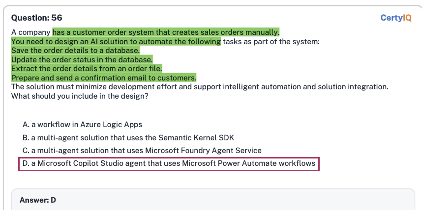

### 1. Extracted Question Summary

* **Scenario:** A company has a customer order system that creates sales orders manually. You need to design an AI solution to automate the following tasks as part of the system:


* Save the order details to a database.


* Update the order status in the database.


* Extract the order details from an order file.


* Prepare and send a confirmation email to customers.


* **Constraint:** The solution must minimize development effort and support intelligent automation and solution integration.


* **Question:** What should you include in the design?


* **Options:**
* **A.** a workflow in Azure Logic Apps


* **B.** a multi-agent solution that uses the Semantic Kernel SDK


* **C.** a multi-agent solution that uses Microsoft Foundry Agent Service


* **D.** a Microsoft Copilot Studio agent that uses Microsoft Power Automate workflows


---

### 2. Correct Answer

**D: a Microsoft Copilot Studio agent that uses Microsoft Power Automate workflows**

---

### 3. Verification of Visible Selection / Community Key

* The marked selection in the screenshot (**Answer: D**) is **Correct**, because pairing Microsoft Copilot Studio with Microsoft Power Automate delivers the required low-code, minimal-development-effort integration and AI orchestration needed to extract file data, update databases, and dispatch confirmation emails.


---

### 4. Official Microsoft Justification

* Under the Microsoft Learn pathway **"Architect agentic AI business solutions"** (specifically the modules covering *Choose an agent development platform*, *Automate tasks with low-code agentic solutions*, and *Integrate Copilot Studio with Power Automate flows*):
* When designing agentic automation, architects must evaluate the tradeoff between **low-code platform acceleration** versus **code-first multi-agent frameworks**.
* The requirement explicitly mandates to **minimize development effort** while supporting **intelligent automation and solution integration** (document extraction, database CRUD, and email delivery).


* Microsoft Copilot Studio serves as the low-code conversational and autonomous agent layer, while **Microsoft Power Automate** workflows (cloud flows, AI Builder document extraction, and prebuilt database/email connectors) execute backend operations (saving records, updating database statuses, and sending customer notifications) with zero custom code.


---

### 5. Distractor Analysis (Why Others Are Wrong)

* **A. a workflow in Azure Logic Apps:** While Logic Apps excels at enterprise integration, standard Logic Apps workflows lack native conversational/agentic reasoning interfaces out of the box and do not minimize development effort compared to Power Platform's pre-integrated AI Builder and Copilot Studio ecosystem.


* **B. a multi-agent solution that uses the Semantic Kernel SDK:** Semantic Kernel is a pro-code developer framework requiring custom C# or Python programming, custom state persistence, and manual connector orchestration; this directly violates the requirement to *minimize development effort*.


* **C. a multi-agent solution that uses Microsoft Foundry Agent Service:** Microsoft Foundry Agent Service is a code-first/developer-focused orchestration runtime designed for pro-dev multi-agent patterns; it requires significant development overhead compared to low-code Power Platform solutions.


---

### 6. Exam Keyword / Trap Alert

* **Keywords:** *"Minimize development effort"* + *"intelligent automation and solution integration"* (extracting file data, updating databases, sending emails).


* **Trap:** Whenever an AB-100 scenario lists complex transactional tasks but specifies **minimize development effort**, avoid pro-code agent services (*Semantic Kernel SDK* or *Microsoft Foundry Agent Service*); always choose the low-code combination of **Microsoft Copilot Studio agent with Microsoft Power Automate workflows**.

<br>

---

## Q57

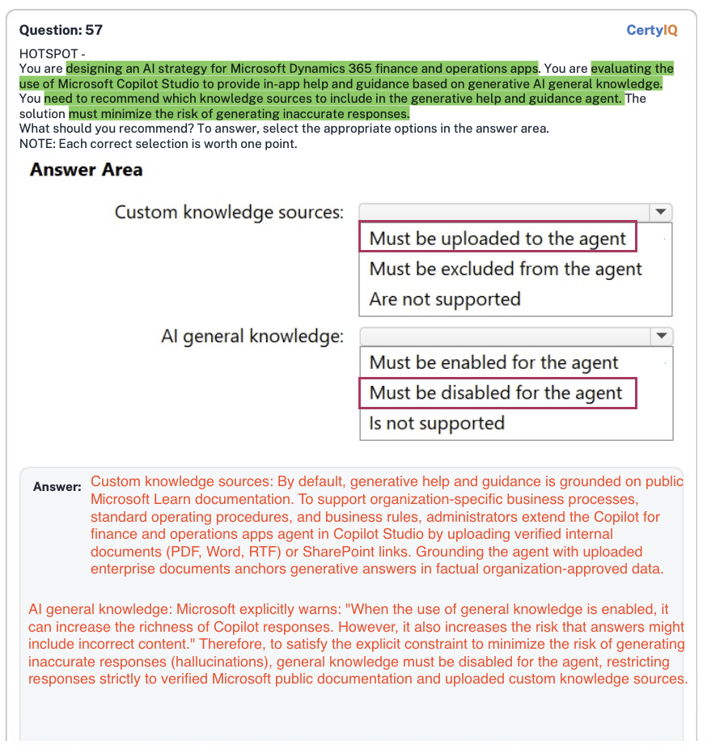

### 1. Extracted Question Summary

* **Scenario:** You are designing an AI strategy for Microsoft Dynamics 365 finance and operations apps. You are evaluating the use of Microsoft Copilot Studio to provide in-app help and guidance based on generative AI general knowledge.


* **Constraint / Requirement:** Recommend which knowledge sources to include in the generative help and guidance agent to **minimize the risk of generating inaccurate responses**.


* **Answer Area:**
* **Custom knowledge sources:**


* *Must be uploaded to the agent*


* *Must be excluded from the agent*


* *Are not supported*


* **AI general knowledge:**


* *Must be enabled for the agent*


* *Must be disabled for the agent*


* *Is not supported*


---

### 2. Correct Answer

* **Custom knowledge sources:** **Must be uploaded to the agent**
* **AI general knowledge:** **Must be disabled for the agent**

---

### 3. Verification of Visible Selection / Community Key

*(Section skipped as no answer or community key is marked or selected in the screenshot)*.

---

### 4. Official Microsoft Justification

* Under the Microsoft Learn documentation for Dynamics 365 finance and operations apps (*"Add knowledge to generative help and guidance with Copilot"* and *"Responsible AI FAQ for Generative help and guidance with Copilot"*):
* **Custom knowledge sources:** By default, generative help and guidance is grounded on public Microsoft Learn documentation. To support organization-specific business processes, standard operating procedures, and business rules, administrators extend the `Copilot for finance and operations apps` agent in Copilot Studio by uploading verified internal documents (PDF, Word, RTF) or SharePoint links. Grounding the agent with uploaded enterprise documents anchors generative answers in factual organization-approved data.
* **AI general knowledge:** Microsoft explicitly warns: *"When the use of general knowledge is enabled, it can increase the richness of Copilot responses. However, it also increases the risk that answers might include incorrect content."* Therefore, to satisfy the explicit constraint to **minimize the risk of generating inaccurate responses** (hallucinations), general knowledge **must be disabled for the agent**, restricting responses strictly to verified Microsoft public documentation and uploaded custom knowledge sources.


---

### 5. Distractor Analysis (Why Others Are Wrong)

#### Dropdown 1: Custom knowledge sources

* **Must be excluded from the agent:** Excluding custom knowledge sources would prevent the agent from providing relevant guidance on company-specific customizations, localized business rules, and internal operational workflows.
* **Are not supported:** Custom knowledge sources are fully supported in Copilot Studio for finance and operations apps via the *Upload files* and *Knowledge* sections.

#### Dropdown 2: AI general knowledge

* **Must be enabled for the agent:** Enabling the AI to use its open pre-trained general parametric knowledge allows the model to respond to ungrounded queries, significantly increasing the probability of hallucinations and inaccurate operational guidance.
* **Is not supported:** General knowledge is a supported feature in Copilot Studio (toggle: *Allow the AI to use its own general knowledge*), but it is disabled by default specifically to mitigate accuracy risks.

---

### 6. Exam Keyword / Trap Alert

* **Keywords:** *"In-app help and guidance"* + *"minimize the risk of generating inaccurate responses"*.


* **Trap:** Pay close attention to Microsoft’s specific architecture warning: allowing AI general knowledge increases conversational fluency at the direct expense of grounding accuracy. Whenever a question specifies preventing inaccuracies or hallucinations in transactional ERP workflows, **AI general knowledge must be disabled** and **custom knowledge must be uploaded**.


<br>

---

## Q58


### 1. Extracted Question Summary

* **Scenario:** You need to design a multi-agent solution that will include a custom agent. The solution must meet two specific requirements:


1. *Define the rules and constraints that the agent must follow.*


2. *Automate a backend process that involves data movement between services and runs independently of the agent's reasoning steps.*


* **Question:** What should you include in the design for each requirement?


* **Answer Area:**
* **Define rules and constraints:**


* *Agent flows*


* *Conversation topics*


* *Microsoft Power Automate cloud flow*


* **Automate a backend process:**


* *Conversation topics*


* *Microsoft Power Automate cloud flow*


* *Microsoft Power Pages*


---

### 2. Correct Answer

* **Define rules and constraints:** **Conversation topics**
* **Automate a backend process:** **Microsoft Power Automate cloud flow**

---

### 3. Verification of Visible Selection / Community Key

* *(Section skipped as no answer or community key is marked or selected in the screenshot)*.


---

### 4. Official Microsoft Justification

* Under the Microsoft Learn pathway **"Architect agentic AI business solutions"** (specifically the modules covering *Control and govern agent behavior using topics and instructions* and *Automate tasks and integrate backend services*):
* **Conversation topics:** While generative orchestration allows large language models to reason over instructions, **conversation topics** provide deterministic, node-based control. Topics allow architects to define explicit conditional logic, strict validation constraints, boundary rules, and step-by-step branching guardrails that force the agent into controlled conversation states rather than relying on unconstrained generative routing.
* **Microsoft Power Automate cloud flow:** Automated or scheduled cloud flows operate decoupled from the agent's conversational runtime. When an enterprise process requires asynchronous or event-driven data movement between services (e.g., ETL synchronization, database replication, or batch file processing) without being triggered by or waiting for the agent's conversational reasoning loop, a standalone **Microsoft Power Automate cloud flow** is the designated architectural component.


---

### 5. Distractor Analysis (Why Others Are Wrong)

#### Dropdown 1: Define rules and constraints

* **Agent flows:** Agent flows (or flows added as agent actions/tools) execute specific parameterized tasks called dynamically by the agent during runtime; they execute backend actions rather than structuring the agent’s conversational rules, policies, and dialog boundaries.


* **Microsoft Power Automate cloud flow:** General cloud flows manage transactional logic, external integration, and system orchestration; they do not dictate conversational dialog rules or agent behavior constraints within Copilot Studio.


#### Dropdown 2: Automate a backend process

* **Conversation topics:** Designed exclusively for user-facing conversational dialog logic and intent handling; they cannot run headless asynchronous backend processes that move data independently of user interaction or agent reasoning.


* **Microsoft Power Pages:** An external-facing website and web portal solution designed to publish data securely to external anonymous or authenticated web users; it is not a backend process automation or data movement engine.


---

### 6. Exam Keyword / Trap Alert

* **Keywords:**
* *"Define the rules and constraints that the agent must follow"* = **Conversation topics** (enforces deterministic business logic over generative variance).


* *"Runs independently of the agent's reasoning steps"* + *"data movement between services"* = **Microsoft Power Automate cloud flow** (event-driven/automated flow running decoupled from the agent).


* **Trap:** Do not select *Agent flows* for the backend process: **Agent flows** are invoked *by* the agent's generative reasoning orchestrator as tools; when the requirement emphasizes running **independently of the agent's reasoning steps**, the answer must be an automated **Microsoft Power Automate cloud flow**.

<br>

---

## Q59


### 1. Extracted Question Summary

* **Question Type:** Repeated Scenario / Solution Evaluation (Yes/No)


* **Scenario:** A company uses Microsoft 365 and Dynamics 365.


* **Requirement:** Recommend a solution to automatically summarize email threads, generate suggested replies in Microsoft Outlook, and provide meeting preparation summaries that include relevant customer relationship management (CRM) data.


* **Proposed Solution:** You recommend **Microsoft 365 Copilot for Sales**.


* **Question:** Does this meet the goal?


* **A.** Yes


* **B.** No


---

### 2. Correct Answer

**A: Yes**

---

### 3. Verification of Visible Selection / Community Key

* *(Section skipped as no answer or community key is marked or highlighted in the screenshot)*.


---

### 4. Official Microsoft Justification

* Under the Microsoft Learn pathway **"Architect agentic AI business solutions"** (specifically the modules covering *Role-based Copilot solutions* and *Empowering sellers with Microsoft 365 Copilot for Sales*):
* **Microsoft 365 Copilot for Sales** bridges Microsoft 365 productivity apps (Outlook, Teams, Word) directly with enterprise CRM platforms (Dynamics 365 Sales or Salesforce).
* Inside **Microsoft Outlook**, Copilot for Sales natively provides:
* **Email thread summaries:** Grounded in past communications and active CRM pipeline context.
* **AI-generated reply drafts:** Suggesting personalized follow-ups with contextual data pulled from the connected CRM system (e.g., pricing, recent opportunities, contact details).
* **Meeting preparation briefs:** Pre-meeting digests summarizing past interactions, open action items, and relevant CRM contact/opportunity records directly on the calendar invite card.


* Because the proposed solution satisfies all three explicit capabilities using out-of-the-box role-based AI, it directly meets the goal.


---

### 5. Distractor Analysis (Why Others Are Wrong)

* **B. No:** Incorrect because Microsoft 365 Copilot for Sales specifically delivers CRM-grounded thread summarization, email reply generation in Outlook, and meeting preparation briefings. Generic Microsoft 365 Copilot alone lacks native CRM record binding, but **Copilot for Sales** is designed precisely for this cross-system workflow.

---

### 6. Exam Keyword / Trap Alert

* **Keywords:** *"Summarize email threads, generate suggested replies in Microsoft Outlook"* + *"meeting preparation summaries that include relevant customer relationship management (CRM) data"*.


* **Trap:** Pay attention to repeated-scenario questions in this series: if the proposed solution is *Microsoft 365 Copilot for Service* or *Dynamics 365 Customer Service*, the answer will be **No** (as they target case resolution, transcripts, and contact centers rather than seller-oriented CRM meeting briefs and email thread replies in Outlook).

<br>

---

## Q60


### 1. Extracted Question Summary

* **Question Type:** Repeated Scenario / Solution Evaluation (Yes/No)
* **Scenario:** A company uses Microsoft 365 and Dynamics 365.
* **Requirement:** Recommend a solution to automatically summarize email threads, generate suggested replies in Microsoft Outlook, and provide meeting preparation summaries that include relevant customer relationship management (CRM) data.
* **Proposed Solution:** You recommend **a classic Microsoft Dataverse workflow**.
* **Question:** Does this meet the goal?
* **A.** Yes
* **B.** No


---

### 2. Correct Answer

**B: No**

---

### 3. Verification of Visible Selection / Community Key

* The boxed answer in the screenshot (**Answer: B**) is **Correct**, because a classic Dataverse workflow is a legacy, rule-based database automation tool that lacks generative AI models to summarize text, generate contextual Outlook email replies, or draft meeting preparation briefs.

---

### 4. Official Microsoft Justification

* Under the Microsoft Learn pathway **"Architect agentic AI business solutions"** (specifically the modules covering *Role-based Copilot solutions* and *Empowering sellers with Microsoft 365 Copilot for Sales*):
* Natural language processing capabilities such as synthesizing lengthy email conversations into concise summaries, drafting context-aware email replies grounded in CRM data, and aggregating CRM pipeline records into meeting preparation cards require a generative AI solution—specifically **Microsoft 365 Copilot for Sales**.
* Classic Microsoft Dataverse workflows operate deterministically based on static database triggers (e.g., record create, update, delete) and predefined procedural steps. They do not have integration with large language models (LLMs) or generative capabilities, nor do they interface natively into the Microsoft Outlook add-in UI to present meeting briefs and draft responses.


---

### 5. Distractor Analysis (Why Others Are Wrong)

* **A. Yes:** Incorrect because classic Dataverse workflows are incapable of performing generative natural language summarization, drafting dynamic email replies, or rendering AI summaries inside Microsoft Outlook.

---

### 6. Exam Keyword / Trap Alert

* **Keywords:** *"Automatically summarize email threads, generate suggested replies in Microsoft Outlook, and provide meeting preparation summaries"*.
* **Trap:** This is the negative counterpart to Question 59! When the proposed solution for this exact prompt is **Microsoft 365 Copilot for Sales**, the answer is **Yes**; when the proposed solution is a legacy automation component like **a classic Microsoft Dataverse workflow** or standard Power Automate flow without Copilot, the answer is always **No**.

<br>

---

## Q61


### 1. Extracted Question Summary

* **Question Type:** Repeated Scenario / Solution Evaluation (Yes/No)


* **Scenario:** A company uses Microsoft 365 and Dynamics 365.


* **Requirement:** Recommend a solution to automatically summarize email threads, generate suggested replies in Microsoft Outlook, and provide meeting preparation summaries that include relevant customer relationship management (CRM) data.


* **Proposed Solution:** You recommend **a Microsoft 365 Copilot agent template**.


* **Question:** Does this meet the goal?


* **A.** Yes


* **B.** No


---

### 2. Correct Answer

**B: No**

---

### 3. Verification of Visible Selection / Community Key

* The answer marked in the screenshot (**Answer: B**) is **Correct**, because prebuilt or custom Microsoft 365 Copilot agent templates are designed for building task-oriented declarative or custom workflow agents and lack the native, pre-integrated CRM bridge into Microsoft Outlook required to summarize threads, draft sales replies, and compile CRM meeting briefs.


---

### 4. Official Microsoft Justification

* Under the Microsoft Learn pathway **"Architect agentic AI business solutions"** (specifically the modules covering *Role-based Copilot solutions* and *Empowering sellers with Microsoft 365 Copilot for Sales*):
* **Microsoft 365 Copilot agent templates** are starter blueprints (declarative agents) created via Copilot Studio or SharePoint to automate specific knowledge lookups, team Q&A, or standalone organizational workflows. They do not embed specialized role-based integration into the native Microsoft Outlook UI to parse incoming client emails against CRM records or assemble structured pre-meeting opportunity briefs.
* To achieve native, out-of-the-box bi-directional integration between Microsoft Outlook/Teams and CRM entities (such as Contacts, Opportunities, and Accounts in Dynamics 365 Sales or Salesforce), the designated solution is the first-party role-based offering: **Microsoft 365 Copilot for Sales**.


---

### 5. Distractor Analysis (Why Others Are Wrong)

* **A. Yes:** Incorrect. An agent template requires manual definition of topics, actions, connectors, and external API schemas, and even then, standard templates cannot natively inject CRM-grounded thread summarization and context cards directly into the core Microsoft Outlook client experience.

---

### 6. Exam Keyword / Trap Alert

* **Keywords:** *"Automatically summarize email threads, generate suggested replies in Microsoft Outlook, and provide meeting preparation summaries that include relevant customer relationship management (CRM) data"*.


* **Trap (The Complete 3-Question Scenario Set):**
1. Solution = *Microsoft 365 Copilot for Sales* $\rightarrow$ **Yes**
2. Solution = *Classic Microsoft Dataverse workflow* $\rightarrow$ **No**
3. Solution = *Microsoft 365 Copilot agent template* $\rightarrow$ **No**


<br>

---

## Q62


### 1. Extracted Question Summary

* **Scenario:** You need to design an application lifecycle management (ALM) process for a Microsoft Power Platform environment that contains a solution named `Solution1`. `Solution1` must include a custom connector for Copilot in Microsoft Dynamics 365 Customer Service.


* **Requirements:**
* Ensure that the custom connector can be deployed consistently across environments as part of the ALM process.


* Allow the custom connector to be edited only in the development environment.


* **Question:** What should you include in the design?


* **Options:**
* **A.** Add the custom connector to GitHub.


* **B.** Share the custom connector.


* **C.** Create the custom connector in the default solution.


* **D.** Add the custom connector to Solution1.


---

### 2. Correct Answer

**D: Add the custom connector to Solution1.**

---

### 3. Verification of Visible Selection / Community Key

* The boxed answer in the screenshot (**Answer: D**) is **Correct**, because making a custom connector a solution component inside `Solution1` allows it to be exported as a managed solution into downstream environments (Test/Prod), enforcing that it can only be edited in the development environment.


---

### 4. Official Microsoft Justification

* Under the Microsoft Learn pathway **"Architect agentic AI business solutions"** (specifically the modules covering *Manage the application lifecycle for agentic AI solutions* and *Solution architecture in Power Platform*):
* In Microsoft Power Platform ALM, any custom asset—including custom connectors, environment variables, connection references, and Copilot Studio agents—must be **solution-aware** to participate in automated deployment pipelines.
* Adding the custom connector to a dedicated unmanaged solution (`Solution1`) within the development environment enables standard ALM workflows.


* When `Solution1` is exported as a **managed solution** and deployed to downstream target environments (UAT, Staging, Production), its components become read-only, satisfying the strict requirement that modifications are restricted exclusively to the source development environment.


---

### 5. Distractor Analysis (Why Others Are Wrong)

* **A. Add the custom connector to GitHub:** While GitHub or Azure DevOps repositories store unpacked source code and solution definitions for version control, simply pushing code/definitions to GitHub does not package or enforce deployment/edit boundaries inside Power Platform environments by itself.
* **B. Share the custom connector:** Sharing grants runtime or edit permissions to specific users/groups within a single environment; it does not deploy components across environments or prevent downstream edits in an ALM process.


* **C. Create the custom connector in the default solution:** Anti-pattern in Power Platform ALM. The default solution cannot be exported as managed, making it impossible to transport customizations cleanly across environments or protect components from direct editing in production environments.

---

### 6. Exam Keyword / Trap Alert

* **Keywords:** *"Deployed consistently across environments as part of the ALM process"* + *"edited only in the development environment"*.


* **Trap:** Do not get distracted by source-control options like *GitHub* or *Azure DevOps*; in Power Platform architecture, the foundational vehicle that enables managed cross-environment deployment and prevents editing in non-dev environments is always adding the component to a **custom solution** (`Solution1`).

<br>

---


## Q63


### 1. Extracted Question Summary

* **Scenario:** A company uses a Microsoft Copilot Studio agent to automate tasks in a web app.


* **Problem:** During testing, you discover that the automation sometimes fails because of frequent changes to the app's user interface.


* **Requirement:** Recommend a solution to ensure that the agent successfully automates the tasks while minimizing changes to the agent.


* **Question:** What should you include in the recommendation?


* **Options:**
* **A.** Computer Use in Copilot Studio


* **B.** custom models in Azure AI Studio


* **C.** conversation topics in Copilot Studio


* **D.** an agent flow in Copilot Studio


---

### 2. Correct Answer

**A: Computer Use in Copilot Studio**

---

### 3. Verification of Visible Selection / Community Key

* The answer marked at the bottom of the screenshot (**Answer: A**) is **Correct**, because Computer Use provides multimodal vision and real-time visual reasoning that dynamically adapts to layout and UI changes without requiring hard-coded selectors or agent code revisions.


---

### 4. Official Microsoft Justification

* Under the Microsoft Learn pathway **"Architect agentic AI business solutions"** (specifically the modules covering *Extending agents with autonomous tools* and *Automate web and desktop apps with computer use in Copilot Studio*):
* Traditional web automation and rule-based RPA scripts rely on brittle DOM element selectors (such as fixed XPath, CSS selectors, or exact HTML IDs). When a web application's user interface undergoes frequent layout, styling, or structural changes, traditional script-based automations break and require constant maintenance.
* **Computer Use in Copilot Studio** leverages frontier multimodal vision models to visually interpret the interface dynamically as a human user would. It identifies buttons, input fields, and UI elements based on their visual appearance, contextual labels, and semantic intent rather than rigid coordinate paths or brittle DOM paths. This dynamic visual reasoning allows the automation to succeed across UI updates while minimizing modifications to the agent configuration.


---

### 5. Distractor Analysis (Why Others Are Wrong)

* **B. custom models in Azure AI Studio:** Custom models (e.g., fine-tuned LLMs or custom SLMs) are intended for domain-specific language generation or classification tasks; they do not natively interact with web browsers or execute automated GUI navigation.
* **C. conversation topics in Copilot Studio:** Conversation topics govern the conversational turn-taking, dialog branches, and user interaction flow within the chat canvas; they cannot fix broken UI selectors or automate third-party web interfaces.
* **D. an agent flow in Copilot Studio:** Agent flows (cloud flows or desktop flows invoked by the agent) that interact with web UIs still depend on predefined UI selectors or API endpoints; they do not provide autonomous visual adaptation to dynamic UI modifications and would require constant re-recording/updating.

---

### 6. Exam Keyword / Trap Alert

* **Keywords:** *"Automation sometimes fails because of frequent changes to the app's user interface"* + *"minimize changes to the agent"*.


* **Trap:** When UI fragility or dynamic interface drift causes automation failures, the solution is **Computer Use in Copilot Studio**, which replaces brittle DOM-based RPA with vision-based AI navigation.

<br>

---


## Q64


### 1. Extracted Question Summary

* **Scenario:** A company processes invoices stored across multiple systems in multiple formats.


* **Requirements:** Implement an AI solution to automate invoice processing that meets the following criteria:


* Automate multi-step invoice processing tasks, including document analysis, data validation, and approval routing.


* Enable users to interact directly via Microsoft Teams to review and approve invoices.


* Minimize development efforts to define and customize approval workflows.


* **Question:** What should you include in the solution?


* **Options:**
* **A.** Azure Document Intelligence in Foundry Tools and Azure Logic Apps


* **B.** a SharePoint agent


* **C.** Microsoft Copilot Studio and AI Builder


* **D.** Azure OpenAI and Azure Functions


---

### 2. Correct Answer

**C: Microsoft Copilot Studio and AI Builder**

---

### 3. Verification of Visible Selection / Community Key

* The visible selection displayed at the bottom of the screenshot (**Answer: C**) is **Correct**, because AI Builder provides prebuilt invoice processing models with minimal configuration, while Microsoft Copilot Studio deploys natively to Microsoft Teams for conversational user approvals and multi-step agentic orchestration.


---

### 4. Official Microsoft Justification

* Under the Microsoft Learn pathway **"Architect agentic AI business solutions"** (specifically the modules covering *Automate document processing with AI Builder*, *Build custom agents with Copilot Studio*, and *Low-code agentic automation patterns*):
* **AI Builder:** Provides prebuilt document processing models specifically tailored for invoices, receipts, and identity documents out of the box. It extracts structured key-value pairs (vendor name, line items, totals, tax) across diverse invoice formats with zero custom code or model training overhead, fulfilling the requirement to *minimize development efforts*.


* **Microsoft Copilot Studio:** Serves as the agentic conversational front-end that natively integrates with Microsoft Teams. It orchestrates the multi-step workflow—triggering document extraction via AI Builder, validating business rules, and routing interactive approval cards/dialogs to reviewers directly within Microsoft Teams channels or personal chats.


---

### 5. Distractor Analysis (Why Others Are Wrong)

* **A. Azure Document Intelligence in Foundry Tools and Azure Logic Apps:** While Azure Document Intelligence provides robust invoice extraction, pairing it with Foundry Tools and Azure Logic Apps requires pro-code/developer-centric API configurations, custom schema mappings, and separate bot framework registrations to surface conversational cards in Microsoft Teams, significantly increasing development effort.


* **B. a SharePoint agent:** SharePoint agents are grounded specifically on SharePoint document libraries and sites for Q&A and knowledge retrieval; they do not natively handle multi-system data validation, structured invoice parsing, or approval routing.


* **D. Azure OpenAI and Azure Functions:** A pro-code architecture requiring custom prompt engineering/vision extraction, manual code maintenance in Azure Functions, and custom bot channel registrations to connect to Microsoft Teams; this directly violates the constraint to *minimize development efforts*.


---

### 6. Exam Keyword / Trap Alert

* **Keywords:** *"Invoice processing"* + *"interact directly via Microsoft Teams to review and approve"* + *"minimize development efforts"*.


* **Trap:** Whenever an AB-100 question mentions **invoice processing** combined with **minimal development effort** and **Teams interaction**, avoid Azure pro-code services (Azure Functions, Logic Apps, or raw Azure OpenAI); the target Microsoft pattern is always **AI Builder** (for prebuilt document processing) paired with **Microsoft Copilot Studio** (for low-code Teams agent interaction).

<br>

---

## Q65


### 1. Extracted Question Summary

* **Scenario:** You need to design a Microsoft Copilot Studio agent for customer support.


* **Requirement:** The agent must securely retrieve product warranty data from a REST API. The solution must minimize development effort.


* **Question:** What should you include in the design?


* **Options:**
* **A.** Export the agent as a managed solution and customize the agent in Power Apps.


* **B.** Create a custom connector in Copilot Studio and use the connector to call the API.


* **C.** Use a Microsoft Power Automate desktop flow to screen scrape the warranty data.


* **D.** Add the warranty data to the Fallback topic.


---

### 2. Correct Answer

**B: Create a custom connector in Copilot Studio and use the connector to call the API.**

---

### 3. Verification of Visible Selection / Community Key

* The answer boxed and marked in the screenshot (**Answer: B**) is **Correct**, as creating a custom connector (or importing an OpenAPI specification) directly wraps the REST API into a reusable, secure, low-code tool action with minimal development effort.


---

### 4. Official Microsoft Justification

* Under the Microsoft Learn pathway **"Architect agentic AI business solutions"** (specifically the modules covering *Extending agents with tools and actions*, *Integrate REST APIs using custom connectors*, and *Security architecture for external data retrieval*):
* In Microsoft Copilot Studio, agents extend their reasoning and ground responses against external external systems by invoking **Actions / Tools**.
* When an external system exposes an existing **REST API**, the standard, low-code architectural pattern to securely interface with it is a **Custom Connector**.
* Custom connectors wrap the REST API endpoints, define request/response schemas via OpenAPI (Swagger) or Postman collections, and handle standard authentication mechanisms (such as OAuth 2.0, API Key, or Entra ID) natively.
* Adding the custom connector as a plugin/action allows the agent's generative orchestrator to dynamically populate input parameters and securely fetch warranty data at runtime with minimal configuration overhead.


---

### 5. Distractor Analysis (Why Others Are Wrong)

* **A. Export the agent as a managed solution and customize the agent in Power Apps:** Managed solutions are locked down to prevent direct edits in downstream environments; furthermore, Power Apps is not the design studio used to customize Copilot Studio conversational actions or REST API calls.


* **C. Use a Microsoft Power Automate desktop flow to screen scrape the warranty data:** Desktop flows provide Robotic Process Automation (RPA) to automate legacy desktop or web user interfaces that lack programmatic APIs; screen scraping an API is an architectural anti-pattern that introduces unnecessary infrastructure and maintenance overhead.


* **D. Add the warranty data to the Fallback topic:** The Fallback topic triggers when the agent cannot match user input to an existing topic or knowledge source; it is a conversation handling mechanism, not a dynamic data retrieval layer for external REST APIs.


---

### 6. Exam Keyword / Trap Alert

* **Keywords:** *"Securely retrieve ... data from a REST API"* + *"minimize development effort"*.


* **Trap:** Whenever an external endpoint is explicitly identified as a **REST API**, avoid UI automation or RPA tools (*desktop flows/screen scraping*); the primary low-code integration mechanism in Power Platform and Copilot Studio is always a **Custom Connector**.


<br>

## Q66


### 1. Extracted Question Summary

* **Type:** Drag-and-Drop (DRAG DROP)


* **Scenario:** A company has an ecommerce support portal that uses Microsoft Dataverse. You are designing a Microsoft Copilot Studio agent for the portal with generative orchestration enabled.


* **Requirements:**
1. *Respond with a default help message when the user input is unclear.*


2. *Initiate external processes, such as retrieving the order status, when users make specific requests.*


* **Features Available:**
* *A tool (connector)*


* *A trigger phrase*


* *The Fallback topic*


* *A skill*


* *The Escalate topic*


* **Answer Area:**
* Respond with a default help message when the user input is unclear: `[Feature]`


* Initiate external processes when requested: `[Feature]`


---

### 2. Correct Answer

* **Respond with a default help message when the user input is unclear:** **The Fallback topic**
* **Initiate external processes when requested:** **A tool (connector)**

---

### 3. Verification of Visible Selection / Community Key

* *(Section skipped as no answers or target drop selections are filled or marked in the screenshot)*.


---

### 4. Official Microsoft Justification

* Under the Microsoft Learn pathway **"Architect agentic AI business solutions"** (specifically the modules covering *Configure system topics in Microsoft Copilot Studio*, *Use generative orchestration with tools and actions*, and *Extend agents with connectors and APIs*):
* **The Fallback topic:** In Copilot Studio, the system **Fallback topic** is triggered when the agent cannot determine an intent, parse ambiguous/unclear input, or locate relevant information across its knowledge sources. Configuring the Fallback topic allows architects to define custom recovery responses, such as a default help menu, guided clarification prompts, or links to assistance.
* **A tool (connector):** When **generative orchestration** is enabled, the agent relies on large language models to reason over user queries and dynamically select available tools. To interact with external systems and execute operations—such as retrieving order status, querying Dataverse records, or invoking external REST APIs—architects provide the agent with **tools (connectors)** equipped with natural language descriptions that the generative planner invokes when needed.


---

### 5. Distractor Analysis (Why Others Are Wrong)

* **A trigger phrase:** Trigger phrases are used in classic, deterministic intent-matching architectures to map user utterances to specific topics; when generative orchestration is enabled, the model evaluates semantic descriptions rather than static trigger phrases. Furthermore, a trigger phrase alone cannot initiate external backend calls.
* **A skill:** Bot Framework skills are external bot-to-bot extensibility components; they are not the primary, native low-code mechanism for executing external Dataverse/API lookups within Copilot Studio.
* **The Escalate topic:** System topic dedicated exclusively to transferring the active session to a human agent or queue (e.g., Dynamics 365 Contact Center); it is not designed to handle generic unclear messages or run external order-lookup operations.

---

### 6. Exam Keyword / Trap Alert

* **Keywords:**
* *"User input is unclear"* $\rightarrow$ **The Fallback topic**.


* *"Initiate external processes"* + *"generative orchestration will be enabled"* $\rightarrow$ **A tool (connector)**.


* **Trap:** When *generative orchestration* is explicitly stated, do not choose *trigger phrase*; generative agents dynamically select **tools** based on intent and tool descriptions.


<br>

---

## Q67


### 1. Extracted Question Summary

* **Scenario:** A company uses Microsoft Dynamics 365 to manage service operations. Dispatchers coordinate service requests, and technicians perform scheduled on-site work.


* **Goal:** Design a solution that uses Microsoft Copilot to improve the efficiency of service operations while meeting two specific requirements:


1. *Provide AI-driven assistance to help staff organize and resolve work orders.*


2. *Deliver contextual AI support to frontline workers as they prepare for and complete customer appointments.*


* **Question:** Which two components should you include in the design? (Each correct answer presents part of the solution).


* **Options:**
* **A.** Copilot Service workspace


* **B.** Copilot in Outlook


* **C.** Dynamics 365 Customer Service


* **D.** Copilot in Customer Service


* **E.** Copilot in Field Service


* **F.** the Dynamics 365 Field Service mobile app


---

### 2. Correct Answer

* **E: Copilot in Field Service**


* **F: the Dynamics 365 Field Service mobile app**


---

### 3. Verification of Visible Selection / Community Key

* *(Section skipped as no answer or community key is marked or highlighted in the screenshot)*.


---

### 4. Official Microsoft Justification

* Under the Microsoft Learn pathway **"Architect agentic AI business solutions"** (specifically modules addressing *Empower frontline workers with Copilot in Dynamics 365 Field Service* and *Service operations architecture*):
* **Copilot in Field Service:** Provides generative AI recaps, scheduling assistance, and work order management directly for dispatchers, service managers, and back-office staff. It generates on-demand work order summaries, suggests next best actions, and helps dispatchers coordinate and resolve service tasks efficiently.
* **The Dynamics 365 Field Service mobile app:** Frontline workers (field technicians) operate on-site using the dedicated mobile application. The Field Service mobile app integrates native Copilot experiences directly into the technician's mobile workflow—surfacing contextual booking summaries, pre-appointment preparation recaps, natural language task updates, and automated draft notes in the flow of field execution.


---

### 5. Distractor Analysis (Why Others Are Wrong)

* **A. Copilot Service workspace:** A dedicated workspace view built inside Dynamics 365 Customer Service for customer support contact center agents handling cases, conversations, and customer queues; it is not designed for field dispatch or on-site work orders.
* **B. Copilot in Outlook:** Useful for drafting emails or scheduling appointments from email conversations, but it lacks the domain-specific work order lifecycle management and frontline mobile capabilities required for on-site technicians.
* **C. Dynamics 365 Customer Service:** Focuses on inbound case management, omnichannel routing, and customer support desk operations rather than dispatched mobile field technicians and work order fulfillment.
* **D. Copilot in Customer Service:** Focuses on helping service agents draft case responses, summarize support cases, and search knowledge bases for tier-1/tier-2 customer desk support, not field dispatchers and on-site technicians.

---

### 6. Exam Keyword / Trap Alert

* **Keywords:**
* *"Dispatchers coordinate service requests"* + *"organize and resolve work orders"* $\rightarrow$ **Copilot in Field Service**.


* *"Frontline workers as they prepare for and complete customer appointments"* $\rightarrow$ **the Dynamics 365 Field Service mobile app**.


* **Trap:** Do not mix up **Customer Service** (desk agents, cases, contact center) with **Field Service** (dispatchers, work orders, on-site appointments, frontline mobile app). The mention of "work orders" and "on-site appointments" firmly places this architecture in the **Field Service** domain.

<br>

---

## Q68


### 1. Extracted Question Summary

* **Scenario:** A company uses Microsoft Foundry agents.


* **Requirement:** Ensure that an agent can dynamically use external tools at runtime without updating the agent.


* **Question:** What should you include in the solution?


* **Options:**
* **A.** a Microsoft Foundry hub


* **B.** a Model Context Protocol (MCP) server


* **C.** Azure AI Search


* **D.** Microsoft Copilot Studio


---

### 2. Correct Answer

**B: a Model Context Protocol (MCP) server**

---

### 3. Verification of Visible Selection / Community Key

* The answer boxed and displayed at the bottom of the screenshot (**Answer: B**) is **Correct**, as Model Context Protocol (MCP) provides a decoupled client-server architecture where tools, prompts, and resources are discovered and invoked dynamically from an external MCP server at runtime without requiring hard-coded modifications or redeployment of the agent itself.


---

### 4. Official Microsoft Justification

* Under the Microsoft Learn pathway **"Architect agentic AI business solutions"** (specifically modules addressing *Extending pro-code agents with open standards* and *Integrating Model Context Protocol with Azure AI Foundry Agent Service*):
* In traditional agent architectures, adding or altering external tools (such as API plugins or function definitions) requires updating the agent’s schema, modifying client-side tool lists, and redeploying or updating the agent definition.
* The **Model Context Protocol (MCP)** is an open-standard architecture supported across Microsoft's pro-code agent ecosystem (including Azure AI Foundry Agent Service and Semantic Kernel).
* MCP decouples the LLM client (the agent runtime) from the tool providers (the **MCP server**). At runtime, the agent queries the MCP server’s manifest to dynamically discover available tools, actions, and contexts. New capabilities or endpoints can be registered directly on the MCP server without touching, updating, or redeploying the calling agent.


---

### 5. Distractor Analysis (Why Others Are Wrong)

* **A. a Microsoft Foundry hub:** A top-level Azure resource that provides enterprise governance, security perimeters, compute, and shared connections across projects and teams; it does not dynamically expose or serve executable external tool manifests to agents at runtime.


* **C. Azure AI Search:** An enterprise vector and hybrid search retrieval engine used for Retrieval-Augmented Generation (RAG) over unstructured/structured knowledge data; it does not serve as an executable dynamic tool server protocol.


* **D. Microsoft Copilot Studio:** A low-code agent authoring platform; modifying tools inside Copilot Studio requires authoring and publishing changes to the agent itself, directly violating the requirement of using external tools *without updating the agent*.


---

### 6. Exam Keyword / Trap Alert

* **Keywords:** *"Microsoft Foundry agents"* + *"dynamically use external tools at runtime without updating the agent"*.


* **Trap:** Whenever an AB-100 question mentions dynamic tool invocation without changing or updating the agent code/definition, think of the open client-server tool discovery protocol: **Model Context Protocol (MCP) server**.


<br>

---

## Q69


### 1. Extracted Question Summary

* **Scenario:** A company has a Microsoft Dynamics 365 Sales environment that has Microsoft Copilot enabled.


* **Requirement:** Customize Copilot by tailoring how opportunity summaries are generated or how they are presented to users.


* **Proposed Solution:** You add fields to the opportunity summary.


* **Question:** Does this meet the goal?


* **A.** Yes


* **B.** No


---

### 2. Correct Answer

**A: Yes**

---

### 3. Verification of Visible Selection / Community Key

* *(Section skipped as no answer or community key is marked or highlighted in the screenshot)*.


---

### 4. Official Microsoft Justification

* Under the Microsoft Learn pathway **"Architect agentic AI business solutions"** (specifically the modules covering *Configure and customize Microsoft Dynamics 365 Sales Copilot capabilities* and *Tailoring record summaries*):
* In Dynamics 365 Sales, administrators can configure and customize out-of-the-box Copilot summaries (such as the Opportunity summary or Lead summary) directly within the Sales Hub settings (`App Settings > Copilot > Summaries`).
* Admins can customize **how opportunity summaries are presented to users** by selecting which standard or custom Dataverse columns/fields are included or excluded, reordering the fields, and choosing up to a defined number of key fields that Copilot evaluates and displays in the summary view card.
* Because adding fields to the opportunity summary directly modifies how the summary is generated and presented, this solution meets the goal.


---

### 5. Distractor Analysis (Why Others Are Wrong)

* **B. No:** Incorrect because field selection/configuration is the primary supported administrative method in Dynamics 365 Sales Copilot settings to tailor both the data inputs Copilot grounds upon and the fields shown in the opportunity summary card.

---

### 6. Exam Keyword / Trap Alert

* **Keywords:** *"Dynamics 365 Sales"* + *"tailoring how opportunity summaries are generated or how they are presented to users"*.


* **Trap:** In this repeated-scenario question set, native customization options within the Sales Copilot admin console (e.g., adding/modifying fields, changing the prompt guide/instructions) meet the goal (**Yes**), whereas generic or irrelevant developer actions (e.g., creating a classic workflow or modifying an unrelated table) do not (**No**).


<br>

---

## Q70


### 1. Extracted Question Summary

* **Question Type:** Repeated Scenario / Solution Evaluation (Yes/No)


* **Scenario:** A company has a Microsoft Dynamics 365 Sales environment that has Microsoft Copilot enabled.


* **Requirement:** Customize Copilot by tailoring how opportunity summaries are generated or how they are presented to users.


* **Proposed Solution:** You build Microsoft Power Automate flows to trigger customized Copilot summaries.


* **Question:** Does this meet the goal?


* **A.** Yes


* **B.** No


---

### 2. Correct Answer

**B: No**

---

### 3. Verification of Visible Selection / Community Key

* The answer marked at the bottom of the screenshot (**Answer: B**) is **Correct**, because Power Automate flows cannot natively intercept, trigger, or configure the presentation of built-in Dynamics 365 Sales Copilot opportunity summary cards.


---

### 4. Official Microsoft Justification

* Under the Microsoft Learn pathway **"Architect agentic AI business solutions"** (specifically the modules covering *Configure and customize Microsoft Dynamics 365 Sales Copilot capabilities* and *Tailoring record summaries*):
* In Dynamics 365 Sales, opportunity summaries are generated dynamically in real time within the Copilot sidecar pane or form headers using internal orchestration against Dataverse tables.
* Tailoring the fields, inputs, and layout of these summaries is handled declaratively by system administrators via the **Sales Hub App Settings** under `Copilot > Summaries` (or Copilot Studio extensions for prompt definitions and column mappings).
* Microsoft Power Automate cloud flows are asynchronous event- or schedule-driven automation pipelines. They are not the architectural mechanism used to configure, trigger, or present the interactive out-of-the-box Copilot opportunity summary cards rendered inside the Dynamics 365 Sales interface.


---

### 5. Distractor Analysis (Why Others Are Wrong)

* **A. Yes:** Incorrect because building a Power Automate flow does not alter the native Copilot opportunity summarization engine, its grounding schema, or the visual fields exposed to sellers on the opportunity form.


---

### 6. Exam Keyword / Trap Alert

* **Keywords:** *"Customize Copilot by tailoring how opportunity summaries are generated or how they are presented to users"* in *"Dynamics 365 Sales"*.


* **Trap (The Opportunity Summary Scenario Set):**
* If the solution is **"add fields to the opportunity summary"** $\rightarrow$ **Yes** (configured natively in Sales Copilot settings).
* If the solution is **"build Microsoft Power Automate flows to trigger customized Copilot summaries"** $\rightarrow$ **No**.

<br>

---

## Q71


### 1. Extracted Question Summary

* **Question Type:** Repeated Scenario / Solution Evaluation (Yes/No)


* **Scenario:** A company has a Microsoft Dynamics 365 Sales environment that has Microsoft Copilot enabled.


* **Requirement:** Customize Copilot by tailoring how opportunity summaries are generated or how they are presented to users.


* **Proposed Solution:** You configure AI Builder lead scoring models to influence opportunity summaries.


* **Question:** Does this meet the goal?


* **A.** Yes


* **B.** No


---

### 2. Correct Answer

**B: No**

---

### 3. Verification of Visible Selection / Community Key

* The answer displayed at the bottom of the screenshot (**Answer: B**) is **Correct**, because AI Builder lead scoring models predict lead qualification likelihood and have no architectural role in configuring or rendering Dynamics 365 Sales Copilot opportunity summary cards.


---

### 4. Official Microsoft Justification

* Under the Microsoft Learn pathway **"Architect agentic AI business solutions"** (specifically the modules covering *Configure and customize Microsoft Dynamics 365 Sales Copilot capabilities* and *Tailoring record summaries*):
* In Dynamics 365 Sales, opportunity summaries are generated using internal Copilot summarization pipelines grounded directly on the Opportunity table and related activity records in Dataverse.
* Tailoring the opportunity summary (which fields appear, their order, and which columns the generative model considers) is configured administratively via **Sales Hub App Settings** (`Copilot > Summaries`) or through Copilot Studio prompt customizations for Sales Copilot.
* **AI Builder lead scoring** (predictive lead scoring) is an analytical machine learning model designed to analyze historical data and assign numeric likelihood scores and grade factors to **Lead** records; it cannot configure, customize, or trigger how Copilot generates and presents opportunity summaries.


---

### 5. Distractor Analysis (Why Others Are Wrong)

* **A. Yes:** Incorrect. Predictive lead scoring applies to leads rather than opportunities and outputs a score/ranking field, without providing administrative hooks to modify the structure, fields, or natural language prompts of Copilot opportunity summaries.


---

### 6. Exam Keyword / Trap Alert

* **Keywords:** *"Customize Copilot by tailoring how opportunity summaries are generated or how they are presented to users"* in *"Dynamics 365 Sales"*.


* **Trap (The Opportunity Summary Trilogy):**
1. *Add fields to the opportunity summary* $\rightarrow$ **Yes** (directly configures what data appears in the summary card)
2. *Build Microsoft Power Automate flows to trigger customized Copilot summaries* $\rightarrow$ **No** (flows do not control the native summarization card UI)
3. *Configure AI Builder lead scoring models to influence opportunity summaries* $\rightarrow$ **No** (predictive scoring is unrelated to generative opportunity summarization)


<br>

## Q74


### 1. Extracted Question Summary

* **Question Type:** Repeated Scenario / Solution Evaluation (Yes/No)


* **Scenario:** A company has a Microsoft Dynamics 365 Sales environment that has Microsoft Copilot enabled.


* **Requirement:** Customize Copilot by tailoring how opportunity summaries are generated or how they are presented to users.


* **Proposed Solution:** You add the opportunity summary widget to the Opportunity form.


* **Question:** Does this meet the goal?


* **A.** Yes


* **B.** No


---

### 2. Correct Answer

**A: Yes**

*(Note: In certification dump discussions, this item is frequently disputed or marked as B because some candidates view adding the widget as standard form editing; however, according to Microsoft's architectural configuration standards, it is **A: Yes**.)*

---

### 3. Verification of Visible Selection / Community Key

* *(Section skipped as no answer or community key is marked or highlighted in the screenshot)*.


---

### 4. Official Microsoft Justification

* Under the Microsoft Learn pathway **"Architect agentic AI business solutions"** (specifically the modules covering *Configure fields for generating summaries and recent changes in Dynamics 365 Sales* and *Summarize records with Copilot*):
* The requirement explicitly features an **OR** operator: *"tailoring how opportunity summaries are generated **or how they are presented to users**"*.


* By default, Copilot summaries appear inside the collapsible Copilot side pane. Microsoft provides the **Opportunity summary widget** (`Record summary` display component) as an embedded UI control that can be added directly to the main or custom Opportunity forms.
* Adding the opportunity summary widget to the Opportunity form directly customizes **how the summary is presented to users** (transforming it from an on-demand chat side-pane interaction into an inline, contextual header/widget directly on the core record canvas).


---

### 5. Distractor Analysis (Why Others Are Wrong)

* **B. No:** Incorrect. While adding the widget does not change the underlying generative prompt or data fields used to *generate* the summary, the problem statement states *"generated **OR** how they are presented to users"*. Because embedding the widget specifically modifies the presentation surface and delivery experience to the end user on the form, it satisfies the criteria.


---

### 6. Exam Keyword / Trap Alert

* **Keywords:** *"Customize Copilot by tailoring how opportunity summaries are generated OR how they are presented to users"*.


* **Trap (The Complete 4-Part Opportunity Summary Family):**
1. *Add fields to the opportunity summary* $\rightarrow$ **Yes** (tailors how summaries are *generated* and which attributes are displayed)
2. *Add the opportunity summary widget to the Opportunity form* $\rightarrow$ **Yes** (tailors *how they are presented to users* on the form)
3. *Build Microsoft Power Automate flows to trigger customized Copilot summaries* $\rightarrow$ **No** (flows do not control the native summarization card UI)


4. *Configure AI Builder lead scoring models to influence opportunity summaries* $\rightarrow$ **No** (predictive scoring is unrelated to generative opportunity summarization)

<br>

---

## Q75


### 1. Extracted Question Summary

* **Type:** Hotspot / Yes-No Statement Matrix


* **Scenario:** A company is designing a Microsoft Copilot Studio solution for loan review specialists using a model-driven app. The loan form includes a custom Power Apps Component Framework (PCF) control that invokes the agent via custom events and passes record/user context, rendering recommendations inside the form.


* **Documented Requirements:**
1. Specialists must be able to use the same agent in Microsoft Teams and SharePoint.


2. If the agent service is unavailable, the form must remain usable with cached/rule-based guidance.


3. Loan approval fields in Dataverse must be updated **only after a specialist reviews and accepts a recommendation**.


4. Only the minimum required fields can be sent to the agent, excluding personal data unless approved by governance.


5. Separate Dev, Test, and Prod environments with managed packages for controlled promotion.


* **Statements to Evaluate:**
1. *Publishing the agent to Microsoft 365 Copilot meets the usage requirements for the specialists.*


2. *Using managed packages across separate environments and sending only selected non-sensitive fields to the agent meet the documented deployment and security requirements.*


3. *Configuring the PCF control to write the agent recommendation directly to the approval fields when the asynchronous response is received meets the accountability requirements.*


---

### 2. Correct Answer

* **Publishing the agent to Microsoft 365 Copilot meets the usage requirements for the specialists:** **Yes**
* **Using managed packages across separate environments and sending only selected non-sensitive fields to the agent meet the documented deployment and security requirements:** **Yes**
* **Configuring the PCF control to write the agent recommendation directly to the approval fields when the asynchronous response is received meets the accountability requirements:** **No**

---

### 3. Verification of Visible Selection / Community Key

*(Skipped as no radio buttons or target selections are filled or marked in the screenshot)*.

---

### 4. Official Microsoft Justification

* Under the Microsoft Learn pathway **"Architect agentic AI business solutions"** (specifically modules on *Deploy agents across Microsoft 365 channels*, *Implement responsible AI and human-in-the-loop oversight*, and *Manage enterprise ALM and data privacy*):
* **Statement 1 (Yes):** In Microsoft Copilot Studio, publishing an agent to the **Microsoft 365 Copilot** channel registers it as an enterprise agent across the Microsoft 365 ecosystem. This single publication action surfaces the agent seamlessly within both **Microsoft Teams** (as a sidecar/extension) and **SharePoint**, fulfilling the cross-channel usage requirement without maintaining disparate agent codebases.


* **Statement 2 (Yes):** This statement aligns with Power Platform enterprise governance:
* *Deployment ALM:* Developing in an unmanaged dev environment and promoting via **managed solutions (packages)** across isolated Dev $\rightarrow$ Test $\rightarrow$ Prod environments ensures immutability and controlled versioning.


* *Security & Privacy:* Adhering to the principle of **data minimization** by extracting and transmitting only non-sensitive, necessary fields adheres to strict compliance and prevents unauthorized leakage of Personally Identifiable Information (PII) to language models.


* **Statement 3 (No):** Microsoft’s Responsible AI architecture standard for high-stakes business operations (such as credit lending and financial approvals) mandates **Human-in-the-Loop (HITL)** accountability. The business requirement explicitly dictates that approval fields in Dataverse *must be updated only after a specialist reviews and accepts a recommendation*. Automatically writing the agent's output directly to Dataverse upon receiving the asynchronous response bypasses human review, introducing autonomous execution risk and directly violating the accountability constraint.


---

### 5. Distractor Analysis (Why Others Are Wrong)

* **Statement 1 if chosen as "No":** Incorrect because Microsoft 365 Copilot provides native extensibility spanning Teams, SharePoint, and Microsoft 365 apps. You do not need distinct agents for each surface.
* **Statement 2 if chosen as "No":** Incorrect because managed solutions across separated environments represent the official Microsoft Power Platform ALM best practice, and stripping PII/sending only required columns satisfies Dataverse privacy governance.


* **Statement 3 if chosen as "Yes":** Incorrect because autonomous database writes without manual confirmation eliminate specialist agency, directly contradicting the mandated workflow where the specialist acts as the decision-maker and approver.


---

### 6. Exam Keyword / Trap Alert

* **Keywords:**
* *"Same agent in Microsoft Teams and SharePoint"* $\rightarrow$ **Publish to Microsoft 365 Copilot**.


* *"Updated only after a specialist reviews and accepts"* $\rightarrow$ Watch out for autonomous actions like *"write directly when response is received"* (always **No** for Human-in-the-Loop accountability requirements).


* **Trap:** Do not conflate the PCF control rendering the recommendation *on screen* with *writing the recommendation to the database*. Rendering for review is compliant; auto-committing the response directly to approval fields violates the audit and accountability design.

<br>

---

## Q76


### 1. Extracted Question Summary

* **Scenario:** Your company uses an Azure OpenAI model to analyze customer feedback and generate responses. The model retrieves product information from Azure Blob Storage and responds to user queries.


* **Problem Statement:** You discover that users can use malicious prompts and inputs to manipulate the model by submitting text that contains hidden instructions (indirect/direct prompt injection attacks).


* **Requirement:** Recommend a security control to mitigate the threat while **minimizing development effort**.


* **Options:**
* **A.** content filters


* **B.** an Azure AI Content Safety policy


* **C.** a data loss prevention (DLP) policy


* **D.** Azure Content Understanding in Microsoft Foundry Tools


---

### 2. Correct Answer

**A: content filters**

---

### 3. Verification of Visible Selection / Community Key

* The answer marked in the screenshot (**Answer: B**) is **Incorrect / Disputed**.
* While Azure AI Content Safety powers the underlying detection engine, deploying or configuring an external Azure AI Content Safety policy requires provisioning a separate Azure AI Content Safety resource and writing custom API call code before sending the payload to Azure OpenAI; whereas native **content filters** in Azure OpenAI include **Prompt Shields** out of the box and can be enabled directly on the model deployment with **zero code / minimal development effort**.


---

### 4. Official Microsoft Justification

* Under the Microsoft Learn pathway **"Architect agentic AI business solutions"** (specifically modules on *Responsible Generative AI*, *Guardrails and Content Filtering in Azure OpenAI Service*, and *Mitigate prompt injection attacks using Prompt Shields*):
* The security threat described—where inputs or retrieved data contain hidden instructions designed to hijack model execution—is known as a **Prompt Injection / Jailbreak Attack** (both direct user attacks and indirect prompt attacks via external data sources).
* Azure OpenAI Service features native, built-in **content filters** that incorporate **Prompt Shields** and **Jailbreak Detection**.
* Content filters operate directly inside the Azure OpenAI invocation pipeline at the deployment level. They automatically inspect incoming prompts and documents for adversarial patterns and hidden system instructions before the model processes them.
* Because content filters are configured directly on the Azure OpenAI resource/deployment via the Azure OpenAI Studio / Microsoft Foundry portal with simple toggles, they provide immediate protection with **minimal development effort** (no custom middleware or standalone API coding required).


---

### 5. Distractor Analysis (Why Others Are Wrong)

* **B. an Azure AI Content Safety policy:** Azure AI Content Safety provides standalone APIs for text/image analysis across multi-cloud or custom platforms. Implementing it as a standalone policy for an Azure OpenAI model requires creating a separate service instance, managing API keys, and writing custom application middleware code to pre-screen requests, which directly contradicts the requirement to *minimize development effort*.


* **C. a data loss prevention (DLP) policy:** DLP policies (in Microsoft Purview or Power Platform) prevent unauthorized exfiltration or sharing of sensitive data (such as credit card numbers or credentials); they do not inspect prompts for adversarial prompt injection or hidden behavioral instructions.


* **D. Azure Content Understanding in Microsoft Foundry Tools:** Azure Content Understanding is designed to structure, extract, and analyze multimodal content (documents, audio, video); it is not a generative AI security guardrail against prompt injection attacks.


---

### 6. Exam Keyword / Trap Alert

* **Keywords:** *"Azure OpenAI model"* + *"malicious prompts and inputs ... text that contains hidden instructions"* + *"minimize development effort"*.


* **Trap:** Do not fall for *an Azure AI Content Safety policy* just because it deals with AI safety. When the workload is explicitly hosted as an **Azure OpenAI model**, the native, zero-code mechanism that encapsulates Prompt Shields is **content filters**.


Both mechanisms are built on the same underlying safety engine, but they serve different architectural boundaries, integration layers, and developer scopes across the Azure AI landscape.

---

### Key Comparison

| Feature / Dimension | Content Filters (Azure OpenAI) | Azure AI Content Safety Policy |
| --- | --- | --- |
| **Primary Scope** | Built directly into the **Azure OpenAI Service / Foundry deployment pipeline**. | **Standalone multi-modal Azure AI service** callable across any custom application, database, or third-party model. |
| **Integration Overhead** | **Zero-code / Minimal Effort:** Configured via toggles in Azure OpenAI Studio / Microsoft Foundry and attached directly to model deployments. | **Pro-code / Middleware Required:** Requires provisioning a dedicated resource, managing separate API keys/endpoints, and writing HTTP request handlers. |
| **Pipeline Position** | **In-flight (Native):** Automatically intercepts user prompts on inbound requests and model completions on outbound streams prior to reaching the client. | **External / Out-of-band:** The calling application must explicitly call the Content Safety API before sending input to an LLM or before persisting output. |
| **Prompt Shields & Jailbreaks** | Native toggle (`Prompt Shields for direct & indirect attacks`) included out-of-the-box in the deployment filter configuration. | Available via dedicated REST/SDK endpoints (`analyzeText`, `shieldPrompt`), requiring custom orchestration. |
| **Custom Blocklists & Regex** | Supported natively within the filter configuration pane. | Managed via dedicated blocklist management APIs. |
| **Target Workload** | Dedicated Azure OpenAI foundation model endpoints (GPT-4o, reasoning models, DALL-E, embeddings). | Any workload: custom open-source models, agentic orchestrators, user-uploaded media pipelines, user comments on web apps, etc. |

---

### Architectural Takeaway for the AB-100 Exam

* **Choose Content Filters when:**
* The scenario specifically mentions an **Azure OpenAI model** or **Azure AI Foundry model deployment**.
* The goal is to mitigate prompt injection, jailbreaks, or harmful output with **minimal development effort**.
* It acts as a native guardrail transparently attached to the model endpoint.


* **Choose an Azure AI Content Safety Policy when:**
* The solution needs to moderate text, images, or audio across **non-Azure OpenAI workloads** (e.g., legacy custom applications, third-party LLMs, or pre-screening files stored in blob storage before any AI model touches them).
* The architecture explicitly requires a centralized, standalone content safety service decoupling moderation logic from model hosting.


<br>

---

## Q77


### 1. Extracted Question Summary

* **Scenario:** You are designing a multi-agent solution to orchestrate a set of specialized agents. You plan to include an agent that connects to a third-party data source.


* **Constraints / Requirements:**
* The agent must be discoverable and usable by users in **Microsoft 365 Copilot** and **Microsoft Teams**.


* Recommend a development strategy for the agent.


* **Question:** Which two tools should you include in the recommendation? (Each correct answer presents part of the solution).


* **Options:**
* **A.** Foundry Agent Service


* **B.** the Assistants API in Azure OpenAI


* **C.** the Foundry SDK


* **D.** Microsoft Copilot Studio


* **E.** the Microsoft 365 Agents SDK


---

### 2. Correct Answer

* **D: Microsoft Copilot Studio**


* **E: the Microsoft 365 Agents SDK**


---

### 3. Verification of Visible Selection / Community Key

* The answer displayed at the bottom of the screenshot (**Answer: DE**) is **Correct**, because Microsoft Copilot Studio (low-code) and the Microsoft 365 Agents SDK (pro-code) are the primary development paths supported by Microsoft to author, package, and publish agents natively into the Microsoft 365 Copilot and Microsoft Teams ecosystems.


---

### 4. Official Microsoft Justification

* Under the Microsoft Learn pathway **"Architect agentic AI business solutions"** (specifically modules addressing *Extend Microsoft 365 Copilot with custom agents*, *Build agents using Copilot Studio*, and *Pro-code agent development with the Microsoft 365 Agents SDK*):
* Agents intended to be surfaced, discovered, and invoked natively within **Microsoft 365 Copilot** and **Microsoft Teams** must adhere to the Microsoft 365 agent manifest and packaging standards (declarative or custom engine agents).


* Microsoft provides two development strategies for building agents targeted at these client surfaces:
1. **Low-Code Approach — Microsoft Copilot Studio:** Enables makers and architects to connect to third-party data sources (via custom connectors, plugins, or Power Platform connectors) and publish directly as an agent in Microsoft 365 Copilot and Teams with native discoverability.


2. **Pro-Code Approach — The Microsoft 365 Agents SDK:** (Evolving from the Teams AI library) Provides developers with code-first tools, runtimes, and libraries to build custom engine agents that run across Microsoft 365 surfaces and Teams while consuming external APIs and third-party data sources.


---

### 5. Distractor Analysis (Why Others Are Wrong)

* **A. Foundry Agent Service:** Designed for building and orchestrating enterprise pro-code agents hosted in Azure AI Foundry. While Foundry agents can be consumed via custom endpoints or APIs, they are not the development tools used to define and register native discoverable agents in Microsoft 365 Copilot/Teams without an integrating framework.


* **B. the Assistants API in Azure OpenAI:** A foundational model API for managing threads, runs, and tool calls in Azure OpenAI; it does not provide native integration, channel publication, or discoverability inside Microsoft 365 Copilot and Microsoft Teams.


* **C. the Foundry SDK:** Used for managing Azure AI Foundry resources, evaluation pipelines, and workspace deployments; it does not author agents packaged for deployment to Microsoft 365 channels.


---

### 6. Exam Keyword / Trap Alert

* **Keywords:** *"Discoverable and usable by users in Microsoft 365 Copilot and Microsoft Teams"* + *"two tools"*.


* **Trap:** Pay attention to the two distinct architectural tiers Microsoft always pairs together: **Microsoft Copilot Studio** (the low-code path) and **the Microsoft 365 Agents SDK** (the pro-code path). When the target deployment surface is Microsoft 365 / Teams, avoid general Azure infrastructure tools like Foundry Agent Service or the Assistants API.


<br>

---

## Q81


### 1. Extracted Question Summary

* **Scenario:** You are designing a Microsoft Copilot Studio agent that uses a custom Microsoft Foundry model to generate responses.


* **Requirement:** Ensure that the agent can securely connect to and invoke the custom model during user interactions.


* **Question:** What should you include in the design?


* **Options:**
* **A.** Configure the agent to use classic orchestration.


* **B.** Create a connection to Microsoft Foundry in the agent.


* **C.** Add the Microsoft Foundry model as a Copilot Studio skill.


* **D.** Create a custom engine agent.


---

### 2. Correct Answer

**B: Create a connection to Microsoft Foundry in the agent.**

---

### 3. Verification of Visible Selection / Community Key

*(Section skipped as no answer or community key is marked or visible in the screenshot)*.

---

### 4. Official Microsoft Justification

* Under the Microsoft Learn pathway **"Architect agentic AI business solutions"** (specifically modules covering *Connect Microsoft Copilot Studio to Azure AI Foundry models* and *Enterprise security and authentication in Copilot Studio*):
* Microsoft Copilot Studio supports natively consuming models deployed in **Azure AI Foundry (Microsoft Foundry)** as custom models for generative responses.
* To enable a Copilot Studio agent to securely authenticate, route payloads to, and invoke a model hosted in Azure AI Foundry, you establish a **connection to Microsoft Foundry directly within the agent settings** (using Microsoft Entra ID authentication and role-based access control, such as `Azure AI Developer` / `Cognitive Services OpenAI User`).
* Once this connection reference is configured in the agent, Copilot Studio handles secure token exchange and communication with the Foundry model deployment during runtime conversations.


---

### 5. Distractor Analysis (Why Others Are Wrong)

* **A. Configure the agent to use classic orchestration:** Classic orchestration relies on trigger-phrase matching and predetermined dialog trees; it neither enables dynamic generative responses using custom models nor establishes secure connectivity to Azure AI Foundry.


* **C. Add the Microsoft Foundry model as a Copilot Studio skill:** Skills in Copilot Studio refer to legacy Bot Framework Skills (v4 SDK web services exposing manifest contracts); an Azure AI Foundry model endpoint is a foundation model deployment, not a Bot Framework Skill.


* **D. Create a custom engine agent:** Custom engine agents are built pro-code using the Microsoft 365 Agents SDK or Teams AI library outside Copilot Studio; the prompt explicitly states you are *designing a Microsoft Copilot Studio agent*.


---

### 6. Exam Keyword / Trap Alert

* **Keywords:** *"Microsoft Copilot Studio agent"* + *"custom Microsoft Foundry model"* + *"securely connect to and invoke"*.


* **Trap:** Do not mistake model integration for a *custom engine agent* (which leaves Copilot Studio entirely) or a *skill* (which is for Bot Framework bots). Within Copilot Studio, external model endpoints are surfaced by configuring a dedicated **connection to Microsoft Foundry**.

<br>

---


## Q82


### 1. Extracted Question Summary

* **Scenario:** You are designing an AI business solution containing the following components:
* A Microsoft Power Automate workflow


* A Microsoft Copilot Studio agent


* A Microsoft Dataverse database


* A Microsoft Power Apps app


* **Requirement:** As part of the application lifecycle management (ALM) process, package these components so they can be deployed to other environments as a group. Recommend a solution that supports versioning, dependencies, and deployments.


* **Options:**
* **A.** GitHub Actions


* **B.** Azure DevOps


* **C.** Microsoft Power Platform solutions


---

### 2. Correct Answer

**C: Microsoft Power Platform solutions**

---

### 3. Verification of Visible Selection / Community Key

* The boxed answer in the screenshot (**Answer: C**) is **Correct**, because Power Platform solutions are the native packaging container used to bundle Dataverse tables, apps, cloud flows, and Copilot Studio agents together while tracking component dependencies and version numbers.


---

### 4. Official Microsoft Justification

* Under the Microsoft Learn pathway **"Architect agentic AI business solutions"** (specifically the module *Manage the application lifecycle for agentic AI solutions* and Power Platform ALM architecture standards):
* In Microsoft Power Platform, **solutions** serve as the foundational mechanism for implementing ALM. They act as the packaging vehicle to transport apps, agents, flows, Dataverse schema elements, and site assets across environments (Development $\rightarrow$ Test $\rightarrow$ Production).


* Solutions inherently manage:
* **Grouping & Packaging:** Allowing heterogeneous components (Copilot Studio agents, Power Automate cloud flows, Canvas/Model-Driven apps, and Dataverse tables) to be bundled and deployed together.


* **Dependency Tracking:** Enforcing and validating upstream/downstream component dependencies (e.g., ensuring a flow or table required by an agent is present prior to import).


* **Versioning:** Maintaining semantic version strings (e.g., `1.0.0.0`) across unmanaged exports and managed solution releases.


---

### 5. Distractor Analysis (Why Others Are Wrong)

* **A. GitHub Actions:** GitHub Actions is a continuous integration / continuous deployment (CI/CD) automation platform used to run pipelines and orchestrate deployment workflows; it is not the packaging mechanism that defines Power Platform component boundaries, schemas, or dependency graphs.


* **B. Azure DevOps:** Azure DevOps provides work tracking, source repositories, and release pipelines (Azure Pipelines); like GitHub Actions, it executes ALM automation tasks via the Power Platform Build Tools, but it relies on **Power Platform solutions** as the artifact payload being exported and deployed.


---

### 6. Exam Keyword / Trap Alert

* **Keywords:** *"Package the components, so that they can be deployed to other environments as a group"* + *"supports versioning, dependencies, and deployments"*.


* **Trap:** Do not mistake CI/CD pipeline automation engines (*Azure DevOps* or *GitHub Actions*) for the packaging container itself. The vehicle that *packages* components and resolves internal *dependencies* inside Power Platform is always a **Microsoft Power Platform solution**.

<br>

---

## Q83


### 1. Extracted Question Summary

* **Scenario:** A company has Microsoft 365 Copilot agents.


* **Requirements:** Design a security solution for the agents that satisfies the following criteria:


* *Identify and mitigate potential risks that relate to AI use.*


* *Protect AI apps and the sensitive data processed or generated by the agents.*


* *Support responsible AI governance by retaining and logging interactions, detecting policy violations, and investigating incidents.*


* **Question:** Which two components should you include in the design? (Each correct answer presents part of the solution).


* **Options:**
* **A.** Microsoft Purview


* **B.** Azure AI Content Safety


* **C.** role-based access control (RBAC) in Microsoft Foundry


* **D.** Microsoft Defender


---

### 2. Correct Answer

* **A: Microsoft Purview**


* **D: Microsoft Defender**


---

### 3. Verification of Visible Selection / Community Key

*(Section skipped as no answer or community key is marked or highlighted in the screenshot)*.

---

### 4. Official Microsoft Justification

* Under the Microsoft Learn pathway **"Architect agentic AI business solutions"** (specifically the modules covering *Govern and secure agentic AI solutions*, *Data security and compliance with Microsoft Purview*, and *Protect AI workloads with Microsoft Defender*):
* Microsoft’s enterprise security architecture for Microsoft 365 Copilot and Copilot Studio agents relies on the unified combination of **Microsoft Purview** and **Microsoft Defender**:
* **Microsoft Purview (Purview AI Hub):** Delivers end-to-end data governance, compliance, and auditing. It enforces sensitivity labels and Data Loss Prevention (DLP) across data consumed and generated by agents, retains audit logs and prompt/response transcripts for eDiscovery, and flags compliance policy violations or unethical prompts via Communication Compliance.
* **Microsoft Defender (Microsoft Defender for Cloud Apps & Defender for Cloud):** Identifies and mitigates threats specific to AI usage. It discovers unsanctioned/shadow AI apps, evaluates organizational AI risk postures, enforces Conditional Access and app controls, detects anomalous behavioral patterns or compromised identities, and prevents malware/adversarial threats targeting enterprise AI applications.


---

### 5. Distractor Analysis (Why Others Are Wrong)

* **B. Azure AI Content Safety:** A developer-facing cognitive service providing text/image analysis APIs and prompt shields for custom pro-code models; it does not manage enterprise data retention, eDiscovery logging, or broader Microsoft 365 Copilot compliance and incident governance.


* **C. role-based access control (RBAC) in Microsoft Foundry:** Manages Azure resource access permissions (e.g., Reader, Contributor, Azure AI Developer) within Azure AI Foundry projects and hubs; it does not govern runtime interactions, log end-user prompt transcripts in M365, or protect sensitive business data generated across Microsoft 365 Copilot agents.


---

### 6. Exam Keyword / Trap Alert

* **Keywords:** *"Microsoft 365 Copilot agents"* + *"protect sensitive data"* + *"retaining and logging interactions, detecting policy violations, and investigating incidents"*.


* **Trap:** For enterprise governance, data loss prevention, audit logging, and threat detection across the Microsoft 365 Copilot and agentic ecosystem, Microsoft always pairs **Microsoft Purview** (for compliance, DLP, and audit logging) with **Microsoft Defender** (for AI posture management and threat defense).


<br>

---

## Q84


### 1. Extracted Question Summary

* **Scenario:** You are creating validation criteria for a custom generative AI model that produces business reports based on internal enterprise data.


* **Requirement:** You need to assess whether the model's outputs are appropriate and meaningful for the business reports.


* **Question:** Which metric should you use?


* **Options:**
* **A.** the number of active users interacting with the model


* **B.** alignment of the output to domain-specific tasks


* **C.** the average system resource usage during inference


* **D.** the model training duration


---

### 2. Correct Answer

**B: alignment of the output to domain-specific tasks**

---

### 3. Verification of Visible Selection / Community Key

* The answer boxed and marked at the bottom of the screenshot (**Answer: B**) is **Correct**, because evaluating whether generated reports are meaningful and contextually suitable for internal business objectives requires measuring semantic and functional alignment against the specific domain task rather than infrastructure or telemetry metrics.


---

### 4. Official Microsoft Justification

* Under the Microsoft Learn pathway **"Architect agentic AI business solutions"** (specifically the modules covering *Evaluate and monitor generative AI models in Azure AI Foundry* and *Define validation criteria for agentic AI solutions*):
* Model evaluation for generative AI business applications requires establishing quantitative and qualitative benchmarks tailored to the task:
* **Operational / Infrastructure Metrics:** Monitor system health, token throughput, latency, compute usage, and training duration.
* **Engagement Metrics:** Track user adoption, active users, and session frequency.
* **Quality / Task-Alignment Metrics:** Assess whether the generated content fulfills the intended business purpose (groundedness, relevance, coherence, fluency, and compliance with domain conventions).


* When validating whether generated text is **"appropriate and meaningful for the business reports,"** the architect must evaluate the **alignment of the output to domain-specific tasks** (ensuring correct terminology, structure, business logic, and relevance to the enterprise context).


---

### 5. Distractor Analysis (Why Others Are Wrong)

* **A. the number of active users interacting with the model:** An adoption/telemetry metric reflecting usage volume; it does not measure the semantic quality, accuracy, or appropriateness of the reports being generated.


* **C. the average system resource usage during inference:** An operational infrastructure/cost metric (measuring GPU/CPU memory, compute saturation, and inference efficiency); it provides no insight into the quality or business relevance of the text output.


* **D. the model training duration:** An engineering/pipeline efficiency metric related to model fine-tuning or pre-training; it does not validate post-training model output quality or functional suitability.


---

### 6. Exam Keyword / Trap Alert

* **Keywords:** *"Validation criteria"* + *"assess whether the model's outputs are appropriate and meaningful for the business reports"*.


* **Trap:** Do not confuse **operational metrics** (compute usage, latency, training time) or **adoption metrics** (user counts) with **generative evaluation metrics**. When assessing whether outputs *make sense and fit the business goal*, the answer is always focused on task/domain alignment and output relevance.


To configure and validate **"alignment of the output to domain-specific tasks"** for generative AI business reports, Microsoft defines a structured evaluation architecture inside **Azure AI Foundry (formerly Azure AI Studio)** and the **Prompt flow / Evaluation SDK**.

Here is the exact implementation and configuration pattern used to measure and operationalize this metric:

---

### 1. Evaluation Architecture Overview

Evaluating domain alignment moves beyond traditional natural language metrics (like BLEU or ROUGE) and instead measures **task performance, business relevance, and semantic grounding** using:

* **LLM-assisted Evaluators (AI-assisted metrics)**: Using a judge model (e.g., GPT-4o) running a standardized rubric.
* **Custom Custom-Coded / Rubric Evaluators**: Measuring adherence to business schemas, financial reporting formats, and domain constraints.

```
       [ Test Dataset ] (Enterprise Ground Truth)
              │
              ▼
   [ Target Custom Model ] ──► Generated Business Report
                                       │
                                       ▼
                         [ Azure AI Evaluation Pipeline ]
                         ├── Groundedness Evaluator
                         ├── Relevance / Coherence Evaluator
                         └── Custom Domain-Specific Evaluator (Rubric-based)
                                       │
                                       ▼
                         [ Alignment Metric Score: 1 - 5 ]

```

---

### 2. Implementation Steps in Azure AI Foundry

#### Step 1: Curate a Golden Evaluation Dataset

Create a JSON Lines (`.jsonl`) dataset representing realistic business report generation tasks. Each line contains:

* `query` / `prompt`: The user/system request (e.g., *"Generate Q3 revenue analysis for EMEA"*).
* `context`: The retrieved enterprise documents or financial records from Azure Blob Storage / AI Search.
* `ground_truth`: The validated reference report expected by domain experts.

#### Step 2: Configure Built-In Quality & Grounding Evaluators

Under Azure AI Foundry **Evaluation** (or using the `azure-ai-evaluation` Python SDK), enable the core Microsoft evaluators that compose task alignment:

1. **Relevance**: Evaluates whether the generated report directly addresses the prompt's objectives without unnecessary filler.
2. **Groundedness**: Ensures every claim, metric, and figure in the generated report is backed strictly by the provided enterprise context.
3. **Coherence**: Evaluates logical flow and enterprise reporting tone.

#### Step 3: Implement a Custom Domain-Specific Evaluator

For organization-specific reporting (e.g., specific financial compliance, accounting terminology, executive summary layout), define a **custom evaluator prompt with an explicit 5-point Likert rubric**:

```python
from azure.ai.evaluation import ModelEvaluation, evaluate

# Define custom rubric for domain alignment
domain_alignment_prompt = """
You are an expert financial auditor evaluating generated business reports.
Rate the model output on a scale of 1 to 5 based on how well it aligns with domain-specific reporting standards:

Rubric:
1 - Unacceptable: Contains incorrect domain terminology, hallucinations, or ignores standard report structure.
3 - Satisfactory: Follows the general format, but misses secondary business nuances or key domain metrics.
5 - Excellent: Fully adheres to domain conventions, accurately structures KPIs, uses exact enterprise terminology, and directly fulfills the business reporting requirement.

Input Prompt: {{prompt}}
Enterprise Context: {{context}}
Model Output: {{response}}

Output format:
Score: <integer 1-5>
Reasoning: <concise justification>
"""

```

#### Step 4: Run the Evaluation Run

Execute the evaluation across the test dataset via Python SDK or the Azure AI Foundry UI:

```python
result = evaluate(
    data="evaluation_dataset.jsonl",
    target=my_custom_model_callback,
    evaluators={
        "domain_alignment": custom_domain_evaluator,
        "groundedness": groundedness_evaluator,
        "relevance": relevance_evaluator,
    },
    evaluator_config={
        "default": {
            "azure_deployment": "gpt-4o",
            "azure_endpoint": "<endpoint>"
        }
    }
)

```

---

### 3. Continuous Monitoring & Automated CI/CD Gates

To maintain alignment as models or enterprise prompts evolve:

* **CI/CD Quality Gates (Azure DevOps / GitHub Actions)**: Configure automated pipeline gates that fail model promotion if the `domain_alignment` score drops below an acceptable baseline (e.g., $< 4.0 / 5.0$) or if groundedness drops below $0.95$.
* **Online Monitoring**: In Azure AI Foundry, attach online continuous evaluations to the production inference endpoint to sample live user interactions, logging drift in domain alignment directly to Application Insights.

<br>

---

## Q85


### 1. Extracted Question Summary

* **Scenario:** A company has Microsoft Foundry agents that generate responses by using Azure OpenAI resources. The agents are deployed to both the United States and Europe.


* **Requirement:** A company mandate states that the agents and their grounding data must adhere to data residency and movement regulations.


* **Question:** You need to recommend a governance solution for the agents. What should you include in the recommendation?


* **Options:**
* **A.** Microsoft Defender for Cloud


* **B.** Azure Policy


* **C.** Azure Monitor


* **D.** Microsoft Purview


---

### 2. Correct Answer

**D: Microsoft Purview**

---

### 3. Verification of Visible Selection / Community Key

* The answer boxed and displayed at the bottom of the screenshot (**Answer: D**) is **Correct**, because Microsoft Purview is Microsoft's primary enterprise data governance platform for mapping data lineage, tracking geographic data residency, and governing data movement across regions and AI workloads.


---

### 4. Official Microsoft Justification

* Under the Microsoft Learn pathway **"Architect agentic AI business solutions"** (specifically the modules covering *Govern and secure agentic AI solutions* and *Govern enterprise AI data with Microsoft Purview*):
* When generative AI agents operate across geopolitical boundaries (such as the US and EU) and retrieve grounding data, organizations must enforce **data residency**, **cross-border data transfer limitations**, and **regulatory compliance** (e.g., GDPR, EU AI Act).


* **Microsoft Purview** provides comprehensive data cataloging, data mapping, data lifecycle management, and cross-boundary governance. Through the Purview Data Map and Data Governance controls, Purview inspects, classifies, and audits where grounding data resides, detects unauthorized cross-border movement, and applies data residency policies to prevent non-compliant data egress across regions.


---

### 5. Distractor Analysis (Why Others Are Wrong)

* **A. Microsoft Defender for Cloud:** Focused on cloud security posture management (CSPM), vulnerability scanning, and threat protection for Azure infrastructure, containers, and VMs; it does not govern data residency or cross-region grounding data transfer policies.


* **B. Azure Policy:** Used for resource-level governance and infrastructure deployment compliance (e.g., restricting which Azure region an Azure resource or resource group can be provisioned in); it does not govern the actual contents, grounding data movement, or runtime data residency compliance within the agent data plane.


* **C. Azure Monitor:** Collects, analyzes, and acts on telemetry (metrics and logs) from cloud and on-premises environments; it is an observability and alerting platform, not a regulatory data governance tool.


---

### 6. Exam Keyword / Trap Alert

* **Keywords:** *"Grounding data must adhere to data residency and movement regulations"* + *"governance solution"*.


* **Trap:** Candidates often confuse **Azure Policy** with **Microsoft Purview**. If the question asks about *restricting where cloud resources can be created*, the answer is Azure Policy; if it asks about *governing data residency, compliance, and movement of the data itself*, the answer is always **Microsoft Purview**.

<br>

---

## Q86


### 1. Extracted Question Summary

* **Scenario:** A company has a Microsoft Copilot Studio agent that uses custom connectors to interact with enterprise APIs.


* **Requirement:** Recommend an application lifecycle management (ALM) process to ensure that the connectors are deployed consistently across development, test, and production environments and meet governance and traceability requirements.


* **Question:** What should you recommend?


* **Options:**
* **A.** Deploy the APIs as Azure Functions.


* **B.** Manage the connectors as solution components and deploy the components by using ALM pipelines.


* **C.** Maintain connector definitions in environment variables.


* **D.** Export and import the connectors between the environments as unmanaged solutions.


---

### 2. Correct Answer

**B: Manage the connectors as solution components and deploy the components by using ALM pipelines.**

---

### 3. Verification of Visible Selection / Community Key

* The answer boxed and marked at the bottom of the screenshot (**Answer: B**) is **Correct**, because solution-aware custom connectors deployed via automated Power Platform/ALM pipelines provide strict version control, dependency tracking, governance, and audit traceability across multiple environments.


---

### 4. Official Microsoft Justification

* Under the Microsoft Learn pathway **"Architect agentic AI business solutions"** (specifically the modules covering *Manage the application lifecycle for agentic AI solutions* and *Enterprise governance and ALM for Power Platform and Copilot Studio*):
* **Solution-Aware Custom Connectors:** In Microsoft Power Platform, custom connectors are solution components that can be authored in an unmanaged development solution alongside the Copilot Studio agent, cloud flows, and connection references.
* **ALM Pipelines & Traceability:** Microsoft Power Platform Pipelines (or Azure DevOps / GitHub Actions pipelines with Power Platform CLI) automate the build, export, and import of solutions as **managed solutions** into downstream test and production environments. This guarantees consistent deployment, eliminates manual configuration drift, enforces approval gates, and maintains an immutable audit trail and version history satisfying governance and traceability standards.


---

### 5. Distractor Analysis (Why Others Are Wrong)

* **A. Deploy the APIs as Azure Functions:** Deploying backend code as Azure Functions relates to hosting the API itself, not establishing an ALM or deployment governance process for the Power Platform custom connectors wrapping those APIs.


* **C. Maintain connector definitions in environment variables:** Environment variables store configurable configuration keys, host URLs, and runtime parameters across environments (e.g., pointing the custom connector to dev vs. prod API base URLs); they cannot store or manage the schema definition of the custom connector itself.


* **D. Export and import the connectors between the environments as unmanaged solutions:** Importing unmanaged solutions into test or production environments is an enterprise anti-pattern; it leaves components editable directly in target environments, prevents proper layer tracking/uninstallations, and violates governance and traceability standards.


---

### 6. Exam Keyword / Trap Alert

* **Keywords:** *"ALM process"* + *"deployed consistently across development, test, and production"* + *"meet governance and traceability requirements"*.


* **Trap:** Always reject **unmanaged solutions in downstream environments**; official Microsoft ALM best practice strictly mandates that components are authored in an unmanaged solution in dev, exported as **managed**, and promoted via automated **ALM pipelines**.

<br>

---

## Q87


### 1. Extracted Question Summary

* **Type:** Hotspot / Drop-down Selection


* **Scenario:** A company plans to implement an AI solution containing a **Microsoft Copilot Studio agent** and a **Microsoft Foundry agent**. The solution will be stored in a source code repository.


* **Requirements:**
* A test environment must be used before a deployment to production.


* Production must be isolated from development and testing.


* The deployment must be repeatable and fully automated.


* The solution must **NOT** require manual intervention.


* **Question:** Which deployment method should you recommend for each agent?


* **Dropdown Options:**
* **Copilot Studio:**
* *Export from the source code repository and import to the target environment.*


* *Use a Bicep file.*


* *Use a Microsoft Power Platform deployment pipeline.*


* **Microsoft Foundry:**
* *Use a Bicep file.*


* *Use a Microsoft Power Platform deployment pipeline.*


* *Use an Azure DevOps pipeline.*


---

### 2. Correct Answer

* **Copilot Studio:** **Use a Microsoft Power Platform deployment pipeline.**


* **Microsoft Foundry:** **Use an Azure DevOps pipeline.**


---

### 3. Verification of Visible Selection / Community Key

* The selections highlighted/boxed in the screenshot (**Copilot Studio: Use a Microsoft Power Platform deployment pipeline**; **Microsoft Foundry: Use an Azure DevOps pipeline**) are **Correct**, because Power Platform deployment pipelines automate multi-stage solution promotion across Dataverse environments without manual file exports, while Azure DevOps pipelines automate CI/CD code deployments to Azure AI Foundry resources from source control.


---

### 4. Official Microsoft Justification

* Under the Microsoft Learn pathway **"Architect agentic AI business solutions"** (specifically the modules covering *Manage the application lifecycle for agentic AI solutions* and *DevOps practices for Azure AI Foundry and Copilot Studio*):
* **Microsoft Copilot Studio ALM:** Copilot Studio agents are native Power Platform solution components stored within Microsoft Dataverse environments. Deploying agents across isolated Dev $\rightarrow$ Test $\rightarrow$ Prod environments automatically without manual intervention is achieved natively using **Power Platform deployment pipelines** (or Power Platform build tasks). Power Platform pipelines manage managed solution builds, dependency validation, connection references, and environment isolation natively within the platform.


* **Microsoft Foundry Agent ALM:** Microsoft Foundry (Azure AI Foundry) agents are pro-code AI assets (code, model declarations, prompt flows, container definitions, and tool manifests) managed in git-based source control repositories. Deploying pro-code AI Foundry assets across isolated cloud environments in a fully automated, repeatable CI/CD lifecycle requires an enterprise pipeline engine such as an **Azure DevOps pipeline** (or GitHub Actions), leveraging the Azure CLI/AI Foundry SDK to deploy model endpoints, evaluation jobs, and agent definitions without manual intervention.


---

### 5. Distractor Analysis (Why Others Are Wrong)

* **Copilot Studio:**
* *Export from the source code repository and import to the target environment:* Represents a manual or disjointed multi-step process that violates the requirement that the solution must be *fully automated* and *must NOT require manual intervention*.


* *Use a Bicep file:* Bicep is an Azure Resource Manager (ARM) Infrastructure-as-Code tool for provisioning Azure cloud infrastructure; it does not import, package, or govern internal Dataverse solution components or Copilot Studio conversational agents.


* **Microsoft Foundry:**
* *Use a Bicep file:* While Bicep can provision the underlying Azure AI Foundry Hub and Project workspace resources, a Bicep file alone is a declarative template, not an automated deployment pipeline engine that promotes application code from a source repository through test and production stages without intervention.
* *Use a Microsoft Power Platform deployment pipeline:* Power Platform deployment pipelines only operate within Power Platform/Dataverse environments and cannot deploy code or resources to Azure AI Foundry.


---

### 6. Exam Keyword / Trap Alert

* **Keywords:** *"Stored in a source code repository"* + *"Repeatable and fully automated"* + *"NOT require manual intervention"* across separate Dev/Test/Prod environments.


* **Trap:** Pay attention to the platform boundary: **Copilot Studio** belongs to the Power Platform ecosystem ($\rightarrow$ **Power Platform deployment pipeline**), while **Microsoft Foundry** is an Azure developer service ($\rightarrow$ **Azure DevOps pipeline**). Do not select *Bicep file* for deployment orchestration—Bicep provisions infrastructure, but *pipelines* execute automated multi-stage promotions.

<br>

---

## Q88


### 1. Extracted Question Summary

* **Type:** Hotspot / Drop-down Selection


* **Scenario:** A company has a Microsoft Copilot Studio prompt-and-response agent.


* **Requirements:** Ensure that the agent meets the following requirements:


1. *Provides effective and relevant responses*


2. *Provides conversational outcomes*


* **Question:** Which metric should you use for each requirement?


* **Dropdown Options:**
* **Provides effective and relevant responses:**
* *Generated answer rate and quality*


* *Reactions*


* *Tool use*


* **Provides conversational outcomes:**
* *Satisfaction*


* *Tool use*


* *Topics by outcome*


---

### 2. Correct Answer

* **Provides effective and relevant responses:** **Generated answer rate and quality**


* **Provides conversational outcomes:** **Topics by outcome**

---

### 3. Verification of Visible Selection / Community Key

* **Generated answer rate and quality:** **Correct**, because it tracks how frequently the agent generates generative answers and evaluates the relevance/quality of those responses.


* **Satisfaction:** **Incorrect / Disputed**. While *Satisfaction* (CSAT) captures post-conversation user feedback, the exact metric in Microsoft Copilot Studio analytics designed to evaluate session resolution versus escalation or abandonment is **Topics by outcome**.


---

### 4. Official Microsoft Justification

* Under the Microsoft Learn pathway **"Architect agentic AI business solutions"** (specifically the modules covering *Analyze agent performance in Microsoft Copilot Studio* and *Key metrics and generative AI analytics*):
* **Generated answer rate and quality:** In Microsoft Copilot Studio analytics, the *Generative AI* dashboard provides metrics on generative answers grounded across enterprise knowledge sources. The *Generated answer rate and quality* metric measures the proportion of user queries answered via generative responses versus standard scripted topics, alongside indicators of answer relevance and effectiveness.


* **Topics by outcome:** Copilot Studio measures conversational outcomes through the *Outcomes* / *Topics by outcome* chart. A conversation outcome tracks how a session ended across three explicit operational states:
1. **Resolved:** The user reached the intended objective or accepted the final confirmation.
2. **Escalated:** The user was transferred to a live agent via the Escalate topic.
3. **Abandoned:** The user left the session without resolving or escalating.
Therefore, to track and measure *conversational outcomes*, architects configure and monitor **Topics by outcome**.


---

### 5. Distractor Analysis (Why Others Are Wrong)

* **Provides effective and relevant responses:**
* *Reactions:* Only captures informal thumbs-up / thumbs-down micro-feedback from users; it is a sentiment indicator rather than an end-to-end measure of answer coverage rate and quality.


* *Tool use:* Measures the execution telemetry and frequency of plugin/connector tool actions, not the linguistic relevance or effectiveness of conversational answers.


* **Provides conversational outcomes:**
* *Satisfaction:* Measures the Customer Satisfaction (CSAT) score gathered via the End of Conversation survey; it gauges user happiness, whereas Microsoft explicitly categorizes *Resolved*, *Escalated*, and *Abandoned* under the **Outcome** analytics dimension (Topics by outcome).
* *Tool use:* Measures tool invocation frequency and API execution success, having no relationship with conversational outcome classification.


---

### 6. Exam Keyword / Trap Alert

* **Keywords:**
* *"Effective and relevant responses"* in a prompt-and-response / generative agent $\rightarrow$ **Generated answer rate and quality**.


* *"Conversational outcomes"* $\rightarrow$ Match the literal keyword **outcome** to **Topics by outcome** (Resolved, Escalated, Abandoned).


* **Trap:** Community dumps frequently highlight *Satisfaction* for the second dropdown simply because it sounds like a measure of conversational success; however, Microsoft’s native analytics schema specifically designates **Topics by outcome** as the metric for conversational outcomes.


<br>

---

## Q89


### 1. Extracted Question Summary

* **Scenario:** A company extends Copilot in Microsoft Dynamics 365 Customer Service.


* **Requirement:** Recommend an automated application lifecycle management (ALM) process so that the Copilot components can be safely developed, tested, and promoted to production.


* **Question:** Which two actions should you include in the ALM process? (Each correct answer presents part of the solution).


* **Options:**
* **A.** Use an unmanaged solution in production.


* **B.** Rebuild the agents in each environment.


* **C.** Use Microsoft Power Platform pipelines.


* **D.** Include the components in a solution.


* **E.** Store the agent transcripts in source control.


---

### 2. Correct Answer

* **C: Use Microsoft Power Platform pipelines.**


* **D: Include the components in a solution.**


---

### 3. Verification of Visible Selection / Community Key

* The selections boxed in the screenshot and indicated at the bottom (**Answer: CD**) are **Correct**, because Power Platform solutions act as the packaging vehicle for Copilot extensions, and Power Platform pipelines deliver the automated, governed mechanism for promoting those solutions across development, test, and production environments.


---

### 4. Official Microsoft Justification

* Under the Microsoft Learn pathway **"Architect agentic AI business solutions"** (specifically the modules covering *Manage the application lifecycle for agentic AI solutions* and *Extend Microsoft Copilot in Dynamics 365 Customer Service*):
* Extensions to Dynamics 365 Copilot (such as custom topics, plugins, prompts, and knowledge references built in Copilot Studio) are solution-aware artifacts hosted within Microsoft Dataverse.
* **Include the components in a solution:** Enterprise ALM in the Power Platform ecosystem mandates bundling all customizations, agent definitions, and dependencies inside a **solution** to enable version tracking, dependency enforcement, and portable deployments.


* **Use Microsoft Power Platform pipelines:** To make the promotion automated and repeatable across isolated environments (Dev $\rightarrow$ Test $\rightarrow$ Prod) without manual file exports or portal imports, architects deploy **Power Platform pipelines**. Pipelines automate exporting from dev, converting artifacts into **managed solutions**, and deploying them downstream with built-in auditability and governance controls.


---

### 5. Distractor Analysis (Why Others Are Wrong)

* **A. Use an unmanaged solution in production:** Violates enterprise ALM rules. Downstream environments (Test and Production) must always receive **managed solutions** to ensure components cannot be modified directly in production and can be cleanly uninstalled or serviced.


* **B. Rebuild the agents in each environment:** Manually recreating or rebuilding components across environments introduces configuration drift, human error, and completely contradicts the core requirement of an *automated ALM process*.


* **E. Store the agent transcripts in source control:** Transcripts are runtime telemetry/session interaction logs between users and Copilot, not deployment code or schema artifacts; storing user transcripts in source control is an architectural error and a severe data privacy violation.


---

### 6. Exam Keyword / Trap Alert

* **Keywords:** *"Automated application lifecycle management (ALM) process"* + *"promoted to production"* in Dynamics 365 / Power Platform.


* **Trap:** Always remember the two foundational pillars of Power Platform ALM: the **packaging container** (**Include the components in a solution**) and the **automated promotion mechanism** (**Use Microsoft Power Platform pipelines**). Any option suggesting *unmanaged solutions in production* or *rebuilding in each environment* is an immediate distractor.

<br>

---

## Q90


### 1. Extracted Question Summary

* **Type:** Hotspot / Drop-down Selection


* **Scenario:** You are designing a testing solution for a Microsoft Copilot Studio agent that integrates with Microsoft Dynamics 365 Customer Service and Dynamics 365 Sales.


* **Requirement:** Design end-to-end scenarios to test the agent's ability to:


1. Coordinate tasks and data interactions across both Dynamics 365 apps.


2. Interpret user input and provide contextually relevant outputs.


* **Question:** Which test scenario and metric should you include in the design?


* **Dropdown Options:**
* **Test scenario:**
* *In each app, test isolated tasks without using workflows.*


* *Run task-based scenarios that involve both apps.*


* *Test visual consistency across both apps.*


* **Metric:**
* *Measure the initial prompt response time for each app.*


* *Track the average click rate across both apps.*


* *Track the successful completion of cross-app tasks.*


---

### 2. Correct Answer

* **Test scenario:** **Run task-based scenarios that involve both apps.**


* **Metric:** **Track the successful completion of cross-app tasks.**


---

### 3. Verification of Visible Selection / Community Key

*(Section skipped as no answer or community key is marked or highlighted in the screenshot)*.

---

### 4. Official Microsoft Justification

* Under the Microsoft Learn pathway **"Architect agentic AI business solutions"** (specifically modules on *Validate and test multi-system agentic AI solutions* and *Designing automated integration test suites for Copilot Studio*):
* **End-to-End Multi-System Testing:** When an agent is architected to operate across multiple workload silos (e.g., querying an Opportunity in Sales and updating a Case in Customer Service), unit testing individual actions in isolation does not validate agentic orchestration. The test strategy must execute **task-based scenarios that involve both apps** to validate cross-system state transitions, context propagation, and tool calling across disparate Dataverse environments.
* **Task Completion Metric:** To validate whether the agent successfully coordinates multi-system actions, the primary operational efficacy metric is the **task completion rate** (specifically, **tracking the successful completion of cross-app tasks**). This verifies that the agent not only parses conversational intent, but completes the intended multi-step transaction from source to destination without failing handoffs or dropping context.


---

### 5. Distractor Analysis (Why Others Are Wrong)

* **Test scenario:**
* *In each app, test isolated tasks without using workflows:* This describes isolated unit/component testing; it completely fails to test the requirement to *"coordinate tasks and data interactions across both Dynamics 365 apps"*.


* *Test visual consistency across both apps:* Visual UI consistency tests front-end styling and branding (Power Apps forms/themes), which is irrelevant to the conversational logic, API tool calling, and backend data coordination of a Copilot Studio agent.


* **Metric:**
* *Measure the initial prompt response time for each app:* An infrastructure latency metric measuring network/model time-to-first-token; it provides no verification of whether the multi-app business transaction completed accurately.


* *Track the average click rate across both apps:* A human user engagement / UI analytics metric; conversational agents execute actions via APIs and plugins, where user click rates on the apps are entirely unrelated to agent functional testing.


---

### 6. Exam Keyword / Trap Alert

* **Keywords:** *"End-to-end scenarios"* + *"coordinate tasks and data interactions across both Dynamics 365 apps"*.


* **Trap:** Match the scope of the test scenario and metric directly to the requirement: when testing multi-app coordination end-to-end, the scenario must involve **both apps**, and the metric must track **cross-app task completion**. Avoid UI-level metrics (clicks, visual consistency) or isolated single-app tests.

<br>

---

## Q91


### 1. Extracted Question Summary

* **Scenario:** A company has multiple AI models that support the generation of sales transactions. Each release of the models must be reviewed by a security and compliance team before being deployed to the production environment. The security and compliance team must have access to prior versions to properly determine potential exposures introduced.


* **Requirement:** Recommend a solution to evaluate the impact of each deployment to production while enhancing business continuity.


* **Question:** What should you recommend?


* **Options:**
* **A.** Create a central model registry that uses version history.


* **B.** Establish a promotion process by using a quality gate.


* **C.** Implement version control for all the AI system components.


* **D.** Track model retirement schedules to prevent service disruptions.


---

### 2. Correct Answer

**C: Implement version control for all the AI system components.**

---

### 3. Verification of Visible Selection / Community Key

* The answer boxed and displayed at the bottom of the screenshot (**Answer: C**) is **Correct**, because generative AI solutions consist of interdependent components (model weights/artifacts, prompt templates, tool schemas, and orchestration code); comprehensive version control across *all* system components provides the necessary audit trail for compliance review and enables rollback capabilities to enhance business continuity.


---

### 4. Official Microsoft Justification

* Under the Microsoft Learn pathway **"Architect agentic AI business solutions"** (specifically the modules covering *Manage the application lifecycle for agentic AI solutions* and *Enterprise governance, compliance, and auditing for AI*):
* In an agentic generative AI solution, an AI model deployment does not exist in isolation. Output behavior, security exposure, and operational risks are dictated by the interplay of prompt definitions, tool orchestrations, model versions, and system code.
* To enable a security and compliance team to compare releases, analyze diffs, and pinpoint newly introduced vulnerabilities or exposures, the entire solution stack must be versioned holistically.
* Furthermore, version control across all system components (infrastructure, prompt definitions, code, and model configs) is the foundational prerequisite for **business continuity**, allowing teams to instantly roll back the entire system state to a previously validated baseline if an issue is detected in production.


---

### 5. Distractor Analysis (Why Others Are Wrong)

* **A. Create a central model registry that uses version history:** While model registries track foundation model weights and fine-tuned checkpoints, they track only the model artifact itself. They do not version prompt templates, agent orchestration code, data pipelines, or system parameters that frequently introduce security exposures.


* **B. Establish a promotion process by using a quality gate:** A quality gate enforces automated validation checks (such as evaluation test pass rates or security scans) during the promotion pipeline. While valuable in ALM, it does not provide the historical version repository or audit trail needed for compliance teams to review past configurations or enable rollbacks.


* **D. Track model retirement schedules to prevent service disruptions:** Model retirement tracking ensures deprecated models are upgraded before deprecation dates; it has no role in compliance review of code/model diffs or evaluating security exposures between version releases.


---

### 6. Exam Keyword / Trap Alert

* **Keywords:** *"Security and compliance team must have access to prior versions"* + *"evaluate the impact of each deployment"* + *"enhance business continuity"*.


* **Trap:** Do not fall for *Option A (model registry)*. In enterprise agentic AI architectures, versioning the model alone is insufficient—Microsoft emphasizes tracking and versioning **all AI system components** (prompts, tools, models, configurations) to ensure end-to-end auditability and rollback capability.

In enterprise agentic AI architectures (and specifically for the AB-100 curriculum), **"implementing version control for all AI system components"** means versioning the **composite solution state**—capturing the code, models, prompt definitions, tool contracts, and environment configurations together so that any release can be recreated, diffed, or rolled back as a cohesive unit.

---

### Does it mean keeping a single Commit ID?

**Yes, conceptually and practically.**

An AI agent is not just an executable file or a standalone set of model weights; it is a distributed system comprising:

1. **Model artifacts / references** (e.g., base model name, fine-tuned checkpoint URI, API version, temperature/top-p parameters).
2. **System prompts & metaprompts** (jinja templates, markdown prompt definitions).
3. **Tool & Action definitions** (OpenAPI specs, MCP manifests, plugin functions).
4. **Data retrieval / RAG configurations** (chunking strategy, index names, embedding model versions).
5. **Infrastructure-as-Code (IaC)** (Bicep/Terraform definitions of endpoints and identity bindings).

If you change a prompt without updating the expected tool schema, or if you bump a model version without testing the prompt, the agent breaks or introduces prompt injection/compliance vulnerabilities. Therefore, enterprise Git repositories track these interdependent assets in a **single repository (or via Git submodules / release tags)** where **a single Git Commit ID represents the exact, validated state of the entire AI system**.

When promoting to production, the deployment pipeline stamps this commit ID (and an immutable semantic release tag, e.g., `v1.4.0`) onto:

* The deployed Azure AI Foundry project/endpoints.
* The Power Platform managed solution version (e.g., `1.4.0.0`).
* The evaluation and compliance audit record.

---

### Example 1: Pro-Code Agent in Azure AI Foundry (Using Git + Azure DevOps / GitHub)

#### Scenario

A financial sales agent built with Azure AI Foundry Agent Service uses GPT-4o, a semantic search index over quarterly earnings in Azure Blob Storage, and an external MCP tool server to execute transactions.

#### Repository Directory Structure (Tracked under a Single Git Commit)

```text
/finance-sales-agent (Git Root)
├── .github/workflows/
│   └── deploy-agent.yml          # CI/CD deployment pipeline definition
├── infra/
│   └── main.bicep                # IaC: Provisions AI Hub, Project, Storage, Role Assignments
├── models/
│   └── model_config.json         # Specifies model: "gpt-4o", version: "2024-11-20", temperature: 0.2
├── prompts/
│   ├── system_instructions.md   # Metaprompt, safety guardrails, tone instructions
│   └── sales_task.jinja2        # Task-specific prompt template
├── tools/
│   └── mcp_server_manifest.json  # Schema and endpoints for transaction execution tools
├── rag/
│   └── index_definition.json    # Search index schema, chunk size (512 tokens), embedding model
└── evaluations/
    ├── test_dataset.jsonl        # Golden dataset for domain alignment and safety
    └── eval_rubric.py            # AI-assisted evaluation scripts (groundedness, compliance)

```

#### How Version Control & Rollback Are Implemented

1. **The Change:** A developer refines `system_instructions.md` to add stricter compliance guardrails and updates `model_config.json` to point to a newer model snapshot.
2. **Commit & Pull Request:** The developer commits both changes together under Git Commit `a1b2c3d`.
3. **Automated Quality Gate:** The pipeline runs automated evaluations (`eval_rubric.py`) against `test_dataset.jsonl` using Commit `a1b2c3d`.
4. **Compliance Audit:** The security and compliance team inspects the exact `git diff` between `v1.0.0` (previous commit) and Commit `a1b2c3d` to verify what instructions or schemas changed.
5. **Business Continuity / Rollback:** If the new release causes hallucinations or latency spikes in production, operations does not guess what broke: they execute a rollback pipeline targeting tag `v1.0.0` (Commit `f9e8d7c`), which simultaneously reverts the model parameters, prompt instructions, and tool definitions back to the known good state.

---

### Example 2: Low-Code Copilot Studio Agent with Power Platform ALM & PAC CLI

#### Scenario

A customer service agent created in Microsoft Copilot Studio connects via custom connectors to an enterprise ERP system and uses Dataverse tables to store customer interaction records.

#### Repository Directory Structure (Extracted via Power Platform CLI / `pac`)

Low-code solutions are stored in Dataverse, but for version control and ALM, they are unpacked into source control as human-readable YAML and XML files:

```text
/customer-service-copilot (Git Root)
├── src/
│   ├── Other/
│   │   ├── Solution.xml          # Solution metadata & semantic version (e.g., <Version>2.1.0.0</Version>)
│   │   └── Customizations.xml    # Dataverse entity definitions, relationships, choice columns
│   ├── BotComponents/
│   │   ├── cr123_loanAgent.bot.yaml       # Core Copilot Studio agent instructions & orchestration
│   │   ├── cr123_loanAgent.topic.Inquire.yaml # Conversational trigger phrases and node steps
│   │   └── cr123_loanAgent.topic.Escalate.yaml
│   ├── Connectors/
│   │   ├── cr123_ERPConnector.json        # Custom connector OpenAPI definition
│   │   └── cr123_ERPConnector_icon.png
│   └── EnvironmentVariables/
│       └── cr123_ERPBaseUrl.json          # Base URL reference for Dev vs. Test vs. Prod
└── pipelines/
    └── export-pack-deploy.yml    # Pipeline running 'pac solution pack' and managed deployment

```

#### How Version Control & Rollback Are Implemented

1. **Unpacking to Git:** When the maker finishes editing topics and connector definitions in Copilot Studio, an automated pipeline uses the Power Platform CLI command:
```bash
pac solution export --name CustomerServiceCopilot --path ./solution.zip
pac solution unpack --zipfile ./solution.zip --folder ./src

```


2. **Single Commit Representation:** All generated YAML topic files, connector schemas, and the updated `Solution.xml` version (`2.1.0.0`) are committed under a single Git commit (e.g., `e4f5a6b`).
3. **Compliance Review:** The compliance officer reviews the Git PR directly. The diff clearly highlights changes in the YAML conversational logic and changes to the custom connector's API endpoints.
4. **Deploying the Managed Container:** Once approved, the pipeline runs `pac solution pack` from Commit `e4f5a6b`, compiles the solution into a **Managed Solution** `.zip`, and deploys it downstream.
5. **Business Continuity / Rollback:** If the newly deployed topics cause runtime issues in production, the pipeline pulls the previous Git commit (`2.0.0.0`), repacks the managed solution, and executes an in-place solution upgrade/rollback in the target production Dataverse environment.

<br>

---

## Q92


### 1. Extracted Question Summary

* **Scenario:** A company has an AI solution that uses a Microsoft Copilot Studio agent. You need to monitor the agent's performance.


* **Requirements:**
1. *Monitor the agent's telemetry in near-real-time (NRT).*


2. *Download transcripts of full conversations.*


3. *Monitor the agent's usage and performance.*


* **Task:** Drag the appropriate option to each requirement (options can be used once, more than once, or not at all).


* **Available Options:**
* Application Insights


* Copilot Studio


* Log Analytics


* Microsoft Power Apps


---

### 2. Correct Answer

* **Monitor the agent's telemetry in NRT:** **Application Insights**
* **Download transcripts of full conversations:** **Microsoft Power Apps** *(or **Copilot Studio**)*
* **Monitor the agent's usage and performance:** **Copilot Studio**

---

### 3. Verification of Visible Selection / Community Key

* *(Section skipped as no answers are placed in the target answer boxes in the screenshot)*.


---

### 4. Official Microsoft Justification

Under the Microsoft Learn curriculum for **"Architect agentic AI business solutions"** (specifically the modules covering *Analyze agent performance in Microsoft Copilot Studio*, *Connect Copilot Studio to Azure Application Insights*, and *Understand conversation transcripts*):

1. **Monitor the agent's telemetry in NRT $\rightarrow$ Application Insights:**
* Copilot Studio includes native integration with **Azure Application Insights**. By configuring the connection string in the agent settings (`Settings > Advanced > Application Insights`), diagnostic events, incoming user activities, topic executions, latency, and errors stream in **near-real-time (NRT)** into Application Insights for live metric tracking and deep debugging.


2. **Download transcripts of full conversations $\rightarrow$ Microsoft Power Apps:**
* Microsoft Learn explicitly differentiates between session summary data and **full conversation transcripts**:
* In **Copilot Studio**, makers can download session data (`Download Sessions`), but it is an aggregated summary CSV limited to 28 days that truncates activity detail and redacts certain payload elements.
* In **Microsoft Power Apps** (`make.powerapps.com`), administrators and makers with the *Bot Transcript Viewer* role access the core Dataverse **`ConversationTranscript`** table. Exporting from Power Apps downloads the raw, unredacted, multi-turn **full conversation transcripts** (including complete activity payloads, `nodeTraceData`, variable states, and adaptive card interaction data).


3. **Monitor the agent's usage and performance $\rightarrow$ Copilot Studio:**
* The built-in **Analytics / Monitor** page directly inside **Copilot Studio** provides the out-of-the-box dashboards for operational usage and business performance KPIs (total sessions, engaged sessions, escalation rate, resolution rate, abandon rate, and CSAT) without requiring any external Azure infrastructure.


---

### 5. Distractor Analysis (Why Others Are Wrong)

* **Log Analytics:** While Application Insights data can eventually be queried using Kusto Query Language (KQL) backed by a Log Analytics workspace, Copilot Studio's native telemetry connector specifically targets **Application Insights** as the telemetry ingestion service.
* **Application Insights for transcripts:** Application Insights captures event-level traces, exceptions, and dependency calls; it does not store or provide a mechanism to download full conversation transcripts.
* **Microsoft Power Apps for telemetry or usage dashboards:** Power Apps is an application development portal and Dataverse interface; it does not provide live telemetry streams or pre-built agent performance dashboards.

---

### 6. Exam Keyword / Trap Alert

* **Keywords:**
* *"Telemetry in near-real-time (NRT)"* $\rightarrow$ **Application Insights**.


* *"Usage and performance"* $\rightarrow$ **Copilot Studio** (native Analytics/Monitor dashboards).


* *"Download transcripts of full conversations"* $\rightarrow$ Look for **Microsoft Power Apps** (via the Dataverse `ConversationTranscript` table).


* **Trap:** Community discussions heavily debate *Copilot Studio* vs. *Power Apps* for transcripts. Remember Microsoft's documentation rule: Copilot Studio downloads *session summaries*, while Power Apps downloads the *full Dataverse conversation activity transcripts*.


<br>

---

## Q93


### 1. Extracted Question Summary

* **Scenario:** A company deploys a Microsoft Copilot Studio agent that integrates with a Microsoft Power Automate desktop flow.


* **Requirements:** Recommend a testing solution that satisfies the following:


1. *Test cases must validate the most recent changes to the agent before the agent is released.*


2. *The flow must be validated as part of the agent's orchestration.*


* **Task:** Select the appropriate dropdown options in the Answer Area:


* **Validate the most recent changes to the agent before release:**
* *Publish the agent to a channel and test the agent on live users.*


* *Run tests against the latest unpublished version of the agent.*


* *Run tests against the production version of the agent.*


* **Validate the flow as part of the agent's orchestration:**
* *Add the flow to the agent as a tool.*


* *Add the flow to a canvas app.*


* *Use the Power Automate for desktop console.*


---

### 2. Correct Answer

* **Validate the most recent changes to the agent before release:** **Run tests against the latest unpublished version of the agent.**


* **Validate the flow as part of the agent's orchestration:** **Add the flow to the agent as a tool.**


---

### 3. Verification of Visible Selection / Community Key

*(Skipped as no dropdown selections are marked or highlighted in the screenshot)*.

---

### 4. Official Microsoft Justification

* Under the Microsoft Learn pathway **"Architect agentic AI business solutions"** (specifically the modules covering *Test and validate Microsoft Copilot Studio agents* and *Extend agents with tools and Power Automate flows*):
* **Testing Unpublished Configurations:** In Microsoft Copilot Studio, changes made to topics, prompts, dynamic chaining, and tools take effect immediately in the authoring canvas and the built-in **Test pane** without requiring a release or publication. Microsoft's testing framework and automated testing tools (such as the Power Platform Copilot Studio Testing Framework / Direct Line API test runs against the draft endpoint) target the **latest unpublished version of the agent** to validate modifications before deploying or publishing them live.
* **Validating Orchestration with External Actions:** In generative/agentic Copilot Studio architectures, integrating automated flows (including Power Automate desktop flows wrapped via cloud flows) requires exposing them as **tools / actions / plugins**. When added as a **tool**, the generative orchestrator dynamically plans, selects parameters, invokes the flow, and processes its outputs during the conversation. Validating the flow within this dynamic chain requires adding it to the agent as a tool.


---

### 5. Distractor Analysis (Why Others Are Wrong)

* **Validate the most recent changes to the agent before release:**
* *Publish the agent to a channel and test the agent on live users:* Violates ALM and quality assurance standards by exposing untested, unvalidated changes to end users in production.


* *Run tests against the production version of the agent:* The production version contains only previously published code and does not reflect the "most recent changes" authored in the development canvas prior to release.


* **Validate the flow as part of the agent's orchestration:**
* *Add the flow to a canvas app:* Canvas apps are user interface containers; adding a desktop flow to a canvas app tests Power Apps integration, not the Copilot Studio agent's dynamic reasoning or orchestration loop.


* *Use the Power Automate for desktop console:* The desktop console tests the Robotic Process Automation (RPA) script locally in isolation on a host machine; it does not test trigger invocation, parameter passing, or runtime orchestration from the Copilot agent.


---

### 6. Exam Keyword / Trap Alert

* **Keywords:** *"Validate the most recent changes ... before the agent is released"* $\rightarrow$ **latest unpublished version**; *"validated as part of the agent's orchestration"* $\rightarrow$ **add the flow to the agent as a tool**.


* **Trap:** Do not fall for *Power Automate for desktop console* for the second dropdown. While the console is used to test desktop scripts individually, the question specifically mandates validating the flow *as part of the agent's orchestration*, which requires registering and executing it as an agent **tool**.

<br>

---

## Q94


### 1. Extracted Question Summary

* **Scenario:** A company has a Microsoft Copilot Studio agent that provides answers based on a knowledge base for customer support. Users report that, occasionally, the agent provides inaccurate answers.


* **Requirement:** Use metrics from the **Analytics tab** in Copilot Studio to identify the cause of the inaccuracies.


* **Question:** Which two options should you use? (Each correct answer presents part of the solution).


* **Options:**
* **A.** survey results


* **B.** session information and session outcomes


* **C.** topic usage and topics with low resolution


* **D.** engagement, resolution, and escalation rates


* **E.** quality of generated answers


---

### 2. Correct Answer

* **Primary / Architecturally Definitive Selection:**
* **B: session information and session outcomes**
* **E: quality of generated answers**
*(Note: Some dump versions dispute between **B & E** and **C & E**; however, **E** is universally mandatory, and **B** provides the drill-down session transcript context required to diagnose root cause for knowledge-base agents).*


---

### 3. Verification of Visible Selection / Community Key

* The boxed selection in the screenshot (**Answer: C and D**) is **Incorrect**.


* **Option D** (engagement, resolution, and escalation rates) only tracks macroscopic volume and percentage trends across conversations; it provides no granular diagnostic insight into *why* an individual response or generative answer was inaccurate. Furthermore, completely omitting **Option E** when troubleshooting a knowledge-base generative AI agent contradicts Microsoft’s documented generative AI analytics model.

---

### 4. Official Microsoft Justification

Under the Microsoft Learn pathway **"Architect agentic AI business solutions"** (specifically the modules covering *Analyze agent performance in Microsoft Copilot Studio* and *Explore user questions, session, and feedback data*):

1. **E: Quality of generated answers:**
* In Microsoft Copilot Studio, agents answering from enterprise knowledge sources rely on the **Generative AI** analytics dashboard.
* Under the **Generated answer rate and quality** panel, Copilot Studio samples responses and classifies them as *Good* or *Poor*. For answers marked as *Poor*, Copilot Studio exposes a detailed **Reason** metric (such as *Not fully grounded*, *Irrelevant*, *Incomplete*, or *Missing information*). This directly isolates the cause of inaccuracies stemming from the knowledge base.


2. **B: Session information and session outcomes:**
* To pinpoint why an inaccuracy occurred during a conversation, architects must drill down into the **Sessions** view.
* The Sessions panel displays the multi-turn conversational context, exact user query phrasing, how the agent routed the inquiry, and the session outcome (e.g., Escalated, Abandoned, or Resolved) with corresponding outcome reasons. This allows architects to determine whether inaccuracies were triggered by ambiguous user prompts, retrieval grounding failures, or incorrect fallback handling.


---

### 5. Distractor Analysis (Why Others Are Wrong)

* **A. survey results:** Survey results (CSAT / End of Conversation feedback) capture subjective customer satisfaction scores and comments; while they indicate that a user was dissatisfied, they do not diagnose the technical or data-grounding cause of inaccurate generative responses.
* **C. topic usage and topics with low resolution:** This metric analyzes manually scripted, trigger-phrase-based dialog topics. Because the prompt specifically focuses on an agent providing answers dynamically from a *knowledge base*, topic-resolution analytics do not evaluate the generative grounding pipeline.


* **D. engagement, resolution, and escalation rates:** These are macro-level Key Performance Indicators (KPIs) showing high-level operational health and percentage volume; macro rates show *that* problems occurred, but cannot reveal the underlying cause of inaccurate statements.

---

### 6. Exam Keyword / Trap Alert

* **Keywords:** *"Answers based on a knowledge base"* + *"inaccurate answers"* + *"identify the cause of the inaccuracies"*.


* **Trap:** Do not select high-level rate KPIs (like *engagement, resolution, and escalation rates*) when the exam asks for the **cause** of generative answer inaccuracies. Look specifically for **quality of generated answers** (which exposes the specific quality failure reasons) paired with **session information and session outcomes**.


<br>

---

## Q95


### 1. Extracted Question Summary

* **Scenario:** A company uses a fine-tuned Microsoft Foundry model that requires frequent updates as new customer feedback becomes available.
* **Requirements:** Design an application lifecycle management (ALM) process meeting two specific criteria:
1. *Data changes must be tracked and versioned.*
2. *The model must be retrained consistently by using approved training data.*


* **Question:** Which two actions should you include in the design? (Each correct answer presents part of the solution).
* **Options:**
* **A.** Associate the storage location to the fine-tuning job.
* **B.** Create a content filter.
* **C.** Store the training data in Azure Files.
* **D.** Upload the training data to Microsoft Foundry data files.
* **E.** Store the training data in Azure Blob Storage that has version control enabled.


---

### 2. Correct Answer

* **D: Upload the training data to Microsoft Foundry data files**
* **E: Store the training data in Azure Blob Storage that has version control enabled**

---

### 3. Verification of Visible Selection / Community Key

* The answer displayed at the bottom of the screenshot (**Answer: DE**) is **Correct**, because Azure Blob Storage with versioning guarantees that all raw feedback dataset modifications are tracked over time, while uploading curated datasets to Microsoft Foundry data files ensures deterministic, reproducible retraining from verified and approved artifacts.

---

### 4. Official Microsoft Justification

* Under the Microsoft Learn pathway **"Architect agentic AI business solutions"** (specifically the modules covering *Manage the application lifecycle for agentic AI solutions* and *Fine-tune foundation models in Azure AI Foundry*):
* **Data Tracking & Versioning (Option E):** In enterprise machine learning lifecycle governance (LLMOps/MLOps), raw datasets and feedback corpora must be backed by an immutable version history. Storing training files in **Azure Blob Storage with version control (blob versioning) enabled** provides automatic version timestamps, rollback capabilities, and an audit trail for data changes over time without manual snapshot management.
* **Deterministic Retraining with Approved Data (Option D):** Microsoft Foundry fine-tuning runs require training datasets to be validated, formatted (e.g., `.jsonl`), and registered as **Microsoft Foundry data files (or data assets)**. Registering/uploading approved snapshots directly as Foundry data files binds the fine-tuning pipeline to an explicit, immutable training data artifact. This prevents ad-hoc data mutations from silently altering retrained model behavior, guaranteeing consistency across retraining cycles.


---

### 5. Distractor Analysis (Why Others Are Wrong)

* **A. Associate the storage location to the fine-tuning job:** Simply associating a generic storage URI or folder path to a job introduces non-deterministic training runs; if files in that folder are modified or appended, future retraining executions will produce inconsistent results without explicit version governance.
* **B. Create a content filter:** Content filters enforce Responsible AI safety guardrails at runtime (detecting hate speech, sexual content, violence, and prompt injection); they have no relationship to data ALM, versioning, or training pipelines.
* **C. Store the training data in Azure Files:** Azure Files provides SMB/NFS file shares for lift-and-shift server storage; it lacks native blob-level version control and object-level ALM integrations optimized for machine learning data pipelines.

---

### 6. Exam Keyword / Trap Alert

* **Keywords:** *"Data changes must be tracked and versioned"* $\rightarrow$ **Azure Blob Storage with version control enabled**; *"Retrained consistently by using approved training data"* $\rightarrow$ **Microsoft Foundry data files**.
* **Trap:** Do not choose loose storage associations (Option A). For Microsoft Foundry ALM questions, retraining consistency requires **static, approved data files/assets**, while version tracking relies on **underlying Blob Storage versioning**.


To operationalize an automated, reproducible ALM fine-tuning lifecycle where **data changes are version-controlled** and **models are consistently retrained using approved data**, follow this end-to-end implementation architecture in Azure AI Foundry:

---

### End-to-End Architectural Flow

```
[ New Customer Feedback ] ──► Curated & Preprocessed (.jsonl)
                                       │
                                       ▼
                       [ Azure Blob Storage Account ]
                       └── Blob Versioning: ENABLED
                           ├── feedback-v1.jsonl (Base commit)
                           └── feedback-v2.jsonl (Version ID: 2026-11-10T...)
                                       │
                                       ▼ (Register / Approve)
                       [ Microsoft Foundry Data Files ]
                       └── Data Asset: "customer-feedback-approved"
                           ├── Version 1 (Points to Blob Version 1)
                           └── Version 2 (Points to Blob Version 2)
                                       │
                                       ▼ (Trigger Retraining Job)
                       [ Microsoft Foundry Fine-Tuning Job ]
                       ├── Base Model: gpt-4o-mini / babbage-002
                       ├── Training Data: data_asset:customer-feedback-approved:2
                       └── Hyperparameters: Frozen in CI/CD pipeline
                                       │
                                       ▼
                       [ Azure AI Model Registry & Deployment Endpoint ]

```

---

### Step-by-Step Practical Implementation

#### Step 1: Configure Azure Blob Storage with Object Versioning

1. In the Azure Portal or via Bicep/Terraform, create or configure the target Storage Account holding the training corpora.
2. Enable **Blob versioning**:
* Navigate to **Storage account > Data management > Data protection**.
* Check **Enable versioning for blobs** (and optionally *soft delete* to prevent accidental data destruction).


3. Whenever data engineers upload updated training records (e.g., `feedback_training.jsonl`), Azure Blob Storage automatically stamps each overwrite with an immutable, historical **Version ID**.

#### Step 2: Register Approved Data in Microsoft Foundry (Data Assets / Files)

To prevent ad-hoc or unverified training runs, retrain models only against data that has cleared data governance reviews:

1. In **Azure AI Foundry portal** (`ai.azure.com`), navigate to your Project $\rightarrow$ **Data**.
2. Select **+ New data** $\rightarrow$ choose **From Azure storage**.
3. Point to the specific versioned Blob URI and provide an immutable name and version string (e.g., `feedback-dataset-approved:2.0`).
4. This creates a pinned **Foundry Data Asset**. Even if the raw underlying storage receives further edits, this registered Data File remains frozen and auditable.

```bash
# Example via Azure AI CLI / Python SDK
from azure.ai.projects import AIProjectClient
from azure.ai.projects.models import DataAsset

project_client = AIProjectClient.from_connection_string(...)

# Register approved versioned blob as a Foundry Data Asset
data_asset = project_client.data.upload(
    name="customer-feedback-approved",
    version="2.0",
    path="https://<mystorage>.blob.core.windows.net/training-data/feedback_v2.jsonl"
)

```

#### Step 3: Trigger the Retraining Job Referencing the Data File

1. In Azure AI Foundry, navigate to **Fine-tuning** $\rightarrow$ **Create fine-tuning job**.
2. Select the target base foundation model (e.g., `gpt-4o-mini` or an OSS model like Llama 3).
3. Under **Training data**, select the registered Foundry data asset (`customer-feedback-approved`, version `2.0`).
4. Execute or automate via Azure DevOps / GitHub Actions pipeline:

```bash
# Automated pipeline trigger using Azure CLI
az ai-foundry fine-tune create \
  --project-name "CustomerInsightsProject" \
  --model "gpt-4o-mini" \
  --training-data "azureml:customer-feedback-approved:2" \
  --suffix "v2-retrained"

```

#### Step 4: Validate and Promote to Production

1. Run automated AI-assisted evaluations (groundedness, coherence, safety) against the retrained candidate model.
2. Compare the metrics against the current production model benchmark.
3. Upon approval through the ALM quality gate, update the model deployment endpoint to route traffic to the newly fine-tuned model version.

<br>

---

## Q96


### 1. Extracted Question Summary

* **Scenario:** A company deploys agents that generate responses by using Azure OpenAI resources. The agents are deployed to both the United States and Europe.


* **Requirements:** Recommend a governance solution meeting two requirements:


1. *Enforces the deployment of the resources to only approved Azure regions*


2. *Provides continuous compliance verification of the resources*


* **Task:** Select the appropriate option for each requirement from the dropdown options:


* **Enforces the deployment of the resources to only approved regions:**
* Azure Monitor


* Azure Policy


* Microsoft Defender for Cloud


* Microsoft Purview


* Microsoft Sentinel


* **Provides continuous compliance verification of the resources:**
* Azure Monitor


* Azure Policy


* Microsoft Defender for Cloud


* Microsoft Purview


* Microsoft Sentinel


---

### 2. Correct Answer

* **Enforces the deployment of the resources to only approved regions:** **Azure Policy**
* **Provides continuous compliance verification of the resources:** **Azure Policy**

---

### 3. Verification of Visible Selection / Community Key

*(Section skipped as no answers are placed or highlighted in the target answer boxes in the screenshot)*.

---

### 4. Official Microsoft Justification

Under the Microsoft Learn pathway **"Architect agentic AI business solutions"** (specifically the modules covering *Govern and secure agentic AI solutions* and *Manage compliance and governance for Azure AI infrastructure*):

* **Resource Placement Enforcement (Azure Policy):**
* **Azure Policy** evaluates Azure Resource Manager (ARM) requests at the control plane before resources are provisioned.
* Using the built-in policy definition `"Allowed locations"`, Azure Policy blocks (effect: `Deny`) or audits the creation of Azure OpenAI and Azure AI Foundry resources outside approved geopolitical boundaries (e.g., restricting deployment strictly to designated US and EU regions).


* **Continuous Compliance Verification of Resources (Azure Policy):**
* Azure Policy does not only evaluate deployments at point-of-creation; it performs **continuous, periodic compliance scans** (running automatically every 24 hours, or triggered on demand / via ARM change events) across all existing resources in the management group, subscription, or resource group hierarchy.
* It continuously evaluates existing Azure OpenAI resources against compliance initiatives (e.g., verifying customer-managed key [CMK] encryption, disabling public network access, checking TLS versions, and ensuring adherence to allowed regions), generating real-time non-compliance reports and triggering remediation tasks where configured.


---

### 5. Distractor Analysis (Why Others Are Wrong)

* **Microsoft Purview:** Governs the **data plane** (data cataloging, data residency of prompts/transcripts, sensitivity labels, and cross-border data lineage); it does not enforce control-plane ARM deployments or verify whether an Azure infrastructure resource is deployed in an approved region.
* **Microsoft Defender for Cloud:** A Cloud Security Posture Management (CSPM) and Cloud Workload Protection Platform (CWPP) that detects vulnerabilities, malware, and active threats; while its regulatory compliance dashboard surfaces security benchmarks, it relies on underlying Azure Policy definitions and does not itself define or enforce ARM resource creation restrictions.
* **Azure Monitor:** Ingests operational telemetry, metrics, and logs; it provides diagnostic visibility and alerting on system performance, not policy enforcement or resource compliance governance.
* **Microsoft Sentinel:** A cloud-native Security Information and Event Management (SIEM) and Security Orchestration, Automation, and Response (SOAR) solution for threat hunting and incident triage; it does not manage infrastructure deployment restrictions or resource-level compliance checks.

---

### 6. Exam Keyword / Trap Alert

* **Keywords:** *"Deployment of the resources to only approved Azure regions"* + *"continuous compliance verification of the resources"*.


* **Trap:** Pay careful attention to the word **"resources"**. When the exam asks about *data movement or data residency*, the answer is **Microsoft Purview**; when it asks about *governing and verifying the deployment and compliance of Azure resources themselves*, both boxes resolve to **Azure Policy**. Remember that Hotspot options can be used once, more than once, or not at all.

<br>

---

## Q97


### 1. Extracted Question Summary

* **Scenario:** A company has an AI solution that uses Azure OpenAI models.


* **Requirement:** Recommend a governance solution that monitors and audits changes to model configurations and data usage. The solution must minimize administrative effort.


* **Question:** What should you include in the recommendation?


* **Options:**
* **A.** Azure Monitor


* **B.** Azure Stream Analytics


* **C.** Azure API Management


* **D.** Azure Policy


* **E.** Microsoft Purview


---

### 2. Correct Answer

**E: Microsoft Purview**

---

### 3. Verification of Visible Selection / Community Key

*(Section skipped as no answer or community key is marked or visible in the screenshot)*.

---

### 4. Official Microsoft Justification

* Under the Microsoft Learn pathway **"Architect agentic AI business solutions"** (specifically the modules covering *Govern and secure agentic AI solutions* and *Data security and compliance with Microsoft Purview*):
* **Microsoft Purview (including Purview AI Hub)** is Microsoft's centralized data governance, compliance, auditing, and data security platform.
* Purview provides turnkey, out-of-the-box visibility into AI assets:
* **Auditing Data Usage:** It tracks, catalogs, and audits the flow of enterprise data and sensitive information consumed by or generated from generative AI endpoints (including Azure OpenAI) without requiring complex manual pipeline setups.
* **Monitoring Configurations & AI Workloads:** Through integrated AI Hub governance policies and data map telemetry, Purview monitors configuration changes, sensitivity label adherence, and compliance drift.
* **Minimizing Administrative Effort:** Because Purview offers native, centralized AI governance controls, organizations avoid stitching together custom logging pipelines, event triggers, and compliance dashboards.


---

### 5. Distractor Analysis (Why Others Are Wrong)

* **A. Azure Monitor:** Collects performance telemetry, infrastructure metrics, and diagnostic logs (such as HTTP response codes and latency); it lacks native data governance, sensitive data tracking, and compliance audit capabilities for AI data usage without substantial manual query engineering.
* **B. Azure Stream Analytics:** A real-time complex event-processing engine used to analyze streaming data pipelines; it is not a governance or compliance auditing service.
* **C. Azure API Management:** Can act as an AI Gateway (managing rate limits, token consumption, and routing); however, it is an API traffic proxy, not an enterprise governance solution designed to audit data usage and model configuration lifecycle compliance.
* **D. Azure Policy:** Enforces control-plane resource provisioning rules (such as blocking unapproved regions or enforcing encryption settings); it does not audit runtime data usage, sensitive data access, or data plane activity.

---

### 6. Exam Keyword / Trap Alert

* **Keywords:** *"Governance solution"* + *"monitors and audits changes to model configurations and data usage"* + *"minimize administrative effort"*.


* **Trap:** When a question specifies auditing **data usage** alongside **governance**, candidates often second-guess between *Azure Policy* (control plane only) and *Azure Monitor* (operational logs only). The unified, minimal-effort platform for holistic AI data governance and usage auditing is always **Microsoft Purview**.

<br>

---


## Q98


### 1. Extracted Question Summary

* **Type:** Hotspot / Drop-down Selection
* **Scenario:** A company uses Azure OpenAI models that use grounding data from Microsoft Fabric for agents. The models are fine-tuned by using proprietary datasets.
* **Requirements:** Design a governance solution meeting two requirements:
1. *Restricts access to the grounding data to only assigned roles*
2. *Restricts model fine-tuning to only the AI engineering team*


* **Task:** Select the appropriate option for each requirement from the dropdown lists:
* **Restricts access to the grounding data:**
* Azure AI Content Safety


* Azure Monitor alerts


* Azure Policy compliance rules


* Microsoft Purview access policies


* **Restricts model fine-tuning:**
* Azure Policy compliance rules


* Azure Resource Manager (ARM) resource locks


* Microsoft Entra Conditional Access


* Role-based access control (RBAC) in Microsoft Foundry


---

### 2. Correct Answer

* **Restricts access to the grounding data:** **Microsoft Purview access policies**
* **Restricts model fine-tuning:** **Role-based access control (RBAC) in Microsoft Foundry**

---

### 3. Verification of Visible Selection / Community Key

*(Section skipped as no answers are selected or highlighted in the target answer boxes in the screenshot)*.

---

### 4. Official Microsoft Justification

Under the Microsoft Learn pathway **"Architect agentic AI business solutions"** (specifically modules covering *Govern and secure agentic AI solutions*, *Data security and access governance with Microsoft Purview and Microsoft Fabric*, and *Secure model management in Azure AI Foundry*):

1. **Restricting Access to Grounding Data (Microsoft Purview access policies):**
* Microsoft Fabric seamlessly integrates with **Microsoft Purview Information Protection and Purview access policies**. Purview access policies provide centralized, declarative data-plane access governance over enterprise data estates (including Fabric OneLake items, lakehouses, and semantic models).
* By authoring Purview access policies, administrators define role-based and attribute-based permissions governing exactly which user identities, agent service principals, and roles are permitted to read and retrieve grounding data, ensuring sensitive business data remains protected during RAG operations.


2. **Restricting Model Fine-Tuning (RBAC in Microsoft Foundry):**
* Model fine-tuning, training runs, and deployment lifecycle actions within the Azure AI ecosystem are managed via **Microsoft Foundry (Azure AI Foundry)**.
* Access to initiate, configure, and manage fine-tuning jobs is governed by **Azure Role-Based Access Control (RBAC)** applied at the Foundry Hub and Project levels (e.g., assigning the `Azure AI Developer` role to the AI engineering team, while restricting others to `Azure AI Reader` or `Azure AI User`). This directly prevents unauthorized teams from triggering compute-intensive fine-tuning jobs or retraining models against sensitive proprietary datasets.


---

### 5. Distractor Analysis (Why Others Are Wrong)

* **Restricts access to the grounding data:**
* *Azure AI Content Safety:* A runtime content moderation service that scans prompts and responses for hate speech, sexual content, self-harm, violence, and prompt injection attacks; it does not manage storage/lakehouse data authorization or user access rights to grounding data.
* *Azure Monitor alerts:* Observability and alerting mechanism for performance anomalies, error rates, and metric thresholds; it has no role in access control or data governance.


* *Azure Policy compliance rules:* Evaluates ARM control-plane deployment rules (e.g., enforcing regions or encryption flags); it cannot grant, deny, or evaluate granular data-plane read permissions over Microsoft Fabric data.


* **Restricts model fine-tuning:**
* *Azure Policy compliance rules:* Enforces governance standards on infrastructure resource properties; it does not control task-level operational execution permissions (such as initiating a fine-tuning job inside an existing AI Foundry project).


* *ARM resource locks:* Locks resources to prevent accidental deletion (`CanNotDelete`) or unauthorized modifications to resource metadata (`ReadOnly`); it does not manage granular user-role permissions for executing machine learning fine-tuning workflows.


* *Microsoft Entra Conditional Access:* Enforces tenant-wide identity session controls based on signals (such as device compliance, trusted location, or MFA requirements); it does not manage granular authorization for specific actions within the Azure AI Foundry workspace.


---

### 6. Exam Keyword / Trap Alert

* **Keywords:**
* *"Grounding data from Microsoft Fabric"* + *"restricts access to only assigned roles"* $\rightarrow$ **Microsoft Purview access policies** (governs data-plane permissions in Fabric/OneLake).
* *"Model fine-tuning"* + *"only the AI engineering team"* $\rightarrow$ **Role-based access control (RBAC) in Microsoft Foundry** (governs workspace operations and job executions).


* **Trap:** Do not select *Conditional Access* or *Azure Policy* to restrict fine-tuning. Fine-tuning is an operational capability inside the Azure AI Foundry project workspace, which is exclusively controlled via **Azure AI Foundry RBAC roles**.

<br>

---

## Q99


### 1. Extracted Question Summary

* **Type:** Drag-and-Drop


* **Scenario:** A company has a Microsoft Copilot Studio agent that has been in production for three months and has received positive feedback from users.


* **Requirements:** Identify:


1. *The number of questions unanswered by the agent*


2. *The number of abandoned sessions between the users and the agent*


* **Task:** Drag the appropriate Copilot Studio insight to each requirement (each insight may be used once, more than once, or not at all).


* **Available Insights:**
* Conversation outcomes


* Generated answer rate and quality


* Reactions


* Survey results


---

### 2. Correct Answer

* **The number of unanswered questions:** **Generated answer rate and quality**
* **The number of abandoned sessions:** **Conversation outcomes**

---

### 3. Verification of Visible Selection / Community Key

*(Section skipped as no answers are placed or highlighted in the target answer area in the screenshot)*.

---

### 4. Official Microsoft Justification

Under the Microsoft Learn pathway **"Architect agentic AI business solutions"** (specifically the modules covering *Analyze agent performance in Microsoft Copilot Studio* and *Explore user questions, session, and feedback data*):

* **Generated answer rate and quality:** The *Generated answer rate and quality* insight panel inside Copilot Studio analytics monitors generative AI coverage. It explicitly tracks the ratio and absolute count of queries categorized by generative status: **Answered** vs. **Unanswered**. Drilling down into this insight provides makers with the exact list of user prompts where the agent could not formulate an answer due to knowledge gaps or fallback triggers.
* **Conversation outcomes:** The *Conversation outcomes* dashboard tracks session lifecycle resolution. In Copilot Studio, conversation sessions are categorized into four distinct outcome states: **Resolved**, **Escalated**, **Abandoned**, and **Unengaged**. The *Conversation outcomes* chart and detail view provide the exact volume and rate of **abandoned sessions** (sessions where users left or timed out without reaching a resolution or trigger escalation).

---

### 5. Distractor Analysis (Why Others Are Wrong)

* **Reactions:** Tracks informal micro-feedback (thumbs up, thumbs down, and optional text feedback) submitted by users during an interaction; it indicates sentiment on specific answers, not macroscopic counts of unanswered queries or session completion outcomes.
* **Survey results:** Aggregates Customer Satisfaction (CSAT) survey scores collected at the end of a conversation (typically through the End of Conversation topic); it captures subjective user satisfaction ratings rather than session abandonment states or telemetry counts of unanswered prompts.

---

### 6. Exam Keyword / Trap Alert

* **Keywords:**
* *"Number of unanswered questions"* $\rightarrow$ **Generated answer rate and quality** (tracks Answered vs. Unanswered status).
* *"Number of abandoned sessions"* $\rightarrow$ **Conversation outcomes** (tracks Resolved, Escalated, and Abandoned sessions).


* **Trap:** Do not associate *abandoned sessions* with *Survey results* or *Reactions*—if a user abandons a conversation, they leave prior to survey presentation, meaning abandonment is strictly recorded under session lifecycle metrics (**Conversation outcomes**).


<br>

---

## Q100


### 1. Extracted Question Summary

* **Scenario:** You are evaluating a Microsoft Copilot Studio agent that supports Microsoft Dynamics 365 Customer Service representatives.
* **Requirements:** Recommend a testing solution meeting the following criteria:
* *Evaluates agent effectiveness during active sessions.*
* *Validates whether the agent delivers accurate and helpful responses.*
* *Provides measurable, actionable insights for continuous improvement.*


* **Question:** What should you recommend?
* **Options:**
* **A.** Track resolution, deflection, and accuracy by using dashboards and use scripts to ensure consistent responses.
* **B.** Perform load testing to validate how the agent scales under a high chat volume.
* **C.** Review historical tickets to find agents that have the shortest resolution times.
* **D.** Measure uptime and page load times.


---

### 2. Correct Answer

**A: Track resolution, deflection, and accuracy by using dashboards and use scripts to ensure consistent responses.**

---

### 3. Verification of Visible Selection / Community Key

* The answer boxed in the screenshot (**Answer: A**) is **Correct**, because tracking conversational resolution, case deflection, and response accuracy via native dashboards alongside standardized testing scripts directly validates operational effectiveness, answer quality, and actionable optimization during active sessions.

---

### 4. Official Microsoft Justification

* Under the Microsoft Learn pathway **"Architect agentic AI business solutions"** (specifically the modules covering *Test and evaluate agentic AI solutions* and *Analyze agent performance in Microsoft Copilot Studio*):
* When evaluating an agent supporting customer service operations, evaluation cannot rely purely on infrastructure telemetry; it must measure business and conversational performance:
* **Active Session Effectiveness & Deflection:** Tracking **resolution** (queries solved without escalation) and **deflection** (inquiries answered by Copilot instead of transferring to human reps) measures operational efficiency in real time.
* **Response Accuracy & Helpfulness:** Analytics dashboards (including Generative AI quality indicators and customer CSAT) quantify answer accuracy and helpfulness.
* **Continuous Improvement via Scripts:** Executing standardized test **scripts** across scenarios ensures baseline consistency and provides measurable, reproducible benchmarks to guide ongoing prompt, topic, and knowledge-source refinements.


---

### 5. Distractor Analysis (Why Others Are Wrong)

* **B. Perform load testing to validate how the agent scales under a high chat volume:** Tests infrastructure throughput, concurrency limits, and throttling ceilings; it does not evaluate whether individual agent responses are accurate, helpful, or effective.
* **C. Review historical tickets to find agents that have the shortest resolution times:** Analyzes human service representatives' past performance rather than evaluating the Copilot Studio agent's runtime behavior during active sessions.
* **D. Measure uptime and page load times:** Infrastructure and network availability metrics that verify system accessibility; they provide zero qualitative insight into response relevance, accuracy, or conversational outcomes.

---

### 6. Exam Keyword / Trap Alert

* **Keywords:** *"Evaluates agent effectiveness during active sessions"* + *"accurate and helpful responses"* + *"actionable insights for continuous improvement"*.
* **Trap:** Distinguish between **conversational/business testing** (resolution, deflection, accuracy, test scripts) and **non-functional infrastructure testing** (load testing, uptime, latency). When the goal is measuring helpfulness and operational impact for support representatives, choose **resolution, deflection, and accuracy**.


In the context of the AB-100 certification and Microsoft Copilot Studio architecture, **"continuous improvement via scripts"** refers to treating conversational testing like code: using **standardized, programmatic test datasets (test scripts) run via automated evaluation frameworks/APIs** to continuously measure, benchmark, and improve agent quality over time.

---

### What "Scripts" Means in Agentic AI

In traditional software, a "script" is procedural automation code (e.g., Python or PowerShell). In Copilot Studio and generative AI evaluation, a **test script** refers to:

1. **Curated Test Sets (Golden Conversations):**
* A structured file (CSV, JSON, or YAML) defining multi-turn conversational dialogs, user prompts, context variables, and the target ideal/expected responses.
* It specifies the scoring criteria (e.g., *Relevance*, *Groundedness*, *Completeness*, or *Semantic Similarity*) and pass/fail thresholds.


2. **Automated Test Runners (REST API & CI/CD Pipelines):**
* Using the **Copilot Studio Evaluation REST APIs** or SDK scripts to trigger test suites programmatically against the agent's draft or published endpoints.
* Running regression checks across hundreds of customer service scenarios automatically in Azure DevOps or GitHub Actions rather than having human testers manually chat with the bot.


---

### How It Drives "Continuous Improvement"

Generative models are non-deterministic, and enterprise agents constantly evolve as makers add new knowledge base articles, update system prompts, or modify custom connector tools. A fix to one scenario can unintentionally cause hallucinations or regressions in another.

The continuous improvement loop works in three phases:

```
[ Production Analytics ] ──► Identify poor/unanswered queries & escalations
                                          │
                                          ▼
[ Update Test Scripts ]  ──► Add failing scenarios to Golden Test Set (CSV/API)
                                          │
                                          ▼
[ Refine Agent & Run ]   ──► Update prompts/KB ──► Automated Script Evaluation Run
                                          │
                                          ▼
[ Benchmark & Deploy ]   ──► Confirm Regression Score Meets Target (e.g., >85%)

```

1. **Feed Failures Back into Test Scripts:** When Copilot Studio analytics surface low CSAT, unanswered questions, or escalation spikes, architects extract those failed conversations and add them as new rows/cases in the testing script.
2. **Deterministic Benchmarking:** Before deploying a modified prompt or adding a new SharePoint knowledge library, the automated test script is executed against the unpublished agent.
3. **Preventing Drift and Regressions:** Because the test script runs the exact same baseline questions every time, it provides an objective, measurable score (e.g., "Groundedness: 94%, Accuracy: 91%"). If a prompt tweak drops accuracy on previous questions, the pipeline catches it immediately.

In Question 100, combining **dashboards** (monitoring real-time resolution and deflection in live customer service sessions) with **test scripts** ensures you have both operational visibility and a repeatable regression mechanism to safely improve response accuracy without breaking existing workflows.


<br>

---

## Q101


<br>

---

## Q102


### 1. Extracted Question Summary

* **Scenario:** A company has an AI solution built by using Microsoft Copilot Studio and Power Platform, utilized across sales, marketing, and customer service teams.


* **Requirement:** Performing a Return on AI Investment (ROAI) analysis to evaluate the impact of the solution by identifying **measurable business drivers**.


* **Question:** Which two business drivers should you identify? (Each correct answer presents part of the solution).


* **Options:**
* **A.** the reduced average case resolution time


* **B.** market capitalization


* **C.** economic market predictability


* **D.** increased employee productivity


* **E.** brand awareness


---

### 2. Correct Answer

* **A: the reduced average case resolution time**


* **D: increased employee productivity**


---

### 3. Verification of Visible Selection / Community Key

* The boxed selections in the screenshot (**Answer: A and D**) are **Correct**, because both represent directly quantifiable, operational business metrics used in Microsoft's Return on AI Investment (ROAI) framework to quantify time saved and operational efficiency.


---

### 4. Official Microsoft Justification

* Under the Microsoft Learn pathway **"Architect agentic AI business solutions"** (specifically the modules covering *Define business value and return on AI investment (ROAI)* and *Evaluate business impact of agentic AI solutions*):
* Measuring Return on AI Investment (ROAI) requires linking agentic deployments to **concrete, quantifiable business value drivers** that reflect operational efficiency and workforce enablement.
* **The reduced average case resolution time (Option A):** In customer support and service workflows, agentic AI automates information retrieval, drafts case summaries, and resolves standard inquiries autonomously, directly compressing the average resolution handle time per ticket.
* **Increased employee productivity (Option D):** Across sales, marketing, and support teams, automating routine multi-step tasks, drafting communications, and synthesizing CRM insights frees up employee hours, directly measurable in labor cost savings and increased output per full-time equivalent (FTE).


---

### 5. Distractor Analysis (Why Others Are Wrong)

* **B. market capitalization:** Represents the aggregate market valuation of a publicly traded company's outstanding equity shares; it is driven by macroeconomic cycles, global earnings, and investor sentiment, making it impossible to isolate as a direct, measurable driver of an internal Copilot Studio implementation.


* **C. economic market predictability:** A macroeconomic external condition describing market volatility and forecasting confidence; it is an external environmental factor rather than an internal corporate business driver influenced by AI adoption.


* **E. brand awareness:** An intangible marketing perception metric; while marketing efforts may aim to boost visibility, brand awareness is difficult to correlate directly to internal agentic automation and does not serve as a primary quantifiable operational driver for calculating financial ROAI.


---

### 6. Exam Keyword / Trap Alert

* **Keywords:** *"Return on AI investment (ROAI) analysis"* + *"measurable business drivers"* across sales, marketing, and customer service.


* **Trap:** When asked about **ROAI** or **business value realization**, filter out macro-financial metrics (like *market capitalization*) or soft/speculative metrics (like *market predictability*). Always focus on direct operational metrics: **time saved (reduced resolution time)** and **capacity gained (increased employee productivity)**.


<br>

---

## Q103


### 1. Extracted Question Summary

* **Scenario:** A company has a Microsoft Foundry agent that summarizes customer feedback and recommends products to customers, referencing data from multiple knowledge sources.


* **Problem:** Users report that agent response time is slow, and telemetry shows that the agent frequently reaches its token usage limit.


* **Requirement:** Recommend a solution to reduce token usage without degrading the quality of the generated responses.


* **Question:** What should you recommend?


* **Options:**
* **A.** Chunk documents during indexing.


* **B.** Reduce the number of knowledge sources used by the agent.


* **C.** Reconfigure the prompts to limit the amount of retrieved content from the knowledge sources.


* **D.** Lower the maximum token usage limit for the responses.


---

### 2. Correct Answer

**C: Reconfigure the prompts to limit the amount of retrieved content from the knowledge sources.**

---

### 3. Verification of Visible Selection / Community Key

* The answer boxed and displayed at the bottom of the screenshot (**Answer: C**) is **Correct**, because restricting the volume of retrieved grounding content injected into the prompt directly mitigates input context window exhaustion while preserving response quality and topical precision.


---

### 4. Official Microsoft Justification

* Under the Microsoft Learn pathway **"Architect agentic AI business solutions"** (specifically the modules covering *Design and optimize Retrieval-Augmented Generation (RAG) solutions in Azure AI Foundry* and *Manage token limits, context windows, and latency in generative AI*):
* In a RAG architecture spanning multiple knowledge repositories, reaching token usage limits is overwhelmingly caused by **excessive input context ingestion**—retrieving too many chunks, large raw text passages, or irrelevant context into the prompt payload before the model generates a completion.
* Reconfiguring the prompt instructions and retrieval parameters (e.g., constraining `top_k`, setting strict retrieval context limits, and specifying concise context injection guidelines in the metaprompt) directly reduces the token payload sent per call.
* This targeted context pruning prevents token limit exhaustion and reduces Time-to-First-Token (TTFT) latency, all while preserving response quality by keeping the most relevant, high-scoring grounding information intact.


---

### 5. Distractor Analysis (Why Others Are Wrong)

* **A. Chunk documents during indexing:** Chunking is a preprocessing step for document searchability; however, chunking alone does not control how many chunks are retrieved or injected into the prompt at runtime. If the agent still retrieves an unrestricted number of chunks from multiple knowledge bases, it will continue to exhaust token limits.


* **B. Reduce the number of knowledge sources used by the agent:** Stripping knowledge sources deprives the agent of necessary business data (e.g., customer feedback records or product catalog specifications), directly degrading response completeness and solution quality.


* **D. Lower the maximum token usage limit for the responses:** Restricting `max_tokens` applies strictly to the completion/output generation; it does not solve input token bloat from large retrieved contexts and often leads to truncated, incomplete, or degraded answers.


---

### 6. Exam Keyword / Trap Alert

* **Keywords:** *"Frequently reaches its token usage limit"* + *"reduce token usage without degrading the quality"* + *"multiple knowledge sources"*.


* **Trap:** Do not confuse **output token caps** (`max_tokens`) with **input context explosion**. When an agent references multiple knowledge sources, the bottleneck is almost always the volume of retrieved text injected into the prompt; the remedy is **limiting retrieved content within the prompt/retrieval configuration**.


<br>

---

## Q104


### 1. Extracted Question Summary

* **Scenario:** A company has Microsoft Power Platform development, staging, and production environments. Each environment has its own Microsoft Dataverse tables and Azure AI Search index.


* **Agent Configuration:** You are designing an ALM process to deploy a Microsoft Copilot Studio agent (`Agent1`) between environments. `Agent1` uses two grounding data sources in development:


* A Dataverse table named `CustomerOrders`


* An Azure AI Search index named `customer-knowledge`


* **Requirements:** Deploy `Agent1` to production such that the solution:


* Ensures the agent uses the production grounding data sources.


* Minimizes downtime.


* Handles credentials and endpoints securely.


* **Question:** What should you include in the deployment package solution, and what should you reconfigure after the deployment?


* **Dropdown Options:**
* **Include in the deployment package solution:**
* *Agent1 only*


* *The data sources only*


* *Agent1 and the data source connections*


* *Agent1 and references to the data sources*


* *Agent1, the data sources, and the data source connections*


* **Reconfigure after the deployment:**
* *The Dataverse connection only*


* *The Azure AI Search connection only*


* *The Dataverse and Azure AI Search connections*


* *The Agent1 configuration*


* *The environment variables*


---

### 2. Correct Answer

* **Include in the deployment package solution:** **Agent1 and references to the data sources**


* **Reconfigure after the deployment:** **The Dataverse and Azure AI Search connections**


---

### 3. Verification of Visible Selection / Community Key

*(Section skipped as no answers are placed or highlighted in the target answer boxes in the screenshot)*.

---

### 4. Official Microsoft Justification

Under the Microsoft Learn pathway **"Architect agentic AI business solutions"** (specifically the modules covering *Manage the application lifecycle for agentic AI solutions* and *Enterprise governance and ALM for Power Platform and Copilot Studio*):

* **Packaging with Connection References:** Microsoft Power Platform ALM best practices dictate that solutions should never package physical, authenticated connections (which contain user credentials or environment-specific auth bindings). Instead, solutions bundle the components (`Agent1`) along with **connection references** (the declarative pointer placeholders to data sources like Dataverse and Azure AI Search). This abstracts the identity layer, enabling safe export without embedding secrets or hardcoded environment configurations.
* **Post-Deployment Connection Binding:** In Power Platform deployment pipelines (or when deploying managed solutions downstream to production), connection references must be bound to authenticated connections within that target environment. Because both the Dataverse connector and the Azure AI Search custom/prebuilt connector require dedicated, authenticated connections belonging to the production tenant/environment, **the Dataverse and Azure AI Search connections** must be established or re-bound in the target environment after deployment to ensure secure and uninterrupted runtime execution.

---

### 5. Distractor Analysis (Why Others Are Wrong)

* **Include in the deployment package solution:**
* *Agent1 only:* Omits the connection references; importing into a target environment would break the agent’s knowledge-source bindings because the downstream system would have no pointers to establish connections to the Dataverse table or search index.


* *The data sources only:* Completely fails to package the actual Copilot Studio agent (`Agent1`).


* *Agent1 and the data source connections / Agent1, the data sources, and the data source connections:* Physical connections cannot and should not be exported inside a solution package; connections are tied to user/service principal credentials in a specific environment and are strictly non-transportable across tenant/environment boundaries.


* **Reconfigure after the deployment:**
* *The Dataverse connection only / The Azure AI Search connection only:* Both data sources reside in separate environments per the scenario ("Each environment has its own Microsoft Dataverse tables and Azure AI Search index"). Configuring only one leaves the other unbound or pointing across environment boundaries, violating data isolation.


* *The Agent1 configuration:* In a healthy ALM pipeline, agents deployed via managed solutions must not be manually modified or reconfigured directly in downstream environments.


* *The environment variables:* While environment variables can store non-sensitive configuration values (like index names or endpoints), connection references themselves map directly to connections, making re-binding the target connections the essential required action for authentication and operational runtime.


---

### 6. Exam Keyword / Trap Alert

* **Keywords:** *"Each environment has its own Microsoft Dataverse tables and Azure AI Search index"* + *"handles credentials and endpoints securely"*.


* **Trap:** Never select options proposing to include actual **connections** in a solution package—Power Platform solutions export **connection references**, not live connections. Downstream environments always require binding/reconfiguring **both** authenticated target connections.


Precisely. That is the exact architectural pattern Microsoft enforces across Power Platform and Copilot Studio ALM:

* **In the Development Solution Package:**
You include **Agent1 and references to the data sources** (Connection References). Connection References act as abstract pointers/metadata placeholders. They define *what* connector schema and capabilities the agent expects without embedding hardcoded environment URLs, credentials, or user identities into the solution files.
* **During / Post-Deployment to Production:**
You reconfigure **the Dataverse and Azure AI Search connections**. In the production environment, the target pipeline or administrator binds those Connection References to live, production-specific connections authenticated via managed identities, service principals, or designated enterprise service accounts.

This decouples your deployment artifacts from environment-specific credentials and guarantees that `Agent1` automatically queries production Dataverse records and production Azure AI Search indexes upon promotion.

<br>

---


## Q105


### 1. Extracted Question Summary

* **Scenario:** A company has a Microsoft Copilot Studio agent that uses generative AI to assist Microsoft Dynamics 365 Customer Service representatives.


* **Problem:** The agent currently exhibits a low resolution rate and a high escalation rate.


* **Requirement:** Identify the issue.


* **Question:** What should you use?


* **Options:**
* **A.** the Agent dashboard of Dynamics 365 Customer Service historical analytics


* **B.** the Insights tab from the Search & intelligence settings of the Microsoft 365 admin center


* **C.** the Copilot hub in the Power Platform admin center


* **D.** the Analytics tab in Copilot Studio


---

### 2. Correct Answer

**D: the Analytics tab in Copilot Studio**

---

### 3. Verification of Visible Selection / Community Key

* The boxed selection in the screenshot (**Answer: D**) is **Correct**, because the **Analytics tab in Copilot Studio** provides the dedicated conversational dashboards, escalation drivers, and generative AI answer failure analytics required to diagnose why an agent fails to resolve queries.


---

### 4. Official Microsoft Justification

* Under the Microsoft Learn pathway **"Architect agentic AI business solutions"** (specifically the modules covering *Analyze agent performance in Microsoft Copilot Studio* and *Explore user questions, session, and feedback data*):
* When a Copilot Studio agent experiences conversational anomalies—such as a **low resolution rate** and a **high escalation rate**—the primary diagnostic console is the native **Analytics** page inside Microsoft Copilot Studio.


* The Analytics tab contains specialized drill-down reports:
* **Escalation Drivers:** Pinpoints the exact topics, trigger phrases, or fallback paths causing the agent to transfer conversations to human agents.
* **Generative AI Insights:** Analyzes ungrounded responses, knowledge gaps, and queries marked as unanswered or poor quality that prompt users or system rules to escalate.
* **Session Outcomes:** Details the transition paths between engaged, resolved, escalated, and abandoned sessions.


---

### 5. Distractor Analysis (Why Others Are Wrong)

* **A. the Agent dashboard of Dynamics 365 Customer Service historical analytics:** Measures human customer service representative performance (e.g., human agent handle time, SLA adherence, case volume) rather than debugging the Copilot Studio agent's conversational topic triggers or knowledge grounding failures.


* **B. the Insights tab from the Search & intelligence settings of the Microsoft 365 admin center:** Analyzes enterprise search queries across SharePoint, OneDrive, and Microsoft Graph; it does not analyze Copilot Studio conversational sessions or escalation telemetry.


* **C. the Copilot hub in the Power Platform admin center:** A tenant-level administration pane for governance, tenant licensing, data loss prevention (DLP), and feature toggles; it does not provide granular topic-level session analytics or conversational failure analysis for an individual agent.


---

### 6. Exam Keyword / Trap Alert

* **Keywords:** *"Low resolution rate and a high escalation rate"* in a *"Microsoft Copilot Studio agent"* $\rightarrow$ **the Analytics tab in Copilot Studio**.


* **Trap:** Do not be distracted by the mention of *Dynamics 365 Customer Service*. When investigating why the *Copilot agent itself* is failing or escalating, always use Copilot Studio's internal **Analytics tab**, not the Dynamics 365 representative dashboards.

<br>

---

## Q106


### 1. Extracted Question Summary

* **Scenario:** A company has a Microsoft Foundry generative AI model.


* **Requirement:** Evaluate the model's output to measure the overall quality and coherence of generated responses. The evaluation must use GPT-4o as a judge and return a numeric score for each output.


* **Question:** Which type of metric should you use?


* **Options:**
* **A.** AI quality (NLP)


* **B.** risk and safety


* **C.** Groundedness


* **D.** AI quality (AI assisted)


---

### 2. Correct Answer

**D: AI quality (AI assisted)**

---

### 3. Verification of Visible Selection / Community Key

* The answer boxed and shown at the bottom of the screenshot (**Answer: D**) is **Correct**, because Azure AI Foundry classifies LLM-as-a-judge evaluators (such as using GPT-4o to grade coherence and quality on a 1–5 scale) under the **AI quality (AI assisted)** evaluation metric category.


---

### 4. Official Microsoft Justification

* Under the Microsoft Learn pathway **"Architect agentic AI business solutions"** (specifically the module *Evaluate generative AI models and applications with Azure AI Foundry*):
* Azure AI Foundry splits evaluation metrics into broad functional suites:
* **AI Quality (AI-assisted) metrics:** Use an evaluator foundation model (such as GPT-4, GPT-4o, or GPT-4o-mini) as an automated judge to rate qualitative criteria—including **Coherence**, **Fluency**, **Relevance**, and **Groundedness**—returning a discrete numeric score (typically on a 1–5 scale) along with chain-of-thought justification for every evaluated output.
* When evaluating multidimensional linguistic quality and coherence using an LLM judge, Microsoft AI Foundry explicitly designates this evaluation pipeline as **AI quality (AI-assisted)**.


---

### 5. Distractor Analysis (Why Others Are Wrong)

* **A. AI quality (NLP):** Traditional NLP metrics rely on deterministic mathematical/string overlap algorithms comparing generated output against ground-truth references (e.g., BLEU, ROUGE, METEOR, BERTScore, and Levenshtein distance); they do not use an LLM model (like GPT-4o) as a judge.


* **B. risk and safety:** Evaluates model vulnerabilities and safety violations (e.g., self-harm, hate and unfairness, sexual content, violence, and protected material/jailbreak susceptibility); it does not evaluate response coherence or general linguistic quality.


* **C. Groundedness:** Groundedness is a single specific metric that measures whether an answer derives strictly from retrieval context; it does not represent the overarching *type/category* of metric requested, nor does it measure conversational coherence across multiple dimensions.


---

### 6. Exam Keyword / Trap Alert

* **Keywords:** *"Overall quality and coherence"* + *"use GPT-4o as a judge"* + *"return a numeric score"* + *"Which type of metric"*.


* **Trap:** Pay attention to whether the question asks for a specific metric name or the **metric category / type**. When a high-level category is requested and an LLM judge is specified, select **AI quality (AI assisted)** rather than traditional NLP string-matching metrics.


<br>

---

## Q107


### 1. Extracted Question Summary

* **Scenario:** You use Microsoft Copilot Studio analytics to analyze the performance of a deployed Copilot Studio agent.


* **Requirements:** Identify which performance metrics to use to measure the following:


1. *The percentage of engaged sessions that are escalated to a live customer service representative*


2. *The number of agent queries that cause a knowledge source error*


* **Task:** Select the appropriate option for each requirement in the Answer Area:


* **The percentage of engaged sessions that are escalated to a representative:**


* Answer quality


* Customer Satisfaction (CSAT) score


* Engagement rate


* Escalation rate


* **The number of agent queries that cause a knowledge source error:**


* Answer quality


* Engagement rate


* Escalation rate


---

### 2. Correct Answer

* **The percentage of engaged sessions that are escalated to a representative:** **Escalation rate**
* **The number of agent queries that cause a knowledge source error:** **Answer quality**

---

### 3. Verification of Visible Selection / Community Key

*(Section skipped as no answer or community key is marked or highlighted in the screenshot)*.

---

### 4. Official Microsoft Justification

Under the Microsoft Learn pathway **"Architect agentic AI business solutions"** (specifically the modules covering *Analyze agent performance in Microsoft Copilot Studio* and *Explore user questions, session, and feedback data*):

* **Escalation Rate:**
* In Copilot Studio analytics, **Escalation rate** is explicitly defined as the percentage of engaged sessions where a user escalates or the conversation is handed off to a live agent or external service desk (via the *Escalate* system topic).


* **Answer Quality:**
* Under the **Generative AI** analytics dashboard, the **Answer quality** (or *Generated answer rate and quality*) metric evaluates how generative responses perform.
* When drilling down into queries that failed to produce an answer or produced poor responses, Copilot Studio tracks specific diagnostic reasons and exceptions, specifically categorizing queries that encountered backend retrieval failures under **knowledge source errors** (e.g., source timeouts, authentication drops, or unreadable index/table schemas).


---

### 5. Distractor Analysis (Why Others Are Wrong)

* **Dropdown 1:**
* *Answer quality:* Evaluates generative response groundedness, accuracy, and reasons for poor/unanswered queries; it does not measure the session-level escalation percentage.


* *Customer Satisfaction (CSAT) score:* Measures end-of-conversation survey ratings (1–5 scale) provided by users.


* *Engagement rate:* Measures the percentage of total sessions where a user actively interacted (triggered at least one user topic/response beyond the greeting).


* **Dropdown 2:**
* *Engagement rate:* A macro volume metric tracking session participation; it cannot count query-level backend exceptions or knowledge source retrieval failures.


* *Escalation rate:* Measures handoffs to human agents; while knowledge source errors might eventually lead to an escalation, the metric measuring the error count itself is captured under generative AI **Answer quality**.


---

### 6. Exam Keyword / Trap Alert

* **Keywords:**
* *"Percentage of engaged sessions that are escalated"* $\rightarrow$ **Escalation rate**.


* *"Queries that cause a knowledge source error"* $\rightarrow$ **Answer quality** (tracked under the generative answer breakdown in Copilot Studio analytics).


* **Trap:** Notice the second dropdown only lists *Answer quality*, *Engagement rate*, and *Escalation rate*. Since engagement and escalation are macro session metrics, process of elimination directly points to **Answer quality** as the only query/content-level diagnostic metric.


<br>

---

## Q108


### 1. Extracted Question Summary

* **Scenario:** A company plans to deploy a Microsoft Foundry agent.
* **Requirement:** Recommend an application lifecycle management (ALM) process to ensure that the agent evaluates against baseline accuracy metrics before being deployed.
* **Question:** What should you recommend?
* **Options:**
* **A.** Configure GitHub Actions for new agent versions.
* **B.** Deploy each new agent version directly to production.
* **C.** Use Observability in Foundry Control Plane with evaluation and drift monitoring.
* **D.** Enable Application Insights and use Azure Monitor.


---

### 2. Correct Answer

**C: Use Observability in Foundry Control Plane with evaluation and drift monitoring.**

---

### 3. Verification of Visible Selection / Community Key

* The boxed answer in the screenshot (**Answer: C**) is **Correct**, because the native Microsoft Foundry Control Plane combines automated evaluation pipelines, baseline accuracy scoring, quality gates, and drift monitoring to govern pre-deployment validation within an AI ALM process.

---

### 4. Official Microsoft Justification

* Under the Microsoft Learn pathway **"Architect agentic AI business solutions"** (specifically the modules covering *Manage the application lifecycle for agentic AI solutions* and *Evaluate generative AI models and applications with Azure AI Foundry*):
* Microsoft Foundry provides dedicated **Control Plane governance and Observability** capabilities that integrate evaluation directly into the model and agent lifecycle.
* The control plane allows architects to establish **baseline accuracy benchmarks** using pre-configured evaluator models (AI-assisted evaluators) and golden test datasets.
* By coupling **evaluation runs** with **drift monitoring** (behavioral, groundedness, and quality drift against established baselines), the control plane acts as an automated quality gate that prevents models and agents from advancing to deployment if they fail to meet baseline thresholds.


---

### 5. Distractor Analysis (Why Others Are Wrong)

* **A. Configure GitHub Actions for new agent versions:** While GitHub Actions is a primary CI/CD automation runner, simply configuring actions alone does not specify *how* or *where* agent accuracy evaluation and baseline comparisons occur. Without configuring the underlying Foundry evaluation and monitoring control plane, a pipeline runner has no AI-specific evaluation harness or drift baselines to execute against.
* **B. Deploy each new agent version directly to production:** Directly violates ALM principles and the core requirement to validate quality and accuracy *before* deployment.
* **D. Enable Application Insights and use Azure Monitor:** Application Insights and Azure Monitor provide post-deployment operational telemetry (latency, HTTP error codes, token throughput); they do not provide pre-deployment conversational accuracy evaluations, baseline rubric assessments, or AI evaluation quality gates.


---

### 6. Exam Keyword / Trap Alert

* **Keywords:** *"Microsoft Foundry agent"* + *"ALM process"* + *"evaluates against baseline accuracy metrics before being deployed"*.
* **Trap:** Do not instinctively pick *GitHub Actions* just because the question mentions "ALM". The AB-100 exam differentiates generic DevOps runners from native **Foundry Control Plane evaluation and drift monitoring**, which houses the actual AI accuracy benchmarking engine.


<br>

---

## Q109


### 1. Extracted Question Summary

* **Scenario:** You need to recommend a security solution for agents in a Microsoft Power Platform environment.


* **Requirements:**
* *The agents must use only approved connectors and services.*


* *The solution must prevent the agents from accessing sensitive data.*


* **Question:** What should you recommend?


* **Options:**
* **A.** Configure Azure Monitor to capture connector activity logs.


* **B.** Enable a Microsoft Dataverse audit.


* **C.** Deploy data loss prevention (DLP) policies in Power Platform.


* **D.** Enable customer-managed keys in Microsoft Dataverse.


---

### 2. Correct Answer

**C: Deploy data loss prevention (DLP) policies in Power Platform.**

---

### 3. Verification of Visible Selection / Community Key

* The answer boxed and displayed at the bottom of the screenshot (**Answer: C**) is **Correct**, because Data Loss Prevention (DLP) policies in the Power Platform admin center enforce connector governance, categorizing connectors into Business, Non-Business, or Blocked to restrict unauthorized services and prevent sensitive data exfiltration by agents.


---

### 4. Official Microsoft Justification

* Under the Microsoft Learn pathway **"Architect agentic AI business solutions"** (specifically the modules covering *Govern and secure agentic AI solutions* and *Configure security and governance for Microsoft Copilot Studio and Power Platform*):
* **Power Platform Data Loss Prevention (DLP) policies** serve as the primary security guardrails governing connector behavior across environments.
* DLP policies allow tenant and environment administrators to:
* Restrict agents and flows to use **only approved connectors and services** by placing unauthorized or consumer connectors into the **Blocked** group.
* Classify connectors into **Business** (data-sharing permitted) and **Non-Business** (isolated) groups, preventing agents from bridging sensitive enterprise business data (e.g., Dataverse, SQL Server) to external or non-approved endpoints.
* Enforce granular connector action controls (endpoint filtering and action-level blocking) to prevent sensitive data access and exfiltration.


---

### 5. Distractor Analysis (Why Others Are Wrong)

* **A. Configure Azure Monitor to capture connector activity logs:** Azure Monitor captures runtime execution telemetry and logs after actions occur; it is a passive observability tool and cannot proactively prevent an agent from invoking unapproved connectors or accessing sensitive data.


* **B. Enable a Microsoft Dataverse audit:** Dataverse auditing records a historical change log of user access, entity creation, modification, and deletion within Dataverse tables; it is an auditing mechanism, not an access prevention control or connector governance boundary.


* **D. Enable customer-managed keys in Microsoft Dataverse:** Customer-managed keys (CMK) provide encryption-at-rest key control using Azure Key Vault; CMK protects database storage volume security, but does not control connector permissions or prevent agents from routing sensitive data to unauthorized external endpoints.


---

### 6. Exam Keyword / Trap Alert

* **Keywords:** *"Agents in a Microsoft Power Platform environment"* + *"only approved connectors and services"* + *"prevent the agents from accessing sensitive data"*.


* **Trap:** Whenever a question mentions controlling which **connectors** an agent, bot, or flow can invoke inside a Power Platform environment, the answer is always **Data Loss Prevention (DLP) policies**. Do not confuse data-at-rest encryption (CMK) or post-event logging (Azure Monitor / Dataverse audit) with real-time preventive connector security.


<br>

---

## Q110


### 1. Extracted Question Summary

* **Scenario:** A company has an AI business solution that uses Microsoft Copilot Studio agents.


* **Requirement:** Recommend prompt best practices to improve the effectiveness of agent interactions.


* **Question:** Which two actions should you include in the recommendation? (Each correct answer presents part of the solution).


* **Options:**
* **A.** Track the duration of the average user session.


* **B.** Analyze the prompt length distribution.


* **C.** Regularly test and refine the prompts based on user input.


* **D.** Use clear and specific instructions in the prompts.


* **E.** Measure system resource usage during prompt processing.


---

### 2. Correct Answer

* **C: Regularly test and refine the prompts based on user input.**


* **D: Use clear and specific instructions in the prompts.**


---

### 3. Verification of Visible Selection / Community Key

* The answer boxed and displayed at the bottom of the screenshot (**Answer: CD**) is **Correct**, because formulating explicit, unambiguous guidance in system prompts and iteratively optimizing them against real-world conversational input represent core prompt engineering best practices in Copilot Studio.


---

### 4. Official Microsoft Justification

Under the Microsoft Learn pathway **"Architect agentic AI business solutions"** (specifically the modules covering *Design and optimize prompts for generative AI* and *Enhance agent responses in Microsoft Copilot Studio*):

* **Clear and specific instructions (Option D):** Microsoft's prompt engineering principles emphasize providing explicit constraints, persona definitions, tone, formatting guidelines, and clear task boundaries. Generative models perform best when instructions leave minimal room for ambiguity regarding role, grounding context, and output expectations.
* **Iterative testing and refinement based on user input (Option C):** Prompt engineering is an ongoing lifecycle activity. Makers must analyze production conversation transcripts, user feedback, and failed intent triggers to iteratively refine prompt phrasing, guardrails, and examples (few-shot prompting) to ensure the agent adapts to authentic user interaction patterns.

---

### 5. Distractor Analysis (Why Others Are Wrong)

* **A. Track the duration of the average user session:** This is an operational engagement KPI; it evaluates overall session length trends rather than acting as a prompt design or authoring best practice.


* **B. Analyze the prompt length distribution:** Merely measuring the character or token length distribution of user inputs does not improve prompt efficacy or provide actionable prompt engineering instructions.


* **E. Measure system resource usage during prompt processing:** This is an infrastructure/compute performance metric (relevant to Azure hosting or capacity planning); it has no direct bearing on the qualitative effectiveness of prompts in Copilot Studio.


---

### 6. Exam Keyword / Trap Alert

* **Keywords:** *"Prompt best practices"* + *"improve the effectiveness of agent interactions"*.


* **Trap:** Distinguish between **prompt engineering actions** (clear instructions, iterative refinement) and **telemetry/infrastructure metrics** (session duration, resource usage). When the prompt asks for prompt best practices, eliminate passive operational metrics immediately.

<br>

---

## Q111


### 1. Extracted Question Summary

* **Type:** Drag-and-Drop


* **Scenario:** A company has a cloud-based AI solution that uses Azure OpenAI models.


* **Requirements:** Design a monitoring solution that:


* *Monitors performance metrics and operational health for the models*


* *Monitors AI apps and agents for compliance*


* *Uses Azure-native capabilities*


* *Minimizes development effort*


* **Task:** Drag the appropriate option to each target requirement in the Answer Area:


* **Monitors AI app and agents for compliance:**


* **Monitors performance metrics and operational health:**


* **Available Options:**
* Azure API Management


* Azure Policy


* Microsoft Defender


* Azure Monitor


* Azure Stream Analytics


* Microsoft Purview


---

### 2. Correct Answer

* **Monitors AI app and agents for compliance:** **Microsoft Purview**
* **Monitors performance metrics and operational health:** **Azure Monitor**

---

### 3. Verification of Visible Selection / Community Key

*(Skipped as no targets are populated or highlighted in the Answer Area in the screenshot)*.

---

### 4. Official Microsoft Justification

Under the Microsoft Learn pathway **"Architect agentic AI business solutions"** (specifically the modules covering *Govern and secure agentic AI solutions*, *Data security and compliance with Microsoft Purview*, and *Monitor generative AI applications and infrastructure*):

* **Compliance Monitoring (Microsoft Purview):**
* **Microsoft Purview (specifically the Purview AI Hub)** delivers turnkey, native capabilities to discover, monitor, and govern AI applications and agents.
* It automatically monitors data compliance risks—such as the exposure of sensitive data (PII, IP, financial data), adherence to data handling regulations, sensitivity label transmission, and compliance violations during prompt/completion exchanges—with zero custom coding or minimal administrative overhead.


* **Performance Metrics and Operational Health (Azure Monitor):**
* **Azure Monitor** (along with Application Insights) is the native Azure observability service built for infrastructure and platform services.
* It natively ingests platform metrics for Azure OpenAI resources—including latency (Time to First Token / TTFT, end-to-end response duration), request volume, HTTP status codes (such as `429 Too Many Requests` throttling events), and active capacity/TPM utilization—providing automated alerting and dashboards out of the box with zero custom development.


---

### 5. Distractor Analysis (Why Others Are Wrong)

* **Azure API Management:** Serves as an API gateway for traffic management, rate-limiting, and security token handling; while it can emit logs into Azure Monitor, it is not an end-to-end monitoring service for model health or regulatory data compliance.


* **Azure Policy:** Enforces Azure Resource Manager (ARM) control-plane resource creation rules (e.g., allowed regions, resource locks); it does not monitor data interactions, data-plane compliance of agent conversations, or operational runtime performance metrics.


* **Microsoft Defender:** A threat protection and posture management tool focusing on detecting cyberattacks, malware, and security configuration vulnerabilities; it does not track model latency, throughput, or holistic data governance compliance.


* **Azure Stream Analytics:** A complex real-time stream data processing engine; implementing monitoring with it would require custom ingestion schemas, query authoring, and visualization pipelines, which violates the requirement to *minimize development effort*.


---

### 6. Exam Keyword / Trap Alert

* **Keywords:**
* *"Monitors AI apps and agents for compliance"* + *"minimizes development effort"* $\rightarrow$ **Microsoft Purview**.


* *"Monitors performance metrics and operational health"* $\rightarrow$ **Azure Monitor**.


* **Trap:** Do not mix up **compliance monitoring** with *Azure Policy*. *Azure Policy* checks infrastructure properties (control plane), whereas monitoring active *AI apps and agents for compliance* refers to data governance, privacy, and sensitive data oversight, which is governed by **Microsoft Purview**.


<br>

---

## Q112


### 1. Extracted Question Summary

* **Scenario:** A company has Microsoft Copilot Studio agents. The company plans to deploy custom connectors across development, test, and production environments.


* **Requirement:** Design an application lifecycle management (ALM) process to ensure consistency and prevent direct editing in production.


* **Question:** Which two actions should you include in the design? (Each correct answer presents part of the solution).


* **Options:**
* **A.** Deploy managed solutions to production.


* **B.** Deploy unmanaged solutions to production.


* **C.** Manually rebuild the agents in each environment.


* **D.** Move the agents between the environments by using data export and import.


* **E.** Include agents and connectors in a solution.


---

### 2. Correct Answer

* **A: Deploy managed solutions to production.**


* **E: Include agents and connectors in a solution.**


---

### 3. Verification of Visible Selection / Community Key

* The answer boxed and displayed at the bottom of the screenshot (**Answer: AE**) is **Correct**, because bundling agents and custom connectors into a Power Platform solution ensures architectural consistency across tiers, and deploying as a managed solution enforces immutability to prevent direct modifications in production.


---

### 4. Official Microsoft Justification

Under the Microsoft Learn pathway **"Architect agentic AI business solutions"** (specifically the modules covering *Manage the application lifecycle for agentic AI solutions* and *Enterprise governance and ALM for Power Platform and Copilot Studio*):

* **Include agents and connectors in a solution (Option E):** In Microsoft Power Platform ALM, solutions serve as the fundamental deployment container. To guarantee relational consistency and prevent missing component dependencies across environments, Copilot Studio agents along with their associated custom connectors (and connection references) must be authored and packaged together inside a single solution in the development environment.
* **Deploy managed solutions to production (Option A):** Managed solutions are intended for non-development environments (Test, UAT, and Production). Deploying as managed creates a read-only layer for solution components, locking them against direct canvas/portal customization by makers and ensuring strict environment hygiene and ALM governance.

---

### 5. Distractor Analysis (Why Others Are Wrong)

* **B. Deploy unmanaged solutions to production:** Unmanaged solutions leave all assets directly editable on the default customization layer; this violates the explicit requirement to *prevent direct editing in production* and compromises configuration drift governance.


* **C. Manually rebuild the agents in each environment:** Introduces severe human error, configuration drift, and maintenance overhead; it is the exact opposite of an automated, repeatable ALM methodology.


* **D. Move the agents between the environments by using data export and import:** Copilot Studio agents and custom connectors are metadata and schema components, not relational business data records; they cannot be governed or promoted across tiers using standard data import/export utilities.


---

### 6. Exam Keyword / Trap Alert

* **Keywords:** *"Ensure consistency"* $\rightarrow$ **Include agents and connectors in a solution**; *"Prevent direct editing in production"* $\rightarrow$ **Deploy managed solutions to production**.


* **Trap:** Never select *unmanaged solutions* for downstream environments like staging or production. Unmanaged solutions belong exclusively in **Development**; all downstream tiers require **Managed solutions** to enforce lock-down and prevent unauthorized modifications.

<br>

---

## Q113


<br>

---

## Q114


### 1. Extracted Question Summary

* **Scenario:** A company has an AI solution named `Solution1` deployed to the production environment, which uses an Azure OpenAI model to generate marketing emails for existing customers.


* **Problem:** During an internal review, you identify that `Solution1` creates different emails depending on the customers' traits (demographic/protected traits).


* **Requirement:** Recommend a strategy to mitigate the bias while adhering to Microsoft Responsible AI principles.


* **Options:**
* **A.** Modify Solution1 to randomly generate emails for different traits.


* **B.** Modify the system instructions of Solution1.


* **C.** Retrain the model by using a larger dataset.


* **D.** Modify the contents of the training dataset.


---

### 2. Correct Answer

**B: Modify the system instructions of Solution1.**

---

### 3. Verification of Visible Selection / Community Key

* The answer visible at the bottom of the screenshot (**Answer: D**) is **Incorrect/Flawed**.


* **Reason:** The scenario specifies that `Solution1` is an active production solution utilizing a pre-trained **Azure OpenAI** foundation model (not a custom ML model trained from scratch); modifying foundational training data is not possible for standard Azure OpenAI models, whereas configuring prompt engineering guardrails via **system instructions** is Microsoft's prescribed method to enforce fairness and suppress trait-based stereotyping or bias in deployed generative agents.


---

### 4. Official Microsoft Justification

Under the Microsoft Learn pathway **"Architect agentic AI business solutions"** (specifically the modules covering *Apply Responsible AI principles for generative AI solutions* and *Design and optimize prompts for generative AI*):

* **Adhering to the Principle of Fairness:** Microsoft's Responsible AI standard for **Fairness** requires that AI systems treat all demographic groups equitably and avoid disparate treatment or stereotyping based on sensitive customer traits.
* **Mitigation via Metaprompts / System Instructions:** For foundation models in Azure OpenAI, developers do not possess access to the underlying pre-training corpus. The primary, most effective architectural mechanism to constrain generative outputs is **metaprompt design (system instructions)**.
* By refining the system instructions to explicitly specify behavioral rules (e.g., *"Ensure all marketing tone, value propositions, and discount structures remain neutral and uniform regardless of demographic attributes, gender, age, or background"*), you prevent the model from deriving biased correlations from customer profile variables.

---

### 5. Distractor Analysis (Why Others Are Wrong)

* **A. Modify Solution1 to randomly generate emails for different traits:** Adding randomness does not remove algorithmic bias; it merely makes the bias non-deterministic and inconsistent, which exacerbates compliance and fairness issues.
* **C. Retrain the model by using a larger dataset:** Standard Azure OpenAI generative models are base foundation models, not models trained from scratch. Furthermore, simply making a dataset larger without curated balance often amplifies existing systemic bias rather than mitigating it.
* **D. Modify the contents of the training dataset:** While modifying training datasets is a valid pre-processing technique in classical machine learning (when training bespoke classification models from scratch), `Solution1` uses Azure OpenAI foundation models deployed in production. Enterprise architects do not have access to alter the base model's training corpus, making this an irrelevant and flawed dump distractor.


---

### 6. Exam Keyword / Trap Alert

* **Keywords:** *"Azure OpenAI model to generate marketing emails"* + *"creates different emails depending on the customers' traits"* + *"mitigate the bias"* + *"Microsoft responsible AI principles"*.


* **Trap:** Do not fall for classical ML answers like *"Modify the contents of the training dataset"* (Option D). In AB-100 questions involving **Azure OpenAI foundation models** already in production, behavioral correction and bias mitigation are achieved at the inference layer via **system instructions (metaprompts)**.

<br>

---

## Q115


### 1. Extracted Question Summary

* **Scenario:** A company has a canvas app named `App1` in a Microsoft Power Platform environment named `Env1`. `Env1` uses a customer-managed key (CMK) for data encryption. `App1` connects to multiple data sources to retrieve and update customer and order information.


* **Requirement:** Recommend a solution to add Microsoft Copilot components to `App1`. The solution must **NOT modify the current security or encryption configurations of `Env1**`.


* **Question:** What should you include in the recommendation?


* **Options:**
* **A.** Modify the data sources of App1 to make them compatible with Copilot.


* **B.** Duplicate App1 and republish the app in Env1.


* **C.** Enable Copilot features for Env1.


* **D.** Move App1 to a new environment that uses Microsoft-managed keys.


---

### 2. Correct Answer

**D: Move App1 to a new environment that uses Microsoft-managed keys.**

---

### 3. Verification of Visible Selection / Community Key

* The answer displayed at the bottom of the screenshot (**Answer: D**) is **Correct**, because Microsoft documentation explicitly identifies Customer-Managed Keys (CMK) as an incompatible configuration for Copilot in canvas apps; since `Env1`'s encryption cannot be altered, the app must be migrated to an environment backed by Microsoft-managed default encryption.


---

### 4. Official Microsoft Justification

Under the Microsoft Learn documentation for Power Apps AI capabilities (*Add a Copilot control to a canvas app* and *Prerequisites for Copilot in Power Apps*):

* Microsoft explicitly defines the platform prerequisites and known constraints for generative AI controls: **"Copilot doesn't work in environments that use a customer-managed key or Customer Lockbox."**
* The prompt explicitly mandates that the architecture **"must NOT modify the current security or encryption configurations of Env1."**


* Because `Env1` is locked to Customer-Managed Keys (CMK) and cannot have its encryption structure altered, you cannot run Copilot components inside `Env1`.


* Therefore, the only viable design pattern to enable Copilot components in `App1` without altering `Env1` is to export `App1` and **move it to a target Power Platform environment configured with standard Microsoft-managed keys (MMK)**.


---

### 5. Distractor Analysis (Why Others Are Wrong)

* **A. Modify the data sources of App1 to make them compatible with Copilot:** The roadblock is not the underlying connectors or schemas; the hard technical limitation is the environment-level CMK encryption barrier. Modifying data sources does not bypass the environment encryption constraint.
* **B. Duplicate App1 and republish the app in Env1:** Duplicating the canvas app within `Env1` still leaves the app subject to `Env1`'s CMK encryption, where Copilot components remain unsupported.


* **C. Enable Copilot features for Env1:** Copilot generative AI features cannot run in an environment protected by CMK. Attempting to toggle or use Copilot inside `Env1` fails the platform prerequisites unless CMK is removed (which violates the constraint not to modify `Env1`'s encryption setup).


---

### 6. Exam Keyword / Trap Alert

* **Keywords:** *"customer-managed key for data encryption"* + *"add Microsoft Copilot components to App1"* + *"must NOT modify the current security or encryption configurations of Env1"*.


* **Trap:** Many candidates assume Copilot is universally supported across all enterprise environments and pick *C (Enable Copilot features for Env1)*. Remember this explicit constraint: **Copilot controls in canvas apps do not support environments with Customer-Managed Keys (CMK) or Customer Lockbox**. When the exam says you cannot touch the source environment's encryption, moving to an MMK environment is the standard Microsoft pattern.


This is an important architectural nuance in the Power Platform ecosystem and the AB-100 syllabus. The short answer is: **there is a sharp divide between embedded Copilot controls in Power Apps vs. standalone Copilot Studio agents.**

---

### 1. Copilots in Apps (The Restriction in Question 115)

In **Power Apps (Canvas and Model-Driven apps)**, adding the out-of-the-box **Copilot control** (which allows end users to chat with the app or analyze the app's Dataverse records) has a hard platform constraint:

* **The Restriction:** **Copilot chat controls do not work in environments with Customer-Managed Keys (CMK) or Customer Lockbox.**
* **Technical Reason:** The embedded Copilot control in Power Apps uses direct Dataverse semantic indexing and Azure OpenAI orchestration pipelines that traditionally bypass or conflict with the localized encryption handshake managed by customer-held Azure Key Vault keys. In model-driven and canvas apps, the documentation explicitly notes:
> *"Questions and answers about enterprise data in environments that have a customer-managed key or Customer Lockbox won't use your data stored in Dataverse."*


* **Architecture Fix:** If an app requires the native embedded Copilot control and the source environment has CMK enabled, the app must run in an environment that uses default **Microsoft-managed keys (MMK)**.

---

### 2. What About Deploying Copilot Studio Agents into a CMK Environment?

**Copilot Studio agents ARE supported in environments with Customer-Managed Keys (CMK).**

In Microsoft Copilot Studio:

* **Data-at-Rest Encryption with CMK:** Microsoft supports applying CMK enterprise policies to environments hosting Copilot Studio agents.
* When CMK is enabled on the environment:
1. The agent definition, topic metadata, session transcripts, and conversational history stored in Dataverse are encrypted using your Azure Key Vault key.
2. The underlying search index and Copilot indexes encrypt customer conversational data with your key.
3. If your enterprise revokes the key or locks the Key Vault, access to the agent and its conversational storage is immediately severed.


* **Known Edge Limitations in CMK environments:**
* Some preview sub-features (such as certain computer-use agent models or specific unstructured file upload parsing pipelines) may flag individual feature limitations when CMK is enforced, but the **core agent hosting and authoring itself is fully supported under CMK**.


---

### Exam Summary Rule (AB-100 Mental Model)

| Workload | Supported in CMK Environment? | Exam Strategy / Rule |
| --- | --- | --- |
| **Power Apps Embedded Copilot Control** (Canvas / Model-driven chat control) | ❌ **No** | If the question asks to add the Copilot control to a canvas app in a CMK environment without touching encryption, **move the app to an MMK environment**. |
| **Copilot Studio Agents** (Standalone agents, conversational bots) | ✔️ **Yes** | Copilot Studio supports environment-level CMK enterprise policies to encrypt conversational data at rest via Azure Key Vault. |


## Q120


### 1. Extracted Question Summary

* **Question Number:** 120 (Repeated Scenario / Yes-No series)


* **Scenario:** A company has a team that analyzes its customers by using a manual process.


* **Task:** You are designing an AI-based agent to automate and improve the process. You need to recommend on which platform to build the agent.


* **Requirements:**
* *Use generative AI to answer common questions.*


* *Provide analytics to review AI performance.*


* *Identify customer demographics.*


* *Minimize custom development.*


* **Proposed Solution:** You recommend **GitHub Copilot**.


* **Question:** Does this meet the goal?


* **A.** Yes


* **B.** No


---

### 2. Correct Answer

**B: No**

---

### 3. Verification of Visible Selection / Community Key

* The boxed answer and displayed text (**Answer: B**) in the screenshot is **Correct**, because GitHub Copilot is a developer-focused AI pair programmer for writing code, not an agent-building business platform that provides customer analysis, conversational QA, or customer demographic insights.


---

### 4. Official Microsoft Justification

* Under the Microsoft Learn pathway **"Architect agentic AI business solutions"** (specifically the modules covering *Choose the right Microsoft agentic AI technology* and *Build agents with Microsoft Copilot Studio and Power Platform*):
* **GitHub Copilot** is designed exclusively as an AI coding assistant inside developer IDEs (such as Visual Studio and VS Code) to provide code completions, explain syntax, and assist software engineers. It cannot be used as a customer-facing or business-facing agent runtime platform.
* To meet the scenario's requirements with **minimal custom development**, Microsoft specifies **Microsoft Copilot Studio** (or Dynamics 365 Customer Insights integration):


* Generative AI to answer customer questions using knowledge sources.
* Out-of-the-box native **Analytics** dashboards to review AI performance (escalation, resolution, answer quality).
* Entity extraction and demographic classification combined with low-code Dataverse/Power Platform connectors without writing bespoke code.


---

### 5. Distractor Analysis (Why Others Are Wrong)

* **A. Yes:** Incorrect because GitHub Copilot does not possess business agent authoring capabilities, does not ingest enterprise business data to analyze customer demographics, does not answer end-user business questions, and does not provide conversational AI performance analytics.


---

### 6. Exam Keyword / Trap Alert

* **Keywords:** *"Build the agent"* + *"answer common questions"* + *"identify customer demographics"* + *"minimize custom development"*.


* **Trap:** Pay attention to repeated-scenario questions offering developer tools (**GitHub Copilot**) or basic infrastructure services when the prompt calls for building an end-to-end business agent with minimal code; the intended platform is **Microsoft Copilot Studio**.


<br>

---

## Q121


### 1. Extracted Question Summary

* **Question Number:** 121 (Repeated Scenario / Yes-No series)


* **Scenario:** A company has a team that analyzes its customers by using a manual process.


* **Task:** You are designing an AI-based agent to automate and improve the process. You need to recommend on which platform to build the agent.


* **Requirements:**
* *Use generative AI to answer common questions.*


* *Provide analytics to review AI performance.*


* *Identify customer demographics.*


* *Minimize custom development.*


* **Proposed Solution:** You recommend **Microsoft Security Copilot**.


* **Question:** Does this meet the goal?


* **A.** Yes


* **B.** No


---

### 2. Correct Answer

**B: No**

---

### 3. Verification of Visible Selection / Community Key

* The boxed answer and displayed text (**Answer: B**) in the screenshot is **Correct**, because Microsoft Security Copilot is a specialized cybersecurity analysis tool for SOC analysts and incident response, not a business agent authoring platform for customer analytics or customer demographic profiling.


---

### 4. Official Microsoft Justification

Under the Microsoft Learn pathway **"Architect agentic AI business solutions"** (specifically the modules covering *Choose the right Microsoft agentic AI technology* and *Build agents with Microsoft Copilot Studio and Power Platform*):

* **Microsoft Security Copilot (Copilot for Security)** is purpose-built to assist cybersecurity operations (SecOps) teams. It integrates with Microsoft Defender XDR, Microsoft Sentinel, Microsoft Intune, and Microsoft Entra to synthesize threat intelligence, investigate incidents, summarize alerts, and analyze reverse-engineered malicious scripts. It cannot be used as an extensible business platform to construct custom customer-facing or customer-analytics agents.
* To fulfill the requirement of building a low-code agent that answers customer queries, tracks conversational performance metrics, and integrates with customer demographic profiles with **minimal custom development**, Microsoft prescribes **Microsoft Copilot Studio** (leveraging Power Platform connectors, Dataverse customer tables, or Dynamics 365 Customer Insights).


---

### 5. Distractor Analysis (Why Others Are Wrong)

* **A. Yes:** Incorrect because Microsoft Security Copilot provides zero capabilities for analyzing retail or commercial customer demographics, cannot ingest general CRM customer data to answer general business questions, and is entirely out of scope for business process automation.


---

### 6. Exam Keyword / Trap Alert

* **Keywords:** *"Build the agent"* + *"identify customer demographics"* + *"minimize custom development"*.


* **Trap:** This is part of the recurring platform-selection question set. Whenever the proposed solution mentions domain-specific Copilots like **Microsoft Security Copilot** or developer tools like **GitHub Copilot**, the answer is always **No (B)**. The only platform in this series that fulfills all business agent requirements with minimal custom development is **Microsoft Copilot Studio**.


## Q122


### 1. Extracted Question Summary

* **Question Number:** 122 (Repeated Scenario / Yes-No series)


* **Scenario:** A company has a team that analyzes its customers by using a manual process.


* **Task:** You are designing an AI-based agent to automate and improve the process. You need to recommend on which platform to build the agent.


* **Requirements:**
* *Use generative AI to answer common questions.*


* *Provide analytics to review AI performance.*


* *Identify customer demographics.*


* *Minimize custom development.*


* **Proposed Solution:** You recommend **Microsoft Copilot Studio**.


* **Question:** Does this meet the goal?


* **A.** Yes


* **B.** No


---

### 2. Correct Answer

**A: Yes**

---

### 3. Verification of Visible Selection / Community Key

* The boxed answer and displayed text (**Answer: A**) in the screenshot is **Correct**, because Microsoft Copilot Studio satisfies every stated functional requirement natively with low-code configuration, fully aligning with the goal to minimize custom development.


---

### 4. Official Microsoft Justification

Under the Microsoft Learn pathway **"Architect agentic AI business solutions"** (specifically the modules covering *Choose the right Microsoft agentic AI technology* and *Build agents with Microsoft Copilot Studio and Power Platform*):

* **Generative AI for Common Questions:** Copilot Studio enables conversational generative answers out of the box using internal and external knowledge sources (SharePoint, Dataverse, websites, and documents) without writing custom RAG pipelines.
* **Native AI Performance Analytics:** It includes integrated **Analytics** dashboards out of the box (tracking engagement rates, escalation rates, resolution rates, and generative answer quality/errors).
* **Customer Demographic Identification:** Through native entity extraction, prebuilt Power Platform connectors to Dataverse/CRM systems, and integration with Dynamics 365 Customer Insights, agents can identify, extract, and match customer demographic profiles during conversations.
* **Minimal Custom Development:** As a graphical, low-code Software as a Service (SaaS) platform, Copilot Studio delivers these capabilities without requiring custom API endpoints, infrastructure management, or code-first orchestration pipelines.

---

### 5. Distractor Analysis (Why Others Are Wrong)

* **B. No:** Incorrect because Microsoft Copilot Studio directly meets every requirement specified in the scenario with minimal development effort. Unlike *GitHub Copilot* (developer coding assistant) or *Microsoft Security Copilot* (SecOps incident analysis), Copilot Studio is the exact Microsoft platform architected for creating custom conversational business agents.


---

### 6. Exam Keyword / Trap Alert

* **Keywords:** *"Build the agent"* + *"answer common questions"* + *"analytics to review AI performance"* + *"minimize custom development"* $\rightarrow$ **Microsoft Copilot Studio** = **Yes**.


* **Trap:** In this repeated-scenario triplet (Questions 120, 121, 122), remember the complete matrix:
* *GitHub Copilot* $\rightarrow$ **No** (dev tool)
* *Microsoft Security Copilot* $\rightarrow$ **No** (cybersecurity tool)
* *Microsoft Copilot Studio* $\rightarrow$ **Yes** (the intended low-code business agent platform)


<br>

---

## Q123


### 1. Extracted Question Summary

* **Scenario:** A company uses multiple Microsoft Copilot Studio agents across different channels.
* **Requirement:** Recommend a monitoring solution that provides comprehensive telemetry data and performance insights for the agents.
* **Question:** What should you include in the recommendation?
* **Options:**
* **A.** Microsoft Power BI
* **B.** the Analytics tab in Copilot Studio
* **C.** Log Analytics
* **D.** Azure Advisor


---

### 2. Correct Answer

**C: Log Analytics**

---

### 3. Verification of Visible Selection / Community Key

* The answer displayed at the bottom of the screenshot (**Answer: C**) is **Correct**, because across multiple agents deployed over multiple channels, centralizing and querying diagnostic runtime logs and deep conversational telemetry via Azure Monitor Log Analytics (the underlying data plane for Application Insights) is the enterprise solution for end-to-end multi-agent observability.

---

### 4. Official Microsoft Justification

Under the Microsoft Learn pathway **"Architect agentic AI business solutions"** (specifically the modules covering *Analyze agent performance in Microsoft Copilot Studio* and *Monitor generative AI applications and infrastructure*):

* **Enterprise Multi-Agent Observability:** While the native *Analytics tab* in Copilot Studio provides pre-aggregated operational dashboards for a single agent inside its own environment, it cannot aggregate raw execution traces across **multiple agents running on diverse external channels** (e.g., custom web canvases, MS Teams, mobile apps, Dynamics 365, or direct line APIs).
* **Telemetry Ingestion & KQL Analysis:** Copilot Studio natively connects to Azure Application Insights, which routes and stores its diagnostic logs, custom events, bot conversation lifecycles, and exception traces into an **Azure Monitor Log Analytics workspace**.
* **Log Analytics** serves as the centralized observability repository, enabling architects to use Kusto Query Language (KQL) to correlate telemetry, monitor latency spikes, debug trigger failures across multiple agents simultaneously, and build unified cross-agent monitoring workbooks.

---

### 5. Distractor Analysis (Why Others Are Wrong)

* **A. Microsoft Power BI:** A business intelligence and data visualization reporting service; it is not a telemetry collection platform or operational monitoring engine on its own.
* **B. the Analytics tab in Copilot Studio:** Designed for single-agent conversational summaries (CSAT, escalation percentage, engaged sessions); it lacks raw distributed telemetry, deep exception logs, and cross-agent aggregation capabilities across an entire multi-agent enterprise estate.
* **D. Azure Advisor:** A recommendation engine that analyzes resource configurations to provide optimization tips regarding cost, security, reliability, and operational excellence across Azure infrastructure; it does not collect conversational telemetry or runtime agent traces.

---

### 6. Exam Keyword / Trap Alert

* **Keywords:** *"Multiple Microsoft Copilot Studio agents across different channels"* + *"comprehensive telemetry data"*.
* **Trap:** Pay close attention to the pool of choices across variations of this question:
* If **Application Insights** is listed, it is the primary choice for Copilot Studio agent telemetry.
* If **Application Insights** is absent and replaced by **Log Analytics**, **Log Analytics** is the correct answer (since it forms the underlying log storage and analytical engine for telemetry).
* Only choose *the Analytics tab in Copilot Studio* when evaluating single-agent operational metrics or when neither deep telemetry service (Application Insights / Log Analytics) is present in the options.


<br>

## Q124


### 1. Extracted Question Summary

* **Scenario:** Your company extends Copilot capabilities in Microsoft Dynamics 365 Finance. You plan to use Azure DevOps for application lifecycle management (ALM).


* **Requirement:** Recommend a management solution for the ALM process.


* **Question:** What should you include in the recommendation?


* **Options:**
* **A.** Lifecycle Services (LCS)


* **B.** pipelines in Microsoft Power Platform


* **C.** solutions in Microsoft Power Platform


* **D.** Azure DevOps test plans


---

### 2. Correct Answer

**C: solutions in Microsoft Power Platform**

---

### 3. Verification of Visible Selection / Community Key

* The answer boxed and displayed at the bottom of the screenshot (**Answer: C**) is **Correct**, because extensions to Copilot capabilities across Dynamics 365 and Power Platform are authored as Copilot Studio / Dataverse components and must be packaged inside **solutions in Microsoft Power Platform** to be versioned, exported, and transported via Azure DevOps pipelines.


---

### 4. Official Microsoft Justification

* Under the Microsoft Learn pathway **"Architect agentic AI business solutions"** (specifically the modules covering *Manage the application lifecycle for agentic AI solutions* and *Extend Microsoft 365 and Dynamics 365 Copilots*):
* When extending Copilot capabilities in Dynamics 365 Finance (via Copilot Studio, generative answers, conversational plugins, or prompt plugins), the underlying architecture is built on **Microsoft Dataverse**.
* In an enterprise ALM pipeline using **Azure DevOps** (via the Power Platform Build Tools), **solutions in Microsoft Power Platform** serve as the mandatory packaging mechanism and deployment container.
* To track customizations in source control (Git), build artifacts, and deploy them across dev, test, and production environments, the Copilot extensions must reside within a Power Platform solution.


---

### 5. Distractor Analysis (Why Others Are Wrong)

* **A. Lifecycle Services (LCS):** LCS manages traditional X++ code deployments, environment provisioning, and infrastructure maintenance for Finance and Operations; however, modern Copilot extensions and agentic plugins are hosted on the Power Platform / Dataverse tier and are packaged via Power Platform solutions, not LCS deployable packages.
* **B. pipelines in Microsoft Power Platform:** The scenario explicitly states that the company **plans to use Azure DevOps for ALM**. Recommending in-product Power Platform pipelines conflicts with the stated architecture to drive ALM via Azure DevOps.


* **D. Azure DevOps test plans:** A test management tool for manual and exploratory testing; it does not package, manage, or deploy Copilot components through an ALM lifecycle.


---

### 6. Exam Keyword / Trap Alert

* **Keywords:** *"Extends Copilot capabilities in Microsoft Dynamics 365 Finance"* + *"use Azure DevOps for application lifecycle management (ALM)"*.


* **Trap:** Do not get confused by "Dynamics 365 Finance" and reflexively choose *Lifecycle Services (LCS)*. All Copilot and Copilot Studio extensions live in Dataverse and are packaged via **solutions in Microsoft Power Platform**. Furthermore, because the question already specifies using **Azure DevOps**, rule out *pipelines in Microsoft Power Platform*.

